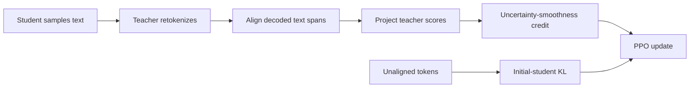
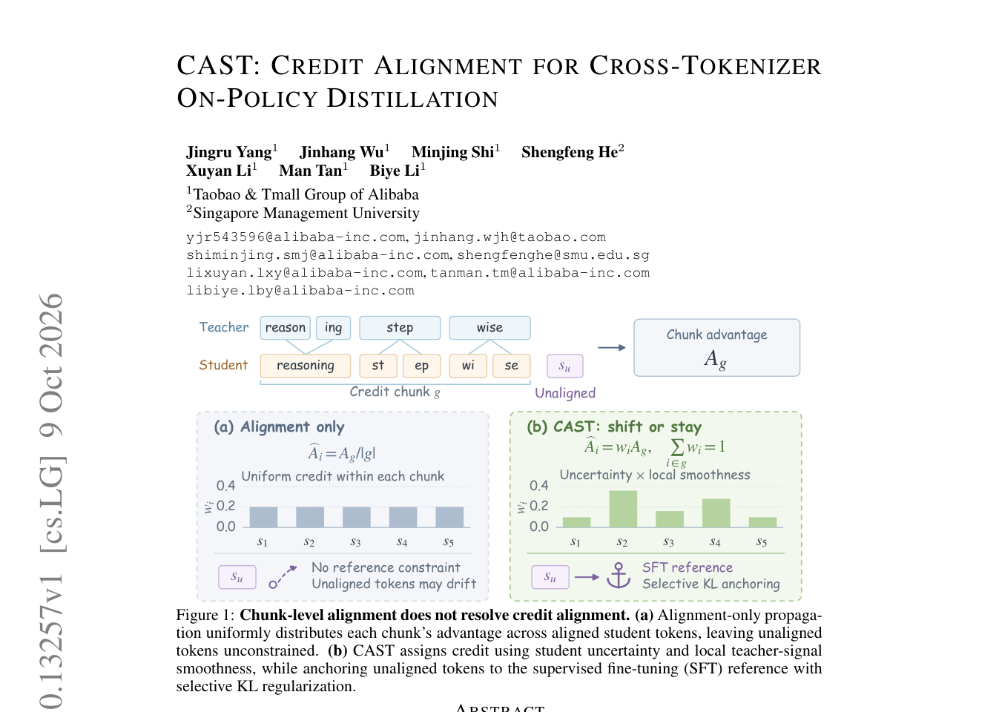

# CAST: Credit Alignment for Cross-Tokenizer On-Policy Distillation

<!-- source-sha256: 99c5018f457be7446d9a75070440205a50523271f6f8475d664708cd09b51fbd -->

[简体中文](README.md)

> This implements the core mechanism. Short-budget checkpoint results diagnose runtime behavior, not capability at the paper's scale.

## Paper information

| Field | Value |
| --- | --- |
| Paper | [arXiv 2610.13257](https://arxiv.org/abs/2610.13257) |
| Affiliations | Taobao & Tmall Group of Alibaba / Singapore Management University |
| First public release | 2026-10-09 (arXiv v1) |
| Author code | No public author implementation found as of 2026-10-12. |
| Adapter | `cast-opd` |
| Local implementation | [`src/auto_research/reproductions/cast_opd/`](https://github.com/daiwk/auto-research/tree/main/src/auto_research/reproductions/cast_opd/) |

## Original paper

### Background and contribution

Different tokenizers segment the same text differently, so comparing token IDs is meaningless. CAST aligns actual decoded text, projects the teacher span's total log probability uniformly onto the student span, then allocates credit by uncertainty and local smoothness. On unaligned positions, a KL anchor to the initial student limits drift.

<!-- paper-figure:start -->
### Key figure from the paper

Page 1, Figure 1 of the official v1 PDF: the title, algorithm flow, and accompanying text were checked. It is not a local redraw or experiment output. Also available in the [paper PDF](https://arxiv.org/pdf/2610.13257#page=1) and [abstract record](https://arxiv.org/abs/2610.13257). Copyright belongs to the authors.
<!-- paper-figure:end -->

### Core equations

For credit chunk $g$, $A_g=\sum_{i\in g}(\tilde\ell_i^T-\ell_i^S)$. Let $\epsilon_g=\max(\mathrm{mean}\delta_i,0.1)$, $w_i\propto\max(H_i,10^{-8})/(\delta_i+\epsilon_g)$, and $\hat A_i=A_gw_i$, preserving total credit. On unaligned tokens let $z_i=\log\pi_0(a_i|s_i)-\log\pi_\theta(a_i|s_i)$; the anchor is $\min(e^{z_i}-z_i-1,d_{max})$.

### Paper results

For cross-tokenizer Qwen3-8B → Mistral/Llama, CAST improves Avg-6 over the strongest controls by 2.45/1.32 percentage points. Three-seed CAST averages were 47.01±0.28 and 43.72±0.16. Table 4 reports 45.07% for the matched uniform control and 47.22% for CAST. No online A/B test was reported. The [paper-results extract](paper-results.json) is marked `paper_reported=true` and `measured_locally=false` and stored outside the local metrics directory.

## Local reproduction

> Compare heterogeneous-tokenizer span alignment and credit/anchor training with the same undistilled student checkpoint. A short run with a weak teacher does not establish knowledge transfer or a stable relative gain.

Preferred entry point: `PYTHONPATH=src python scripts/run_oct12_post_training.py --objective cast-opd --help`. The CLI accepts legacy `--objective cast`, normalizing it to `cast-opd` before loss selection and using the canonical output `adapter_key`. The alias is not a second packaged adapter and does not change the older Agent CAST.

Supply local student and teacher checkpoints with public IDs/revisions, public train and validation JSONL, dataset revision, train-only split manifest, and output path. The CLI does not download weights or upload data. It trains real q_proj/v_proj LoRA.

The packaged adapter reads only `oct12-cast-opd.json` in the data directory, with snake_case CLI fields. Omit `objective` or set it to `cast-opd`; legacy `cast` is normalized. Other objectives, the old packaged key `cast`, and `oct12-cast.json` are not silently accepted. Missing real checkpoint configuration fails without a synthetic fixture fallback.

### Data and results

`public_holdout.validate_holdout` verifies the public training source, revision, hashes, counts, normalized question deduplication, and absence of train/validation overlap. The student sees only questions; gold does not enter rollouts or retrieval. The short run reports validation after training without tuning on it. It has no test input and does not read test. Formal tuning must use train/validation only.

The CLI enforces heterogeneous tokenizers, with 2 independent rollouts and 6-token credit chunks by default. Alignment uses NFKC and decoded-whitespace normalization; spans with Unicode replacement characters or over 32 tokens remain unaligned. This is not a same-vocabulary weighted loss. The shared-tokenizer punctuation-chunk variant is not implemented.

The canonical `cast-opd` key was rerun on a real NVIDIA A100 at snapshot `6765289590741a1b656dde7f3d0495349c70f485`. [Local measurements](metrics/gsm8k-a100-42.json): 2 steps, seed 42, 2 rollouts per step, at most 128 output tokens, 512 aligned and 0 unaligned tokens. LoRA parameter change L2 was 0.007753067897551781. Exact match on four validation items remained zero. Losses were 0.6927358508110046 / 0.9769706130027771; gradient L2s were 0.8826789855957031 / 0.969049334526062. The results match the old run, without recasting failure as improvement. The teacher is smaller than the student. This diagnoses cross-tokenizer runtime, not effective transfer, and full alignment did not exercise the unaligned KL branch.

The [new GPU receipt](../../gpu-validations/cast-opd-a100-20261012.json) records the canonical key, execution commit, pinned public checkpoint/data revisions, and per-file hashes from `git show` at that commit, not from current HEAD or dirty files. `passed` refers to that snapshot's CUDA mechanism only. The old `cast` metrics, command/commit/hash, and original `pending_rerun` status are preserved in the [namespace migration archive](assets/historical-namespace-migration.json), not counted as current dashboard validation. A single seed and some truncated responses establish only an L1 runtime smoke test.

### Code and limitations

`decoded_alignment / project_teacher_scores / credit_chunks / cast_credit / selective_anchor` and `cast_step` implement retokenization, greedy decoded spans, advantage conservation, and actual reference KL.

[Contract and behavior tests](https://github.com/daiwk/auto-research/blob/main/tests/test_oct12_post_training.py) use a small causal model to check real gradients, masked prefixes, reference recovery, boundary updates, and gold isolation, not reasoning capability. Original-scale data, models, and reasoning budgets; matched-budget multi-seed capability evaluation; production experiments; and Evolve controller integration remain unimplemented.
