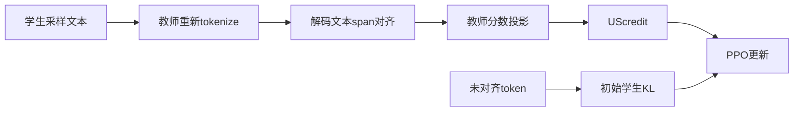
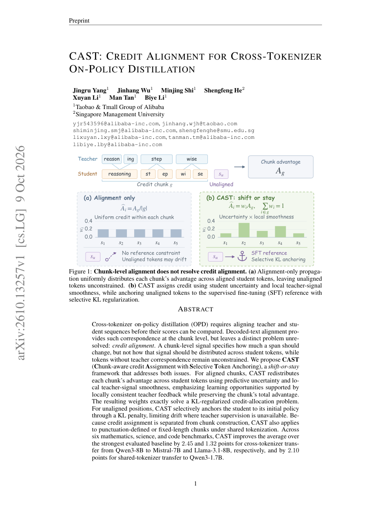

# cast：CAST: Credit Alignment for Cross-Tokenizer On-Policy Distillation

> 核心机制代码路径；短预算 checkpoint 结果只支持 runtime 诊断，不支持论文规模能力结论。

## 论文信息

| 字段 | 内容 |
|---|---|
| 论文链接 | [arXiv v1](https://arxiv.org/abs/2610.13257v1) / [全文](https://arxiv.org/html/2610.13257v1) |
| 公司 / 机构 | Taobao & Tmall Group of Alibaba / Singapore Management University |
| 首次公开日期 | 2026-10-09（arXiv v1） |
| 原作者代码 | 未发现 / 未发布官方代码（截至 2026-10-12）；原文未提供可验证官方实现 |
| 本地 adapter / 方法（Adapter） | `cast` |
| 本地复现代码 | [packaged adapter](../../../src/auto_research/reproductions/cast/adapter.py)、[objectives](../../../src/auto_research/post_training/oct12_objectives.py)、[checkpoint runner](../../../src/auto_research/post_training/oct12_checkpoint.py) |

## 原始论文总结

### 背景与主要改动

异构 tokenizer 的同一文本有不同分段，直接比较 token ID 无意义。CAST 先匹配实际解码文本，将教师 span 的总 log probability 均匀投影到学生 span，再按不确定性×局部平滑度分配 credit；未对齐位置通过初始学生 KL 限制漂移。

### 原论文关键图

原版 PDF 第 1 页 Figure 1 全页截图，已检查图题、算法流程与正文，非本地重绘或实验产物。版权归原作者；截图来源为官方 arXiv PDF v1。

### 核心公式

对 credit chunk $g$，$A_g=\sum_{i\in g}(\tilde\ell_i^T-\ell_i^S)$。$\epsilon_g=\max(\mathrm{mean}\delta_i,0.1)$，$w_i\propto\max(H_i,10^{-8})/(\delta_i+\epsilon_g)$，$\hat A_i=A_gw_i$，因此总 credit 保持。未对齐位置令 $z_i=\log\pi_0(a_i|s_i)-\log\pi_\theta(a_i|s_i)$，anchor 为 $\min(e^{z_i}-z_i-1,d_{max})$。

### 论文离线与线上效果

原文跨 tokenizer Qwen3-8B→Mistral/Llama 相对最强对照 Avg-6 改善 2.45/1.32 个百分点；三 seed CAST 平均为 47.01±0.28 与 43.72±0.16。Table 4 matched uniform control 为 45.07%，CAST 为 47.22%。未报告线上 A/B。 原论文标量摘录见 [paper-results.json](paper-results.json)，`paper_reported=true`、`measured_locally=false`；独立存放于非 metrics 目录，不能作为本地复现指标。

## 本地复现

入口：`PYTHONPATH=src python scripts/run_oct12_post_training.py --objective cast --help`。

必须提供本地 student/teacher checkpoint 路径与公开 ID/revision、公开 train/validation JSONL、dataset revision、train-only split manifest 和 output 路径。 CLI 不下载模型，不上传数据，实际训练 q_proj/v_proj LoRA。

`cast` packaged adapter 读取数据目录中的 `oct12-cast.json`，字段对应 CLI 的 snake_case 参数；没有真实 checkpoint 配置时明确报错，不回退到合成 fixture。

### 数据协议与结果

必须复用 `public_holdout.validate_holdout` 校验公开 source train、revision、文件 SHA256、条数、规范化 question 去重及 train/validation 不重叠。学生生成只接收问题；gold 不进入 solver rollout/retrieval。validation 仅训练后报告，本短跑没有据 validation 选超参；test 无入口且不读取。正式实验的选参必须仅使用 train/validation。

CLI 强制异构 tokenizer，默认独立 2 rollouts、6-token credit chunk。NFKC/decoded-whitespace 规范化；含 Unicode replacement 或超过 32 token 的 span 留为未对齐。不是同词表加权 loss 冒充 cross-tokenizer。暂未实现共享 tokenizer 的标点 chunk 变体。

目前未完成真实 NVIDIA A100/A30 执行，GPU gate 尚未通过；不写本地稳定指标或伪造 receipt。运行保存真实 loss/token 数/参数变化/validation 口径和角色 revisions；少量截断响应、单 seed 只能支持 L1 runtime smoke。planned receipt：`docs/gpu-validations/cast-a100-20261012.json`，须由真实执行生成。

### 代码映射与复现边界

`decoded_alignment / project_teacher_scores / credit_chunks / cast_credit / selective_anchor` 与 `cast_step` 覆盖 retokenization、greedy decoded spans、advantage 保持和实际参考 KL。

契约与行为测试：[test_oct12_post_training.py](../../../tests/test_oct12_post_training.py)。小因果模型测试仅验证真实梯度、masked prefix、参考恢复、边界更新及 gold 隔离；不是 reasoning 能力比较。尚未完成论文规模数据/模型/长推理预算、多 seed 同预算能力对照、线上系统或 Evolve 控制器集成。
