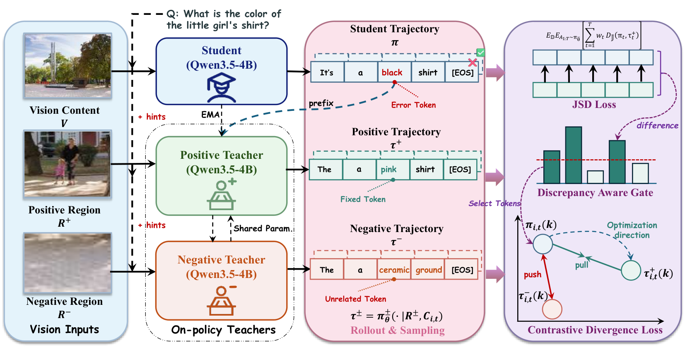
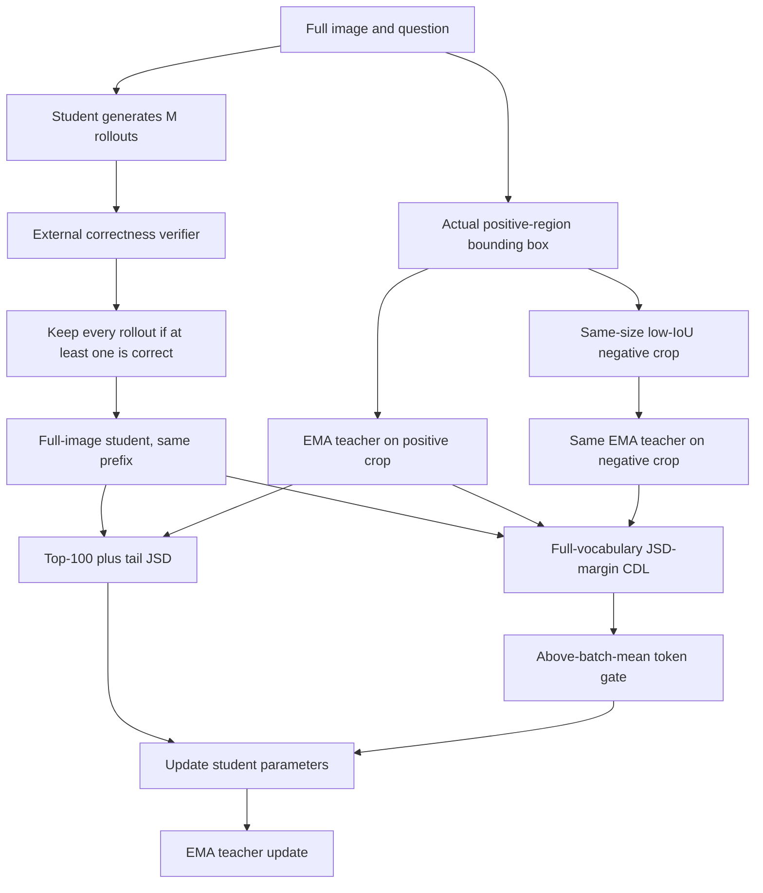

# CV-OPD: Adding Visual Evidence Constraints to On-Policy Self-Distillation

<!-- source-sha256: 7b091b054ee977ece744cb4a511fc1288438b9aeee17d5625925fe961ee71e79 -->

[简体中文](README.md)

## Paper information

| Field | Value |
| --- | --- |
| Paper | [arXiv 2610.13264](https://arxiv.org/abs/2610.13264) |
| Affiliations | Xiamen University / Moxin Technology |
| First public release | 2026-10-09 (arXiv v1) |
| Author code | Yes: [authors' code](https://github.com/HaoLin3419/Contrastive-Vision-OPD). |
| Adapter | `cv-opd` |
| Local implementation | [`src/auto_research/reproductions/cv_opd/`](https://github.com/daiwk/auto-research/tree/main/src/auto_research/reproductions/cv_opd/) |

The original v1 submission was 2026-10-09 09:15:34 UTC. The Apache-2.0 author repository is pinned at `e9452a00ea50ddb776645b9acc49275e0180955e`. The local equations were implemented independently, without running its installation script. Its `paper_assets/paper.pdf` is Vision-OPD 2605.18740v4, **not this paper**. The [official v1 PDF](https://arxiv.org/pdf/2610.13264v1) confirms Haowei Wang's Xiamen University and Moxin Technology affiliations and Hao Lin's Xiamen University affiliation. Algorithm details follow the [v1 full text](https://arxiv.org/html/2610.13264v1) and Appendix A.3.

[source-verification.json](source-verification.json) records the official PDF's size, SHA256, first-page affiliations, and the upstream PDF discrepancy. Downloaded PDFs and temporary renders are not committed.

## Original paper

### Background and contribution

Crop-to-full-image OPD can teach answer distributions without teaching reliance on the right image regions. Vision-OPD remained above chance after answer-related regions were removed. CV-OPD introduces a shared-parameter negative teacher using a same-image, same-size, low-IoU crop, adding attraction to the positive teacher and repulsion from the negative teacher to JSD distillation.

Three constraints matter: the positive and negative teachers differ only in their crop and see the same student prefix; CDL uses a bounded-JSD margin; and DAG uses a strict greater-than-mean token threshold over the entire retained batch. A sample is retained only if at least one rollout is correct, and then **all** its rollouts are retained.

### Architecture

<!-- paper-figure:start -->
### Key figure from the paper

[](https://arxiv.org/html/2610.13264v1/fig2.png)

[Figure 3 in arXiv v1](https://arxiv.org/html/2610.13264v1#S3.F3) shows the full-image student, shared-parameter positive and negative crop teachers, JSD, discrepancy-aware gating, and contrastive divergence loss. The [original PNG](https://arxiv.org/html/2610.13264v1/fig2.png) is uncropped and unredrawn; the filename is fig2.png, but the paper labels it Figure 3. The Qwen3.5-4B in the diagram is the authors' model, not the local SmolVLM diagnostic. See [provenance and SHA256](assets/provenance.json); the misplaced Vision-OPD PDF was not used. Copyright belongs to the authors.
<!-- paper-figure:end -->

Local implementation diagram:



### Core equations

For student and shared positive/negative teacher distributions $p_t,\tau_t^+,\tau_t^-$ and $m=(p+\tau)/2$:

$$
D_{JS}(p,\tau)=\tfrac12 KL(p\|m)+\tfrac12 KL(\tau\|m).
$$

$$
d_t^\pm=D_{JS}(p_t,\tau_t^\pm),\qquad \ell_t^{CDL}=[\mu+d_t^+-d_t^-]_+,\quad 0<\mu<\log2.
$$

$$
g_t=\mathbf1[d_t^+>\bar d_\mathcal B],\qquad b_x=\mathbf1[\sum_{i=1}^M r_i>0].
$$

Equation 14 writes per-rollout normalization. The local implementation follows Appendix A.3 Algorithm 1: main JSD is computed over the student-aligned top 100 and a complete tail bucket, weighted by $1/T_i$ per rollout and renormalized. CDL uses full-vocabulary JSD averaged over gated tokens. Margin and CDL weight are both 0.1, and EMA update rate is 0.05. The teachers, gate, and generation are detached. The sample gate does not mean training on correct rollouts only.

### Paper results

The authors used Qwen3.5-4B, 6.2K visual-reasoning examples, 8 rollouts of up to 1024 tokens per example, and 8 A100s.

| Paper model | V* accuracy % | ZoomBench % | HR-4K % | HR-8K % | MME-RW EN % | CN % | Avg6 % |
| --- | ---: | ---: | ---: | ---: | ---: | ---: | ---: |
| Qwen3.5-4B | 82.20 | 48.40 | 86.38 | 82.00 | 63.94 | 63.80 | 71.12 |
| Vision-OPD | 89.53 | 59.41 | 81.75 | 80.12 | 74.51 | 70.17 | 75.92 |
| CV-OPD | 91.62 | 62.01 | 84.38 | 83.38 | 76.99 | 70.93 | 78.22 |

Avg6 improves by 2.30 **percentage points**, not 2.30% relative. CV-OPD still trails the undistilled baseline on HR-4K. The reported roughly 10% training-time overhead against Vision-OPD is not a local measurement. No online A/B test was reported.

## Local reproduction

This `core_mechanism / L1` diagnostic updates a real VLM, not an image-classification scoring proxy. GPU validation requires the committed sanitized receipt; CPU tests are not a substitute.

> Compare the same checkpoint's validation accuracy before and after CV-OPD. A three-seed control sets CDL weight to zero, but still runs both crops, DAG, and teacher forwards. It is not original Vision-OPD or a matched-realized-compute capability comparison. Relative capability gains are not reported.

### Data protocol

JSONL requires `image`, a uniform question, actual category `answer`, pixel `bbox=[x0,y0,x1,y1]`, `split`, and `verified=true`. Train on a deterministic subset of a public train source; source images must not cross splits. Existing COCO-Caption2017 `val` captions lack boxes and cannot silently substitute for training inputs.

The diagnostic selects real COCO train2017 main objects from person/cat/dog/car/bus/bird/horse/bicycle, with 2 train, 1 validation, and 1 test image per category (32 total). Validation and test are local holdouts derived from train2017, not official test. The shared question is `Name the main object in this picture. Reply with one COCO category name and no other words.` It supplies neither the real category nor the box to the full-image student. Constant-label training is rejected. The verifier normalizes case, punctuation, whitespace, and initial `a/an`, then requires an exact category: `not a cat`, `cat or dog`, and `cats` do not match `cat`.

`verify_offline_manifest` checks actual checkpoint and dataset SHA256s; the dataset manifest covers JSONL and each referenced image. This binds labels and boxes to source files, not just CLI claims. Integrity checks do not expose held-out content to the model.

The student sees the full image and each teacher sees its crop, all with the same question and no answer. Only the external verifier reads the answer. If no same-size low-IoU negative crop exists, record a failure and skip. If all 8 rollouts are wrong, make exactly zero updates; never insert a gold completion. Rejected rollouts still count toward token cost. Low IoU ensures geometric separation, not absence of another same-class object in the negative crop.

### Entry point

```bash
PYTHONPATH=src python scripts/run_cv_opd.py \
  --checkpoint /path/to/smolvlm256 \
  --checkpoint-id HuggingFaceTB/SmolVLM-256M-Instruct \
  --checkpoint-revision 7e3e67edbbed1bf9888184d9df282b700a323964 \
  --records /path/to/coco-train-boxes.jsonl \
  --dataset-id COCO2017/train2017 --dataset-revision <official-annotation-archive-sha256> \
  --device cuda --steps 16 --rollouts 8 --max-new-tokens 16 \
  --seed 42 --output runs/cv-opd-seed42.json
```

The adapter reads an explicit CLI-parameter map from `dataset_dir/cv-opd.json`, without `seed/output`. Missing configuration fails instead of falling back to a fixture.

### CPU contracts and limits

[cpu-contracts.json](metrics/cpu-contracts.json) records 7 rerun behavioral tests covering box size/IoU, JSD/top-K tail, sample and token gates, teacher stop-gradient, zero gradient without correct samples, strict multiclass verification, label isolation, and image/split hashes. Tests fix seed 42, with seed 2 inside dedicated crop/gate cases. These are unit cases, not multi-seed capability runs or GPU training.

The small path uses SmolVLM-256M and rank-8 language q/v LoRA, not full Qwen3.5-4B training. Public main-object classification with an exact-category verifier differs from the six fine-grained benchmarks. Changing external gold affects correctness scoring only, not image, question, or budget supplied to the policy. No Evolve integration.

### A100 measurements, 2026-10-14

The [sanitized GPU receipt](../../gpu-validations/cv-opd-a100-20261013.json) and [six-run measurements](metrics/a100-six-arms-4496283a.json) bind executable snapshot `4496283ac8e37c070b8f71b20af6138526cbba15`, six actual commands, 24 raw file hashes, and five core source hashes. The receipt filename retains 20261013; completion was 2026-10-13 17:21:37 UTC (October 14 in China). Both arms successfully updated for all three seeds, without test-based reselection.

Pinned checkpoint: `HuggingFaceTB/SmolVLM-256M-Instruct@7e3e67edbbed1bf9888184d9df282b700a323964`. COCO official annotation archive SHA256: `113a836d90195ee1f884e704da6304dfaaecff1f023f49b6ca93c4aaae470268`. Derived records SHA256: `f23de926af9f803f1c5568eae1bb150b2e55b919fce82a66167e961e764acb00`. The receipt includes complete checkpoint and 32-image hashes, not weights, images, or raw logs.

The fixed budget was 16 sample attempts, batch 1, 8 rollouts per image, and at most 16 tokens. CDL weight was 0.1 vs. 0; other settings matched. All accuracies are local L1 correct/8, not paper benchmark scores.

| Seed | Main val | CDL-off val | Main test | CDL-off test | Updates per arm | Main/control sampled tokens | Main/control seconds |
| --- | ---: | ---: | ---: | ---: | ---: | ---: | ---: |
| 42 | 2/8 | 2/8 | 0/8 | 0/8 | 8 | 520 / 520 | 147.99 / 146.34 |
| 43 | 3/8 | 4/8 | 1/8 | 2/8 | 9 | 512 / 491 | 156.34 / 152.62 |
| 44 | 2/8 | 2/8 | 0/8 | 1/8 | 10 | 538 / 513 | 168.57 / 165.13 |

Test mean ± sample SD was **4.17% ± 7.22%** for main and **12.50% ± 12.50%** for control; paired difference was **−8.33 ± 7.22 percentage points**. This does not show a CDL advantage. Initial validation was 3/8, 3/8, and 2/8. Initial test was not measured, so no gain over initial test can be inferred.

Each arm and seed sampled 128 rollouts, counting rejected tokens. Parameter L2 changes were nonzero: 0.003335/0.003482/0.003787 for main, and 0.003192/0.003484/0.003722 for control. Update counts matched within seeds, but realized tokens, gradient trajectories, and wall-clock costs did not. Crop failures were zero and maximum IoU ≤ 0.1. The control still computes unweighted CDL; a nonzero CDL value does not mean it enters the loss.

The evidence establishes executable image rollouts, sample retention, crop teachers, and CUDA updates. Three seeds do not upgrade L1 to capability evidence or establish comparison with Vision-OPD or the reported 10% overhead. `scripts/curate_oct14_cv_opd.py` recalculates from the pinned source bundle without modifying it. Fixture tests reject wrong budgets, weights, zero updates, or source/public-input identities.

### Code map

| Component | Local implementation |
| --- | --- |
| Actual positive/negative crops, JSD, CDL, DAG, EMA | [cv_opd.py](https://github.com/daiwk/auto-research/blob/main/src/auto_research/multimodal/cv_opd.py) |
| Image checkpoint rollouts and updates | [run_cv_opd.py](https://github.com/daiwk/auto-research/blob/main/scripts/run_cv_opd.py) |
| Behavioral tests | [test_cv_opd.py](https://github.com/daiwk/auto-research/blob/main/tests/test_cv_opd.py) |
