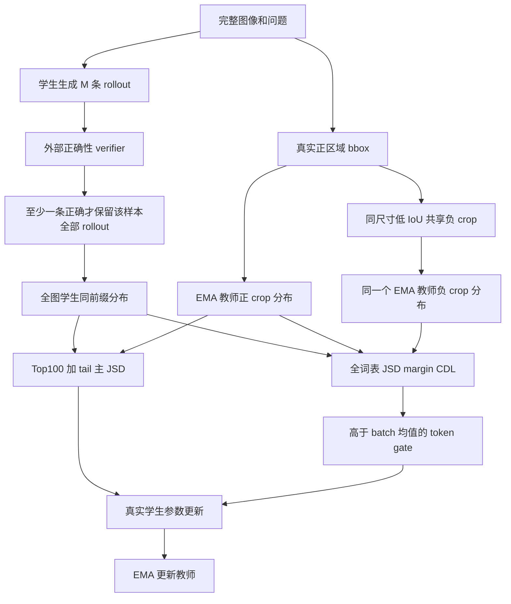

# CV-OPD：把视觉证据约束加入 on-policy 自蒸馏

## 论文信息

| 字段 | 内容 |
| --- | --- |
| 论文链接 | [arXiv 2610.13264](https://arxiv.org/abs/2610.13264) |
| 公司/机构 | Xiamen University（中国教育部多媒体可信感知与高效计算重点实验室） / Moxin Technology |
| 首次公开日期 | 2026-10-09（arXiv v1） |
| 原文开源代码 | 是：[Contrastive-Vision-OPD](https://github.com/HaoLin3419/Contrastive-Vision-OPD) |
| Adapter | `cv-opd` |
| 本地复现代码 | [`src/auto_research/reproductions/cv_opd/`](https://github.com/daiwk/auto-research/tree/main/src/auto_research/reproductions/cv_opd/) |

原始 v1 提交时间为 2026-10-09 09:15:34 UTC。作者仓库固定为 `e9452a00ea50ddb776645b9acc49275e0180955e`，Apache-2.0；本地公式独立实现，没有运行其安装脚本。作者仓库 `paper_assets/paper.pdf` 实际为 Vision-OPD 2605.18740v4，**不是本篇原文**。本篇机构已直接核对 [官方 v1 PDF 首页](https://arxiv.org/pdf/2610.13264v1)：Haowei Wang 同属厦门大学与 Moxin Technology，Hao Lin 属厦门大学。算法依据为 [官方 v1 全文](https://arxiv.org/html/2610.13264v1)及 Appendix A.3。

官方 PDF 的尺寸、SHA256、首页机构与作者仓库异常保存在 [source-verification.json](source-verification.json)，不提交下载 PDF 或渲染临时图片。

## 原始论文总结

### 背景与主要改动

原来的 crop-to-full-image OPD 可以教会模型答案分布，却不必然教会它依赖正确视觉区域。作者在移除答案相关区域后发现，Vision-OPD 仍取得明显高于随机的准确率。CV-OPD 用同图、同尺寸、低 IoU 的负区域构造第二个共享参数教师，把“接近正教师、远离负教师”的约束加入 JSD 蒸馏。

三个不可省略的约束是：正负教师只改变 crop、读取同一学生前缀；CDL 使用有界 JSD 的 margin；DAG 在整个保留 batch 的 token 上严格取大于均值，并且只在至少一个 rollout 正确时保留样本的**全部** rollout。

### 架构图

[原文 Figure 3 与训练算法](https://arxiv.org/html/2610.13264v1#S3.F3)。下图按原文重绘，不使用作者仓库错置的 PDF 图。



### 核心公式

令学生和共享正负教师分布为 $p_t,\tau_t^+,\tau_t^-$，$m=(p+\tau)/2$：

$$D_{JS}(p,\tau)=\tfrac12 KL(p\|m)+\tfrac12 KL(\tau\|m).$$

$$d_t^\pm=D_{JS}(p_t,\tau_t^\pm),\qquad \ell_t^{CDL}=[\mu+d_t^+-d_t^-]_+,\quad 0<\mu<\log2.$$

$$g_t=\mathbf1[d_t^+>\bar d_\mathcal B],\qquad b_x=\mathbf1[\sum_{i=1}^M r_i>0].$$

正文 Eq. 14 写出逐 rollout 归一化权重。本地采用 Appendix A.3 Algorithm 1 的明确实现口径：主 JSD 在学生对齐的 Top-100 加完整 tail bucket 上计算，按每条 rollout 的 $1/T_i$ 加权再归一；CDL 使用全词表 JSD，在 gated token 上均值归一。margin 和 CDL 权重均为 0.1，EMA 更新率为 0.05。教师、gate 与生成过程不回传梯度。样本门槛不是“只训练正确 rollout”。

### 论文离线与线上效果

原文使用 Qwen3.5-4B、6.2K 视觉推理数据、每样本 8 条最多 1024 token 的 rollout、8 张 A100。

| 原文模型 | V* 准确率 % | ZoomBench % | HR-4K % | HR-8K % | MME-RW EN % | CN % | Avg6 % |
| --- | ---: | ---: | ---: | ---: | ---: | ---: | ---: |
| Qwen3.5-4B | 82.20 | 48.40 | 86.38 | 82.00 | 63.94 | 63.80 | 71.12 |
| Vision-OPD | 89.53 | 59.41 | 81.75 | 80.12 | 74.51 | 70.17 | 75.92 |
| CV-OPD | 91.62 | 62.01 | 84.38 | 83.38 | 76.99 | 70.93 | 78.22 |

Avg6 的差值是 +2.30 **百分点**，不是相对提升 2.30%。CV-OPD 的 HR-4K 仍低于未蒸馏基线，保留该负结果。原文声称较 Vision-OPD 增加约 10% 训练时间；这不是本地效率测量。线上 A/B：**未报告**。

## 本地复现

当前实现为 `core_mechanism / L1` 核心机制诊断，真实 VLM 更新而非图像分类打分代理。GPU 完成状态以统一提交的脱敏 receipt 为准，CPU 单测不替代 GPU 门槛。

> **本地对照口径**：基线为同 checkpoint 更新前验证准确率，实验组为 CV-OPD 更新后的模型；没有等训练预算的 Vision-OPD 对照，相对能力提升百分比不适用。

### 数据协议

输入 JSONL 必须包含 `image`、`question`、`answer` 或 `answers`、真实 `bbox=[x0,y0,x1,y1]` 像素坐标、`split` 和 `verified=true`。训练只能用公开 train 源的确定性子集；同一源图像不能跨 train/validation/test。已有 COCO-Caption2017 的 `val` caption 子集没有 bbox，不能静默当作本篇训练数据。

学生和教师输入均只有图片与问题；答案仅供外部 verifier 判断 rollout 正确性。学生看完整图像，正负教师看对应 crop。若没有同尺寸低 IoU 负 crop，记录失败并跳过；若 8 条 rollout 全错，严格零更新，不插入 gold completion。

### 执行入口

```bash
PYTHONPATH=src python scripts/run_cv_opd.py \
  --checkpoint /path/to/smolvlm256 \
  --checkpoint-id HuggingFaceTB/SmolVLM-256M-Instruct \
  --checkpoint-revision 7e3e67edbbed1bf9888184d9df282b700a323964 \
  --records /path/to/coco-train-boxes.jsonl \
  --dataset-id COCO-train2017 --dataset-revision <source-hash> \
  --device cuda --steps 3 --rollouts 8 --max-new-tokens 16 \
  --seed 42 --output runs/cv-opd-seed42.json
```

统一 adapter 在 `dataset_dir/cv-opd.json` 读取同名 CLI 参数的 JSON map，不填 `seed/output`；缺少配置时明确报错，不回退到 fixture。

### 本地结果与边界

[cpu-contracts.json](metrics/cpu-contracts.json)只记录已执行的 4 个行为测试：bbox 尺寸与 IoU、JSD/Top-K tail、样本与 token gate、教师停止梯度和零正确样本的零梯度。测试通过不代表视觉推理能力或 GPU 训练完成。

缩小路径使用 SmolVLM-256M 与语言 q/v rank-8 LoRA；并非 Qwen3.5-4B 的完整训练。公开对象存在性问题、规则式 yes/no verifier 与原文 6 个细粒度 benchmark 不等价。未接入 Evolve，不能靠 registry 标签晋级。

### 代码映射

| 原文组件 | 本地实现 |
| --- | --- |
| 真实正负 crop、JSD、CDL、DAG、EMA | [cv_opd.py](../../../src/auto_research/multimodal/cv_opd.py) |
| 图像 checkpoint rollout 和参数更新 | [run_cv_opd.py](../../../scripts/run_cv_opd.py) |
| 行为测试 | [test_cv_opd.py](../../../tests/test_cv_opd.py) |

