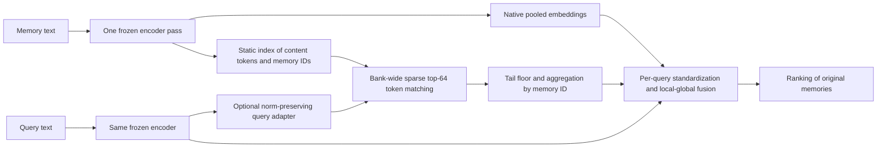
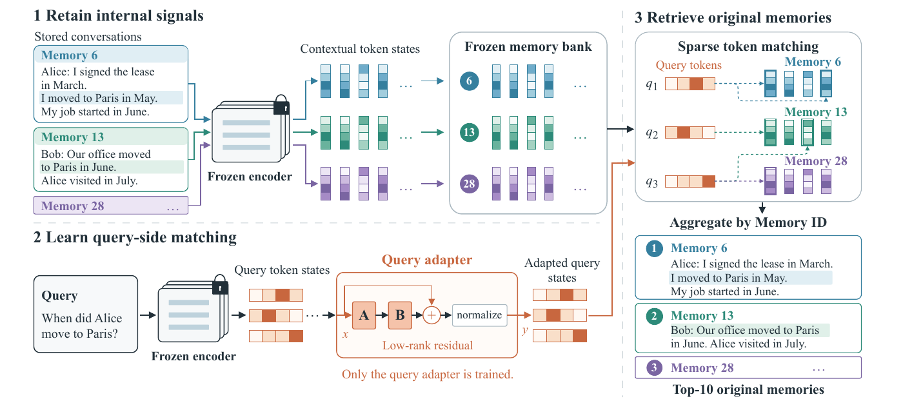

<!-- source-sha256: d0ccf1ffc763bf188793e0db5781602c5cd7a2e41816295f93859c841f49b55d -->

[简体中文](README.md) · English

# Beyond the Final Embedding: Finding memory evidence in existing content tokens

## Paper information

| Field | Details |
| --- | --- |
| Paper | [arXiv 2610.13277](https://arxiv.org/abs/2610.13277) |
| Institutions | Southeast University / MemoraX AI / Leiden University / University of Sydney |
| First public release | 2026-10-09 (arXiv v1) |
| Original source code | No author code found in the paper or official pages on 2026-10-13. |
| Adapter | `beyond-final-embedding` |
| Local reproduction code | [`src/auto_research/reproductions/beyond_final_embedding/`](https://github.com/daiwk/auto-research/tree/main/src/auto_research/reproductions/beyond_final_embedding/) |

First uploaded at 09:27:55 UTC on 2026-10-09. This is from the NEAR author team, but its central method retrieves token evidence rather than using a neighborhood residual. They are compared separately, without assuming the two compose directly.

## Original paper summary

### Background and main changes

A final pooled embedding can lose local factual clues already present in a frozen embedding encoder's last-layer token states. The paper retains content tokens, excluding query prefixes, special tokens and padding, and associates each token with its source memory ID offline. It finds global sparse token top-k over the entire candidate bank, then aggregates by ID to rank memories. It does not run independent MaxSim for each memory and then sort.

Each query token uses its worst returned similarity, clipped at zero, as a common floor for absent token–memory matches. The sparse local and full pooled branches are standardized per query before fusion. Memories with no returned tokens can still rank through the pooled branch. An optional query-only low-rank residual leaves the encoder, memory bank and pooled query unchanged.

### Architecture



Local redraw: [architecture.mmd](assets/architecture.mmd); see [source-provenance.json](assets/source-provenance.json) for the pinned full text.

<!-- paper-figure:start -->
### Key figure from the paper

[](https://arxiv.org/pdf/2610.13277v1#page=3)

Figure 2: The frozen encoder retains contextual token states and source memory IDs. Query tokens find sparse evidence in the fixed bank; matches are aggregated by memory ID and fused with whole-memory similarity to produce the ranking. The orange low-rank residual is optional and trains the query side only. Memory, encoder and index stay fixed. Dialogues and IDs in the figure are examples from the paper, not local data or gold labels. Sources: Luo et al., [v1 Figure 2](https://arxiv.org/html/2610.13277v1#S3.F2), [PDF page 3](https://arxiv.org/pdf/2610.13277v1#page=3).

This visually checked 250 dpi crop leaves figure text unchanged and shows no local measurement. The paper uses the arXiv perpetual non-exclusive license, not CC BY; copyright remains with the authors. See [original-figures.json](assets/original-figures.json) for PDF/image SHA256, page and crop boundaries.

> **Figure 2 from the paper:** The caption describes the selected figure, not a local measurement. From the [paper](https://arxiv.org/pdf/2610.13277v1#page=3); copyright belongs to the authors. Click to open the pinned source.
<!-- paper-figure:end -->

### Core equations

For each query token's returned set $\mathcal R_i$, the floor is $t_i=\max(0,\min_{h\in\mathcal R_i}h_{q,i}^Th)$. Aggregate by source memory ID:

$$
s_{sparse}(q,m)=\frac1{n_q}\sum_i\max\left(t_i,\max_{j:h_{m,j}\in\mathcal R_i}h_{q,i}^Th_{m,j}\right).
$$

$$
s_{fused}=\alpha\frac{s_{pool}-\mu_{pool}}{\max(\sigma_{pool},10^{-6})}+(1-\alpha)\frac{s_{sparse}-\mu_{sparse}}{\max(\sigma_{sparse},10^{-6})}.
$$

Optional query adapter $BA$ is bias-free, has no activation, and preserves input norm:

$$
T(h)=\frac{\|h\|_2(h+BAh)}{\max(\|h+BAh\|_2,\epsilon)},\qquad B_0=0.
$$

Train the adapter with all-memory MaxSim multi-positive cross-entropy at temperature 0.07, but use sparse token search for inference. A fake gradient through discrete ANN neighbor selection is not this training surrogate.

### Offline and online results

| Paper, Qwen-4B average over eight tasks | Recall@10 | NDCG@10 |
| --- | --- | --- |
| Original embedding | 62.5 | 48.0 |
| Original token MaxSim | 67.8 | 54.3 |
| This method, training-free | 73.8 | 59.9 |
| This method, query-adapted | 75.7 | 62.3 |

Source: [Section 5](https://arxiv.org/html/2610.13277v1#S5). Qwen-4B native downstream QA accuracy is 67.86% on LoCoMo (base 63.44%) and 72.60% on LongMemEval (base 67.80%). The optional adapter has negative gains on some backbones; local evidence complements pooled fusion. SQ4 reduces storage in the original setup; RP128+SQ4 reduces quality. None of these paper results belong on the local dashboard. No production A/B test is reported.

## Local reproduction

> **Comparison protocol:** Native pooled cosine from the same frozen MiniLM versus actual sparse-token fusion and a query adapter trained on source data. Relative gains at paper scale do not apply.

```bash
PYTHONPATH=src python scripts/run_oct13_memory.py --paper beyond-final-embedding \
  --raw-data /path/to/longmemeval_s_cleaned.json --model-dir /path/to/minilm \
  --device cuda --seed 42 --max-queries 100 --max-length 128 --batch-size 16 --adapter-epochs 2 \
  --split-policy query-disjoint-shared-bank --diagnostic-only \
  --output runs/beyond/seed42.json
```

### Data protocol, results, and scope

Use the [NEAR pinned public resources and connected-bank grouping protocol](../2610.13314-near/README.md). Extraction runs with `eval().requires_grad_(False)`. One pass returns native masked-mean pooled vectors and normalized content tokens without special tokens and padding. Retain all candidate memories, predeclare text truncation, and never choose memories or tokens by gold.

Train a rank-32 query residual with actual multi-positive MaxSim CE on training relevance labels. Use AdamW, lr 1e-4, weight decay 1e-4, clip 1. Select epoch 0/1/2 and α 0.25/0.5/0.75 using validation NDCG only. Run the selected adapter once on final test, and separately report the predeclared training-free control with α 0.5. Encoder, memory tokens and pooled queries never change. LongMemEval training split replaces EvoTrain supervision, so this does not reproduce cross-dataset generalization.

Exact global top-64 token search corresponds to Appendix D's exact retrieval control; there is no HNSW speed claim. Labels reach only training loss or the evaluator; reference answers never enter encoder inputs, and original Skill/Agent gold plans are not used to build queries. See [implementation-contract.json](metrics/implementation-contract.json) for the behavior contract; fixture evidence cannot substitute for actual GPU diagnostics and negative results below.

If a public candidate bank cannot be strictly grouped, explicitly opt into `--split-policy query-disjoint-shared-bank`. The same frozen memory/token bank can be shared, but the adapter receives only training-query relevance loss. Validation/test labels never update it, and validation alone selects. This fixed-index diagnostic is marked shared-unlabelled-memory, `diagnostic_only=true`, `promotion_eligible=false`. It does not claim unseen-bank generalization, mix with strict results or relax default failure checks.

#### Actual NVIDIA A30 results on 2026-10-14, including negatives

Executed source `34148c2e29c01e9be7e4d5b8cbd09fd0f6016902` used pinned MiniLM, max_length 128, batch 16, rank 32 and two epochs. The original LongMemEval JSON contains official **evaluation instances**. Locally re-split the first 100 into 60 train, 20 validation and 20 test for an unofficial research diagnostic only. This is **neither an official test score nor a cross-dataset experiment**. Labels used for training come only from local train queries, validation selects epoch/α, and test is scored last. Keep raw `l2_public_dataset` unchanged but present the aggregate as an `l1_mechanism` diagnostic.

| Shared bank, 100 queries, same split and seeds 42/43/44 | Test Recall@10 | Test NDCG@10 |
| --- | --- | --- |
| Same frozen MiniLM baseline | 0.900000 | 0.715573 |
| Validation-selected sparse fusion / query adapter | 0.912500 | 0.744397 |
| Fixed α 0.5, training-free sparse fusion | 0.912500 | 0.757752 |

**Training did not outperform the fixed training-free control.** Test scores were not used to reselect α or checkpoints. All three seeds give identical final ranking metrics. They verify a stochastic process on the same data and are not independent data replicates for significance.

| Seed | Two-epoch MaxSim loss | Validation-selected epoch / α | Selected parameter change L2 |
| --- | --- | --- | --- |
| 42 | 1.729410 → 1.713048 | 2 / 0.75 | 0.191639 |
| 43 | 1.729664 → 1.714434 | **0 / 0.75 (trained adapter not selected)** | **0** |
| 44 | 1.729765 → 1.715719 | 2 / 0.75 | 0.189032 |

Seed 43 actually trained for two epochs, but validation selected the initial identity adapter. Its result cannot be attributed to a selected trained model. Encoder, memory tokens and pooled branch stayed frozen throughout.

A separate strict bank-disjoint run uses 30 queries, seed 42 and a 27 train / 1 validation / 2 test split. Baseline Recall@10/NDCG@10 are 0.5/0.5, versus 1/0.715338 for this method. Validation selected epoch 0 / α 0.25, so update L2 is 0. With only two test queries this is a connectivity diagnostic, not pooled with shared-bank results or promoted.

See the [A30 diagnostic summary](metrics/a30-diagnostics-34148c2e.json), [execution context](../../research-audits/oct14-memory-execution-context-34148c2e.json) and [GPU receipt](../../gpu-validations/oct13-beyond-final-embedding-a30.json) for four raw results, all commands and byte hashes. Receipt/adapter paths bind metadata after execution; actual source remains `34148c2e`, not the later binding commit. Device: **NVIDIA A30**. Execution acceptance does not establish formal capability comparison.

### Code map

`algorithm.py` implements the floor, memory-ID scatter aggregation, standardized fusion, norm-preserving adapter and differentiable MaxSim CE. `experiment.py` trains and selects by validation. `../near/data.py` handles real frozen encoders and evaluator input boundaries. The full LMEB suite, eight backbones, original QA reader/judge and index compression were not run. There is no Evolve operator; registration does not make one executable.

Test entry: `python -m pytest tests/reproductions/test_oct13_agents_jepa.py`, covering the floor, global branch for unmatched memories, zero-init identity, norm preservation and actual nonzero-gradient updates.
