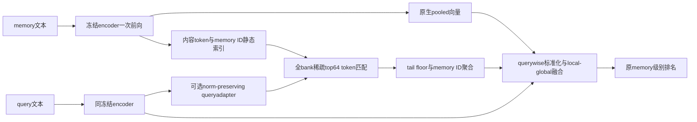

# Beyond the Final Embedding：用已有内容 token 寻找记忆证据

## 论文信息

| 项目 | 内容 |
| --- | --- |
| 论文链接 | [arXiv 2610.13277](https://arxiv.org/abs/2610.13277) |
| 公司/机构 | Southeast University / MemoraX AI / Leiden University / University of Sydney |
| 首次公开日期 | 2026-10-09（arXiv v1） |
| 原文开源代码 | 否：原文与官方页面未找到作者实现仓库（核查日期 2026-10-13） |
| Adapter | `beyond-final-embedding` |
| 本地复现代码 | [`src/auto_research/reproductions/beyond_final_embedding/`](https://github.com/daiwk/auto-research/tree/main/src/auto_research/reproductions/beyond_final_embedding/) |

原始上传为 2026-10-09 09:27:55 UTC；与 NEAR 同作者团队，但中心算法是 token 证据检索，不是邻域 residual。两者独立比较，未推断它们可以直接叠加。

## 原始论文总结

### 背景与主要改动

最终 pooled embedding 会丢掉局部事实线索，但冻结 embedding encoder 的最后层 token states 已经含有上下文证据。论文保留内容 token（排除 query prefix、special tokens 和 padding），离线给每条 token 绑定原 memory ID。在整个候选 bank 中做全局稀疏 token top-k，再按 ID 聚合回 memory 排名；不是对每条 memory 独立 MaxSim 后排序。

对于未返回的 token–memory 匹配，使用每个 query token 的最差返回匹配（裁到非负）作为统一 floor。局部 sparse 分支和完整 pooled 分支都进行 query-wise 标准化，再融合。某 memory 没有任何 token 被返回，也仍能因 pooled 分支进入最终结果。可选的 query-only 低秩 residual 不改变 encoder、memory bank 或 pooled query。

### 架构流程



重绘源码：[architecture.mmd](assets/architecture.mmd)；原图：[Figure 2](https://arxiv.org/html/2610.13277v1#S3.F2)，内嵌图的 source 记录在 [source-provenance.json](assets/source-provenance.json)。

### 核心公式

对每个 query token 的返回集合 $\mathcal R_i$，floor 为 $t_i=\max(0,\min_{h\in\mathcal R_i}h_{q,i}^Th)$。按原 memory ID 聚合：

$$s_{sparse}(q,m)=\frac1{n_q}\sum_i\max\left(t_i,\max_{j:h_{m,j}\in\mathcal R_i}h_{q,i}^Th_{m,j}\right).$$

$$s_{fused}=\alpha\frac{s_{pool}-\mu_{pool}}{\max(\sigma_{pool},10^{-6})}+(1-\alpha)\frac{s_{sparse}-\mu_{sparse}}{\max(\sigma_{sparse},10^{-6})}.$$

可选 query adapter 的 bias-free $BA$ 不含激活，并保持输入范数：

$$T(h)=\frac{\|h\|_2(h+BAh)}{\max(\|h+BAh\|_2,\epsilon)},\qquad B_0=0.$$

用 all-memory MaxSim 的多正例 cross-entropy 训练 adapter（温度0.07），而推理仍为稀疏 token 搜索。不能以 ANN 离散 neighbor selection 的假梯度代替该 surrogate。

### 论文离线与线上效果

| 原文 Qwen-4B 八任务平均 | Recall@10 | NDCG@10 |
| --- | --- | --- |
| 原 embedding | 62.5 | 48.0 |
| 原 token MaxSim | 67.8 | 54.3 |
| 本方法 training-free | 73.8 | 59.9 |
| 本方法 query-adapted | 75.7 | 62.3 |

来源：[原文 §5](https://arxiv.org/html/2610.13277v1#S5)。Qwen-4B native downstream QA accuracy 为 LoCoMo 67.86%（Base63.44%）、LongMemEval72.60%（67.80%）。可选 adapter 在一些 backbone 有负增益；局部证据和 pooled 融合互补。SQ4 在原设置减小 storage，RP128+SQ4 会损失质量；不能把这些原文结果放进本地 dashboard。未报告生产线上 A/B。

## 本地复现

> **本地对照口径**：基线为同冻结 MiniLM 的原生 pooled cosine，实验组为真实 sparse-token fusion 及 source训练的 queryadapter；原文规模相对效果不适用。

```bash
PYTHONPATH=src python scripts/run_oct13_memory.py --paper beyond-final-embedding \
  --raw-data /path/to/longmemeval_s_cleaned.json --model-dir /path/to/minilm \
  --device cuda --seed 42 --max-queries 100 --max-length 128 --adapter-epochs 2 \
  --output runs/beyond/seed42.json
```

### 数据协议、结果与边界

复用 [NEAR 的固定公开资源与连通 bank 分组协议](../2610.13314-near/README.md)。提取时 `eval().requires_grad_(False)`，同一次编码同时提供原生 masked-mean pooled 向量和去除 special/padding 的 normalized content tokens。全部 candidate memories 保留，文本限长预先固定，不能根据 gold 选 memory/token。

训练 rank32 query residual，用训练 split 的 relevance 标签做真实多正例 MaxSim CE，optimizer 为 AdamW、lr1e-4、wd1e-4、clip1。epoch0/1/2 和 α0.25/0.5/0.75 只看 validation NDCG；选好后只执行一次最终 adapted test，并另报告预先固定 α0.5 training-free 对照。encoder、memory tokens 和 pooled query 从未更新。原文 EvoTrain 源监督替为 LongMemEval 训练 split，明确不是跨数据集泛化复现。

采用 exact 全局 top64 token search，是原文附录 D 的精确检索对照，不报告 HNSW 加速指标。标签仅进入训练 loss 或 evaluator，reference answer 不出现在 encoding 输入；原始 Skill/Agent gold plan 从未用来构造 query。行为证据见 [implementation-contract.json](metrics/implementation-contract.json)，尚不代表正式 GPU benchmark。三 seed、真实参数更新和隔离 test 指标须由实际运行产物与 receipt 回写，失败和负结果照常保留。

当公开候选库无法做严格 bank 分组时，可显式加 `--split-policy query-disjoint-shared-bank`。同一冻结 memory/token bank 可共享，但 queryadapter 只接收训练 query 的 relevance loss，validation/test labels 不进入更新；所有选择仍只看validation。该固定索引诊断标记 shared-unlabelled-memory、`diagnostic_only=true`、`promotion_eligible=false`，不宣称未见 bank 泛化，不与默认严格协议混合；默认失败条件不被放宽。

### 代码映射

`algorithm.py` 实现 floor、memory-ID scatter aggregation、标准化融合、范数保持 adapter 和可微 MaxSim CE；`experiment.py` 实际训练并以 validation 选 checkpoint；`../near/data.py` 为真实 frozen encoder 与 evaluator 输入边界。未执行全 LMEB、八 backbone、原 QA reader/judge 或索引压缩。没有 Evolve operator，不宣称“登记即可执行”。

测试入口：`python -m pytest tests/reproductions/test_oct13_agents_jepa.py`，覆盖 floor、未匹配 memory 的全局分支、zero-init identity、范数保持与真实非零梯度参数更新。
