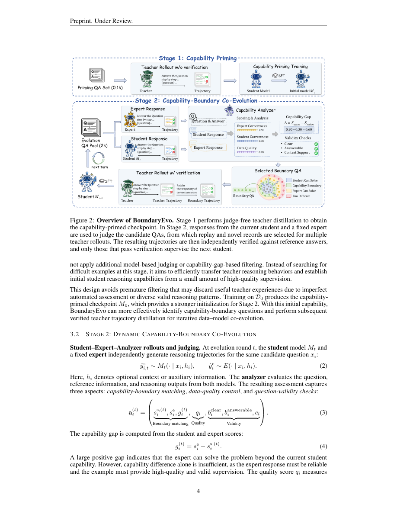

# BoundaryEvo: Data-Model Co-Evolution at the Capability Boundary for Long-Chain Reasoning Distillation

<!-- source-sha256: 6562c19d9fcf3347ab133a4334bcb9bf26240ce57d868c6319d00b8f7022d43b -->

[简体中文](README.md)

> Core-mechanism implementation. Short-budget checkpoint results diagnose the runtime; they do not support paper-scale capability claims.

## Paper information

| Field | Details |
| --- | --- |
| Paper | [arXiv 2610.13285](https://arxiv.org/abs/2610.13285) |
| Organization | Shanghai Artificial Intelligence Laboratory / Nanjing University / Tongji University / The Chinese University of Hong Kong |
| First public release | 2026-10-09 (arXiv v1) |
| Authors' code | Not released at the time of review (2026-10-12). The paper promises a later code and data release, but no usable implementation was found. |
| Adapter | `boundary-evo` |
| Local reproduction code | [`src/auto_research/reproductions/boundary_evo/`](https://github.com/daiwk/auto-research/tree/main/src/auto_research/reproductions/boundary_evo/) |

## Original paper

### Motivation and method

The value of long reasoning supervision changes as a student's capabilities improve. BoundaryEvo first distills a small set of teacher behavior without filtering for correctness to prime the student's capabilities. In each round, the current student, a fixed expert, and an analyzer re-estimate the capability boundary. Replay questions that the student has not yet mastered are retained, and new questions are added. Fresh teacher trajectories are generated and verified only after question selection.

~~~mermaid
flowchart LR
  T[Teacher trajectories] --> P[Judge-free priming] --> S[Current student]
  S --> I[Student and expert solve independently] --> A[External analyzer] --> B[Re-estimate capability boundary] --> N[Replay and novel QA] --> F[Fresh teacher rollouts] --> V[Independent reference verification] --> SFT[SFT] --> S
~~~

### Original method diagram

Full-page capture of Figure 2 from page 4 of the original PDF. The caption, algorithm flow, and accompanying text were checked. It is neither a local redraw nor an experiment artifact. Copyright remains with the authors; the source is the official arXiv v1 PDF.

<!-- paper-figure:start -->
### Key figure from the paper

> **Figure 2:** Overall method and key components. From the [original paper](https://arxiv.org/abs/2610.13285); copyright remains with the authors. Click the image for the source.
<!-- paper-figure:end -->

### Core equations

The gap is $g_i^{(t)}=s_i^e-s_i^{s,(t)}$. Acceptance requires a reliable expert, a student that has not mastered the question, a sufficiently large gap, and passing quality, clarity, answerability, and context checks. $D_t=R'_t\cup\mathrm{Select}(N_t)$; replay items are reassessed as well. Training optimizes $-\sum_j\log p_\theta(y_j|x,y_{<j})/\sum|y|$ on teacher response tokens only. Stage 1 does not filter by answer correctness. In Stage 2, independent verification precedes SFT.

### Paper results

The paper uses Qwen3.5-4B with 100 priming examples and 3×300 evolution examples, totaling 1,000. IMO-AnswerBench improves from 62.9% to 75.3%, and AMO-Bench from 26.8% to 46.0%. DeepSeek-V3.2-Speciale, GPT-5.1, and Gemini 3.5 Flash serve as teacher, expert, and analyzer, respectively. No online A/B test is reported. The [paper scalar extract](paper-results.json) has `paper_reported=true` and `measured_locally=false`. It is stored outside the metrics directory and cannot count as local reproduction evidence.

## Local reproduction

> **Local control:** The formal comparison has not run. The intended baseline is the same student's teacher-primed checkpoint; the treatment applies SFT to fresh teacher trajectories after boundary selection. This short-budget run is a mechanism diagnostic, so a stable relative gain is not applicable and no capability improvement is reported. Empty boundaries and missing Stage 2 updates remain failures.

Entry point: `PYTHONPATH=src python scripts/run_oct12_post_training.py --objective boundary-evo --help`.

Provide local student and teacher checkpoint paths with public IDs and revisions, public train/validation JSONL, dataset revision, a train-only split manifest, and an output path. Expert and analyzer paths, IDs, and revisions are also required. These roles and the student's base model are frozen. The CLI neither downloads models nor uploads data, and performs real LoRA training on `q_proj` and `v_proj`.

The packaged `boundary-evo` adapter reads `oct12-boundary-evo.json` from the data directory. Its fields match the CLI's snake_case arguments. Missing real checkpoint configuration fails explicitly rather than falling back to a synthetic fixture.

### Data protocol and results

Use `public_holdout.validate_holdout` to verify the public source train split, revision, file SHA256, counts, normalized-question deduplication, and train/validation disjointness. Student generation receives only the question; gold data does not enter solver rollout or retrieval. Validation is reported after training and was not used to tune this short run. There is no test entry point and no test data is read. Formal experiments must select configurations using train and validation only.

Defaults are two priming examples, at least two rounds, a four-example evolution pool, two acquisitions, a replay quota of one, and at least two teacher rollouts per question. The paper's Appendix F.3 thresholds are retained: expert ≥0.65, student <0.50, gap ≥0.20, and quality/context ≥0.70. The independent external analyzer may read training references; the evaluated student, teacher, and expert see only the question. JSON parse failures and empty boundaries are recorded without inserting a constant correctness reward. A run without Stage 2 updates cannot validate co-evolution.

A real NVIDIA A100-SXM4-80GB run yielded a **negative result**: see the [sanitized original record](assets/negative-missing-recommended-a100-42.json). The execution snapshot was `456a2ffacc47658c4ccb74f386465d47e5f4e357`: seed 42, 384 maximum tokens, two priming examples, two rounds, a pool of eight, two acquisitions per round, two teacher rollouts, and a 768-token analyzer budget. The student was Qwen2.5-0.5B; teacher, expert, and analyzer were three independent frozen Qwen2.5-7B instances, not the three closed-model roles used in the paper.

The two real priming losses were 0.40377098321914673 and 0.8740767240524292, pre-clipping gradient $L_2$ values were 0.4742562472820282 and 0.574048638343811, and LoRA parameter change in $L_2$ was 0.007703710666217913. All 16 analyzer responses across eight candidates and two rounds returned `missing_required_fields=[recommended]`; none were budget truncations. In each round, selected questions, verified teacher trajectories, and Stage 2 optimizer steps were all zero. Exact match was 2/4 (0.5) on four validation questions, but this is only a post-priming diagnostic, not evidence that capability-boundary co-evolution worked or improved capability.

That older record is labeled `not_passed_boundary_evolution`, excluded from current metrics, and not used for a passing receipt. It independently records the original result SHA256, old source `git show` hashes, and missing-field diagnosis. The zero-update run did not pass mechanism validation and is separate from the real execution of semantic v5 below.

The only initial change was to the analyzer's **generation protocol**: state all eight required fields of the standard JSON Schema, number ranges, and boolean types, and clarify that `recommended` is an evidence-based recommendation. The parser still rejects a missing `recommended` field, including attempts to substitute a different name. It does not fill fields, repair or invent JSON, or adjust the original score, quality, or context thresholds. Solver sampling, teacher verification, and acquisition are unchanged. L0 captures the actual judge prompt contract and establishes only interface constraints.

The new schema ran on a real A100 at the same budget, with a [separate negative record](assets/negative-schema-no-boundary-a100-42.json). The source was `8e3298a8c9075520486de4b0e4d0eda57b411af4` and core `oct12_checkpoint.py` SHA256 was `7d4ed0b6466c99d941054c8179bb9298eb35078958e5a84a0c2a54b37d627dfd`. Of 16 analyzer responses, 15 parsed and one returned `json_decode_error`, with no budget truncations. None of the 15 real assessments passed the original boundary thresholds. Across both rounds, accepted and selected questions, verified teacher trajectories, and Stage 2 updates stayed at zero. The two priming updates, parameter change, and 2/4 validation result matched the prior negative run. They are not Stage 2 evidence or a paper capability result.

Schema v3 remains `not_passed_boundary_evolution` and generates no passing metrics or receipt.

The expanded-pool v4 run also produced a complete real negative result; see the [record](assets/negative-expanded-no-boundary-a100-42.json). It ran `8e3298a8c9075520486de4b0e4d0eda57b411af4` with only two changes: solver maximum tokens 384→768 and the train-only candidate pool per round 8→24. Other budgets, the public training holdout, the original thresholds, and test isolation stayed fixed. Across 24 candidates and two rounds, 42 of 48 analyzer responses parsed, four lacked required fields, and two returned `json_decode_error`. None were budget truncations. Accepted and selected questions, verified teacher trajectories, and Stage 2 updates stayed at zero in both rounds. Two priming updates, LoRA parameter $L_2$ change of 0.007703710666217913, and 2/4 validation still provide no evidence of a successful Stage 2.

The **judge's scoring semantics** were then aligned with [Section 3.2 and Appendix F.3](https://arxiv.org/html/2610.13285v1). Quality reflects the QA item's clarity, answerability, reference correctness, and training value. Clarity and answerability concern the question, not whether a student answered it incorrectly or incompletely. Student and expert scores use their actual independent responses and do not assume the expert is better. When there is no independent external context, the judge assigns context support 1.0 according to the paper; the schema does not fix that value and the parser does not fill it in. Completeness measures whether the student rollout is complete, and `recommended` only helps rank novel candidates; neither adds a hard threshold. This clarifies the paper's semantics, not a relaxation to pass CI or accept more candidates. Old v4 scalar scores are insufficient to establish the cause of those rejections.

The semantic source snapshot is `70c10c2d2fd47369523ff1407cff88853a7a24b2`, with core source SHA256 `60ce8c245a108ca793e4f35f78ebbf8ca83de3aef81011a63d65b156f539fecd`. All 62 post-training tests passed. The ASTs of 20 other functions/classes, the original threshold source, and the judge's AST from sampling through parse return remained unchanged.

### Semantic v5: observed L1 mechanism results

The real NVIDIA A100-SXM4-80GB run completed. The [current native-v2 metrics](metrics/gsm8k-a100-42.json) and [sanitized GPU receipt](../../gpu-validations/boundary-evo-a100-20261012.json) are tied only to the `70c10c2d…` snapshot above. This used seed 42, the same public train-only holdout, 24 candidates per round, 768 tokens each for solver and analyzer, and two rounds. The student and three frozen 7B roles used the immutable revisions below. This is not a reproduction of the paper's scale or closed models.

| Stage | Candidates accepted | Questions selected | Questions with verified teacher trajectories | Stage 2 optimizer steps | Stage 2 training response tokens |
| --- | ---: | ---: | ---: | ---: | ---: |
| Round 0 | 9/24 | 2 | 1 | 1 | 227 |
| Round 1 | 12/24 | 2 | 0 | 0 | 0 |

**Only Round 0 executed a real Stage 2 SFT update.** Questions were selected first, followed by fresh teacher rollouts and independent reference verification before training. Round 1 reassessed the updated student and selected one replay question and one novel question. Neither question's teacher trajectories passed verification, so Round 1 did not train. This failure remains in the record; both rounds did not train. Of 48 analyzer responses, 43 parsed, four lacked required fields, and one failed JSON decoding. None were budget truncations.

This run also performed two real priming updates, with losses and pre-clipping gradients matching the negative records above. The total final LoRA parameter change in $L_2$ was 0.010686376319428153, **including both priming and Stage 2; it cannot be separated into an evolution-only delta**. The original history did not save evolution loss or gradient values, and the artifact neither infers nor invents them. Actual optimizer and verified-trajectory counters, plus 227 training response tokens, establish the Stage 2 execution. Validation exact match was 2/4 (0.5) across four questions. Without a same-budget capability baseline, this does not establish a capability gain, stable relative improvement, or reproduction of the paper's metrics. The external analyzer was not manually calibrated on this short run.

The GPU gate passes only for **L1 execution of the core mechanism** at this frozen source snapshot. All three prior negative records remain in the assets and were not pooled into current metrics or the passing receipt. Formal capability comparison, paper-scale long-trajectory budgets, and multi-seed controls remain incomplete.

Portable command for the measured budget. Replace placeholders with checkpoint caches and public holdout files with official provenance and hashes, and choose a fresh output path. No machine-specific information is included.

~~~bash
PYTHONPATH=src python scripts/run_oct12_post_training.py \
  --objective boundary-evo \
  --student-path '<student-checkpoint-cache>' \
  --student-id Qwen/Qwen2.5-0.5B-Instruct \
  --student-revision 7ae557604adf67be50417f59c2c2f167def9a775 \
  --teacher-path '<teacher-checkpoint-cache>' \
  --teacher-id Qwen/Qwen2.5-7B-Instruct \
  --teacher-revision bb46c15ee4bb56c5b63245ef50fd7637234d6f75 \
  --expert-path '<expert-checkpoint-cache>' \
  --expert-id Qwen/Qwen2.5-7B-Instruct \
  --expert-revision bb46c15ee4bb56c5b63245ef50fd7637234d6f75 \
  --analyzer-path '<analyzer-checkpoint-cache>' \
  --analyzer-id Qwen/Qwen2.5-7B-Instruct \
  --analyzer-revision bb46c15ee4bb56c5b63245ef50fd7637234d6f75 \
  --train-path '<public-train-jsonl>' \
  --validation-path '<public-validation-jsonl>' \
  --split-manifest '<public-split-manifest>' \
  --dataset-revision 3101c7d5072418e28b9008a6636bde82a006892c \
  --device cuda --seed 42 --steps 2 --validation-examples 4 \
  --max-tokens 768 --priming-examples 2 --rounds 2 --pool-examples 24 \
  --acquisition 2 --replay-quota 1 --teacher-rollouts 2 --analyzer-tokens 768 \
  --output '<fresh-output-json>'
~~~

`learning_rate=1e-5` is the unmodified snapshot default. Actual BoundaryEvo updates are triggered by priming, rounds, and acquisition; the shared entry point's `--steps 2` does not mean two updates in each round. The sanitized artifacts retain the raw SHA256, seven source hashes from `git show`, and the public model and data file hashes.

### Code mapping and reproduction boundaries

`BoundaryAssessment / boundary_selection` implement the three levels of boundary conditions and replay-first selection. `boundary_train / judge_boundary / sft_trajectory` run real priming, per-round solvers and model-based analysis, fresh teacher sampling, external numerical verification, and student LoRA SFT.

See [contract and behavior tests](https://github.com/daiwk/auto-research/blob/main/tests/test_oct12_post_training.py). The small causal-model tests validate real gradients, prefix masking, reference recovery, boundary updates, and gold isolation; they do not compare reasoning capability. Paper-scale data, model, and long-reasoning budgets, multi-seed same-budget capability controls, online systems, and evolve integration remain incomplete.
