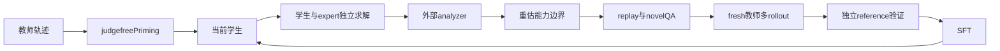
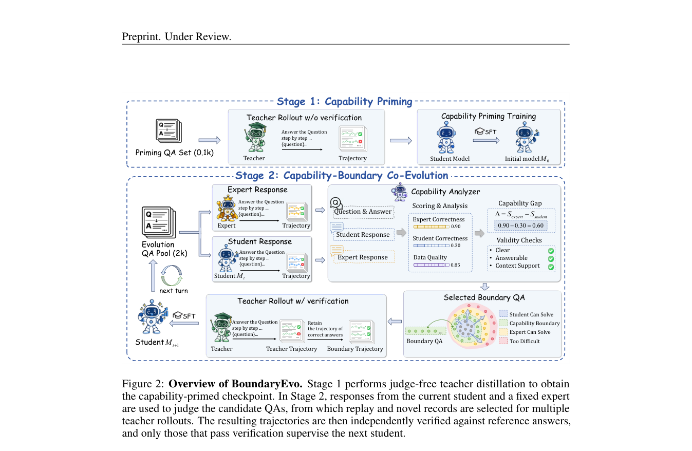

# boundary-evo：BoundaryEvo: Data-Model Co-Evolution at the Capability Boundary for Long-Chain Reasoning Distillation

> 核心机制代码路径；短预算 checkpoint 结果只支持 runtime 诊断，不支持论文规模能力结论。

## 论文信息

| 项目 | 内容 |
| --- | --- |
| 论文链接 | [arXiv 2610.13285](https://arxiv.org/abs/2610.13285) |
| 公司/机构 | Shanghai Artificial Intelligence Laboratory / Nanjing University / Tongji University / The Chinese University of Hong Kong |
| 首次公开日期 | 2026-10-09（arXiv v1） |
| 原文开源代码 | 否：论文承诺后续公开代码与数据，本次未找到可用实现（2026-10-12 核查） |
| Adapter | `boundary-evo` |
| 本地复现代码 | [`src/auto_research/reproductions/boundary_evo/`](https://github.com/daiwk/auto-research/tree/main/src/auto_research/reproductions/boundary_evo/) |

## 原始论文总结

### 背景与主要改动

长推理监督的价值随学生能力变化。BoundaryEvo 先不按 correctness 过滤地蒸馏少量教师行为做 capability priming，然后每轮用当前学生、固定 expert 和 analyzer 重估边界，保留仍未掌握的 replay 并补充新问题；选好问题后再生成并验证 fresh teacher trajectories。



### 原论文关键图

[](https://arxiv.org/pdf/2610.13285v1#page=4)

原版 PDF 第 4 页 Figure 2 全页截图，已检查图题、算法流程与正文，非本地重绘或实验产物。版权归原作者；截图来源为官方 arXiv PDF v1。

<!-- paper-figure:start -->
### 原论文关键图

[](https://arxiv.org/pdf/2610.13285#page=4)

> **原论文 Figure 2（关键图）**：展示原论文方法的总体设计和关键组成。图片来自[原论文](https://arxiv.org/abs/2610.13285)，版权归原作者所有；点击图片可查看来源。
<!-- paper-figure:end -->

### 核心公式

$g_i^{(t)}=s_i^e-s_i^{s,(t)}$；接受需 expert 可靠、学生未掌握、gap 达标，同时 quality/clear/answerable/context 通过。$D_t=R'_t\cup\mathrm{Select}(N_t)$，replay 也重新检查。训练只对教师响应 token 优化 $-\sum_j\log p_\theta(y_j|x,y_{<j})/\sum|y|$；Stage 1 不做答案正确性过滤，Stage 2 独立验证后才 SFT。

### 论文离线与线上效果

原文使用 Qwen3.5-4B、100 条 priming+3×300 evolution，共 1000 条；IMO-AnswerBench 62.9%→75.3%，AMO-Bench 26.8%→46.0%。Teacher、expert、analyzer 角色分别由 DeepSeek-V3.2-Speciale、GPT-5.1、Gemini 3.5 Flash 提供。未报告线上 A/B。 原论文标量摘录见 [paper-results.json](paper-results.json)，`paper_reported=true`、`measured_locally=false`；独立存放于非 metrics 目录，不能作为本地复现指标。

## 本地复现

> **本地对照口径**：正式对照设计尚未执行；计划以相同学生的 teacher-primed checkpoint 为基线，边界筛选后 fresh teacher 轨迹 SFT 为实验组。本次只有短预算机制诊断，本短跑稳定相对提升不适用，不报告能力收益；空边界或无 Stage 2 更新保留失败。

入口：`PYTHONPATH=src python scripts/run_oct12_post_training.py --objective boundary-evo --help`。

必须提供本地 student/teacher checkpoint 路径与公开 ID/revision、公开 train/validation JSONL、dataset revision、train-only split manifest 和 output 路径。还需 expert/analyzer 的 path/ID/revision，角色均冻结，学生基础模型也冻结。 CLI 不下载模型，不上传数据，实际训练 q_proj/v_proj LoRA。

`boundary-evo` packaged adapter 读取数据目录中的 `oct12-boundary-evo.json`，字段对应 CLI 的 snake_case 参数；没有真实 checkpoint 配置时明确报错，不回退到合成 fixture。

### 数据协议与结果

必须复用 `public_holdout.validate_holdout` 校验公开 source train、revision、文件 SHA256、条数、规范化 question 去重及 train/validation 不重叠。学生生成只接收问题；gold 不进入 solver rollout/retrieval。validation 仅训练后报告，本短跑没有据 validation 选超参；test 无入口且不读取。正式实验的选参必须仅使用 train/validation。

默认 priming 2 条、至少 2 rounds、4 条 evolution pool、2 条 acquisition、replay quota 1、每问至少 2 teacher rollouts。接受阈值沿原文 Appendix F.3：expert≥0.65、student<0.50、gap≥0.20、quality/context≥0.70。analyzer 是独立外部 judge，可读取训练 reference；被评估的 student、teacher、expert 只读 question。JSON 解析失败或无有效边界如实记录，不使用常量正确奖励补齐；若没有 Stage 2 更新，不应宣称 co-evolution 路径验证成功。

已取得真实 NVIDIA A100-SXM4-80GB **负结果**，脱敏原始记录见 [negative-missing-recommended-a100-42.json](assets/negative-missing-recommended-a100-42.json)。执行快照为 `456a2ffacc47658c4ccb74f386465d47e5f4e357`，seed 42、max tokens 384、priming 2 条、2 rounds、8 条 pool、每轮 acquisition 2、teacher rollouts 2、analyzer budget 768。学生为 Qwen2.5-0.5B，teacher/expert/analyzer 为三个独立冻结的 Qwen2.5-7B 实例，不等于原论文的三类闭源角色。

两次真实 priming loss 为 0.40377098321914673 / 0.8740767240524292，裁剪前梯度 L2 为 0.4742562472820282 / 0.574048638343811，LoRA 参数变化 L2 为 0.007703710666217913。随后 8 candidates×2 rounds 的 16 个 analyzer 返回均为 `missing_required_fields=[recommended]`，均非预算截断；每轮 selected/verified teacher trajectories/Stage 2 optimizer steps 都为 0。4 题 validation exact match 虽为 2/4（0.5），也只能归于这次 priming 后诊断，不能冒称 capability-boundary co-evolution 有效或有能力提升。

该旧记录标为 `not_passed_boundary_evolution`，不放入当前 metrics，不作为通过回执依据。它独立保存原始结果 SHA256、旧源码 git-show 哈希与缺字段诊断；这次零 Stage 2 运行未通过本机制验证，与下述语义 v5 的真实执行结果分开。

已仅增强 analyzer **生成协议**：明确标准 JSON Schema 的全部 8 required fields、number 范围与 boolean 类型，并说明 recommended 是依据证据作出的真实推荐。解析器仍拒绝缺 recommended（包括其它名称替代），不补字段、不修复/造 JSON、不调整原 score/quality/context 门槛；solver sampling、teacher 校验与 acquisition 算法保持不变。L0 捕获实际 judge prompt 合约，仅证明接口约束。

新 Schema 已在同预算真实 A100 运行，独立负记录见 [negative-schema-no-boundary-a100-42.json](assets/negative-schema-no-boundary-a100-42.json)。执行源码为 `8e3298a8c9075520486de4b0e4d0eda57b411af4`，核心 `oct12_checkpoint.py` SHA256 为 `7d4ed0b6466c99d941054c8179bb9298eb35078958e5a84a0c2a54b37d627dfd`。16 次 analyzer 返回有 15 次完成解析、1 次 `json_decode_error`，均非预算截断；但 15 个真实评分全部未通过原边界门槛，两轮 accepted/selected/verified teacher trajectories/Stage 2 updates 仍均为 0。两次 priming、参数变化与 4 题 validation 2/4 与上一负运行一致，不是 Stage 2 结果，也不构成论文能力结论。

上述 Schema v3 仍标为 `not_passed_boundary_evolution`，不产生 passed metrics 或通过回执。

扩池 v4 已取得真实完整负结果，见 [negative-expanded-no-boundary-a100-42.json](assets/negative-expanded-no-boundary-a100-42.json)。它仍执行 `8e3298a8c9075520486de4b0e4d0eda57b411af4`，仅将 solver max tokens 384→768、每轮 train-only candidate pool 8→24；其余预算、公开 train holdout、原门槛与 test 隔离未变。24 candidates×2 rounds 共 48 次 analyzer 返回，42 次解析成功、4 次缺 required fields、2 次 `json_decode_error`，均非预算截断；两轮 accepted/selected/verified teacher trajectories/Stage 2 updates 仍均为 0。priming 2 次、LoRA 参数变化 L2 0.007703710666217913 和 validation 2/4 仍不是有效 Stage 2 的证据。

随后依据[原文 §3.2 及 Appendix F.3](https://arxiv.org/html/2610.13285v1)完善 **judge 评分语义**：quality 衡量 QA 本身的清晰、可答、参考正确与训练价值，clear/answerable 判断 question，不应因学生答错或响应未完成而直接把 QA 判为缺陷；student/expert 分数各据真实独立响应，不预设专家更好。无独立 external context 时由 judge 按原文定义输出 context support 1.0，schema 不固定该值、parser 不补值。completeness 衡量学生 rollout 完整性，recommended 仅为 novel 排序辅助，两者不添加硬门槛。这是对原论文含义的补全，不是为通过 CI 或增加接收数而放宽原门槛；旧 v4 的标量评分不足以单独证明其拒收的因果原因。

语义源码已冻结为 `70c10c2d2fd47369523ff1407cff88853a7a24b2`，核心源码 SHA256 为 `60ce8c245a108ca793e4f35f78ebbf8ca83de3aef81011a63d65b156f539fecd`。62 项后训练测试通过；20 个其它函数/类 AST、原门槛源码和 judge 从采样到解析返回的 AST 均保持不变。

### 语义 v5：实际 L1 机制结果

真实 NVIDIA A100-SXM4-80GB 运行已完成，当前 [native-v2 metrics](metrics/gsm8k-a100-42.json) 与[脱敏 GPU 回执](../../gpu-validations/boundary-evo-a100-20261012.json)只绑定上述 `70c10c2d…` 执行快照。seed 42、同公开 train-only holdout、每轮 pool 24、solver/analyzer 各 768 tokens、2 rounds；学生与三个冻结 7B 角色使用前述不可变 revisions。不是原论文规模或闭源角色复现。

| 实际阶段 | 接收候选 | 选中问题 | 有验证通过教师轨迹的问题 | Stage 2 optimizer steps | Stage 2 训练响应 tokens |
| --- | ---: | ---: | ---: | ---: | ---: |
| Round 0 | 9/24 | 2 | 1 | 1 | 227 |
| Round 1 | 12/24 | 2 | 0 | 0 | 0 |

**只有 Round 0 真正执行了 1 次 Stage 2 SFT**：先选问题，再 fresh 多教师采样，独立 reference 验证后才训练。Round 1 在更新后的学生上重新估边界，选择集合由一条 replay 加一条 novel 组成，但这两个问题的教师轨迹都未通过验证，因此不训练；失败完整保留，不能说两轮都训练。48 次 analyzer 返回中 43 次解析成功、4 次缺 required fields、1 次 JSON decode failure，均非预算截断。

本次仍有 2 次真实 priming 更新，其 loss/裁剪前梯度与前述负记录一致；最终总 LoRA 参数变化 L2 为 0.010686376319428153，**包含 priming 与 Stage 2，不能拆成单独演化 delta**。原始 history 未保存 evolution loss/gradient 数值，当前产物不推断、不补造；Stage 2 的证据是实际 optimizer/验证轨迹 counters 与 227 个训练响应 tokens。4 题 validation exact match 为 2/4（0.5），没有同预算能力基线，不能宣称能力提升、稳定相对收益或论文指标复现。外部 analyzer 也未在本短跑做人工校准。

GPU gate 仅对该冻结源码的 **L1 核心机制执行**通过；三份旧负记录仍在 assets，未混入当前 metrics 或通过回执。正式能力比较、论文级长轨迹预算与多 seed 对照尚未完成。

可移植的实际预算命令（占位路径须替换为带官方 provenance/hash 的 checkpoint cache、公开 holdout 文件与 fresh 输出；不包含机器信息）：

```bash
PYTHONPATH=src python scripts/run_oct12_post_training.py \
  --objective boundary-evo \
  --student-path '<student-checkpoint-cache>' \
  --student-id Qwen/Qwen2.5-0.5B-Instruct \
  --student-revision 7ae557604adf67be50417f59c2c2f167def9a775 \
  --teacher-path '<teacher-checkpoint-cache>' \
  --teacher-id Qwen/Qwen2.5-7B-Instruct \
  --teacher-revision bb46c15ee4bb56c5b63245ef50fd7637234d6f75 \
  --expert-path '<expert-checkpoint-cache>' \
  --expert-id Qwen/Qwen2.5-7B-Instruct \
  --expert-revision bb46c15ee4bb56c5b63245ef50fd7637234d6f75 \
  --analyzer-path '<analyzer-checkpoint-cache>' \
  --analyzer-id Qwen/Qwen2.5-7B-Instruct \
  --analyzer-revision bb46c15ee4bb56c5b63245ef50fd7637234d6f75 \
  --train-path '<public-train-jsonl>' \
  --validation-path '<public-validation-jsonl>' \
  --split-manifest '<public-split-manifest>' \
  --dataset-revision 3101c7d5072418e28b9008a6636bde82a006892c \
  --device cuda --seed 42 --steps 2 --validation-examples 4 \
  --max-tokens 768 --priming-examples 2 --rounds 2 --pool-examples 24 \
  --acquisition 2 --replay-quota 1 --teacher-rollouts 2 --analyzer-tokens 768 \
  --output '<fresh-output-json>'
```

`learning_rate=1e-5` 是执行快照默认值，未覆写。BoundaryEvo 的实际更新由 priming/round/acquisition 触发；统一入口的 `--steps 2` 不表示两轮各训练 2 次。原始 raw SHA256、七项 `git show` 源码哈希和公开模型/数据文件 SHA 均保存在脱敏产物中。

### 代码映射与复现边界

`BoundaryAssessment / boundary_selection` 实现三层边界条件和 replay-first；`boundary_train / judge_boundary / sft_trajectory` 运行真实 priming、每轮 solver/模型 analyzer、fresh 多教师采样、外部数值验证与学生 LoRA SFT。

契约与行为测试：[test_oct12_post_training.py](https://github.com/daiwk/auto-research/blob/main/tests/test_oct12_post_training.py)。小因果模型测试仅验证真实梯度、masked prefix、参考恢复、边界更新及 gold 隔离；不是 reasoning 能力比较。尚未完成论文规模数据/模型/长推理预算、多 seed 同预算能力对照、线上系统或 Evolve 控制器集成。
