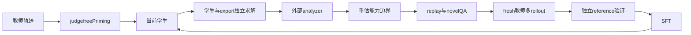

# boundary-evo：BoundaryEvo: Data-Model Co-Evolution at the Capability Boundary for Long-Chain Reasoning Distillation

> 核心机制代码路径；短预算 checkpoint 结果只支持 runtime 诊断，不支持论文规模能力结论。

## 论文信息

| 字段 | 内容 |
|---|---|
| 论文链接 | [arXiv v1](https://arxiv.org/abs/2610.13285v1) / [全文](https://arxiv.org/html/2610.13285v1) |
| 公司 / 机构 | Shanghai Artificial Intelligence Laboratory / Nanjing University / Tongji University / The Chinese University of Hong Kong |
| 首次公开日期 | 2026-10-09（arXiv v1） |
| 原作者代码 | 未发现 / 未发布官方代码（截至 2026-10-12）；原文承诺未来公开代码与数据 |
| 本地 adapter / 方法（Adapter） | `boundary-evo` |
| 本地复现代码 | [packaged adapter](../../../src/auto_research/reproductions/boundary_evo/adapter.py)、[objectives](../../../src/auto_research/post_training/oct12_objectives.py)、[checkpoint runner](../../../src/auto_research/post_training/oct12_checkpoint.py) |

## 原始论文总结

### 背景与主要改动

长推理监督的价值随学生能力变化。BoundaryEvo 先不按 correctness 过滤地蒸馏少量教师行为做 capability priming，然后每轮用当前学生、固定 expert 和 analyzer 重估边界，保留仍未掌握的 replay 并补充新问题；选好问题后再生成并验证 fresh teacher trajectories。

### 原论文关键图

原版 PDF 第 4 页 Figure 2 全页截图，已检查图题、算法流程与正文，非本地重绘或实验产物。版权归原作者；截图来源为官方 arXiv PDF v1。

### 核心公式

$g_i^{(t)}=s_i^e-s_i^{s,(t)}$；接受需 expert 可靠、学生未掌握、gap 达标，同时 quality/clear/answerable/context 通过。$D_t=R'_t\cup\mathrm{Select}(N_t)$，replay 也重新检查。训练只对教师响应 token 优化 $-\sum_j\log p_\theta(y_j|x,y_{<j})/\sum|y|$；Stage 1 不做答案正确性过滤，Stage 2 独立验证后才 SFT。

### 论文离线与线上效果

原文使用 Qwen3.5-4B、100 条 priming+3×300 evolution，共 1000 条；IMO-AnswerBench 62.9%→75.3%，AMO-Bench 26.8%→46.0%。Teacher、expert、analyzer 角色分别由 DeepSeek-V3.2-Speciale、GPT-5.1、Gemini 3.5 Flash 提供。未报告线上 A/B。 原论文标量摘录见 [paper-results.json](paper-results.json)，`paper_reported=true`、`measured_locally=false`；独立存放于非 metrics 目录，不能作为本地复现指标。

## 本地复现

入口：`PYTHONPATH=src python scripts/run_oct12_post_training.py --objective boundary-evo --help`。

必须提供本地 student/teacher checkpoint 路径与公开 ID/revision、公开 train/validation JSONL、dataset revision、train-only split manifest 和 output 路径。还需 expert/analyzer 的 path/ID/revision，角色均冻结，学生基础模型也冻结。 CLI 不下载模型，不上传数据，实际训练 q_proj/v_proj LoRA。

`boundary-evo` packaged adapter 读取数据目录中的 `oct12-boundary-evo.json`，字段对应 CLI 的 snake_case 参数；没有真实 checkpoint 配置时明确报错，不回退到合成 fixture。

### 数据协议与结果

必须复用 `public_holdout.validate_holdout` 校验公开 source train、revision、文件 SHA256、条数、规范化 question 去重及 train/validation 不重叠。学生生成只接收问题；gold 不进入 solver rollout/retrieval。validation 仅训练后报告，本短跑没有据 validation 选超参；test 无入口且不读取。正式实验的选参必须仅使用 train/validation。

默认 priming 2 条、至少 2 rounds、4 条 evolution pool、2 条 acquisition、replay quota 1、每问至少 2 teacher rollouts。接受阈值沿原文 Appendix F.3：expert≥0.65、student<0.50、gap≥0.20、quality/context≥0.70。analyzer 是独立外部 judge，可读取训练 reference；被评估的 student、teacher、expert 只读 question。JSON 解析失败或无有效边界如实记录，不使用常量正确奖励补齐；若没有 Stage 2 更新，不应宣称 co-evolution 路径验证成功。

目前未完成真实 NVIDIA A100/A30 执行，GPU gate 尚未通过；不写本地稳定指标或伪造 receipt。运行保存真实 loss/token 数/参数变化/validation 口径和角色 revisions；少量截断响应、单 seed 只能支持 L1 runtime smoke。planned receipt：`docs/gpu-validations/boundary-evo-a100-20261012.json`，须由真实执行生成。

### 代码映射与复现边界

`BoundaryAssessment / boundary_selection` 实现三层边界条件和 replay-first；`boundary_train / judge_boundary / sft_trajectory` 运行真实 priming、每轮 solver/模型 analyzer、fresh 多教师采样、外部数值验证与学生 LoRA SFT。

契约与行为测试：[test_oct12_post_training.py](../../../tests/test_oct12_post_training.py)。小因果模型测试仅验证真实梯度、masked prefix、参考恢复、边界更新及 gold 隔离；不是 reasoning 能力比较。尚未完成论文规模数据/模型/长推理预算、多 seed 同预算能力对照、线上系统或 Evolve 控制器集成。
