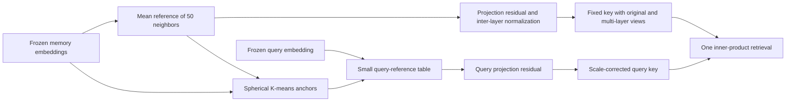
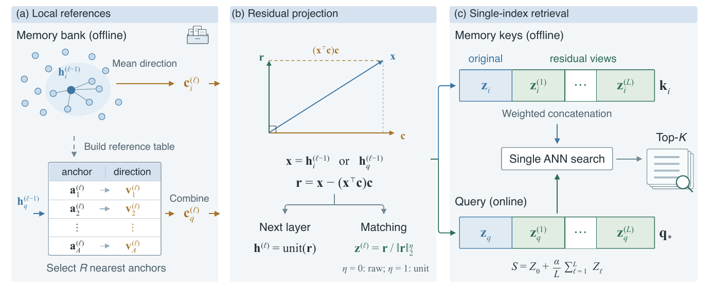

# NEAR: Use nearby memories to construct discriminative residuals

<!-- source-sha256: 780e0e732bad19fc0b08696a8c4d31c25ad8947903056ee9214d9aef2888f7eb -->

[简体中文](README.md)

## Paper information

| Field | Value |
| --- | --- |
| Paper | [arXiv 2610.13314](https://arxiv.org/abs/2610.13314) |
| Affiliations | Southeast University / MemoraX AI / Leiden University / University of Sydney |
| First public release | 2026-10-09 (arXiv v1) |
| Author code | No author code found in the paper or official pages as of 2026-10-13. |
| Adapter | `near` |
| Local implementation | [`src/auto_research/reproductions/near/`](https://github.com/daiwk/auto-research/tree/main/src/auto_research/reproductions/near/) |

The arXiv v1 upload was 2026-10-09 09:57:27 UTC. The formulas are `core_mechanism`; frozen encoder extraction and the public retrieval entry point are L2, not a full rerun of the authors' nine-model LMEB study. The shared-bank experiment below is specifically L1.

## Original paper

### Motivation and method

Memory records often share people, topics, or events. Shared content can make an irrelevant record's embedding match better than one containing the actual fact. NEAR uses neighbors as a reference: find a mean neighbor direction for each memory offline and remove its projection along that direction. The query obtains its reference from a small precomputed table instead of retrieving candidates first.

Each layer recomputes neighborhoods on normalized residuals and preserves the original vector and multiple scoring views. Spherical K-means clusters memory inputs into at most 16 anchors. Each anchor stores the normalized mean direction of its cluster's memory references. A query mixes the directions of its 4 nearest anchors with softmax weights. Memory processing, scaling, and reference tables do not read queries or relevance labels.



The diagram is a local redraw; see [source](assets/architecture.mmd) and [paper provenance](assets/source-provenance.json).

[](https://arxiv.org/pdf/2610.13314v1#page=3)

Luo et al.'s [Figure 2](https://arxiv.org/html/2610.13314v1#S2.F2) builds offline memory references and the anchor table, subtracts projections and forms matching views, then concatenates weighted original and residual views into one fixed memory key. The online query needs one ANN retrieval and the reference table needs no gold retrieval labels. This is a visually checked 250 dpi crop from the [v1 PDF, page 3](https://arxiv.org/pdf/2610.13314v1#page=3), not a local measurement. The source uses the arXiv perpetual non-exclusive license, not CC BY; copyright remains with the authors. Hashes and crop details are in [figure provenance](assets/original-figures.json).

### Core equations

For input state $h$ and unit reference $c$:

$$
r=h-(h^Tc)c,\qquad h^{next}=\operatorname{unit}(r).
$$

Raw or unit-length residuals for scoring are selected only on development data. Layer scales use memory–memory population variance including self-similarity:

$$
\tau_\ell=\max\left(10^{-6},\sqrt{\frac1N\sum_i\operatorname{Var}_j\left[(z_i^{(\ell)})^Tz_j^{(\ell)}\right]}\right).
$$

The implementation computes this from memory covariance rather than forming all pairwise scores. The fused score is:

$$
S(q,m)=s_0/\tau_0+\frac\alpha L\sum_{\ell=1}^L s_\ell/\tau_\ell.
$$

Concatenate memory views weighted by $\sqrt{\alpha/L}$, with the query views additionally divided by their corresponding $\tau_\ell$. One inner product then gives exactly the stated fusion; normalizing the entire concatenation again changes ranking.

### Paper-reported results

| Mean over eight paper tasks | Base Recall@10 / NDCG@10 | NEAR |
| --- | --- | --- |
| Qwen3-Embedding-0.6B | 65.34 / 50.93 | 67.17 / 52.99 |
| Qwen3-Embedding-4B | 62.67 / 47.88 | 69.76 / 55.33 |
| Qwen3-Embedding-8B | 68.65 / 53.95 | 71.76 / 57.00 |

Average retrieval improves across nine embedding backbones, not on every individual task. LoCoMo downstream Qwen-4B accuracy is 72.3%, +9.6 percentage points over Base. Some LongMemEval backbones lose accuracy. [Section 4](https://arxiv.org/html/2610.13314v1#S4) reports query latency excluding the encoder: 0.579 ms for FP32 NEAR versus 0.242 ms for Base. This trades extra retrieval time for quality, not speed. No production A/B is reported.

## Local reproduction

> Baseline: native masked-mean pooled cosine using the same frozen MiniLM. Intervention: NEAR neighborhood-residual fusion. Three seeds on the same split with identical rankings are not independent data replications and do not establish a stable gain.

```bash
PYTHONPATH=src python scripts/run_oct13_memory.py --paper near \
  --raw-data /path/to/longmemeval_s_cleaned.json --model-dir /path/to/minilm \
  --device cuda --seed 42 --max-queries 100 --max-length 128 --batch-size 16 \
  --split-policy query-disjoint-shared-bank --diagnostic-only \
  --output runs/near/seed42.json
```

### Data protocol and measured results

The LongMemEval source is pinned to `98d7416c24c778c2fee6e6f3006e7a073259d48f` with a hard-coded raw-file SHA256. MiniLM is pinned to `1110a243fdf4706b3f48f1d95db1a4f5529b4d41`, verifying every used file. The prefix is taken in source order, then fixed train/validation/test splits are isolated by connected components of shared session IDs to prevent candidate-bank overlap. Duplicate sessions are merged by ID, not by answer.

The grid is depth 1/2/3 × raw/unit residual × α 0.25/0.5/1/2/4. Only validation NDCG selects parameters; test follows selection. The reference, scale and index interfaces take no relevance parameter and model records retain no answer text. Search is exact inner product over a single fixed key, not HNSW, so no ANN latency or compression is claimed.

The first 100 queries form fewer than three connected components, so the default `--split-policy bank-disjoint` fails. Explicit `--split-policy query-disjoint-shared-bank` uses a fixed label-free question-ID hash for 60/20/20. It allows shared frozen unlabeled memories, while training queries/supervision, validation selection and test scoring are isolated. This alternative is diagnostic only, cannot promote, makes no unseen-bank claim, is never pooled with the strict protocol, and is not an automatic fallback. The 100-query command requires the explicit option.

On 2026-10-13 the CPU smoke test used the first 30 queries, max_length64, seed 42, connected splits 27 train / 1 validation / 2 test. Both arms had Recall@10=1 and NDCG@10=0.6445324132, a tie. Validation selected depth 1/raw/α0.25. The [older diagnostic](metrics/cpu-smoke-seed42.json) is preserved.

#### 2026-10-14 actual NVIDIA A30 results

Executed commit `34148c2e29c01e9be7e4d5b8cbd09fd0f6016902`. The public source contains official evaluation instances; the first 100 were re-split by unlabeled query-ID hash into 60 train / 20 validation / 20 test. This is an **unofficial research diagnostic**, not the official test score. Both arms share an unlabeled bank, with no unseen-bank claim. Raw `l2_public_dataset` is preserved; the summary is explicitly `l1_mechanism`, `diagnostic_only=true`, `promotion_eligible=false`.

| Shared bank, 100 queries, seeds 42/43/44 | Test Recall@10 | Test NDCG@10 |
| --- | ---: | ---: |
| Same frozen MiniLM baseline | 0.900000 | 0.715573 |
| NEAR, validation-selected depth 1/raw/α1 | 0.912500 | 0.741030 |

All seeds yielded the same ranking metrics on one split. This verifies repetition of a stochastic algorithm, not three independent datasets or statistical/generalization gains. Validation Recall@10=1 and NDCG@10=0.910872 in each run; only these validation results selected parameters.

The separate strict bank-disjoint first-30 diagnostic (max_length128, seed 42, 27 train / 1 validation / 2 test) tied again: Recall@10=0.5 and NDCG@10=0.5 for both. It is not pooled with shared-bank results; explicit `--diagnostic-only` prevents promotion.

Full commands, split fingerprints, per-file hashes, and four immutable raw results are in the [A30 summary](metrics/a30-diagnostics-34148c2e.json), [execution context](../../research-audits/oct14-memory-execution-context-34148c2e.json), and [GPU receipt](../../gpu-validations/oct13-near-a30.json). Artifact metadata was bound after execution; the actual executed code remains `34148c2e`, not the later binding commit. Device: NVIDIA A30. A passing receipt establishes execution and evidence contracts, not capability gains.

### Code mapping and limits

`algorithm.py` maps Section 3 and Appendix C to residuals, spherical clustering, reference routing, covariance scaling, and single-index fusion. `data.py` uses real frozen MiniLM with a separate relevance scorer. `experiment.py` selects parameters on validation only and records the comparison contract. Full LMEB, nine backbones, downstream QA, and quantization were not rerun. `evolve_operators=[]`: a registry label is not an integrated Evolve operator.

`python -m pytest tests/reproductions/test_oct13_agents_jepa.py` covers covariance/pairwise equivalence, the fused inner-product identity, label isolation and connected bank splits.
