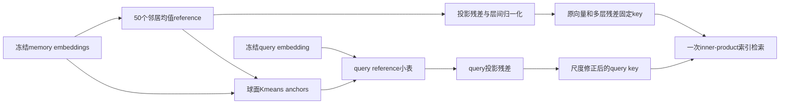

# NEAR：用相近记忆构造区分性残差

## 论文信息

| 项目 | 内容 |
| --- | --- |
| 论文链接 | [arXiv 2610.13314](https://arxiv.org/abs/2610.13314) |
| 公司/机构 | Southeast University / MemoraX AI / Leiden University / University of Sydney |
| 首次公开日期 | 2026-10-09（arXiv v1） |
| 原文开源代码 | 否：原文与官方页面未找到作者实现仓库（核查日期 2026-10-13） |
| Adapter | `near` |
| 本地复现代码 | [`src/auto_research/reproductions/near/`](https://github.com/daiwk/auto-research/tree/main/src/auto_research/reproductions/near/) |

原始上传为 2026-10-09 09:57:27 UTC。本地公式实现为 `core_mechanism`，真实冻结编码器提取与公开检索入口为 L2；不是作者九模型 LMEB 的完整重跑。

## 原始论文总结

### 背景与主要改动

记忆记录往往共享人名、话题和事件。共享内容会让无关证据的整体 embedding 高于真正包含事实的记录。NEAR 将这些近邻从干扰源变成 reference：离线为每条 memory 找近邻均值方向，去掉沿该方向的投影；查询不先检索候选，而从预计算小表得到对应 reference。

每层在归一化残差上重新计算邻域，保留原始向量与多层 scoring view。球面 K-means 将输入 memory states 聚为最多 16 个 anchor，每个 anchor 存该簇 memory reference 的归一化平均方向。查询选择最接近的 4 个 anchor，以 softmax 权重混合方向。memory 侧构造、尺度和 reference table 均不读 query 或 relevance 标签。

### 架构流程



重绘源码：[architecture.mmd](assets/architecture.mmd)；原图为[Figure 2](https://arxiv.org/html/2610.13314v1#S2.F2)，官方 HTML 内嵌图的来源见 [source-provenance.json](assets/source-provenance.json)。

### 核心公式

对 memory 或 query 输入状态 $h$ 与单位 reference $c$：

$$r=h-(h^Tc)c,\qquad h^{next}=\operatorname{unit}(r).$$

残差用于打分时可保留长度或单位化，该选择只看 development。各层尺度使用 memory–memory 的 population variance，包含自相似项：

$$\tau_\ell=\max\left(10^{-6},\sqrt{\frac1N\sum_i\operatorname{Var}_j\left[(z_i^{(\ell)})^Tz_j^{(\ell)}\right]}\right).$$

实现用 memory covariance 等价计算，避免构造全量 pairwise score。最终融合：

$$S(q,m)=s_0/\tau_0+\frac\alpha L\sum_{\ell=1}^L s_\ell/\tau_\ell.$$

将 memory view 按 $\sqrt{\alpha/L}$ 连接，将 query view 另除以对应 $\tau_\ell$，一次内积严格等于上述融合；不能再对连接向量整体归一化，否则改变原式排序。

### 论文离线与线上效果

| 原文八任务平均 | Base Recall@10 / NDCG@10 | NEAR |
| --- | --- | --- |
| Qwen3-Embedding-0.6B | 65.34 / 50.93 | 67.17 / 52.99 |
| Qwen3-Embedding-4B | 62.67 / 47.88 | 69.76 / 55.33 |
| Qwen3-Embedding-8B | 68.65 / 53.95 | 71.76 / 57.00 |

九个 embedding backbone 的平均检索指标均提高，但单任务并非都提升。LoCoMo downstream Qwen-4B accuracy 为 72.3%，较 Base +9.6 个百分点；LongMemEval 部分 backbone 有 accuracy 下降。来源：[原文 §4](https://arxiv.org/html/2610.13314v1#S4)。query latency 不含 encoder，FP32 NEAR 0.579ms、Base 0.242ms；这是质量换额外检索开销，不是提速。未报告生产线上 A/B。

## 本地复现

> **本地对照口径**：基线为同冻结 MiniLM 的原生 masked-mean pooled cosine，实验组为 NEAR 邻域残差融合；目前单 seed 小样本稳定相对提升不适用。

```bash
PYTHONPATH=src python scripts/run_oct13_memory.py --paper near \
  --raw-data /path/to/longmemeval_s_cleaned.json --model-dir /path/to/minilm \
  --device cuda --seed 42 --max-queries 100 --max-length 128 \
  --output runs/near/seed42.json
```

### 数据协议与结果

LongMemEval source 固定 `98d7416c24c778c2fee6e6f3006e7a073259d48f`，原文件 SHA256 硬编码验证；MiniLM 固定 `1110a243fdf4706b3f48f1d95db1a4f5529b4d41`，全部所用文件逐一验证。按源顺序限量，再以共享 session-ID 的连通分量做固定 train/validation/test 隔离，避免相同候选 bank 跨 split。原数据重复的 session ID 只按 ID 合并，不按答案筛选。

参数网格为 depth 1/2/3 × residual raw/unit × α 0.25/0.5/1/2/4，只以 validation NDCG 选择；test 在选择完成后评分。reference/尺度/索引接口没有 relevance 参数，答案文本不保留在模型记录中。本地用单次固定 key 的 exact inner-product 搜索，代替 HNSW，不捏造 ANN 延迟或压缩结论。

首100条的候选库会形成不足三个连通分量，默认 `--split-policy bank-disjoint` 如实报错。可显式指定 `--split-policy query-disjoint-shared-bank`：仅按 question ID 的无标签固定 hash 分60/20/20，允许共享冻结、无标签 memory encodings，但训练 query/监督、validation选择与test评分仍隔离。该替代协议固定 diagnostic、不可晋级，不声称 unseen-bank 泛化，不与严格协议合并统计，也不自动 fallback。100query 示例只有加上此显式参数才可运行。

2026-10-13 CPU smoke：首30 query、max_length64、seed42，连通分组为 train27/validation1/test2；NEAR 与 Base 的 test Recall@10 都为1，NDCG@10 都为0.6445324132，**持平，不证明提升**。选中 depth1/raw/α0.25。指标见 [cpu-smoke-seed42.json](metrics/cpu-smoke-seed42.json)；样本很小且少于三个 seed，保留 diagnostic 标记。更完整 GPU 三 seed 结果由独立 receipt 回写，不能用已有烟测替代。

### 代码映射与边界

`algorithm.py` 对应 §3 与附录 C 的残差、球面聚类、reference routing、covariance尺度和单索引融合；`data.py` 负责真实 frozen MiniLM 与完全独立的 relevance scorer；`experiment.py` 负责 validation-only 参数选择与版本化比较合同。没有重跑全 LMEB、九 backbone、downstream QA 或 quantization。`evolve_operators=[]`，不把 registry 名称当作已集成演化算子。

行为测试：`python -m pytest tests/reproductions/test_oct13_agents_jepa.py`，覆盖协方差尺度与精确 pairwise 等价、融合内积恒等、reference 标签边界和连通 bank split。
