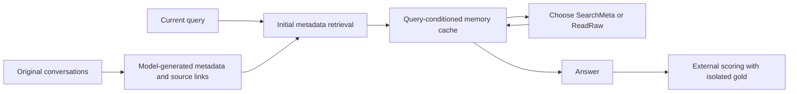
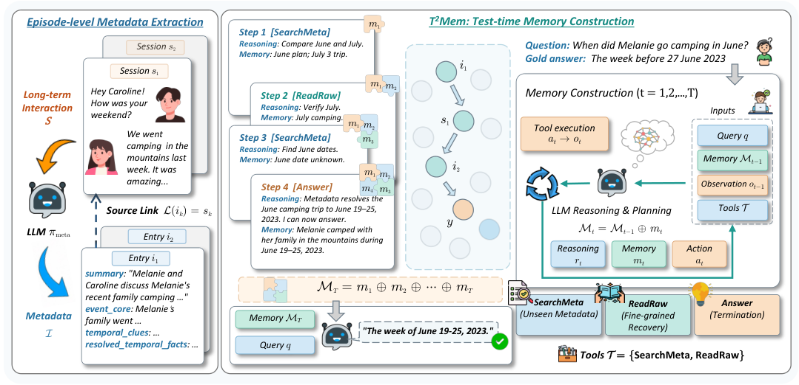

# Test-Time Memory Construction

<!-- source-sha256: bc5e92510ab6359cd80eb68ec9137cc64b472e60521adf6bb4a48e8f5b8fa288 -->

[简体中文](README.md)

> This is a core_mechanism / L1 diagnostic interface, not a reproduction of the paper's capability evaluation or an Evolve promotion candidate.

## Paper information

| Field | Value |
| --- | --- |
| Paper | [arXiv 2610.13348](https://arxiv.org/abs/2610.13348) |
| Affiliations | Northeastern University / Tsinghua University / Alibaba Group |
| First public release | 2026-10-09 (arXiv v1) |
| Author code | Yes: [T2Mem](https://github.com/OpenBMB/T2Mem). |
| Adapter | `t2mem` |
| Local implementation | [`src/auto_research/reproductions/t2mem/`](https://github.com/daiwk/auto-research/tree/main/src/auto_research/reproductions/t2mem/) |

## Original paper

### Background and contribution

Offline processing extracts only lightweight event-level metadata with links to original conversations. At inference, the model constructs a memory cache conditioned on the query, existing memory, and latest observation. It chooses SearchMeta, ReadRaw, or Answer. Memory evolves alongside information needs. See the [full paper](https://arxiv.org/html/2610.13348v1).

### Architecture



[Local diagram source](assets/architecture.mmd). The [original Figure 1](https://arxiv.org/html/2610.13348v1/model.png) depicts the paper's mechanism, not the local redraw. See [provenance](assets/source-provenance.json).

<!-- paper-figure:start -->
### Key figure from the paper

[](https://arxiv.org/html/2610.13348v1/model.png)

> **Original Figure 1:** The architecture, modules, and connections. From the [paper](https://arxiv.org/abs/2610.13348); copyright belongs to the authors.
<!-- paper-figure:end -->

### Core equations

$(r_t,m_t,a_t)=LLM(q,M_{t-1},o_{t-1},T)$ and $M_t=M_{t-1}\oplus m_t$. $SearchMeta(q)=Top_k(q,I\setminus I^{seen})$ and $ReadRaw(k)=L(i_k)=s_k$. Raw reads are restricted to metadata IDs already observed.

### Paper results

| Metric | Paper method | Baseline |
|---|---|---|
| LoCoMo average, Qwen3.5-27B | 71.69 | LazyMem 69.84 |
| LoCoMo temporal, Qwen3.5-27B | 75.70 | LazyMem 62.50 |
| LoCoMo average, Gemma4-31B | 71.30 | LazyMem 70.49 |

These are [paper](https://arxiv.org/html/2610.13348v1) results, not local measurements. No production A/B test was reported. Results across different models, datasets, scorers, or budgets are not directly comparable. The [paper results extract](assets/paper-results.json) stays outside local metrics and dashboards.

## Local reproduction

> The paper compares naive RAG and structured offline memory. The local implementation executes the mechanism, without a stable multi-seed capability comparison or claim of relative improvement.

Implementation: `src/auto_research/agent_research/oct12_memory_tools.py` and `oct12_checkpoint.py`. The thin adapter loads explicit `oct12.json` settings and injects neither fixed candidates nor gold answers.

```bash
PYTHONPATH=src python scripts/run_oct12_agents.py \
  --method t2mem --checkpoint /path/to/public/local/checkpoint --device cuda \
  --checkpoint-id OWNER/MODEL --checkpoint-revision IMMUTABLE_40_HEX_COMMIT \
  --dataset /path/to/public/input --seed 42 --rounds 2 --group-size 2 --train-steps 2 \
  --output runs/oct12/t2mem/result.json
```

### Data and implementation

Inputs are normalized LoCoMo/LongMemEval JSONL. Promotion uses validation only; test is isolated from training, and gold is available only to external scoring. Short runs report `diagnostic_only=true`, `capability_comparison=false`, and `evolve_promotion_eligible=false`. JSONL includes question, sessions, and source_revision. Optional answer is read only by the scorer after answering.

### Results and limitations

A real checkpoint generates metadata, cache entries, tool choices, and answers. Embedding retrieval excludes seen entries, and ReadRaw rejects unobserved IDs. Gold answers are never used in metadata or inference, only by the final external token-F1 scorer. Token F1 differs from the paper's LLM-judge accuracy; do not compare unmatched token budgets.

On 2026-10-12, an A100 ran the pinned Qwen2.5-0.5B checkpoint on the first two official LongMemEval questions, preserving all 53+45 conversations and two actual memory-construction steps per question. The model selected SearchMeta/ReadRaw; external token F1 was `0` on both questions. Successful execution is not successful memory retrieval.

`scripts/prepare_oct12_agent_inputs.py --kind t2mem` exports the pinned public source. See [measurements and sanitized action traces](metrics/public-agent-a100-42.json) and the [GPU receipt](../../gpu-validations/oct12-t2mem-a100.json). No conversations, gold, or raw model answers are committed. There is no formal baseline, multi-seed capability result, or Evolve promotion.

Tests: `python -m pytest tests/test_oct12_agent_algorithms.py tests/test_oct12_agent_delivery.py`.
