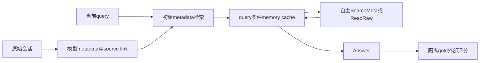

# Test-Time Memory Construction

> 当前是 core_mechanism / L1 机制诊断接口；未声称完成原论文能力复测，未接入 Evolve 晋级。

## 论文信息

| 字段 | 内容 |
|---|---|
| 论文链接 | [arXiv 2610.13348](https://arxiv.org/abs/2610.13348) |
| 公司/机构 | Northeastern University / Tsinghua University / Alibaba Group（一作 Zijun Wang） |
| 首次公开日期 | 2026-10-09（arXiv v1） |
| 原文开源代码 | 是：[T2Mem](https://github.com/OpenBMB/T2Mem) |
| Adapter | `t2mem` |
| 本地复现代码 | [`src/auto_research/reproductions/t2mem/`](https://github.com/daiwk/auto-research/tree/main/src/auto_research/reproductions/t2mem/) |

## 原始论文总结

### 背景与主要改动

离线只提取事件级轻量 metadata 并保留原会话链接。推理时依据查询、已有 memory 与最新 observation 构造 memory cache，再自主选择 SearchMeta、ReadRaw 或 Answer；memory 与信息需求交错演化。 事实来源：[原文全文](https://arxiv.org/html/2610.13348v1)。

### 架构流程



重绘源码：[architecture.mmd](assets/architecture.mmd)。[原论文 Figure 1](https://arxiv.org/html/2610.13348v1/model.png) 展示原文的整体机制；本地重绘没有替换原图作为证据。来源与核查边界见 [source-provenance.json](assets/source-provenance.json)。

### 核心公式

$(r_t,m_t,a_t)=LLM(q,M_{t-1},o_{t-1},T)$；$M_t=M_{t-1}\oplus m_t$。$SearchMeta(q)=Top_k(q,I\setminus I^{seen})$，$ReadRaw(k)=L(i_k)=s_k$；raw读取仅允许已经观察到的 metadata ID。

### 论文离线与线上效果

| 原文指标 | 原文方法 | 原文对照/协议 |
|---|---|---|
| LoCoMo average, Qwen3.5-27B | 71.69 | LazyMem 69.84 |
| LoCoMo temporal, Qwen3.5-27B | 75.70 | LazyMem 62.50 |
| LoCoMo average, Gemma4-31B | 71.30 | LazyMem 70.49 |

这些是[原论文](https://arxiv.org/html/2610.13348v1)报告值，不是本地结果；未报告生产线上 A/B。模型、数据、打分或资源协议不同，禁止直接横比。复核摘录见 [paper-results.json](assets/paper-results.json)。原文数值不进入 local metrics/dashboard。

## 本地复现

> **本地对照口径**：基线为原文 Naive RAG/structured offline memory；本地未做稳定多seed对照；实验组由当前真实实现执行；稳定相对提升不适用，尚无正式能力对照。

实现位于 `src/auto_research/agent_research/oct12_memory_tools.py / oct12_checkpoint.py`；薄 adapter 从明确的 `oct12.json` 加载运行配置，不注入默认固定候选或 gold。统一入口：

```bash
PYTHONPATH=src python scripts/run_oct12_agents.py \\
  --method t2mem --checkpoint /path/to/public/local/checkpoint --device cuda \\
  --checkpoint-id OWNER/MODEL --checkpoint-revision IMMUTABLE_40_HEX_COMMIT \\
  --dataset /path/to/public/input --seed 42 --rounds 2 --group-size 2 --train-steps 2 \\
  --output runs/oct12/t2mem/result.json
```

### 数据协议与代码映射

输入来源为 LoCoMo / LongMemEval normalized JSONL。候选/参数晋级仅在 validation，test 与训练分开；金标只进入独立外部 scoring。短运行报告 `diagnostic_only=true`、`capability_comparison=false` 与 `evolve_promotion_eligible=false`。JSONL含question、sessions、source_revision；answer可选且仅由答案产生后scorer读取。

### 结果、验证与边界

metadata、memory cache、action选择与最终答案均来自真实 checkpoint；embedding检索排除seen entries，ReadRaw不接受未观察ID。答案字段仅进入最终外部token F1 scorer，不能进入元数据或推理。该 scorer 不等同原文 LLM-judge accuracy，未做 token budget 匹配时不横比论文表格。

当前检查为 L0 合同及真梯度测试；本地 NVIDIA 运行由本批集成统一生成脱敏回执，未通过前不得写GPU已验证。CUDA metadata已声明requires_gpu_validation=true，未来回执路径为 docs/gpu-validations/oct12-t2mem-a100.json；本文不预填数值。 论文指标与本地指标严格分离；运行日志/模型权重不提交，失败与负结果保留。

测试入口：`python -m pytest tests/test_oct12_agent_algorithms.py tests/test_oct12_agent_delivery.py`。

