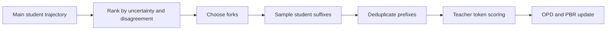
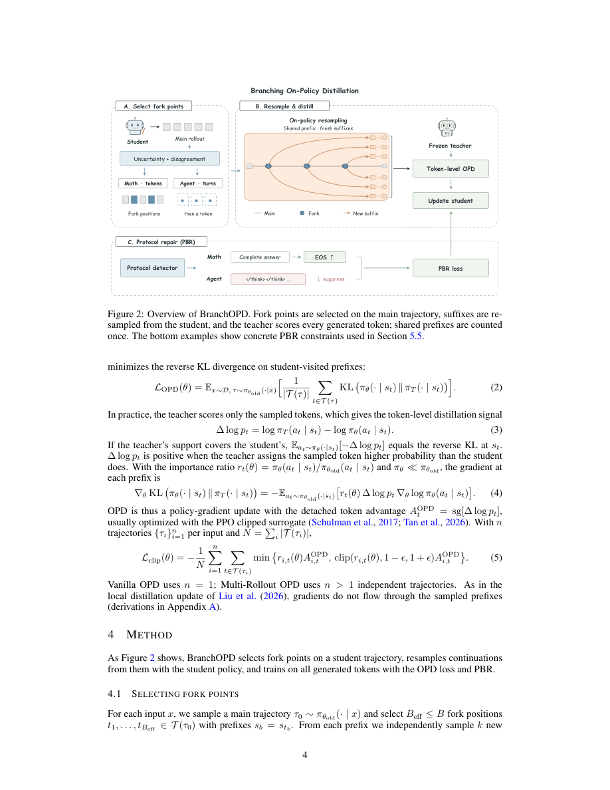

<!-- source-sha256: 791e4bb095cfe07c01c7e427b872a91864a3bfc56166f98b039dd685000a2027 -->

[简体中文](README.md) · English

# BranchOPD: Branching On-Policy Distillation

> The core mechanism runs. Short-budget checkpoint results support only a runtime diagnostic, not conclusions at paper scale.

## Paper information

| Field | Details |
| --- | --- |
| Paper | [arXiv 2610.13481](https://arxiv.org/abs/2610.13481) |
| Institutions | Tsinghua University / Peking University / SenseTime Research |
| First public release | 2026-10-09 (arXiv v1) |
| Original source code | No implementation found: the [authors' repository](https://github.com/chendy25/BranchOPD) contained only LICENSE and README on 2026-10-12. |
| Adapter | `branch-opd` |
| Local reproduction code | [`src/auto_research/reproductions/branch_opd/`](https://github.com/daiwk/auto-research/tree/main/src/auto_research/reproductions/branch_opd/) |

## Original paper summary

### Background and main changes

Ordinary OPD sees one continuation per prefix. BranchOPD identifies forks from student uncertainty and student–teacher disagreement, independently samples suffixes from the same frozen student policy, and counts the common prefix once. It also uses protocol events to supervise termination. Branches are not teacher-forced and are not filtered by answer correctness.



### Original method figure

[](https://arxiv.org/pdf/2610.13481v1#page=4)

This is the full-page capture of Figure 2 on PDF page 4, checked against the caption, method flow and text. It is not a local redraw or experiment output. From the official arXiv v1 PDF; copyright belongs to the authors.

<!-- paper-figure:start -->
### Key figure from the paper

[](https://arxiv.org/pdf/2610.13481#page=4)

> **Figure 2:** Overall design and components. From the [paper](https://arxiv.org/abs/2610.13481); copyright belongs to the authors. Click the image for the source.
<!-- paper-figure:end -->

### Core equations

$v_t=\alpha R(U_t)+(1-\alpha)R(D_t)$. $A_t=\mathrm{clip}(\mathrm{sg}[\log\pi_T(a_t|s_t)-\log\pi_\theta(a_t|s_t)],-10,10)$; $L=-\sum M_t\min(r_tA_t,\mathrm{clip}(r_t,0.8,1.2)A_t)/\sum M_t$. PBR applies $-b\log p(C|s)-(1-b)\log(1-p(C|s))$ to detected set-valued events. The local math protocol encourages EOS after a complete boxed answer.

### Offline and online results

Table 1 reports math macro avg@16 of 44.37% for BranchOPD, 38.94% for vanilla OPD+PBR, and 39.09% for 7-rollout OPD+PBR. Table 2 reports ALFWorld ID/OOD of 57.86%/55.22%. Table 11 reports generation-token savings of 19.1%/31.2% on ALFWorld/WebShop. No production A/B test is reported. The [paper-reported scalars](paper-results.json) carry `paper_reported=true` and `measured_locally=false`. They live outside the metrics directory and are not local reproduction scores.

## Local reproduction

> **Comparison protocol:** The planned baseline is single-trajectory OPD with the same student; the experimental path runs student branching, teacher scoring and PBR. No same-budget baseline ran, so stable relative improvement is not applicable.

Entry point: `PYTHONPATH=src python scripts/run_oct12_post_training.py --objective branch-opd --help`.

Supply local student and teacher checkpoint paths with public IDs and revisions, public train/validation JSONL, the dataset revision, a train-only split manifest, and an output path. The CLI neither downloads models nor uploads data. It actually trains q_proj/v_proj LoRA.

The packaged `branch-opd` adapter reads `oct12-branch-opd.json` from the data directory. Its fields map to snake_case CLI arguments. Without real checkpoint configuration it errors rather than falling back to a synthetic fixture.

### Data protocol and results

`public_holdout.validate_holdout` must verify the public source train set, revision, SHA256, record counts, normalized-question deduplication, and disjoint train/validation sets. The student gets only the question; gold never enters solver rollout or retrieval. Validation is reported after training; this short run did not tune on it. There is no test entry point or test read. Formal selection must use only train/validation.

Defaults: 3 forks × 2 continuations, shared vocabulary, top-k=0, top-p=1 and temperature=1. The short budget explicitly reduces minimum fork spacing to 1 token. It covers single-turn math only. No ALFWorld/WebShop environment snapshots or multi-turn branching were implemented.

The short-budget mechanism ran on an NVIDIA A100-SXM4-80GB at snapshot `456a2ffacc47658c4ccb74f386465d47e5f4e357`. Student: Qwen2.5-0.5B-Instruct. Frozen teacher: Qwen2.5-7B-Instruct. A pinned holdout from public GSM8K train has 6757 train / 716 validation questions. This run trained on the first 2 questions and reported the first 4 validation questions, without reading test. Seed 42, 2 optimizer steps, up to 512 output tokens and 3 forks × 2 continuations. See [gsm8k-a100-42.json](metrics/gsm8k-a100-42.json).

| Step | Loss | Gradient L2 before clipping | Valid suffix/main trajectory tokens | PBR constraints |
| --- | --- | --- | --- | --- |
| 0 | 15.453265190124512 | 22.87696075439453 | 1244 | 5 |
| 1 | 13.375693321228027 | 20.84510040283203 | 985 | 3 |

The two steps generated 12 branches with 2229 valid response tokens, excluding 458 shared-prefix tokens. There were 8 PBR constraints and LoRA parameter change L2 was 0.008337237479241007. Validation exact match was 2/4 (0.5), not a relative gain over the initial student or matched-budget OPD. Four examples and one seed cannot establish stable reasoning ability. Defaults for other objectives in unified `budget`, including priming, rounds and group, did not apply to Branch and did not run.

The [GPU receipt](../../gpu-validations/branch-opd-a100-20261012.json) binds full executed commit, public checkpoint/data revisions, raw-result SHA256, and source hashes independently computed from that commit with `git show`. `passed` establishes branching, PBR, gradients and parameter updates only for that **eager-attention snapshot**, not later SDPA, current HEAD or dirty changes. No paper-scale run, multi-turn agent benchmark or same-budget capability comparison was reproduced.

The old 128-token run is retained separately from current metrics in [historical-pbr-unexercised.json](assets/historical-pbr-unexercised.json). It generated 12 branches and updated parameters, but both steps had zero PBR and exact match on four validation examples was 0. Status `not_passed_pbr_unexercised` records failed historical mechanism validation. It is neither the 512-token run nor a matched baseline. The old raw SHA256 is retained without inventing an unrecorded commit.

### Portable execution command

Use the executed snapshot and repository environment above. Replace placeholders with local public checkpoint caches and holdout files verified against receipt hashes. The runner does not download models. If not overridden, the snapshot defaults are learning rate 1e-5, PBR weight 1, and minimum fork gap 1.

```bash
PYTHONPATH=src python scripts/run_oct12_post_training.py \
  --objective branch-opd \
  --student-path '<student-checkpoint-cache>' \
  --student-id Qwen/Qwen2.5-0.5B-Instruct \
  --student-revision 7ae557604adf67be50417f59c2c2f167def9a775 \
  --teacher-path '<teacher-checkpoint-cache>' \
  --teacher-id Qwen/Qwen2.5-7B-Instruct \
  --teacher-revision bb46c15ee4bb56c5b63245ef50fd7637234d6f75 \
  --train-path '<public-train-jsonl>' \
  --validation-path '<public-validation-jsonl>' \
  --split-manifest '<public-split-manifest>' \
  --dataset-revision 3101c7d5072418e28b9008a6636bde82a006892c \
  --output '<output-json>' --device cuda --seed 42 --steps 2 \
  --validation-examples 4 --max-tokens 512 --forks 3 --continuations 2
```

### Code map and limits

`branch_forks / branch_loss / protocol_boundary_loss` implement selection, OPD and PBR. `branch_step` freezes each sampling group, samples suffixes from shared prefixes and updates LoRA.

See [contract and behavioral tests](https://github.com/daiwk/auto-research/blob/main/tests/test_oct12_post_training.py). A small causal model checks actual gradients, prefix masking, reference recovery, boundary updates and gold isolation, not reasoning ability. Paper-scale data/models and long-reasoning budgets, multi-seed matched capability controls, production and Evolve controller integration remain unimplemented.
