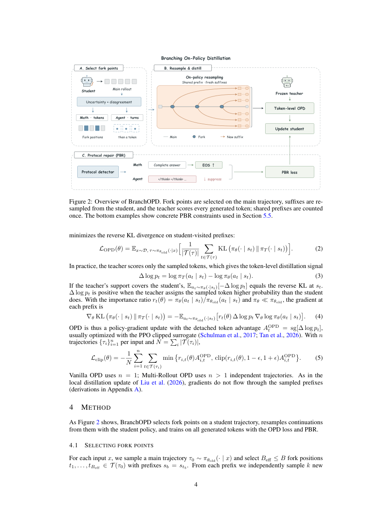

# branch-opd：Branching On-Policy Distillation

> 核心机制代码路径；短预算 checkpoint 结果只支持 runtime 诊断，不支持论文规模能力结论。

## 论文信息

| 字段 | 内容 |
|---|---|
| 论文链接 | [arXiv v1](https://arxiv.org/abs/2610.13481v1) / [全文](https://arxiv.org/html/2610.13481v1) |
| 公司 / 机构 | Tsinghua University / Peking University / SenseTime Research |
| 首次公开日期 | 2026-10-09（arXiv v1） |
| 原作者代码 | [上游仓库](https://github.com/chendy25/BranchOPD)；实现未发布，检查时仅 LICENSE/README |
| 本地 adapter / 方法（Adapter） | `branch-opd` |
| 本地复现代码 | [packaged adapter](../../../src/auto_research/reproductions/branch_opd/adapter.py)、[objectives](../../../src/auto_research/post_training/oct12_objectives.py)、[checkpoint runner](../../../src/auto_research/post_training/oct12_checkpoint.py) |

## 原始论文总结

### 背景与主要改动

普通 OPD 每个前缀只看到一次后续。BranchOPD 用学生不确定性和师生分歧定位 fork，从同一冻结学生策略独立采样 suffix，前缀只计入一次；并用协议事件监督结束行为。分枝不是教师强制 token，也不按答案正确性筛选。

### 原论文关键图

原版 PDF 第 4 页 Figure 2 全页截图，已检查图题、算法流程与正文，非本地重绘或实验产物。版权归原作者；截图来源为官方 arXiv PDF v1。

### 核心公式

$v_t=\alpha R(U_t)+(1-\alpha)R(D_t)$。$A_t=\mathrm{clip}(\mathrm{sg}[\log\pi_T(a_t|s_t)-\log\pi_\theta(a_t|s_t)],-10,10)$；$L=-\sum M_t\min(r_tA_t,\mathrm{clip}(r_t,0.8,1.2)A_t)/\sum M_t$。PBR 对检测到的集合事件使用 $-b\log p(C|s)-(1-b)\log(1-p(C|s))$，本地数学协议在完整 boxed answer 后鼓励 EOS。

### 论文离线与线上效果

论文 Table 1：数学 avg@16 宏平均 BranchOPD 44.37%，Vanilla OPD+PBR 38.94%，7-rollout OPD+PBR 39.09%。Table 2：ALFWorld ID/OOD 为 57.86%/55.22%。Table 11 测得 ALFWorld/WebShop 生成 token 节约 19.1%/31.2%。未报告线上 A/B。 原论文标量摘录见 [paper-results.json](paper-results.json)，`paper_reported=true`、`measured_locally=false`；独立存放于非 metrics 目录，不能作为本地复现指标。

## 本地复现

入口：`PYTHONPATH=src python scripts/run_oct12_post_training.py --objective branch-opd --help`。

必须提供本地 student/teacher checkpoint 路径与公开 ID/revision、公开 train/validation JSONL、dataset revision、train-only split manifest 和 output 路径。 CLI 不下载模型，不上传数据，实际训练 q_proj/v_proj LoRA。

`branch-opd` packaged adapter 读取数据目录中的 `oct12-branch-opd.json`，字段对应 CLI 的 snake_case 参数；没有真实 checkpoint 配置时明确报错，不回退到合成 fixture。

### 数据协议与结果

必须复用 `public_holdout.validate_holdout` 校验公开 source train、revision、文件 SHA256、条数、规范化 question 去重及 train/validation 不重叠。学生生成只接收问题；gold 不进入 solver rollout/retrieval。validation 仅训练后报告，本短跑没有据 validation 选超参；test 无入口且不读取。正式实验的选参必须仅使用 train/validation。

默认 3 forks×2 continuations；同词表，top-k=0/top-p=1/temperature=1。短预算的最小 fork 间隔为 1 token（显式预算差异）。仅数学单 turn；没有实现 ALFWorld/WebShop 环境快照与多 turn 分枝，不能声称 agent benchmark 复现。

目前未完成真实 NVIDIA A100/A30 执行，GPU gate 尚未通过；不写本地稳定指标或伪造 receipt。运行保存真实 loss/token 数/参数变化/validation 口径和角色 revisions；少量截断响应、单 seed 只能支持 L1 runtime smoke。planned receipt：`docs/gpu-validations/branch-opd-a100-20261012.json`，须由真实执行生成。

### 代码映射与复现边界

`branch_forks / branch_loss / protocol_boundary_loss` 对应选择、OPD 和 PBR；`branch_step` 实际冻结采样组、共享前缀 suffix 采样与 LoRA 更新。

契约与行为测试：[test_oct12_post_training.py](../../../tests/test_oct12_post_training.py)。小因果模型测试仅验证真实梯度、masked prefix、参考恢复、边界更新及 gold 隔离；不是 reasoning 能力比较。尚未完成论文规模数据/模型/长推理预算、多 seed 同预算能力对照、线上系统或 Evolve 控制器集成。
