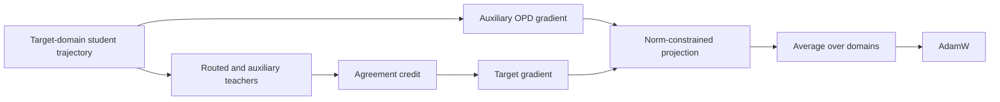
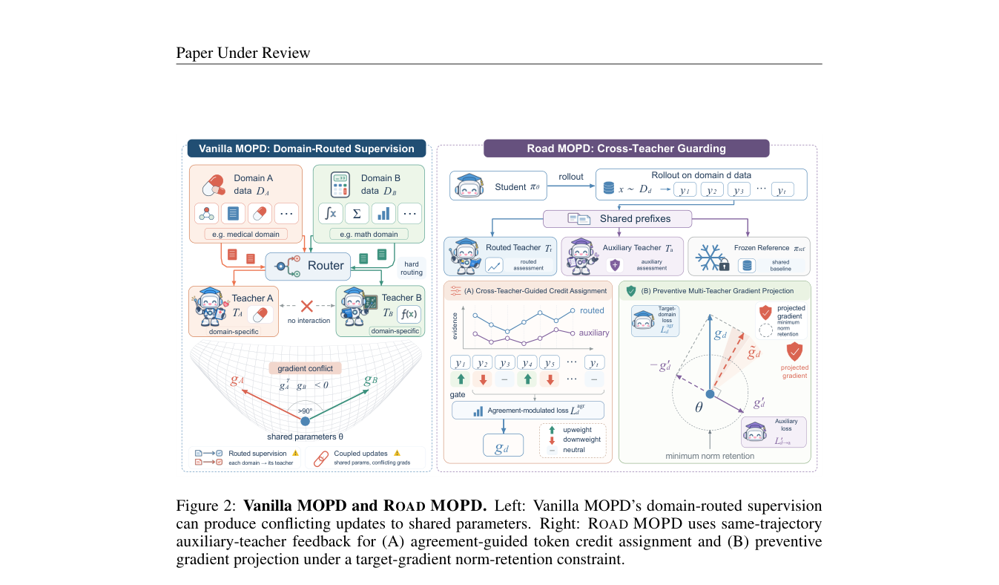

# Road-MOPD: Cross-teacher guarding for multi-teacher on-policy distillation

<!-- source-sha256: 5b86fb9b789ecd0aff99ad7272b4731214b616d5cd33855ae94f3bc0af45a041 -->

[简体中文](README.md)

> Core mechanism implementation. Short-budget checkpoint evidence supports only a runtime diagnostic, not paper-scale capability claims.

## Paper information

| Field | Value |
| --- | --- |
| Paper | [arXiv 2610.13521](https://arxiv.org/abs/2610.13521) |
| Affiliations | Nanjing University / JD.com |
| First public release | 2026-10-09 (arXiv v1) |
| Author code | No public implementation found as of 2026-10-12 |
| Adapter | `road-mopd` |
| Local implementation | [src/auto_research/reproductions/road_mopd/](https://github.com/daiwk/auto-research/tree/main/src/auto_research/reproductions/road_mopd/) |

## Original paper

### Motivation and method

Routing each domain to its own teacher does not prevent updates to shared parameters from harming other capabilities. Road uses the non-routed teacher to obtain compatibility evidence on the same student trajectory in the target domain. It adjusts token credit, computes an actual auxiliary gradient, and projects the target gradient while retaining a lower bound on its norm.



### Original paper figure

[](https://arxiv.org/pdf/2610.13521v1#page=4)

This is the full-page capture of Figure 2 on page 4 of the official v1 PDF. The HTML figure numbering differs; the PDF controls. The caption, algorithm flow, and surrounding text were checked. The capture is not a local redraw or experiment result. Copyright belongs to the original authors.

### Core equations

$s_t=\tanh((\ell_t^r-\ell_t^{ref})/\tau)\tanh((\ell_t^a-\ell_t^{ref})/\tau)$ and $\lambda_t=\mathrm{clip}(1+\rho_gs_t,\lambda_{min},\lambda_{max})$. The target credit is $\lambda_t(\ell_t^r-\ell_t^{ref})-(\ell_t^\theta-\ell_t^{ref})$. When the gradients conflict, $\tilde g=g-\alpha\langle g,g'\rangle g'/\|g'\|^2$; choose the largest feasible $\alpha\in[0,1]$ such that $\|\tilde g\|\ge m\|g\|$.

### Paper-reported results

For Math×Medical with Qwen3-4B, Table 1 reports 42.71% overall for Vanilla MOPD and 47.92% for Road. Mean Medical performance increases from 39.45% to 48.23%. The paper also reports low-conflict and three-domain settings. These capability results do not follow from locally checking the equations. The paper reports no online A/B test. Extracted [paper results](paper-results.json) are marked `paper_reported=true` and `measured_locally=false` and deliberately stored outside the metrics directory.

## Local reproduction

> The reference is multi-teacher OPD without projection; the intervention uses domain-specific teacher routing and per-tensor preventive projection. The small public arithmetic run is a mechanism diagnostic, so a stable relative gain is not applicable.

Entry point: `PYTHONPATH=src python scripts/run_oct12_post_training.py --objective road-mopd --help`.

Supply local student and teacher checkpoint paths, public IDs and revisions, public train and validation JSONL, a dataset revision, a train-only split manifest, and an output path. The auxiliary teacher also needs a path, ID, and revision. The CLI downloads no model and uploads no data. It trains actual q_proj/v_proj LoRA parameters.

The packaged `road-mopd` adapter reads `oct12-road-mopd.json` in the dataset directory. Keys correspond to snake_case CLI arguments. Missing real checkpoint configuration is an error, not a reason to fall back to synthetic fixtures.

### Data protocol and measured results

`public_holdout.validate_holdout` verifies the public source train split and revision, file SHA256 values, row counts, uniqueness after question normalization, and no train/validation overlap. The student generates from questions only; gold answers do not enter solver rollouts or retrieval. Validation is reported after training and was not used to tune this short run. No test entry point exists or reads test data. Formal hyperparameter selection must use train and validation only.

The local path requires exactly 2 explicit domains, distinct frozen teacher identities, and identical token identities. Domain strings sort so the first routes to the primary teacher and the second to the auxiliary teacher; the other teacher acts as the non-routed critic. The default norm retention is m=0.6 and advantage clipping is [-10,10], following the paper. Arbitrary shards of one dataset are not a reproduction of Math×Medical capability.

The actual two-domain runtime ran on an NVIDIA A100-SXM4-80GB at `456a2ffacc47658c4ccb74f386465d47e5f4e357`. [Local metrics](metrics/gsm8k-subdomains-a100-42.json) record seed 42, 2 optimizer steps, and at most 128 generated tokens per response. Losses were 0.16703900694847107 / 0.28455048939213157, with pre-clip gradient L2 norms 1.0818610191345215 / 1.1292130947113037 and 512 valid response tokens. Conflict and projection counts were 0 at step 0 and 39 at step 1. LoRA parameter-change L2 was 0.007815992363012461. Exact match on 4 validation problems was 0; the failure remains in the record.

The 6757/716 holdout uses the original public GSM8K train split and assigns two arithmetic subdomains using monetary terms in the **question** only, preserving each original question, answer, and partition. Monetary-arithmetic routes to an independently frozen Qwen2.5-7B and nonmonetary-arithmetic to an independently frozen Qwen2.5-0.5B; the latter starts from the same checkpoint as the student. These are not the original Math/Medical specialists and there is no equal-budget capability control. The logs do not separately measure how non-neutral token agreement was. The 39 projections cannot establish credit modulation strength, cross-domain capability protection, or accuracy gains.

A JSONL read failure caused by Unicode line separators was not counted as training. This run used an LF-delimited export with `ensure_ascii=True`, which does not change decoded text. The train and validation SHA256 values match the new data hashes in the result; see `data_transformation`. Default branching or priming parameters inherited from other objectives in the shared budget do not indicate that those algorithms ran.

The [GPU receipt](../../gpu-validations/road-mopd-a100-20261012.json) binds the executed commit, public model and data revisions, raw-result SHA256, and hashes from `git show` for 8 source files including data preparation. `passed` establishes only that credit computation, auxiliary gradients, projection, and parameter updates ran on that eager-attention snapshot. It does not cover later SDPA or current HEAD changes or establish paper-scale capability.

### Reproducible command

Use the stated snapshot and project environment with verified local caches and two-subdomain holdout files. The snapshot defaults are learning rate 1e-5 and retention 0.6.

```bash
PYTHONPATH=src python scripts/run_oct12_post_training.py \
  --objective road-mopd \
  --student-path '<student-checkpoint-cache>' \
  --student-id Qwen/Qwen2.5-0.5B-Instruct \
  --student-revision 7ae557604adf67be50417f59c2c2f167def9a775 \
  --teacher-path '<teacher-checkpoint-cache>' \
  --teacher-id Qwen/Qwen2.5-7B-Instruct \
  --teacher-revision bb46c15ee4bb56c5b63245ef50fd7637234d6f75 \
  --auxiliary-path '<auxiliary-checkpoint-cache>' \
  --auxiliary-id Qwen/Qwen2.5-0.5B-Instruct \
  --auxiliary-revision 7ae557604adf67be50417f59c2c2f167def9a775 \
  --train-path '<public-train-jsonl>' \
  --validation-path '<public-validation-jsonl>' \
  --split-manifest '<public-split-manifest>' \
  --dataset-revision 3101c7d5072418e28b9008a6636bde82a006892c \
  --output '<output-json>' --device cuda --seed 42 --steps 2 \
  --validation-examples 4 --max-tokens 128
```

### Code mapping and limits

`road_credit / preventive_projection` corresponds to Eqs. 4–9. `road_step` calls real `autograd.grad` per domain. The auxiliary loss constrains the target gradient on the same trajectory rather than optimizing the auxiliary gradient; projected target gradients are then averaged.

[Contract and behavior tests](https://github.com/daiwk/auto-research/blob/main/tests/test_oct12_post_training.py) use a small causal model to verify real gradients, masked prefixes, reference recovery, boundary updates, and gold isolation. They do not compare reasoning capability. Paper-scale data, models, and long-reasoning budgets, an equal-budget multi-seed capability comparison, online deployment, and Evolve integration remain out of scope.
