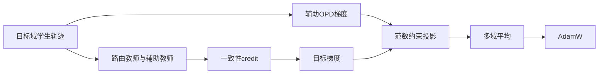
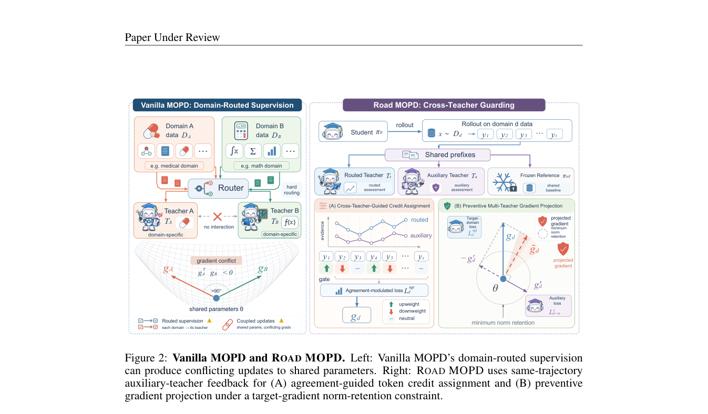

# road-mopd：Beyond Domain-Routed Supervision: Cross-Teacher Guarding for Multi-Teacher On-Policy Distillation

> 核心机制代码路径；短预算 checkpoint 结果只支持 runtime 诊断，不支持论文规模能力结论。

## 论文信息

| 项目 | 内容 |
| --- | --- |
| 论文链接 | [arXiv 2610.13521](https://arxiv.org/abs/2610.13521) |
| 公司/机构 | Nanjing University / JD.com |
| 首次公开日期 | 2026-10-09（arXiv v1） |
| 原文开源代码 | 否：未找到原作者公开实现（2026-10-12 核查） |
| Adapter | `road-mopd` |
| 本地复现代码 | [`src/auto_research/reproductions/road_mopd/`](https://github.com/daiwk/auto-research/tree/main/src/auto_research/reproductions/road_mopd/) |

## 原始论文总结

### 背景与主要改动

多域只路由各自教师，不能防止共享参数更新损害其他能力。Road 用未路由教师在当前目标域的同一学生轨迹上给出兼容性证据，调节 token credit，再求真实辅助梯度，投影目标梯度但保留其范数下限。



### 原论文关键图

[](https://arxiv.org/pdf/2610.13521v1#page=4)

原版 PDF 第 4 页 Figure 2（HTML 标号与 PDF 不同，以 PDF 为准） 全页截图，已检查图题、算法流程与正文，非本地重绘或实验产物。版权归原作者；截图来源为官方 arXiv PDF v1。

<!-- paper-figure:start -->
### 原论文关键图

[](https://arxiv.org/pdf/2610.13521#page=4)

> **原论文 Figure 2（关键图）**：展示原论文方法的总体设计和关键组成。图片来自[原论文](https://arxiv.org/abs/2610.13521)，版权归原作者所有；点击图片可查看来源。
<!-- paper-figure:end -->

### 核心公式

$s_t=\tanh((\ell_t^r-\ell_t^{ref})/\tau)\tanh((\ell_t^a-\ell_t^{ref})/\tau)$，$\lambda_t=\mathrm{clip}(1+\rho_gs_t,\lambda_{min},\lambda_{max})$。目标 credit 为 $\lambda_t(\ell_t^r-\ell_t^{ref})-(\ell_t^\theta-\ell_t^{ref})$。冲突时 $\tilde g=g-\alpha\langle g,g'\rangle g'/\|g'\|^2$；取可行最大 $\alpha\in[0,1]$，满足 $\|\tilde g\|\ge m\|g\|$。

### 论文离线与线上效果

原文 Table 1 Math×Medical / Qwen3-4B：Vanilla MOPD 综合 42.71%，Road 47.92%；Medical 域平均从 39.45% 到 48.23%。论文也报告低冲突与三域设置；本地不据公式证明这些能力结论。未报告线上 A/B。 原论文标量摘录见 [paper-results.json](paper-results.json)，`paper_reported=true`、`measured_locally=false`；独立存放于非 metrics 目录，不能作为本地复现指标。

## 本地复现

> **本地对照口径**：基线为不投影的多教师OPD，实验组执行按域teacher路由与逐tensor预防式梯度投影；小型公开算术域运行是机制诊断，稳定相对提升不适用。

入口：`PYTHONPATH=src python scripts/run_oct12_post_training.py --objective road-mopd --help`。

必须提供本地 student/teacher checkpoint 路径与公开 ID/revision、公开 train/validation JSONL、dataset revision、train-only split manifest 和 output 路径。还需 auxiliary 的 path/ID/revision。 CLI 不下载模型，不上传数据，实际训练 q_proj/v_proj LoRA。

`road-mopd` packaged adapter 读取数据目录中的 `oct12-road-mopd.json`，字段对应 CLI 的 snake_case 参数；没有真实 checkpoint 配置时明确报错，不回退到合成 fixture。

### 数据协议与结果

必须复用 `public_holdout.validate_holdout` 校验公开 source train、revision、文件 SHA256、条数、规范化 question 去重及 train/validation 不重叠。学生生成只接收问题；gold 不进入 solver rollout/retrieval。validation 仅训练后报告，本短跑没有据 validation 选超参；test 无入口且不读取。正式实验的选参必须仅使用 train/validation。

本地支持恰好 2 个显式 domain、不同 frozen teacher 身份、完全一致 token identities。domain 按字符串排序：第一域→teacher，第二域→auxiliary；另一位是非路由 critic。默认范数保留 m=0.6、advantage clipping=[-10,10]，沿原文配置。不得把同一 dataset 的任意分片写成论文 Math×Medical 能力复现。

已完成 NVIDIA A100-SXM4-80GB 的真实两域 runtime 执行，快照为 `456a2ffacc47658c4ccb74f386465d47e5f4e357`。本地测量见 [gsm8k-subdomains-a100-42.json](metrics/gsm8k-subdomains-a100-42.json)：seed 42、2 optimizer steps、每次最多 128 输出 token；两步 loss 为 0.16703900694847107 / 0.28455048939213157，裁剪前梯度 L2 为 1.0818610191345215 / 1.1292130947113037，有效响应 token 共 512。第 0 步 conflict/projection 均为 0，第 1 步均为 39；LoRA 参数变化 L2 为 0.007815992363012461。4 题 validation exact match 为 0，未改写失败结果。

公开 GSM8K 原 train 的 6757/716 holdout 只按 **question** 中 monetary term 标注两个算术子域，原 question/answer 和分区逐条保留。monetary-arithmetic 路由到独立冻结 Qwen2.5-7B，nonmonetary-arithmetic 路由到独立冻结 Qwen2.5-0.5B；后者与学生初始化来自同一 checkpoint。这不是原文专科 Math/Medical teachers，也没有同预算 capability 对照。日志没有单独记录 token agreement coefficient 的非中性程度，不能以 39 次梯度投影宣称 credit 调制强度、跨域能力保护或准确率收益已经得到验证。

原 Unicode 行分隔符导致的 JSONL 读取失败没有当成训练结果；本次使用 LF-delimited、`ensure_ascii=True` 的重新导出数据，转义不改变解码文本。其 train/validation SHA256 与原始结果中的新数据摘要相符，详见 metrics 的 `data_transformation`。原始统一 budget 中其它 objective 的分枝/priming 等默认项不表示本次执行了那些算法。

[GPU 回执](../../gpu-validations/road-mopd-a100-20261012.json) 绑定实际执行 commit、公开模型/数据 revisions、原始结果 SHA256 和该 commit 的 8 份源码 `git show` 哈希（含数据准备脚本）。`passed` 只表示该 eager-attention 快照的真实 credit 计算、辅助梯度和投影/参数更新路径运行完成，不覆盖后续 SDPA/current HEAD 修改，不是论文规模或稳定能力结论。

### 可移植执行命令

在上述快照与仓库环境中，替换已核验的本地缓存和两算术子域 holdout 占位路径；learning rate=1e-5、retention=0.6 使用该快照默认。

```bash
PYTHONPATH=src python scripts/run_oct12_post_training.py \
  --objective road-mopd \
  --student-path '<student-checkpoint-cache>' \
  --student-id Qwen/Qwen2.5-0.5B-Instruct \
  --student-revision 7ae557604adf67be50417f59c2c2f167def9a775 \
  --teacher-path '<teacher-checkpoint-cache>' \
  --teacher-id Qwen/Qwen2.5-7B-Instruct \
  --teacher-revision bb46c15ee4bb56c5b63245ef50fd7637234d6f75 \
  --auxiliary-path '<auxiliary-checkpoint-cache>' \
  --auxiliary-id Qwen/Qwen2.5-0.5B-Instruct \
  --auxiliary-revision 7ae557604adf67be50417f59c2c2f167def9a775 \
  --train-path '<public-train-jsonl>' \
  --validation-path '<public-validation-jsonl>' \
  --split-manifest '<public-split-manifest>' \
  --dataset-revision 3101c7d5072418e28b9008a6636bde82a006892c \
  --output '<output-json>' --device cuda --seed 42 --steps 2 \
  --validation-examples 4 --max-tokens 128
```

### 代码映射与复现边界

`road_credit / preventive_projection` 对应 Eq. 4-9；`road_step` 每域真实 `autograd.grad`，辅助损失只约束同轨迹目标梯度，不额外优化辅助梯度，然后平均投影目标梯度。

契约与行为测试：[test_oct12_post_training.py](https://github.com/daiwk/auto-research/blob/main/tests/test_oct12_post_training.py)。小因果模型测试仅验证真实梯度、masked prefix、参考恢复、边界更新及 gold 隔离；不是 reasoning 能力比较。尚未完成论文规模数据/模型/长推理预算、多 seed 同预算能力对照、线上系统或 Evolve 控制器集成。
