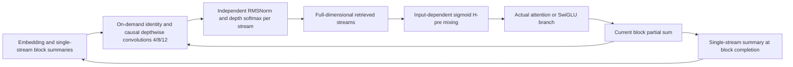
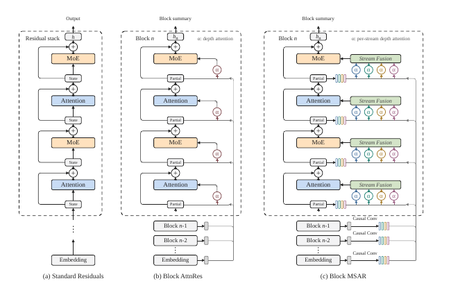

# MSAR: Multi-stream attention residuals across depth

<!-- source-sha256: 7a5425c5ac9f4dc06ba5beebfd37ccaa46244fbff6d27c10defab6b380534f07 -->

[简体中文](README.md)

## Paper information

| Field | Value |
| --- | --- |
| Paper | [arXiv 2610.13630](https://arxiv.org/abs/2610.13630) |
| Affiliations | Shanghai Jiao Tong University / Shanghai Innovation Institute / Xiaohongshu / Peking University |
| First public release | 2026-10-09 (arXiv v1) |
| Author code | The [author-provided repository](https://github.com/jianke0604/MSAR) returned 404 on 2026-10-12; no usable author source was found. |
| Adapter | `msar` |
| Local implementation | [`src/auto_research/reproductions/msar/`](https://github.com/daiwk/auto-research/tree/main/src/auto_research/reproductions/msar/) |

Local evidence is `core_mechanism / L1`. Actual A100 validation for three seeds is separate from paper-reported numbers.

## Original paper

### Motivation and method

Standard residuals compress earlier updates into one accumulated vector. AttnRes retrieves by layer but uses one depth-attention stream. MSAR retains each complete hidden vector, creates full-dimensional views at multiple scales using sequence context, and applies a separate depth softmax for each stream. Unlike channel-splitting heads, it does not split the value representation.

Block MSAR persists only the embedding, single-stream summaries of completed blocks, and the current block's partial sum. Views are expanded when consumed, not written back persistently. Causal convolution kernels of sizes 4/8/12 and an identity stream make four streams. An input-dependent sigmoid scalar mixer reduces the retrieved views to one stream.



[](https://arxiv.org/pdf/2610.13630v1)

[Figure 2 on page 7 of the v1 PDF](https://arxiv.org/pdf/2610.13630v1) confirms convolution after the single-stream summary, retrieval over the current partial sum, and no next expansion at the top layer. The authors' image is separate from the local redraw and is not a local run curve.

### Core equations

Each view of source $v_i$ retains the full $d$ dimensions:

$$
v^{(0)}_{i,t}=v_{i,t},\quad v^{(r)}_{i,t}=\sum_{\delta=0}^{\kappa_r-1}c_{i,r,\delta}\odot v_{i,t-\delta}.
$$

Depth retrieval and lightweight fusion are:

$$
\alpha^{(r)}_{i\to l}=\operatorname{softmax}_i\big((w_l^{(r)})^\top\operatorname{RMSNorm}(v_i^{(r)})\big),\quad z_l^{(r)}=\sum_i\alpha^{(r)}_{i\to l}v_i^{(r)}.
$$

$$
H_l^{\rm pre}=\sigma\big(a_l\operatorname{RMSNorm}(\operatorname{Flatten}(Z_l))W_l+b_l\big),\quad h_l=\sum_r H_{l,r}^{\rm pre}z_l^{(r)}.
$$

The final mixer uses sigmoid, not a stream softmax; depth weights within each stream sum to one. A block summary is $b_n=\sum_{j\in B_n}f_j(h_j)$. The first branch has no partial sum; adding a zero source would change the softmax denominator. See [Sections 3.2–3.3](https://arxiv.org/html/2610.13630v1#S3).

### Paper-reported results

| Setting | Vanilla | AttnRes | MSAR |
| --- | ---: | ---: | ---: |
| 18B MoE, 12-task mean, Table 1 | 37.5 | 41.8 | 45.7 |
| 28B MoE, 12-task mean, Table 1 | 44.6 | 49.4 | 52.4 |
| Iso-loss compute speedup relative to Vanilla | 1.00× | 1.35× | 1.58× |

At 28B the authors report 0.3% more active parameters and 0.5% more training FLOPs. These are the [paper's large-scale experiments](https://arxiv.org/html/2610.13630v1#S4). No online A/B is reported; offline pretraining does not imply a production traffic lift.

## Local reproduction

> The control is a matched, real dense causal Transformer; the intervention is MSAR. This is a mechanism diagnostic, not an estimate of a stable relative gain from a few steps or a single seed.

Actual trainable autoregressive attention and SwiGLU execute, without substituting a Markov transition, fixed prior, or numerical fixture for the model. WikiText-2 official train/validation/test remain separate, and the UTF-8 byte vocabulary is fixed at 256 without fitting on test. Both arms default to width 64, 2 layers, 40 steps, and identical train batches. Only single-stream summaries persist; expanded views are consumed for the current read.

```bash
PYTHONPATH=src python scripts/run_oct12_foundation.py --paper msar \
  --device cuda --seed 42 --steps 40 --width 64 --layers 2 \
  --sequence-length 64 --train-bytes 32768 --eval-bytes 4096 \
  --dataset-dir data/oct12-wikitext --output runs/oct12/msar-s42
```

### Data protocol and offline mirror

The data is [Salesforce/wikitext](https://huggingface.co/datasets/Salesforce/wikitext), revision `b08601e04326c79dfdd32d625aee71d232d685c3`, configuration `wikitext-2-raw-v1`. Byte counts and SHA256 values for each split are recorded. The budget is fixed; test does not select depth, steps, or hyperparameters.

`scripts/prepare_oct12_public_sources.py --source wikitext` exports a small official mirror. The mirror must contain `provenance.json` and hashes covering all three text files. Identity, version, and bytes are checked; unrelated historical data is not relabeled as that revision.

### Measured results

A100 runs on 2026-10-12 used seeds 42/43/44, 40 steps per arm, width 64 and 2 layers. Test byte NLL was 3.23254 ± 0.01263 for the baseline and 3.20308 ± 0.01081 for MSAR (mean ± sample standard deviation). Parameter counts were 180,544 and 190,292 respectively, so steps but not parameter counts matched. The 32 KiB train and 4 KiB validation/test prefixes are mechanism diagnostics, not reproduction of large-model gains.

See [metrics](metrics/wikitext-a100-seeds42-44.json) and the [sanitized GPU receipt](../../gpu-validations/oct12-msar-a100.json). Budget and splits were fixed in advance; test was not used for selection.

### Code mapping and limits

| Mechanism | Code |
| --- | --- |
| Causal multiscale full-dimensional views | `foundation_models/oct12_mechanisms.py::SourceExpansion` |
| Depth softmax and sigmoid fusion | `DepthRead` |
| Single-stream block summaries and real LM training | `MSARLM`, `reproductions/oct12_foundation_multimodal.py` |
| Interface, causality, and gradient tests | `tests/test_oct12_foundation_mechanisms.py` |

The original MoE, trillions of tokens, pipeline communication, two-phase batch reads, and fused CUDA kernels are not reproduced. The reference implementation preserves the mechanism but does not substantiate paper FLOPs, throughput, or 18B/28B benchmarks. The mini-LM was initialized from scratch, not with public pretrained author weights. No Evolve operator is claimed without actual controller execution.
