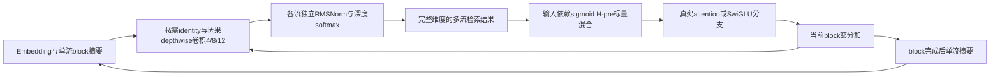
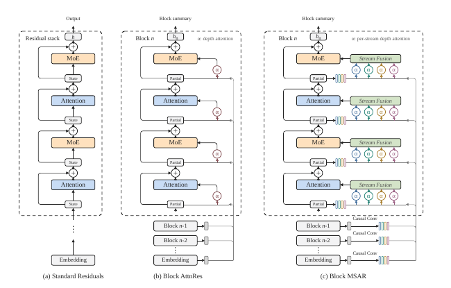

# MSAR：多流深度注意力残差

## 论文信息

| 项目 | 内容 |
| --- | --- |
| 论文链接 | [arXiv 2610.13630](https://arxiv.org/abs/2610.13630) |
| 公司/机构 | Shanghai Jiao Tong University / Shanghai Innovation Institute / Xiaohongshu / Peking University |
| 首次公开日期 | 2026-10-09（arXiv v1） |
| 原文开源代码 | 否：作者提供 https://github.com/jianke0604/MSAR，但2026-10-12核查404，未找到可用作者源码 |
| Adapter | `msar` |
| 本地复现代码 | [`src/auto_research/reproductions/msar/`](https://github.com/daiwk/auto-research/tree/main/src/auto_research/reproductions/msar/) |

本地等级为 `core_mechanism / L1`。已完成 A100 三 seed 机制验证；原文数字与本地实测分开。

## 原始论文总结

### 背景与主要改动

标准残差把历史更新压成一个累加向量；AttnRes 能逐层检索，但只有一个深度注意力流。MSAR 保留每个完整 hidden 向量，用序列上下文产生不同尺度的完整视图，再对每个流独立做深度 softmax。与切分通道的多头不同，它不破坏 value 的全维表示。

Block MSAR 只持久保存 embedding、已完成 block 的单流摘要和当前 block 的部分和，消费时再展开；不会把所有卷积视图永久写回。卷积 kernel 为 4/8/12，加 identity 流共四流；检索后用输入依赖 sigmoid 标量 mixer 合回单流。



原图检查：已阅读 [v1 PDF](https://arxiv.org/pdf/2610.13630v1) 第 7 页 Figure 2；确认卷积发生在单流摘要之后，当前部分和也参与检索，顶层不再做下一次流展开。下图是原图截图，不是本地运行曲线。

<!-- paper-figure:start -->
### 原论文关键图

[](https://arxiv.org/pdf/2610.13630v1)

图片来自[原论文](https://arxiv.org/pdf/2610.13630v1)第7页Figure2，版权归原作者所有；已人工核对，与上述Mermaid重绘分开。
<!-- paper-figure:end -->

### 核心公式

对 source $v_i$，各流保留完整 $d$ 维：

$$
v^{(0)}_{i,t}=v_{i,t},\quad v^{(r)}_{i,t}=\sum_{\delta=0}^{\kappa_r-1}c_{i,r,\delta}\odot v_{i,t-\delta}.
$$

深度检索与轻量融合分别为：

$$
\alpha^{(r)}_{i\to l}=\operatorname{softmax}_i\big((w_l^{(r)})^\top\operatorname{RMSNorm}(v_i^{(r)})\big),\quad z_l^{(r)}=\sum_i\alpha^{(r)}_{i\to l}v_i^{(r)}.
$$

$$
H_l^{\rm pre}=\sigma\big(a_l\operatorname{RMSNorm}(\operatorname{Flatten}(Z_l))W_l+b_l\big),\quad h_l=\sum_r H_{l,r}^{\rm pre}z_l^{(r)}.
$$

这里最后一层 mixer 是 sigmoid 而不是 stream softmax；每个流的 depth 权重才必须和为一。Block 摘要为 $b_n=\sum_{j\in B_n}f_j(h_j)$，当前 partial 在 block 首分支不存在，不能额外加入一个零 source 改变 softmax 分母。公式来源：[原文 §3.2–3.3](https://arxiv.org/html/2610.13630v1#S3).

### 论文离线与线上效果

| 原文设置与指标 | Vanilla | AttnRes | MSAR |
|---|---:|---:|---:|
| 18B MoE，12项平均分，Table 1 | 37.5 | 41.8 | 45.7 |
| 28B MoE，12项平均分，Table 1 | 44.6 | 49.4 | 52.4 |
| iso-loss compute speedup，相对Vanilla | 1.00× | 1.35× | 1.58× |

28B 设置原文报告激活参数增加 0.3%、训练 FLOPs 增加 0.5%。这些都是 [原文实验](https://arxiv.org/html/2610.13630v1#S4) 的大规模结果。**线上 A/B：未报告**；不能把离线预训练效果写成生产流量收益。

## 本地复现

> **本地对照口径**：匹配的真实 dense causal Transformer 为基线，MSAR 为实验组；正式本地相对收益不适用，当前只有机制诊断，少量步骤/单 seed 不能支持稳定提升结论。

实现包含真正可训练的 autoregressive attention 和 SwiGLU，不用 Markov transition、固定先验或数值 fixture 替代核心网络。公开 WikiText-2 保留官方 train/validation/test 分离；UTF-8 byte vocab 固定为 256，不从 test 拟合词表。默认宽度64、2层、各40步、相同训练批次。仅 persistent 单流摘要；临时展开视图随当前 read 消费。

```bash
PYTHONPATH=src python scripts/run_oct12_foundation.py --paper msar \
  --device cuda --seed 42 --steps 40 --width 64 --layers 2 \
  --sequence-length 64 --train-bytes 32768 --eval-bytes 4096 \
  --dataset-dir data/oct12-wikitext --output runs/oct12/msar-s42
```

### 数据协议与离线资源

公开数据固定 [Salesforce/wikitext](https://huggingface.co/datasets/Salesforce/wikitext) revision `b08601e04326c79dfdd32d625aee71d232d685c3`、`wikitext-2-raw-v1`。每 split 的字节数与 SHA256 写入实际结果。预算固定，不用 test 选择层数、步骤或超参数。

`scripts/prepare_oct12_public_sources.py --source wikitext` 能从该固定 revision 导出很小的官方 split 镜像。离线镜像必须具有 `provenance.json` 和覆盖三份 text 的 SHA256；身份/版本或字节不一致直接失败，不把历史网页数据伪装成该 revision。

### 本地结果与验证状态

2026-10-12 在 A100 完成 seed 42/43/44、每组40步、width64/layers2的真实训练。test byte NLL：基线 `3.23254 ± 0.01263`，MSAR `3.20308 ± 0.01081`（均值 ± 样本标准差）。参数量分别180,544与190,292，训练步数相同但参数量不同；32 KiB训练与各4 KiB验证/test前缀只是机制诊断，不是原论文大模型收益复现。

实测见 [wikitext-a100-seeds42-44.json](metrics/wikitext-a100-seeds42-44.json)，脱敏回执见 [GPU证据](../../gpu-validations/oct12-msar-a100.json)。预算与split预先固定，test未用于选择。

### 代码映射与边界

| 论文机制 | 代码 |
|---|---|
| 因果多尺度完整视图 | `foundation_models/oct12_mechanisms.py::SourceExpansion` |
| depth softmax、sigmoid融合 | `DepthRead` |
| 单流Block摘要和真实LM训练 | `MSARLM`、`reproductions/oct12_foundation_multimodal.py` |
| 接口/因果/梯度核验 | `tests/test_oct12_foundation_mechanisms.py` |

未复刻原论文 MoE、数万亿 tokens、pipeline通信、two-phase批量读取或融合 CUDA kernel。参考实现保留算法，却不支持论文中的 FLOPs、吞吐、18B/28B benchmark 结论；从 scratch mini-LM 无公共 pretrained checkpoint，不能把随机初始化说成作者权重。未声明 evolve operator：控制器未执行集成，不以registry标签冒充集成。
