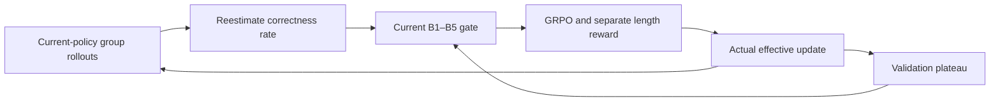
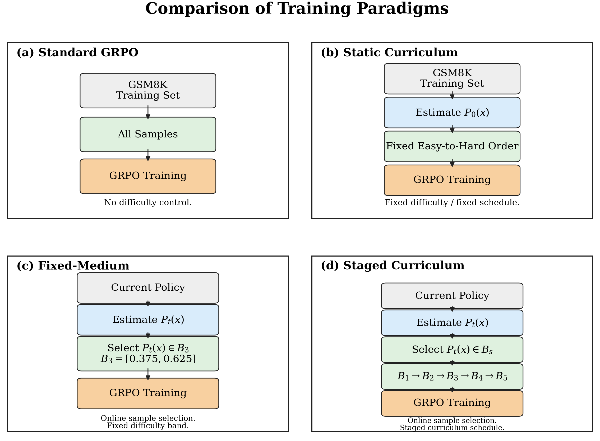

# A Step Harder, Not a Step Too Far: The Benefits and Limits of Curriculum Difficulty Progression in GRPO

<!-- source-sha256: 901d30e49d462f5f13f162abdb634c6b7c6115fc31c20a962498f0e097f47d4c -->

[简体中文](README.md)

## Paper information

| Field | Value |
| --- | --- |
| Paper | [arXiv 2610.13669](https://arxiv.org/abs/2610.13669) |
| Affiliations | Dalian Maritime University |
| First public release | 2026-10-09 (arXiv v1) |
| Author code | Yes: [authors' code](https://github.com/NHLling/GRPO-B). |
| Adapter | `grpo-difficulty-curriculum` |
| Local implementation | [`src/auto_research/reproductions/grpo_difficulty_curriculum/`](https://github.com/daiwk/auto-research/tree/main/src/auto_research/reproductions/grpo_difficulty_curriculum/) |
| Implementation and evaluation level | Core algorithm on a real model; L0/L1 mechanism diagnostics, not a full benchmark reproduction |
| GPU validation | Corrected same-source A30 five-arm comparison with seeds 42/43/44: [three-seed receipt](../../gpu-validations/grpo-difficulty-curriculum-a30-20261014-seeds42-44.json). The older [A100 seed-42 three-arm run](../../gpu-validations/grpo-difficulty-curriculum-a100-20261014.json) remains separate. |

## Original paper

### Background and contribution

Difficulty depends on the current policy: samples can move in and out of a difficulty band. The paper compares a static easy-to-hard curriculum, online fixed-medium selection, and a staged B1→B5 curriculum. Advancing to B5 can hurt results. This implementation reestimates difficulty from actual rollouts at every step, retains B5 as a control, and does not substitute problem length or stale scores.

### Architecture and data flow

The diagram is a local redraw.



<!-- paper-figure:start -->
### Key figure from the paper

[](https://arxiv.org/html/2610.13669v1/figures/fig1_training_paradigms.png)

Standard GRPO uses the whole training set. The static curriculum fixes its order by initial solvability. Fixed-medium reestimates success under the current policy but stays in B3. The staged curriculum also reestimates success online, moving the active band from B1 toward B5. The figure shows the paper's comparison, not local progress or accuracy.

Exact sources: [Figure 2 in v1, HTML S1.F2](https://arxiv.org/html/2610.13669v1#S1.F2) and the [original PNG](https://arxiv.org/html/2610.13669v1/figures/fig1_training_paradigms.png). Despite the filename containing fig1, its caption identifies Figure 2. The original bytes and SHA-256 are tracked in [figure-source.json](figure-source.json). Copyright belongs to the authors. This figure is distinct from the local Mermaid redraw.
<!-- paper-figure:end -->

### Core equations

$$
P_t(x)=G^{-1}\sum_g\mathbf1[V(x,y_g)=1],\quad
\hat d_t(x)=1-P_t(x),\quad a_t(x)=\mathbf1[P_t(x)\in B_s].
$$

The original B1–B5 success-rate bands are [0.625, 0.875], [0.500, 0.750], [0.375, 0.625], [0.250, 0.500], and [0.125, 0.375]. The auxiliary length reward has weight 0.2 and prefers 60–650 tokens; it does not affect difficulty or gating. Stage decisions use validation only, with tolerance 0.0107 and patience of two; advancement restores the selected checkpoint.

### Paper results

The paper used Qwen2.5-1.5B/GSM8K, with 32 offline and 8 online difficulty samples. The detailed fixed-medium run's retrospective best test accuracy was 0.6459; selected B4 reached 0.6558, and another 100 effective B5 updates reduced it to 0.6353. The three-seed result after B5 was 0.6405±0.0053. Some paper comparisons use retrospective best test performance; that does not authorize test-based selection here. No production A/B test was reported. [paper-results.json](paper-results.json) contains sourced paper-reported scalars, not local measurements.

## Local reproduction

> Compare unfiltered, fixed-medium, static, staged, and B5-too-hard from the same checkpoint and configuration, interpreting results in light of actual update and rollout budgets. This only tests the L0/L1 mechanism and does not measure a stable relative gain.

### Data and label access

Public checkpoint and dataset revisions are pinned and checked via `checkpoint_source` and `validate_holdout` hashes. GSM8K train and validation are split from the official training set; official test is not opened. Qwen2.5-0.5B-Instruct is pinned to `7ae557604adf67be50417f59c2c2f167def9a775`; when needed, the Qwen2.5-7B-Instruct teacher/reasoner is pinned to `bb46c15ee4bb56c5b63245ef50fd7637234d6f75`. Reference answers are read only by the external training verifier, as SFT targets, or by an explicitly train-only data-building teacher. Evaluated student or agent prompts do not receive the current problem's gold answer or plan.

All five variants run. Static uses the fixed order from initial success estimates; too-hard is strictly original B5. The runner records current success rates, gated examples, effective updates, non-monotonic difficulty, and all calibration tokens. Staged uses per-step validation for the small diagnostic, retains noise tolerance and best-checkpoint restoration, and never opens official test. A round without an effective update does not consume patience or advance a stage.

### Entry point and budget

Use `scripts/run_oct13_post_training.py --method grpo-difficulty-curriculum`. The adapter reads `oct13_execution.json` from the data directory. Provide student/teacher checkpoint paths and public IDs/revisions, training and validation paths, a split manifest, and the dataset revision. The standalone example uses 2 steps, not the 4 steps in the measured run.

```bash
PYTHONPATH=src python scripts/run_oct13_post_training.py \
  --method grpo-difficulty-curriculum --config data/oct13_execution.json \
  --device cuda --seed 42 --variant fixed-medium --train-examples 8 --group 8 --steps 2 --max-tokens 512 \
  --output runs/oct13/grpo-difficulty-curriculum-42
```

The result accounts for actual generation, rejected samples, difficulty calibration, teacher profiling, and supervised tokens. Failures write a non-overwritable `failure.json`; successes write `result.json` and `report.md`. Directory names alone do not establish source metadata.

### Results and validation

[mechanism-contracts.json](metrics/mechanism-contracts.json) records CPU-verified formulas and behavior using deterministic tensors and fixtures, with `diagnostic_only: true` and `formal_comparison: false`. It is not a substitute for checkpoint training, GPU evidence, same-budget capability comparison, or the paper benchmark.

On 2026-10-14, three independent seed-42 arms ran on NVIDIA A100-SXM4-80GB with pinned Qwen2.5-0.5B and GSM8K train-only holdout, frozen source `6aabe57a97ec3a586aac7aeea66128750f9441da`. Each used 8 training and 4 validation items, group 8, 4 steps, and response cap 512. Calibration and rejected groups enter the ledger. Official test was not opened. [Raw results, configuration, 52 source hashes, and step audits](metrics/public-a100-three-arms-seed42.json) accompany the receipt.

| Arm (seed 42) | Validation accuracy, initial → final | Effective updates | Calibration/training response tokens | All response tokens | Elapsed seconds |
|---|---|---|---|---|---|
| fixed-medium / B3 | 0.50→0.75 | 8 | 72,642 | 81,055 | 538.18 |
| staged / B1→B2 | 0.50→0.50 | 9 | 73,273 | 82,431 | 562.04 |
| B5 / too-hard | 0.50→0.50 | 11 | 74,351 | 83,131 | 555.90 |

Staged followed new-best/keep/advance/new-best and entered B2 at step 4; it did not complete B1→B5. Three variants are not three seeds. This single-seed L1 smoke test sets `formal_comparison: false` and `promotion_eligible: false`. A change on four validation problems is not a stable gain; no B5 regression was observed here. Equal caps do not imply equal realized update or token budgets; elapsed time is not a throughput comparison.

### Historical numerical failure

The [6a/51b negative audit](metrics/public-legacy-curriculum-numerical-negative.json) preserves raw results, statuses, and actual optimizer calls. Float32 mean rounding made mathematically equal [1.2×8]/[0.2×8] rewards yield spuriously nonzero normalized advantages. A30 unfiltered42 had 12/32 such updates, static42 3/8, unfiltered43 13/32, and static43 2/8. Do not relax tolerances or delete these updates to recalculate a pass; parameter changes alone do not establish a real learning signal.

No equal-reward groups were found in the old A10042 three arms (8/9/11 updates) or A30 fixed43 (6), but those runs do not verify the corrected five-arm implementation. The old A100 run omitted static and unfiltered. The older A30 controls are not positive evidence after the fix. Old staged43/B543 were intentionally stopped and partial records retained. None of the five old seed-44 jobs launched. Different A100/A30/framework baselines are not paired capability results.

### Corrected five-arm, seed-42 checkpoint

The [A30 seed-42 native results](metrics/public-a30-complete-five-arms-seed42-b9086275.json) bind the B908 core, the independent 92c observer, pinned public 0.5B/GSM resources, and shared config SHA `96a8984e…`. All arms started at 0.25. The 13/4 equal-reward groups in unfiltered/static were skipped exactly; rejected and zero groups remain in costs and audits.

| Seed-42 arm | Real updates | Equal-reward skips | Validation initial → final | Seconds |
|---|---:|---:|---:|---:|
| unfiltered | 19 | 13 | 0.25→0.50 | 606.797 |
| static | 4 | 4 | 0.25→0.25 | 685.419 |
| fixed-medium | 7 | 0 | 0.25→0.50 | 636.150 |
| staged | 10 | 0 | 0.25→0.00 | 673.666 |
| too-hard | 10 | 0 | 0.25→0.50 | 658.040 |

The staged drop to zero is retained. B5 still had 10 effective updates; this is neither zero updates nor the paper's degradation reproduced. The observer measures allocator peak rather than treating one memory reading as peak. This file is the single-seed checkpoint, not a three-seed receipt. The full plan below does not rely on 6a/51b evidence. Parallel elapsed times do not compare throughput; this is L1 only.

### Corrected five-arm, three-seed results

The [three-seed native results](metrics/public-a30-complete-five-arms-seeds42-44-b9086275.json) and [independent new receipt](../../gpu-validations/grpo-difficulty-curriculum-a30-20261014-seeds42-44.json) cover 15 actual CUDA runs, all on the same A30, B908 core (54 files), 92c observer, pinned 0.5B/GSM, and config SHA `96a8984e…`. Budgets stayed at 8 train, 4 validation, 4 steps, group 8, cap 512, and 900 seconds per job, with no retries. Generated tokens across all calls were 78,259–84,986, all below 143,360.

| Arm | Real updates (42/43/44) | Equal-reward skips (42/43/44) | Validation accuracy (42/43/44) | Mean ± sample SD |
|---|---|---|---|---|
| unfiltered | 19 / 22 / 24 | 13 / 10 / 8 | 0.50 / 0.50 / 0.50 | 0.5000 ± 0.0000 |
| static | 4 / 6 / 7 | 4 / 2 / 1 | 0.25 / 0.50 / 0.50 | 0.4167 ± 0.1443 |
| fixed-medium | 7 / 8 / 4 | 0 / 0 / 0 | 0.50 / 0.50 / 0.50 | 0.5000 ± 0.0000 |
| staged | 10 / 9 / 7 | 0 / 0 / 0 | 0.00 / 0.50 / 0.50 | 0.3333 ± 0.2887 |
| too-hard | 10 / 7 / 7 | 0 / 0 / 0 | 0.50 / 0.50 / 0.50 | 0.5000 ± 0.0000 |

Initial accuracy was 0.25 for all arms within each seed. The audit covers all 480 calibration groups, with 38 equal-reward groups skipped exactly and zero equal-reward optimizer updates. Rejected and zero groups remain in cost and denominators. All 151 actual updates had genuine normalized advantage and finite positive gradient. Jobs took 606.797–692.459 seconds. Elapsed times with up to 2 concurrent processes do not compare throughput.

Staged42's zero and the three nonzero B5 update counts remain as measured. This does not reproduce the full B1→B5 curriculum or B5 degradation. The five variants are paired method/control arms within seeds, not five independent seeds. Each mean has n=3, but this remains a small L1 mechanism smoke test with `formal_comparison: false` and `promotion_eligible: false`. Completion of the default 15-run plan does not mean completion of the original benchmark, formal capability evaluation, or acceptance of the entire batch.

### Code map and remaining limitations

`algorithm.py` defines the five bands, plateau rule, and non-monotonic statistics. `checkpoint.py` handles current-policy estimates, fixed behavior probabilities, dynamic gating, actual updates, and the B5 control. Shared `post_training/oct13_common.py` handles only resource loading, accounting, response likelihood, actual optimizer steps, and outputs; the defining algorithm stays here. Behavioral tests are in `tests/reproductions/test_oct13_post_training.py`; State, GPPO, and TAPO retain their dedicated tests.

A short 0.5B run cannot stand in for the full 1.5B training or a three-seed capability comparison. Equal step caps can yield different update counts, selected examples, and token costs. Retain zero updates or degradation when they occur; neither alone establishes capability. The corrected five-arm plan for seeds 42/43/44 is complete. Older controls do not verify new code, and neither single-seed nor three-seed mechanism receipts establish formal capability. Full-scale training, the full curriculum, and formal comparison remain unfinished. Site-wide catalog sync and CI are separate; no unverified Evolve mapping is registered.
