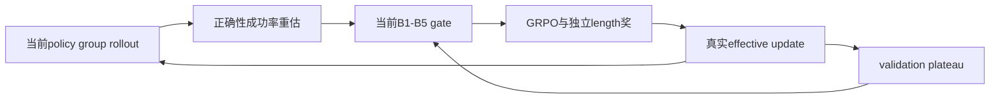

# A Step Harder, Not a Step Too Far: The Benefits and Limits of Curriculum Difficulty Progression in GRPO

## 论文信息

| 字段 | 内容 |
| --- | --- |
| 论文链接 | [arXiv 2610.13669](https://arxiv.org/abs/2610.13669) |
| 公司/机构 | Dalian Maritime University |
| 首次公开日期 | 2026-10-09（arXiv v1） |
| 原文开源代码 | 是：[作者仓库](https://github.com/NHLling/GRPO-B) |
| Adapter | `grpo-difficulty-curriculum` |
| 本地复现代码 | [`src/auto_research/reproductions/grpo_difficulty_curriculum/`](https://github.com/daiwk/auto-research/tree/main/src/auto_research/reproductions/grpo_difficulty_curriculum/) |
| 实现/评测层级 | 核心算法实际模型路径；L0/L1机制诊断，不是原benchmark完整复现 |
| GPU门禁 | 必须真实A100/A30执行并提交绑定源码的脱敏回执；未取得者仍未验收 |

## 原始论文总结

### 背景与主要改动

difficulty随当前policy变化，样本可能反复进出难度带。论文比较静态easy-to-hard、在线fixed-medium和B1→B5课程，进一步升到B5会退化。实现每步真实rollout重新估难、保留B5控制，不按problem长度或旧评分替代。

### 架构与数据流

以下为本地重绘，不冒充原论文图片。



原图来源：[原文图位置](https://arxiv.org/html/2610.13669v1#S1.F2)；[原始图资源](https://arxiv.org/html/2610.13669v1/figures/fig1_training_paradigms.png)。版本及资源记录在 [figure-source.json](figure-source.json)。原图版权归作者，原始效果图与本地重绘分开。

### 核心公式

$$
P_t(x)=G^{-1}\sum_g\mathbf1[V(x,y_g)=1],\quad
\hat d_t(x)=1-P_t(x),\quad a_t(x)=\mathbf1[P_t(x)\in B_s].
$$
原B1–B5成功率区间：[0.625,0.875]、[0.500,0.750]、[0.375,0.625]、[0.250,0.500]、[0.125,0.375]。
辅助length reward权重0.2、偏好60–650 token，不用于difficulty/gating。stage只看validation，tolerance0.0107、两次patience，推进恢复选中checkpoint。

### 论文离线与线上效果

原Qwen2.5-1.5B/GSM8K：32次离线估难、8次在线。详细run的fixed-medium事后最佳test0.6459，选定B4为0.6558；再100个B5有效更新降到0.6353。三seed B5后0.6405±0.0053。部分原比较采用事后最佳test，本地不能因此用test选参。未报告生产线上A/B。

选取的原文稳定标量与出处保存于 [paper-results.json](paper-results.json)，全部标为paper-reported，不是本地测量。

## 本地复现

> **本地对照口径**：基线为相同checkpoint与配置的unfiltered、fixed-medium、static、staged、B5-too-hard；按实际effective-update/rollout预算解释；实验组仅支持本页L0/L1机制，稳定相对提升不适用。

### 数据与标签访问协议

公开checkpoint/data必须固定revision并通过既有 `checkpoint_source` / `validate_holdout` 的文件hash验证。GSM8K仅从官方train拆train/validation，官方test不打开。Qwen2.5-0.5B-Instruct revision为 `7ae557604adf67be50417f59c2c2f167def9a775`，需要teacher/reasoner时用Qwen2.5-7B-Instruct revision `bb46c15ee4bb56c5b63245ef50fd7637234d6f75`。参考答案仅在外部训练verifier、SFT监督target或明确的train-only数据构建teacher边界读取；被评估student/agent prompt不接收当前题gold/plan。

fixed-medium/staged/static/unfiltered/too-hard均可执行。static保留初始成功率固定easy-to-hard顺序；too-hard严格为原B5。逐轮记当前成功率、被gate样本、effective updates、难度非单调轨迹、全部校准token。staged缩放成每步validation诊断，保持噪声容忍/恢复best checkpoint；官方test不打开。

没有真实effective update的轮次不会触发patience或推进难度stage，避免把单纯重采样失败伪装成课程进展。

### 可执行入口与预算

入口为 `scripts/run_oct13_post_training.py --method grpo-difficulty-curriculum`，adapter则从数据目录读取 `oct13_execution.json`。必须提供student/teacher镜像路径、public id/revision、train/validation路径、split manifest与dataset revision。下面是待实跑配置示例，不表示GPU已完成：

```bash
PYTHONPATH=src python scripts/run_oct13_post_training.py \
  --method grpo-difficulty-curriculum --config data/oct13_execution.json \
  --device cuda --seed 42 --variant fixed-medium --train-examples 8 --group 8 --steps 2 --max-tokens 512 \
  --output runs/oct13/grpo-difficulty-curriculum-42
```

真实生成、拒绝、难度校准、teacher profiling及监督token预算进入结果；失败写不可覆盖的 `failure.json`，成功写 `result.json` / `report.md`。不能仅以本地目录名伪造source metadata。

### 当前结果与验收状态

[mechanism-contracts.json](metrics/mechanism-contracts.json)保存已CPU执行的公式/行为合同标量，deterministic tensor/fixture协议，`diagnostic_only: true`、`formal_comparison: false`。不替代公开checkpoint训练、GPU回执、同预算能力比较或原benchmark。GPU指标由实际结果核验后另行摘录；本页不声明未执行实验已经完成。

### 代码映射

algorithm.py：原5带、plateau和非单调统计；checkpoint.py：当前policy估难、固定行为概率、动态gate、真实更新/B5控制。

共享 `post_training/oct13_common.py` 只承担资源装载、成本记录、response likelihood、真实optimizer step和输出；论文机制保留在本目录。行为测试为 `tests/reproductions/test_oct13_post_training.py`；State/GPPO/TAPO还保留既有专属测试。

### 边界与未完成项

0.5B/短预算不代表原1.5B全train或三seed能力比较。同steps可能有不同effective updates/选题数/token，按实测解释。B5零更新/退化不能删除，也不是自动能力证明。

仍需适用A100/A30路径及对照实跑、新源码绑定脱敏receipt、全局目录同步与CI。三个seed不会自动升级机制诊断为正式能力证据。本条未注册未经验证的evolve映射。

