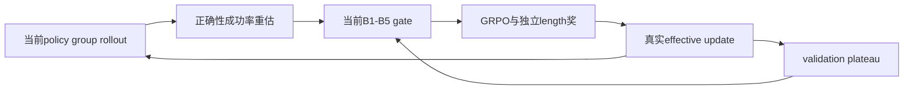
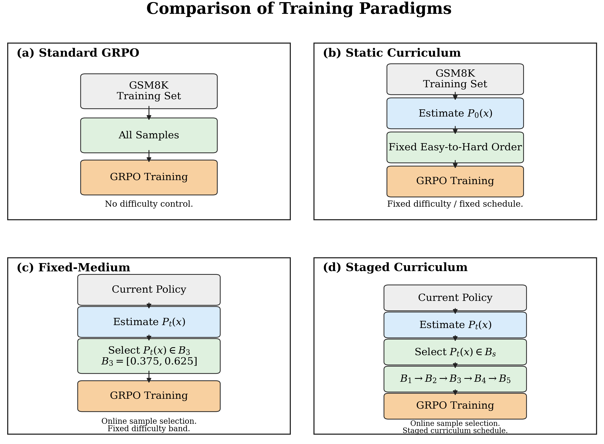

# A Step Harder, Not a Step Too Far: The Benefits and Limits of Curriculum Difficulty Progression in GRPO

## 论文信息

| 字段 | 内容 |
| --- | --- |
| 论文链接 | [arXiv 2610.13669](https://arxiv.org/abs/2610.13669) |
| 公司/机构 | Dalian Maritime University |
| 首次公开日期 | 2026-10-09（arXiv v1） |
| 原文开源代码 | 是：[作者仓库](https://github.com/NHLling/GRPO-B) |
| Adapter | `grpo-difficulty-curriculum` |
| 本地复现代码 | [`src/auto_research/reproductions/grpo_difficulty_curriculum/`](https://github.com/daiwk/auto-research/tree/main/src/auto_research/reproductions/grpo_difficulty_curriculum/) |
| 实现/评测层级 | 核心算法实际模型路径；L0/L1机制诊断，不是原benchmark完整复现 |
| GPU门禁 | 已完成修后同源A30五臂×seeds42/43/44：[新三seed回执](../../gpu-validations/grpo-difficulty-curriculum-a30-20261014-seeds42-44.json)；旧[A100 seed42三臂记录](../../gpu-validations/grpo-difficulty-curriculum-a100-20261014.json)保留，不混算 |

## 原始论文总结

### 背景与主要改动

difficulty随当前policy变化，样本可能反复进出难度带。论文比较静态easy-to-hard、在线fixed-medium和B1→B5课程，进一步升到B5会退化。实现每步真实rollout重新估难、保留B5控制，不按problem长度或旧评分替代。

### 架构与数据流

以下为本地重绘，不冒充原论文图片。



<!-- paper-figure:start -->
### 原论文关键图

[](https://arxiv.org/html/2610.13669v1/figures/fig1_training_paradigms.png)

中文图注（原论文 Figure 2）：标准 GRPO 使用全训练集；静态课程按初始可解率固定排序；fixed-medium 根据当前策略重新估计成功率，但始终选择 B3；staged 同样动态重估，却让活动难度带从 B1 逐步移到 B5。图中的流程对照来自原论文，不是本地课程推进或准确率记录。

精确来源：[固定 v1 的 Figure 2，HTML `S1.F2`](https://arxiv.org/html/2610.13669v1#S1.F2)；[原始 PNG](https://arxiv.org/html/2610.13669v1/figures/fig1_training_paradigms.png)。资源文件名含 `fig1`，但原文图号是 Figure 2，按原文图注记录。本地原始字节副本与 SHA-256 记录在 [figure-source.json](figure-source.json)，版权归原作者；与上方本地 Mermaid 重绘分开。

> **原论文 Figure 2（关键图）**：上文说明所选原图或方法截图的范围；并非本地测量。图片来自[原论文](https://arxiv.org/html/2610.13669v1/figures/fig1_training_paradigms.png)，版权归原作者所有；点击图片可查看固定版本来源。
<!-- paper-figure:end -->

### 核心公式

$$
P_t(x)=G^{-1}\sum_g\mathbf1[V(x,y_g)=1],\quad
\hat d_t(x)=1-P_t(x),\quad a_t(x)=\mathbf1[P_t(x)\in B_s].
$$
原B1–B5成功率区间：[0.625,0.875]、[0.500,0.750]、[0.375,0.625]、[0.250,0.500]、[0.125,0.375]。
辅助length reward权重0.2、偏好60–650 token，不用于difficulty/gating。stage只看validation，tolerance0.0107、两次patience，推进恢复选中checkpoint。

### 论文离线与线上效果

原Qwen2.5-1.5B/GSM8K：32次离线估难、8次在线。详细run的fixed-medium事后最佳test0.6459，选定B4为0.6558；再100个B5有效更新降到0.6353。三seed B5后0.6405±0.0053。部分原比较采用事后最佳test，本地不能因此用test选参。未报告生产线上A/B。

选取的原文稳定标量与出处保存于 [paper-results.json](paper-results.json)，全部标为paper-reported，不是本地测量。

## 本地复现

> **本地对照口径**：基线为相同checkpoint与配置的unfiltered、fixed-medium、static、staged、B5-too-hard；按实际effective-update/rollout预算解释；实验组仅支持本页L0/L1机制，稳定相对提升不适用。

### 数据与标签访问协议

公开checkpoint/data必须固定revision并通过既有 `checkpoint_source` / `validate_holdout` 的文件hash验证。GSM8K仅从官方train拆train/validation，官方test不打开。Qwen2.5-0.5B-Instruct revision为 `7ae557604adf67be50417f59c2c2f167def9a775`，需要teacher/reasoner时用Qwen2.5-7B-Instruct revision `bb46c15ee4bb56c5b63245ef50fd7637234d6f75`。参考答案仅在外部训练verifier、SFT监督target或明确的train-only数据构建teacher边界读取；被评估student/agent prompt不接收当前题gold/plan。

fixed-medium/staged/static/unfiltered/too-hard均可执行。static保留初始成功率固定easy-to-hard顺序；too-hard严格为原B5。逐轮记当前成功率、被gate样本、effective updates、难度非单调轨迹、全部校准token。staged缩放成每步validation诊断，保持噪声容忍/恢复best checkpoint；官方test不打开。

没有真实effective update的轮次不会触发patience或推进难度stage，避免把单纯重采样失败伪装成课程进展。

### 可执行入口与预算

入口为 `scripts/run_oct13_post_training.py --method grpo-difficulty-curriculum`，adapter则从数据目录读取 `oct13_execution.json`。必须提供student/teacher镜像路径、public id/revision、train/validation路径、split manifest与dataset revision。下面为可复用的独立运行示例；已完成实测使用4steps，不能把此2steps示例当实测命令：

```bash
PYTHONPATH=src python scripts/run_oct13_post_training.py \
  --method grpo-difficulty-curriculum --config data/oct13_execution.json \
  --device cuda --seed 42 --variant fixed-medium --train-examples 8 --group 8 --steps 2 --max-tokens 512 \
  --output runs/oct13/grpo-difficulty-curriculum-42
```

真实生成、拒绝、难度校准、teacher profiling及监督token预算进入结果；失败写不可覆盖的 `failure.json`，成功写 `result.json` / `report.md`。不能仅以本地目录名伪造source metadata。

### 当前结果与验收状态

[mechanism-contracts.json](metrics/mechanism-contracts.json)保存已CPU执行的公式/行为合同标量，deterministic tensor/fixture协议，`diagnostic_only: true`、`formal_comparison: false`。不替代公开checkpoint训练、GPU回执、同预算能力比较或原benchmark。GPU指标由实际结果核验后另行摘录；本页不声明未执行实验已经完成。

2026-10-14 已在 NVIDIA A100-SXM4-80GB 上完成原固定 Qwen2.5-0.5B/GSM8K train-only holdout 的三个独立seed42运行，源码冻结为 `6aabe57a97ec3a586aac7aeea66128750f9441da`。每臂8train、group8、4steps、response cap512、4validation；实际全部校准和被拒组成本进入ledger，官方test未打开。原始结果SHA、配置SHA、52源码SHA与实际逐步审计保存于 [public-a100-three-arms-seed42.json](metrics/public-a100-three-arms-seed42.json) 和上述回执。

| 实际臂（均seed42） | validation accuracy初始→结束 | 实际有效更新 | 校准/训练生成response tokens | 全调用生成response tokens | 实际elapsed秒 |
| --- | --- | --- | --- | --- | --- |
| fixed-medium / B3 | 0.50→0.75 | 8 | 72,642 | 81,055 | 538.18 |
| staged / B1→B2 | 0.50→0.50 | 9 | 73,273 | 82,431 | 562.04 |
| B5 / too-hard | 0.50→0.50 | 11 | 74,351 | 83,131 | 555.90 |

staged实际transition为new-best/keep/advance/new-best，第4step进入B2；未完成原B1→B5全课程。三个variants不算三个seeds：这是单seed L1机制smoke，`formal_comparison: false`、`promotion_eligible: false`。4题validation上的fixed-medium变化不能宣称稳定提升；B5本次未发生退化，也不能冒称复现原论文退化结论。同配置caps不等于同实际effective-update或token预算，不以elapsed做吞吐比较。

### 旧课程数值完整性负审计

[旧6a/51b数值负审计](metrics/public-legacy-curriculum-numerical-negative.json)保留原raw/status/实际optimizer calls：float32均值舍入后，数学等值[1.2×8]/[0.2×8]被归一化成伪非零advantage。A30 unfiltered42有12/32、static42有3/8此类更新；unfiltered43有13/32、static43有2/8。不能放宽容差、删掉伪更新后重新合算passed，也不能把参数变化当真实reward学习信号。

旧A10042三臂8/9/11和A30fixed43 6次更新未发现等值奖励组，但不验证修复后的完整五臂路径。旧A100三臂未执行static和unfiltered；旧A30两controls不作为修后positive证据。旧staged43/B543已定向中止并保留partial/log，五个旧seed44未启动。不同A100/A30/framework基线不作paired能力比较。

### 数值修复后的完整五臂seed42阶段

[新A30五臂seed42 native](metrics/public-a30-complete-five-arms-seed42-b9086275.json)绑定真实B908核心、92c独立观察器、固定公开0.5B/GSM及同配置SHA `96a8984e…`；五臂同设备、同seed初始validation均0.25。13/4个等值奖励组在unfiltered/static中全部精确跳过，拒绝组与零组均留在成本/审计中，不把variants当seeds。

| seed42臂 | 真更新 | 等值组跳过 | validation初始→结束 | 实际秒数 |
| --- | ---: | ---: | --- | ---: |
| unfiltered | 19 | 13 | 0.25→0.50 | 606.797 |
| static | 4 | 4 | 0.25→0.25 | 685.419 |
| fixed-medium | 7 | 0 | 0.25→0.50 | 636.150 |
| staged | 10 | 0 | 0.25→0.00 | 673.666 |
| too-hard | 10 | 0 | 0.25→0.50 | 658.040 |

staged退化到0真实保留；这个tiny B5仍有10次有效更新，不冒称零更新或原文退化复现。allocator实测峰值由观察器记录，不把单点显存读数当峰值。该文件保留为单seed阶段测量，不是三seedGPU回执；完整计划结果另见下节，不复用旧6a/51b证明。并行elapsed不比较吞吐，仍仅L1诊断。

### 数值修复后的完整五臂三seed结果

[三seed native](metrics/public-a30-complete-five-arms-seeds42-44-b9086275.json)和[独立新回执](../../gpu-validations/grpo-difficulty-curriculum-a30-20261014-seeds42-44.json)来自15个实际CUDA run，均绑定同A30、B908核心54文件、92c独立观察器、固定公开0.5B/GSM及配置SHA `96a8984e…`。原8train、4validation、4steps、group8、cap512、每job900秒上界未扩大，未重试；真实全调用生成tokens为78,259–84,986，全部小于143,360上界。

| 臂 | 真更新（42/43/44） | 等值组跳过（42/43/44） | validation accuracy（42/43/44） | accuracy均值±样本std |
| --- | --- | --- | --- | --- |
| unfiltered | 19 / 22 / 24 | 13 / 10 / 8 | 0.50 / 0.50 / 0.50 | 0.5000 ± 0.0000 |
| static | 4 / 6 / 7 | 4 / 2 / 1 | 0.25 / 0.50 / 0.50 | 0.4167 ± 0.1443 |
| fixed-medium | 7 / 8 / 4 | 0 / 0 / 0 | 0.50 / 0.50 / 0.50 | 0.5000 ± 0.0000 |
| staged | 10 / 9 / 7 | 0 / 0 / 0 | 0.00 / 0.50 / 0.50 | 0.3333 ± 0.2887 |
| too-hard | 10 / 7 / 7 | 0 / 0 / 0 | 0.50 / 0.50 / 0.50 | 0.5000 ± 0.0000 |

同seed五臂初始accuracy均0.25；全部480个校准组被审计，38个数学等值奖励组精确跳过，等值奖励optimizer updates为0。拒绝/零组不从成本或分母删掉，所有151次实际更新都有真实归一化优势和finite正梯度。单job实测606.797–692.459秒，≤2个并行进程的elapsed不用于吞吐比较。

staged42的0和三个B5非零更新原样保留；本次不复现原文完整B1→B5课程或B5退化。五variants是同seed配对的method/control arms，不是五个独立seeds；每项均值的n=3，但仍为L1小样本机制smoke，`formal_comparison: false`、`promotion_eligible: false`，不能宣称稳定相对提升。该默认十五项执行计划已完成，不代表原benchmark/正式能力评测或本批整体验收完成。

### 代码映射

algorithm.py：原5带、plateau和非单调统计；checkpoint.py：当前policy估难、固定行为概率、动态gate、真实更新/B5控制。

共享 `post_training/oct13_common.py` 只承担资源装载、成本记录、response likelihood、真实optimizer step和输出；论文机制保留在本目录。行为测试为 `tests/reproductions/test_oct13_post_training.py`；State/GPPO/TAPO还保留既有专属测试。

### 边界与未完成项

0.5B/短预算不代表原1.5B全train或三seed能力比较。同steps可能有不同effective updates/选题数/token，按实测解释。B5零更新/退化不能删除，也不是自动能力证明。

数值修复后的五臂42/43/44默认十五项计划已完成；旧controls不能冒充新源码验证。完整原规模/课程与正式能力比较仍未完成，单seed机制GPU门禁通过不代表本批整体完成，三seed机制回执也不代表正式能力比较。还需全局目录同步与CI；本条未注册未经验证的evolve映射。

