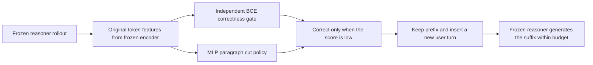
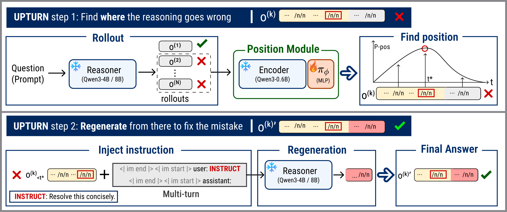

# Inject a Turn, Not a Token: Learning Where to Redirect LLM Reasoning for Self-Correction

<!-- source-sha256: bce03f4dd0c60a79a233911b32ff74ab168f1ef79dc20e7b6acd4a354714b83f -->

[简体中文](README.md)

## Paper information

| Field | Details |
|---|---|
| Paper | [arXiv 2610.13672](https://arxiv.org/abs/2610.13672) |
| Institution | KAIST |
| First public release | 2026-10-09 (arXiv v1) |
| Author code | No release found in paper-linked primary sources as of 2026-10-13. |
| Local adapter | `upturn` |
| Local reproduction code | [`src/auto_research/reproductions/upturn/`](https://github.com/daiwk/auto-research/tree/main/src/auto_research/reproductions/upturn/) |
| Evaluation level | Core algorithm on real models; L0/L1 mechanism diagnostic, not a full reproduction of the benchmark. |
| GPU validation | A complete, real mechanism receipt is retained for seed 42. All three seeds ran, but seed 44 had no rescue signal, so there is no three-seed pass receipt. |

## Paper method and evidence

Freeze the reasoner and a small causal encoder. Learn an MLP policy to cut failed rollouts at paragraph boundaries; rerun the frozen reasoner from different cuts to obtain rescue rewards. At inference, a separate learned gate decides when to correct. Keep the prefix, close the assistant turn, insert a fixed new user turn, and generate a suffix within the remaining response budget.

The following redraw explains the mechanism; it is not the original figure.



<!-- paper-figure:start -->
### Original paper figure

[](https://arxiv.org/html/2610.13672v1/framework.svg)

The [original Figure 3](https://arxiv.org/html/2610.13672v1#S5.F3) shows a frozen reasoner producing rollouts and a frozen 0.6B encoder plus trainable MLP choosing cuts in failed traces. The retained prefix is followed by a fixed new user turn and a new assistant continuation. Illustrated successes are not local results. See the [original SVG](https://arxiv.org/html/2610.13672v1/framework.svg) and [figure provenance and hashes](figure-source.json); copyright remains with the authors.
<!-- paper-figure:end -->

### Core equations

$$
\pi_\phi(t\mid q,o)=\operatorname{softmax}_t(f_\phi(h_t)),\quad
r_i=M^{-1}\sum_sR(q,\tilde o^{(i,s)}),\quad
A_i=r_i-G^{-1}\sum_jr_j.
$$

Cuts are sampled without replacement. Use the PPO ratio and clipping with $0.001H(\pi_\phi)$ and no standard-deviation normalization. The BCE gate uses the causal feature of the final boxed-answer token, with temperature calibrated on a disjoint subset of training prompts. Suffix budget is $L_{\max}-t$. Unparseable answers get gate score zero; the threshold is fixed at 0.4.

### Reported results

The paper's position head is LayerNorm–1024→128→1 (133,377 parameters); the gate has about 66K. DAPO runs for 30 steps with N/G/M all 8 and 8,192 tokens. UPTURN@16 is compared with Base@32 over four frozen reasoners and six math benchmarks; Qwen3-4B average accuracy on AIME24 is 32.6%→50.8%. No production A/B was reported. [Paper-reported scalars](paper-results.json) are not local measurements.

## Local reproduction

**Comparison:** Base@2N generates complete rollouts; UPTURN@N generates N originals and at most N replacements. Matching the maximum allowed generation budget does not match realized runtime. This supports L0/L1 diagnosis, not a stable relative improvement.

### Data and label access

Pin public checkpoint/data revisions and verify file hashes with `checkpoint_source` and `validate_holdout`. Only the official GSM8K train split is used to construct local train and validation; the official test is not opened. Qwen2.5-0.5B-Instruct is pinned to `7ae557604adf67be50417f59c2c2f167def9a775` and Qwen2.5-7B-Instruct to `bb46c15ee4bb56c5b63245ef50fd7637234d6f75` when a teacher/reasoner is needed. Gold is accessed only by the external training verifier, SFT targets, or explicit train-only teacher construction, never by evaluated student/agent prompts.

The real 0.5B encoder and 7B reasoner are frozen; only MLP heads update. The encoder reads the reasoner's original prompt and response tokens without retokenizing; cut features depend only on the retained prefix. Training and calibration of the gate use disjoint training-prompt subsets. No gold is available to the inference gate. Missing failed paragraphs or gate data cause failure; entropy-only updates without rescue advantages do not pass the GPU gate.

Correction concatenates the original prompt, retained token IDs, and actual chat-template suffix that closes the assistant turn, adds a new user turn, and opens the next assistant turn. It never decodes and re-encodes the prefix, avoiding cross-boundary BPE merges. A template that does not retain the original open-assistant marker fails.

### Run command

The adapter reads `oct13_execution.json` from the data directory. Provide student/teacher snapshots, public IDs/revisions, train/validation paths, split manifest, and dataset revision. This command is an example configuration, not itself GPU evidence:

```bash
PYTHONPATH=src python scripts/run_oct13_post_training.py \
  --method upturn --config data/oct13_execution.json \
  --device cuda --seed 42 --train-examples 8 --group 4 --cuts 4 --suffixes 2 --steps 2 --max-tokens 512 --evaluation-group 2 \
  --output runs/oct13/upturn-42
```

Artifacts record real generation, rejection, difficulty calibration, teacher profiling, and supervised-token budgets. Failures write non-overwriting `failure.json`; success writes `result.json` and `report.md`. Directory names are not checkpoint provenance. [CPU mechanism contracts](metrics/mechanism-contracts.json) are deterministic tensor/fixture checks (`diagnostic_only: true`, `formal_comparison: false`), not checkpoint training or GPU evidence.

### A100 evidence: old implementation, failed

[Old 6a source, two seed-42 reasoners](metrics/public-a100-failed-seed42-6aabe57a.json): the 7B run had 24 boxed-answer gate training and 8 calibration samples, zero eligible failed rollouts, 7,556 generated tokens, 32 encoder calls, and 79.61 seconds elapsed. Raw output did not retain per-response correctness or cuts; zero eligibility does not show that every answer was correct.

A fixed Qwen-tokenizer check found that `'.\n\n'` merges into ID 382, while the old helper matched only standalone newline ID 271. It could miss real paragraph boundaries. Revision 32f maps decoded character boundaries back to original token cut indices, preserves prefix IDs, and adds per-response audit to both runners. The old output does not pass the fixed method. The old 0.5B reasoner control also had zero rescue rewards and advantages in both cut groups. Entropy produced two updates, but it remained `failed-no-rescue-signal`; all four validation items scored zero and elapsed time was 250.57 seconds. This failure applies to the old candidate cuts, not the fixed set.

### A100 evidence: fixed, training-only

The 2026-10-14 [training-only probe bound to 51b4718a](metrics/public-a100-train-diagnosis-seed42-51b4718a.json) ran for 118.51 seconds. Of 32 training rollouts, 16 were correct and 16 eligible failed; actual cuts per rollout ranged from 3 to 9. The gate used 24 training and 8 calibration examples over 20 epochs. The two cut groups had rescue rewards [0,0,0.5,0] and [0.5,0,0.5,0], both with nonzero advantages and updates (gradient norms 0.3747/0.3696). Frozen reasoner and rescue generation used 7,556 and 2,547 tokens; 32 encoder calls consumed 11,220 tokens including prompts. No LoRA and no validation or test evaluation. `whole_method_gpu_validation_passed: false`; this probe is not a receipt, a full correction evaluation, a capability result, or a multi-seed pass.

### A100 evidence: complete fixed mechanism, seed 42

[Complete mechanism result](metrics/public-a100-complete-seed42.json) and [GPU receipt tied to source 51b](../../gpu-validations/upturn-a100-20261014.json): 186.82 seconds, eight training prompts × four rollouts, 20 gate epochs, genuine nonzero rescue advantages and updates in both cut groups, frozen encoder and 7B reasoner. Correction inference and four validation evaluations actually ran.

This is one shared evaluation after head training, not before/after training. Frozen-reasoner control averaged 0.625 accuracy with pass rate 1.0; intervention averaged 0.625 with pass rate 0.75. Retain the lower intervention pass rate. The control had four complete generations per question versus two originals plus at most two corrected suffixes. Only maximum response allowance matched (3,072 tokens per question), not candidate pools, realized tokens, or runtime. This receipt covers seed 42 only.

### A100 evidence: three executions, seed 44 did not pass

The [execution cohort](metrics/public-a100-complete-three-seed-execution-cohort.json) records `execution_complete: true`, `all_seed_mechanism_passed: false`, and `accepted_mechanism_aggregate: false`. Seeds 42 and 43 had genuine nonzero rescue signal. [Seed 44's separate failure](metrics/public-a100-complete-failed-seed44.json) ran for 153.99 seconds, had 15 eligible failures, 20 gate epochs, and zero rescue rewards and advantages in both cut groups. Entropy alone produced two small updates. Status remains `failed-no-rescue-signal`; no retry, budget increase, or three-seed pass receipt.

All rows below are post-training comparisons in one evaluation, not before/after deltas:

| Seed | Frozen control accuracy / pass rate | Intervention accuracy / pass rate | Mechanism status |
|---|---|---|---|
| 42 | 0.625 / 1.0 | 0.625 / 0.75 | Passed |
| 43 | 0.375 / 0.75 | 0.5 / 0.75 | Passed |
| 44 | 0.6875 / 1.0 | 0.625 / 0.75 | Failed: no rescue signal |

The cohort's $n=3$ mean includes failed seed 44. It describes execution, not an accepted mechanism aggregate or stable improvement. The seed-42 receipt and historical failures retain their original sources and values.

### Code map and boundaries

`algorithm.py` implements the actual MLP, cut loss, gate, new user turn, and budget. `checkpoint.py` handles failure/head training and maximum-budget inference. Shared `post_training/oct13_common.py` loads resources, records cost, computes response likelihoods, performs optimizer steps, and writes artifacts; defining method logic stays here. Behavior tests are in `tests/reproductions/test_oct13_post_training.py`; State/GPPO/TAPO retain dedicated tests.

Report maximum generation allowance, actual tokens, and correction count without claiming matched runtime. A one-class gate or no rescue remains a failed or limited diagnostic. Three executions do not make a formal capability comparison, and no unverified Evolve mapping was registered.
