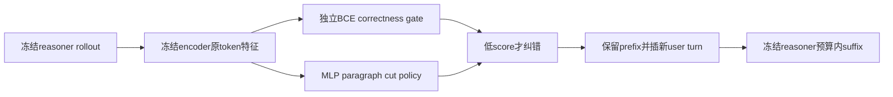

# Inject a Turn, Not a Token: Learning Where to Redirect LLM Reasoning for Self-Correction

## 论文信息

| 字段 | 内容 |
| --- | --- |
| 论文链接 | [arXiv 2610.13672](https://arxiv.org/abs/2610.13672) |
| 公司/机构 | KAIST |
| 首次公开日期 | 2026-10-09（arXiv v1） |
| 原文开源代码 | 否：原文与关联原始来源未找到本方法已发布源码（2026-10-13核验）；不是宣称全网不存在 |
| Adapter | `upturn` |
| 本地复现代码 | [`src/auto_research/reproductions/upturn/`](https://github.com/daiwk/auto-research/tree/main/src/auto_research/reproductions/upturn/) |
| 实现/评测层级 | 核心算法实际模型路径；L0/L1机制诊断，不是原benchmark完整复现 |
| GPU门禁 | 必须真实A100/A30执行并提交绑定源码的脱敏回执；未取得者仍未验收 |

## 原始论文总结

### 背景与主要改动

冻结reasoner和小causal encoder，只学习paragraph boundary处的MLP cut policy。真实失败rollout在不同cut被冻结reasoner重新生成，给rescue奖励。推理时独立learned gate决定纠错；保留prefix、结束assistant turn、插固定新user turn，按剩余response预算生成suffix。

### 架构与数据流

以下为本地重绘，不冒充原论文图片。



原图来源：[原文图位置](https://arxiv.org/html/2610.13672v1#S5.F3)；[原始图资源](https://arxiv.org/html/2610.13672v1/framework.svg)。版本及资源记录在 [figure-source.json](figure-source.json)。原图版权归作者，原始效果图与本地重绘分开。

### 核心公式

$$
\pi_\phi(t\mid q,o)=\operatorname{softmax}_t(f_\phi(h_t)),\quad
r_i=M^{-1}\sum_sR(q,\tilde o^{(i,s)}),\quad
A_i=r_i-G^{-1}\sum_jr_j.
$$
无放回cut group用PPO ratio/clipping，加 $0.001H(\pi_\phi)$，不做std归一化。gate在最后boxed token的causal feature训练BCE、在独立train prompt片校准temperature。
suffix预算为 $L_{\max}-t$；无parseable答案gate为0、阈值固定0.4。

### 论文离线与线上效果

原position head为LayerNorm-1024→128→1（133377参数），gate约66K。DAPO训练30步，N/G/M均8、8192 token。UPTURN@16对照Base@32，4个冻结reasoner、6个数学benchmark；Qwen3-4B AIME24平均准确率32.6%→50.8%。未报告生产线上A/B。

选取的原文稳定标量与出处保存于 [paper-results.json](paper-results.json)，全部标为paper-reported，不是本地测量。

## 本地复现

> **本地对照口径**：基线为Base@2N完整rollout，对照UPTURN@N及至多N次替换；预算匹配为最大允许生成数，不等于实际耗时一致；实验组仅支持本页L0/L1机制，稳定相对提升不适用。

### 数据与标签访问协议

公开checkpoint/data必须固定revision并通过既有 `checkpoint_source` / `validate_holdout` 的文件hash验证。GSM8K仅从官方train拆train/validation，官方test不打开。Qwen2.5-0.5B-Instruct revision为 `7ae557604adf67be50417f59c2c2f167def9a775`，需要teacher/reasoner时用Qwen2.5-7B-Instruct revision `bb46c15ee4bb56c5b63245ef50fd7637234d6f75`。参考答案仅在外部训练verifier、SFT监督target或明确的train-only数据构建teacher边界读取；被评估student/agent prompt不接收当前题gold/plan。

真实0.5B encoder/7B reasoner均完全冻结，只有MLP更新。encoder直接消费reasoner的原prompt/response tokens、不重tokenize；cut feature只依赖保留prefix。gate训练/校准来自不重叠train prompt片，推理没有gold gate。无训练失败paragraph或gate数据时失败；只有entropy更新、无rescue优势不能通过GPU gate。

纠错输入直接拼接原prompt、原保留token和真实chat模板的关闭assistant/新user/新assistant后缀，保留prefix不decode/re-encode，避免跨边界BPE合并改变cut。模板必须保留原open-assistant文本标记，否则明确失败。

### 可执行入口与预算

入口为 `scripts/run_oct13_post_training.py --method upturn`，adapter则从数据目录读取 `oct13_execution.json`。必须提供student/teacher镜像路径、public id/revision、train/validation路径、split manifest与dataset revision。下面是待实跑配置示例，不表示GPU已完成：

```bash
PYTHONPATH=src python scripts/run_oct13_post_training.py \
  --method upturn --config data/oct13_execution.json \
  --device cuda --seed 42 --train-examples 8 --group 4 --cuts 4 --suffixes 2 --steps 2 --max-tokens 512 --evaluation-group 2 \
  --output runs/oct13/upturn-42
```

真实生成、拒绝、难度校准、teacher profiling及监督token预算进入结果；失败写不可覆盖的 `failure.json`，成功写 `result.json` / `report.md`。不能仅以本地目录名伪造source metadata。

### 当前结果与验收状态

[mechanism-contracts.json](metrics/mechanism-contracts.json)保存已CPU执行的公式/行为合同标量，deterministic tensor/fixture协议，`diagnostic_only: true`、`formal_comparison: false`。不替代公开checkpoint训练、GPU回执、同预算能力比较或原benchmark。GPU指标由实际结果核验后另行摘录；本页不声明未执行实验已经完成。

### 代码映射

algorithm.py：真实MLP、cut loss、gate、新user turn及预算；checkpoint.py：failure/head训练和matched maximum-budget推理。

共享 `post_training/oct13_common.py` 只承担资源装载、成本记录、response likelihood、真实optimizer step和输出；论文机制保留在本目录。行为测试为 `tests/reproductions/test_oct13_post_training.py`；State/GPPO/TAPO还保留既有专属测试。

### 边界与未完成项

Base实际生成2N完整候选，UPTURN为N加至多N替换。报告最大生成数、实际token与correction次数，不声称真实runtime相等。小预算下单类gate/rescue全0如实保留，不宣称纠错提升。

仍需适用A100/A30路径及对照实跑、新源码绑定脱敏receipt、全局目录同步与CI。三个seed不会自动升级机制诊断为正式能力证据。本条未注册未经验证的evolve映射。

