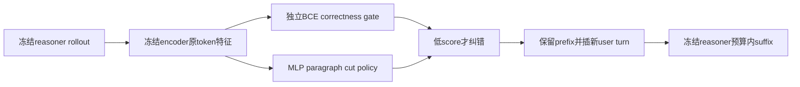
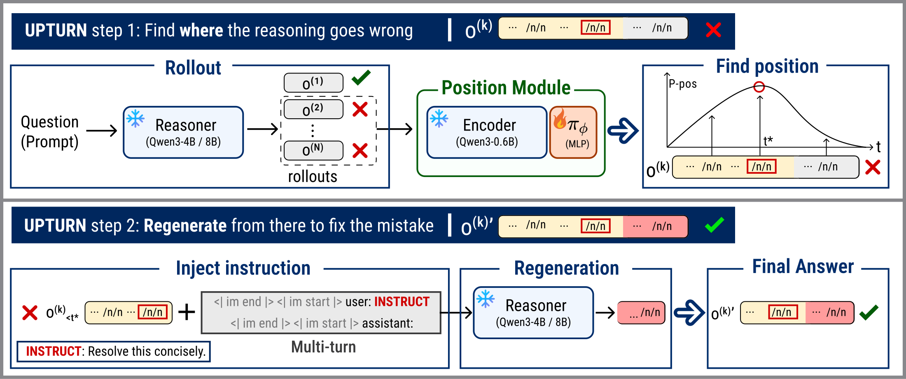

# Inject a Turn, Not a Token: Learning Where to Redirect LLM Reasoning for Self-Correction

## 论文信息

| 字段 | 内容 |
| --- | --- |
| 论文链接 | [arXiv 2610.13672](https://arxiv.org/abs/2610.13672) |
| 公司/机构 | KAIST |
| 首次公开日期 | 2026-10-09（arXiv v1） |
| 原文开源代码 | 否：原文与关联原始来源未找到本方法已发布源码（2026-10-13核验）；不是宣称全网不存在 |
| Adapter | `upturn` |
| 本地复现代码 | [`src/auto_research/reproductions/upturn/`](https://github.com/daiwk/auto-research/tree/main/src/auto_research/reproductions/upturn/) |
| 实现/评测层级 | 核心算法实际模型路径；L0/L1机制诊断，不是原benchmark完整复现 |
| GPU门禁 | seed42真实完整机制回执保留；三seed已执行但44无rescue信号，不签三seed通过回执 |

## 原始论文总结

### 背景与主要改动

冻结reasoner和小causal encoder，只学习paragraph boundary处的MLP cut policy。真实失败rollout在不同cut被冻结reasoner重新生成，给rescue奖励。推理时独立learned gate决定纠错；保留prefix、结束assistant turn、插固定新user turn，按剩余response预算生成suffix。

### 架构与数据流

以下为本地重绘，不冒充原论文图片。



<!-- paper-figure:start -->
### 原论文关键图

[](https://arxiv.org/html/2610.13672v1/framework.svg)

中文图注（原论文 Figure 3）：第一步，冻结 reasoner 产生候选轨迹，冻结 0.6B encoder 与可训练 MLP 在失败轨迹的段落边界选择切点；第二步，保留切点前缀，插入固定指令作为新 user turn，并在新 assistant turn 续写。这是作者原始框架图，图中成功示例不等于本地验证结果。

精确来源：[固定 v1 的 Figure 3，HTML `S5.F3`](https://arxiv.org/html/2610.13672v1#S5.F3)；[原始 SVG](https://arxiv.org/html/2610.13672v1/framework.svg)。本地原始字节副本与 SHA-256 记录在 [figure-source.json](figure-source.json)，版权归原作者；与上方本地 Mermaid 重绘分开。

> **原论文 Figure 3（关键图）**：上文说明所选原图或方法截图的范围；并非本地测量。图片来自[原论文](https://arxiv.org/html/2610.13672v1/framework.svg)，版权归原作者所有；点击图片可查看固定版本来源。
<!-- paper-figure:end -->

### 核心公式

$$
\pi_\phi(t\mid q,o)=\operatorname{softmax}_t(f_\phi(h_t)),\quad
r_i=M^{-1}\sum_sR(q,\tilde o^{(i,s)}),\quad
A_i=r_i-G^{-1}\sum_jr_j.
$$
无放回cut group用PPO ratio/clipping，加 $0.001H(\pi_\phi)$，不做std归一化。gate在最后boxed token的causal feature训练BCE、在独立train prompt片校准temperature。
suffix预算为 $L_{\max}-t$；无parseable答案gate为0、阈值固定0.4。

### 论文离线与线上效果

原position head为LayerNorm-1024→128→1（133377参数），gate约66K。DAPO训练30步，N/G/M均8、8192 token。UPTURN@16对照Base@32，4个冻结reasoner、6个数学benchmark；Qwen3-4B AIME24平均准确率32.6%→50.8%。未报告生产线上A/B。

选取的原文稳定标量与出处保存于 [paper-results.json](paper-results.json)，全部标为paper-reported，不是本地测量。

## 本地复现

> **本地对照口径**：基线为Base@2N完整rollout，对照UPTURN@N及至多N次替换；预算匹配为最大允许生成数，不等于实际耗时一致；实验组仅支持本页L0/L1机制，稳定相对提升不适用。

### 数据与标签访问协议

公开checkpoint/data必须固定revision并通过既有 `checkpoint_source` / `validate_holdout` 的文件hash验证。GSM8K仅从官方train拆train/validation，官方test不打开。Qwen2.5-0.5B-Instruct revision为 `7ae557604adf67be50417f59c2c2f167def9a775`，需要teacher/reasoner时用Qwen2.5-7B-Instruct revision `bb46c15ee4bb56c5b63245ef50fd7637234d6f75`。参考答案仅在外部训练verifier、SFT监督target或明确的train-only数据构建teacher边界读取；被评估student/agent prompt不接收当前题gold/plan。

真实0.5B encoder/7B reasoner均完全冻结，只有MLP更新。encoder直接消费reasoner的原prompt/response tokens、不重tokenize；cut feature只依赖保留prefix。gate训练/校准来自不重叠train prompt片，推理没有gold gate。无训练失败paragraph或gate数据时失败；只有entropy更新、无rescue优势不能通过GPU gate。

纠错输入直接拼接原prompt、原保留token和真实chat模板的关闭assistant/新user/新assistant后缀，保留prefix不decode/re-encode，避免跨边界BPE合并改变cut。模板必须保留原open-assistant文本标记，否则明确失败。

### 可执行入口与预算

入口为 `scripts/run_oct13_post_training.py --method upturn`，adapter则从数据目录读取 `oct13_execution.json`。必须提供student/teacher镜像路径、public id/revision、train/validation路径、split manifest与dataset revision。下面是待实跑配置示例，不表示GPU已完成：

```bash
PYTHONPATH=src python scripts/run_oct13_post_training.py \
  --method upturn --config data/oct13_execution.json \
  --device cuda --seed 42 --train-examples 8 --group 4 --cuts 4 --suffixes 2 --steps 2 --max-tokens 512 --evaluation-group 2 \
  --output runs/oct13/upturn-42
```

真实生成、拒绝、难度校准、teacher profiling及监督token预算进入结果；失败写不可覆盖的 `failure.json`，成功写 `result.json` / `report.md`。不能仅以本地目录名伪造source metadata。

### 当前结果与验收状态

[mechanism-contracts.json](metrics/mechanism-contracts.json)保存已CPU执行的公式/行为合同标量，deterministic tensor/fixture协议，`diagnostic_only: true`、`formal_comparison: false`。不替代公开checkpoint训练、GPU回执、同预算能力比较或原benchmark。GPU指标由实际结果核验后另行摘录；本页不声明未执行实验已经完成。

### 2026-10-14 实际失败记录（旧6a源码）

[seed42两个reasoner负结果](metrics/public-a100-failed-seed42-6aabe57a.json)保留实际A100旧源码执行。7B训练有24 boxed gate train/8 calibration、eligible failed rollout0，生成7556tokens/encoder32calls、elapsed79.61秒；旧raw未存逐response正确性/cuts，不能推断所有回答正确。

独立固定Qwen tokenizer检查发现 `'.\n\n'` 融合为ID382，而旧helper仅匹配孤立newline ID271，确会漏掉真实段落。32f已改为decoded字符边界映射原token截止索引，两处runner都调用，prefix不重新编码，并补逐response审计；旧输出不算修后core通过。小0.5B reasoner对照两position组rescue rewards/advantages全部0，虽然熵项导致2次参数更新，仍是failed-no-rescue-signal；4validation均0，elapsed250.57秒，不伪造通过。

小 reasoner 同样使用旧段落协议：上述全零仅对应旧采样切点，不能代表修后完整候选切点集合。修后7B的train-only诊断绑定 `51b4718a`，实际结果见下一节，只查gate/段落/rescue信号，不签整方法回执。

### 修后训练集诊断

2026-10-14 修后 [51b训练-only诊断](metrics/public-a100-train-diagnosis-seed42-51b4718a.json) 实际运行118.51秒：32train rollouts中16判正、16个eligible failed，实际cut数3–9；gate24train/8cal、20epochs，两个position组救援奖励分别[0,0,0.5,0]/[0.5,0,0.5,0]，均真实非零优势及更新（梯度norm0.3747/0.3696），不再是熵-only变化。frozen reasoner生成7556、rescue2547tokens，encoder32calls/11220含prompt inputtokens。0LoRA、0validation/test评估，`whole_method_gpu_validation_passed: false`、不是回执；修复后的完整gate/correction与同上限基线评估另跑，尚不能据探针宣称能力收益或完成多seed计划。

### 修后完整机制：单seed42

[完整机制结果](metrics/public-a100-complete-seed42.json)与[源码51b绑定GPU回执](../../gpu-validations/upturn-a100-20261014.json)已独立核验：实际186.82秒，原8train×4rollouts、20gate epochs、2position组均真实非零救援优势/更新，encoder与7B reasoner冻结。纠正推理和4validation评估实际执行，不能用前面的train-only探针代替。

这是head训练后的一次共享评估：frozen-reasoner控制avg_accuracy0.625/pass_rate1.0，训练后干预avg_accuracy0.625/pass_rate0.75，**不是训练前→训练后**；pass rate负结果保留。控制每题4个完整generation，方法2个original加至多2个纠正suffix，只匹配最大response allowance（3072tokens/题），并非相同候选池、实际token或runtime。此节仅描述seed42；默认三seed的执行状态另见下一节，不宣称稳定提升。

### 三seed执行完成，但44机制不通过

[完整执行cohort](metrics/public-a100-complete-three-seed-execution-cohort.json)明确 `execution_complete: true`、`all_seed_mechanism_passed: false`、`accepted_mechanism_aggregate: false`。42/43各有真实非零rescue信号；[seed44独立负结果](metrics/public-a100-complete-failed-seed44.json)实际153.99秒，15个eligible失败rollout、20gate epochs、两position组均rescue/advantage全0，只因entropy项产生2次小梯度更新，仍是failed-no-rescue-signal，不签passed或三seed回执，不retry或调预算。

下表均是训练后同一次控制/干预评估，不是训练前后。

| seed | frozen-reasoner control avg_accuracy / pass_rate | intervention avg_accuracy / pass_rate | 机制状态 |
| --- | --- | --- | --- |
| 42 | 0.625 / 1.0 | 0.625 / 0.75 | passed |
| 43 | 0.375 / 0.75 | 0.5 / 0.75 | passed |
| 44 | 0.6875 / 1.0 | 0.625 / 0.75 | failed-no-rescue-signal |

cohort中的n=3均值仅描述所有已执行seed（包含失败44），不算accepted三seed机制，更不算稳定能力提升。原42回执与所有旧失败保持原source和数值。

### 代码映射

algorithm.py：真实MLP、cut loss、gate、新user turn及预算；checkpoint.py：failure/head训练和matched maximum-budget推理。

共享 `post_training/oct13_common.py` 只承担资源装载、成本记录、response likelihood、真实optimizer step和输出；论文机制保留在本目录。行为测试为 `tests/reproductions/test_oct13_post_training.py`；State/GPPO/TAPO还保留既有专属测试。

### 边界与未完成项

Base实际生成2N完整候选，UPTURN为N加至多N替换。报告最大生成数、实际token与correction次数，不声称真实runtime相等。小预算下单类gate/rescue全0如实保留，不宣称纠错提升。

默认42/43/44已实际执行，但44没有定义性的rescue学习信号，不能称三seed机制通过。seed42回执仍有效，完整三seed执行cohort包含失败，不增加retry或选择性丢弃。全局目录同步与CI仍需收口；三个seed不会自动升级机制诊断为正式能力证据。本条未注册未经验证的evolve映射。

