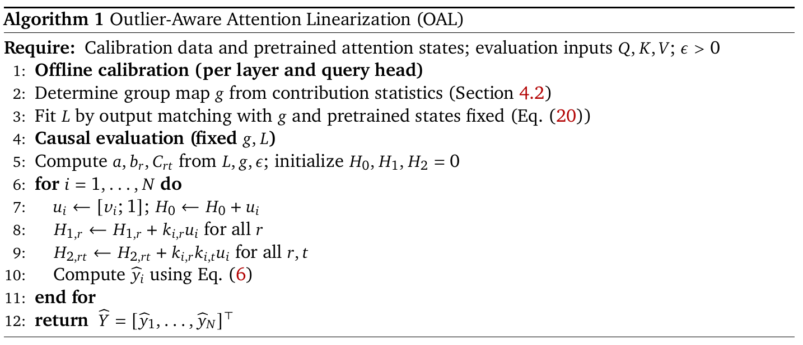
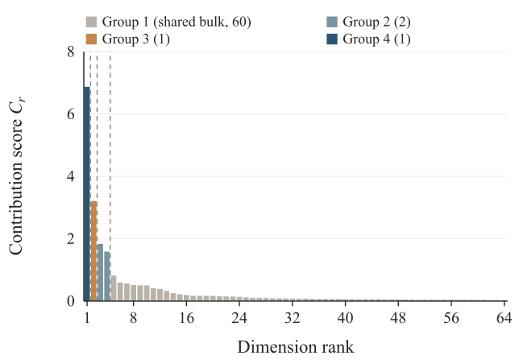
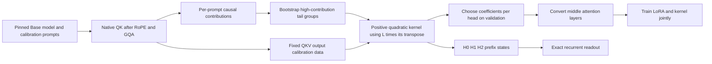

# OAL: A positive quadratic attention kernel grouped by QK outlier contribution

<!-- source-sha256: a6b07c59d41dc5f8f75f73b0a40904158c2664f97e3fd7828efef6ea416ba8cb -->

[简体中文](README.md)

## Paper information

| Field | Value |
| --- | --- |
| Paper | [arXiv 2610.13674](https://arxiv.org/abs/2610.13674) |
| Affiliations | The Chinese University of Hong Kong, Shenzhen / Beijing Normal University, Zhuhai / National University of Singapore |
| First public release | 2026-10-09 (arXiv v1) |
| Author code | [Author repository](https://github.com/wuqianyue09/OAL); no license was found in the reviewed snapshot. |
| Adapter | `oal` |
| Local implementation | [`src/auto_research/reproductions/oal/`](https://github.com/daiwk/auto-research/tree/main/src/auto_research/reproductions/oal/) |

The arXiv v1 upload was 2026-10-09 14:40:19 UTC. The upstream commit is `bc865518fa0a8a47ac1a07318f7b5fd24d3e66d0`. With no license found, only the paper and code contract were reviewed; the local formulas are independent, with no copied source/config assets. The released precomputed groups are for **Qwen2.5-0.5B Base**, not Instruct.

## Original paper

### Motivation and method

Pretrained QK dimensions contribute unevenly to attention. A small set of high-contribution coordinates accounts for much of the approximation error. OAL measures causal contributions on post-RoPE QK, bootstraps prompts to find stable boundaries in the high-contribution tail, and fits a quadratic kernel with shared groups and group-pair coefficients. Positive semidefinite parameterization keeps the denominator strictly positive. Calibration minimizes actual normalized attention **output** MSE rather than matching weights alone.

After calibration, early and late softmax layers remain in place, intermediate layers are converted, and q/k/v/o LoRA in all layers trains jointly with kernel coefficients. Groups stay fixed once selected.

### Original figures and implementation flow

[](https://arxiv.org/pdf/2610.13674v1#page=8)

[Algorithm 1](https://arxiv.org/html/2610.13674v1#alg1) first fixes groups and fits outputs, then recurs through $H_0,H_1,H_2$. The [v1 PDF, page 8](https://arxiv.org/pdf/2610.13674v1#page=8) was rendered at 216 DPI and cropped around the full algorithm without editing.



[Figure 2(a)](https://arxiv.org/html/2610.13674v1#S4.F2.sf1) shows 64 QK dimensions for layer 4, head 0 of Qwen2.5-0.5B. Sixty bulk dimensions share a group; high-contribution dimensions form smaller groups. This head does not establish a universal four-group rule. The [original SVG](https://arxiv.org/html/2610.13674v1/qwen_qk_contribution_grouped.svg) is retained; the PNG is a white-background render at twice the resolution. Both original figures were visually checked; file/PDF SHA256 values are in [provenance](assets/provenance.json), and copyright remains with the authors.

The following is a local redraw; see Appendix B for group selection:



### Core equations

$$
\chi_{p,r}=\frac{1}{|\Omega_p|}\sum_{j\le i}\left|q_{p,i,r}k_{p,j,r}/\sqrt{d_h}\right|,\qquad \chi_r=P^{-1}\sum_p\chi_{p,r}.
$$

Let $s_g=\sum_{r\in\mathcal G_g}q_r k_r/\sqrt{d_h}$ and $\bar s=[1,s_1,\ldots,s_G]^T$:

$$
\kappa_{OAL}(q,k)=\epsilon+\bar s^TLL^T\bar s>0.
$$

$$
H_{0,i}=\sum_{j\le i}[v_j;1],\quad H_{1,i,r}=\sum_{j\le i}k_{j,r}[v_j;1],\quad H_{2,i,rt}=\sum_{j\le i}k_{j,r}k_{j,t}[v_j;1].
$$

$$
\tilde u_i=aH_{0,i}+\frac1{\sqrt{d_h}}\sum_r b_rq_{i,r}H_{1,i,r}+\frac1{d_h}\sum_{r,t}C_{rt}q_{i,r}q_{i,t}H_{2,i,rt},\quad \hat y_i=\tilde u_{i,1:d_v}/\tilde u_{i,d_v+1}.
$$

Appendix B restricts candidate boundaries to the high-contribution tail, with equal-weight prompt resampling under a fixed full-sample sort. Keep every natural split without a cap on group count. If there are fewer than two groups, prefer bootstrap support, then gap size, when adding a boundary. Fit normalized output MSE directly and select among three initializations per head on validation.

### Paper-reported results

| Qwen2.5-0.5B method | WikiText-103 PPL | PIQA % | HellaSwag % | ARC-E % |
| --- | ---: | ---: | ---: | ---: |
| Softmax + LoRA | 10.89 | 70.18 | 51.38 | 62.63 |
| Learned global | 31.71 | 61.15 | 32.43 | 41.41 |
| OAL | 27.50 | 64.69 | 37.20 | 50.38 |

Table 2 frozen attention output MSE is 0.078 before and 0.031 after output projection, with RelMSE 0.432 and 0.595. OAL improves over the compared conversion methods but remains clearly below the softmax reference. On A100-SXM4-40GB, FlashAttention was faster and used less memory throughout forward testing; linear asymptotic complexity is not measured speed over FlashAttention. The paper reports no online A/B.

## Local reproduction

The `core_mechanism / L1` path preserves QK grouping, the positive kernel, output calibration, and joint LoRA updates on a real Base checkpoint. Training uses an exact dense kernel for the small batch; the HD recurrence also runs and is checked for equivalence. There is no native serving cache backend. The reference uses the same pinned Qwen Base, q/k/v/o LoRA and block budget with softmax. This diagnostic does not establish a stable gain or a percentage of the original paper's effect.

### Data protocol

Original public WikiText-2 train/validation/test splits stay separate. `verify_offline_manifest` checks ID, revision, configuration, and actual file SHA256; integrity checking does not supply held-out text to the model. Use the first 4 disjoint train blocks for grouping, the following 4 for output calibration, and later blocks for LoRA. Validation selects kernel initializations and checkpoints. Only after selection is complete is test tokenized and evaluated. Real weights, configuration, and tokenizer hashes are checked so an Instruct checkpoint cannot pass as Base by CLI label.

By default only zero-based layer 4 converts, retaining native QKV, RoPE, GQA, and output projection. The paper converts layers 3–20 with 40 calibration prompts, 1000 bootstrap samples, 4096-token sequences, and 512 WikiText-103 updates. The reduced budget is recorded and is not the original benchmark.

```bash
PYTHONPATH=src python scripts/run_oal.py \
  --checkpoint /path/to/qwen2.5-0.5b-base \
  --data /path/to/wikitext --dataset-id Salesforce/wikitext \
  --dataset-revision b08601e04326c79dfdd32d625aee71d232d685c3 \
  --device cuda --steps 3 --calibration-steps 10 \
  --sequence-length 32 --layers 4 --bootstrap 64 --seed 42 \
  --output runs/oal-seed42.json
```

The Base revision is `060db6499f32faf8b98477b0a26969ef7d8b9987`. Main weights are 988,097,824 bytes, LFS SHA256 `88c142557820ccad55bb59756bfcfcf891de9cc6202816bd346445188a0ed342`. The adapter reads `dataset_dir/oal.json`; use neither an Instruct ID nor fabricated Base provenance.

### Measured results and limits

[CPU contracts](metrics/cpu-contracts.json) record 5 rerun tests for causal contribution, bootstrap without an artificial group cap, positive kernel and dense/HD equivalence, output-calibration gradients, and actual Qwen conversion and LoRA gradients. Seed 42 initializes each case; dedicated recurrence/calibration cases use 11/2 internally. These are not independent multi-seed capability experiments and do not automatically validate A100.

On 2026-10-14 Beijing time, NVIDIA A100-SXM4-80GB ran an equal-budget three-seed comparison with pinned Qwen2.5-0.5B Base and WikiText-2, at source `4496283ac8e37c070b8f71b20af6138526cbba15`. Each arm took 3 actual LoRA updates, converting only layer 4, with 32-token blocks, 64 bootstrap samples, 10 calibration updates per initialization, and 2 independent blocks each for validation and test. Both arms have nonzero parameter changes per seed, with separate raw JSON, state and logs. [Schema v2 metrics](metrics/a100-three-seeds-4496283a.json) retain native metrics, provenance, per-seed values and aggregates. The [sanitized GPU receipt](../../gpu-validations/oal-a100-20261013.json) validates only this reduced path.

| Seed | Softmax + LoRA test PPL | OAL + LoRA test PPL | Maximum dense/HD error |
| --- | ---: | ---: | ---: |
| 42 | 44.1219 | 41.0782 | $1.18\times10^{-6}$ |
| 43 | 43.2296 | 42.3337 | $1.18\times10^{-6}$ |
| 44 | 43.1287 | 43.2233 | $1.28\times10^{-6}$ |
| Mean ± sample std | 43.4934 ± 0.5466 | 42.2117 ± 1.0778 | — |

Seed 44 is slightly worse than matched softmax+LoRA and remains recorded. Mean calibration output MSE was 0.030467 for OAL versus 0.042056 for learned global. Different data, sequence lengths, and converted layers prevent direct comparison with Table 2. Three seeds over two very short test blocks remain `L1 / diagnostic_only`, not the paper's WikiText-103 / 512-step protocol or stable capability evidence.

The authors' HD block-GEMM/Triton backend was not ported; no latency, throughput or bandwidth speedup is claimed. Original downstream benchmarks were not run and there is no Evolve integration. LoRA configuration alone cannot demonstrate a conversion: actual parameter changes and validation/test NLL, including negative results, must be recorded.

| Mechanism | Local code |
| --- | --- |
| Grouping, kernel, HD recurrence, Qwen conversion and LoRA | [oal.py](https://github.com/daiwk/auto-research/blob/main/src/auto_research/foundation_models/oal.py) |
| Real checkpoint calibration and matched baseline | [run_oal.py](https://github.com/daiwk/auto-research/blob/main/scripts/run_oal.py) |
| Behavior tests | [test_oal.py](https://github.com/daiwk/auto-research/blob/main/tests/test_oal.py) |
