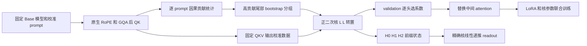

# OAL：按 QK 离群贡献分组的正二次注意力核

## 论文信息

| 字段 | 内容 |
| --- | --- |
| 论文链接 | [arXiv 2610.13674](https://arxiv.org/abs/2610.13674) |
| 公司/机构 | The Chinese University of Hong Kong, Shenzhen / Beijing Normal University, Zhuhai / National University of Singapore |
| 首次公开日期 | 2026-10-09（arXiv v1） |
| 原文开源代码 | 是：[OAL](https://github.com/wuqianyue09/OAL) |
| Adapter | `oal` |
| 本地复现代码 | [`src/auto_research/reproductions/oal/`](https://github.com/daiwk/auto-research/tree/main/src/auto_research/reproductions/oal/) |

原始 v1 提交时间为 2026-10-09 14:40:19 UTC。作者仓库固定 `bc865518fa0a8a47ac1a07318f7b5fd24d3e66d0`；截至本次核查**未找到许可证**。因此只核读原文和代码合同，本地公式独立实现，不复制其 source/config 资产。作者发布的预计算分组对应 **Qwen2.5-0.5B Base**，不能贴到 Instruct 模型。

## 原始论文总结

### 背景与主要改动

预训练 attention 的 QK 各维度贡献不均匀，少量高贡献坐标包含较多 softmax 近似误差。OAL 先在 post-RoPE QK 上计算因果贡献，以 prompt bootstrap 识别高贡献尾部的稳定边界；随后学习共享组和组对系数的二次核。正半定参数化保证分母严格正，并用真实 attention **输出** MSE 校准，而不是仅拟合 attention 权重。

校准之后保留前后 softmax 层，对中间层进行转换，并在所有层的 q/k/v/o 上做 LoRA，联合训练核系数。分组一经确定便固定。

### 架构图

[原文 Figure 2、Algorithm 1 与 Appendix B](https://arxiv.org/html/2610.13674v1#S4.F2)。



### 核心公式

$$\chi_{p,r}=\frac{1}{|\Omega_p|}\sum_{j\le i}\left|q_{p,i,r}k_{p,j,r}/\sqrt{d_h}\right|,\qquad \chi_r=P^{-1}\sum_p\chi_{p,r}.$$

令 $s_g=\sum_{r\in\mathcal G_g}q_r k_r/\sqrt{d_h}$，$\bar s=[1,s_1,\ldots,s_G]^T$：

$$\kappa_{OAL}(q,k)=\epsilon+\bar s^TLL^T\bar s>0.$$

$$H_{0,i}=\sum_{j\le i}[v_j;1],\quad H_{1,i,r}=\sum_{j\le i}k_{j,r}[v_j;1],\quad H_{2,i,rt}=\sum_{j\le i}k_{j,r}k_{j,t}[v_j;1].$$

$$\tilde u_i=aH_{0,i}+\frac1{\sqrt{d_h}}\sum_r b_rq_{i,r}H_{1,i,r}+\frac1{d_h}\sum_{r,t}C_{rt}q_{i,r}q_{i,t}H_{2,i,rt},\quad \hat y_i=\tilde u_{i,1:d_v}/\tilde u_{i,d_v+1}.$$

Appendix B 的候选边界只来自高贡献尾部，使用固定全样本排序进行等权 prompt 重采样。保留全部自然切分，不加组数上限；若不足两组，按 bootstrap support 优先、gap 次优的顺序补边界。核校准直接最小化归一化输出 MSE，三初始化按 validation **逐头**选择。

### 论文离线与线上效果

| 原文 Qwen2.5-0.5B 方法 | WikiText-103 PPL | PIQA % | HellaSwag % | ARC-E % |
| --- | ---: | ---: | ---: | ---: |
| Softmax + LoRA | 10.89 | 70.18 | 51.38 | 62.63 |
| Learned global | 31.71 | 61.15 | 32.43 | 41.41 |
| OAL | 27.50 | 64.69 | 37.20 | 50.38 |

原文 Table 2 的冻结 attention MSE：OAL 在输出投影前为 0.078、后为 0.031；对应 RelMSE 为 0.432 与 0.595。它优于所比较转换方法，但**仍明显落后 softmax reference**。A100-SXM4-40GB 前向测试中 FlashAttention 全程更快且更节省内存，不能把线性复杂度写成其当前实现比 FlashAttention 更快。线上 A/B：**未报告**。

## 本地复现

`core_mechanism / L1`：保留 QK 分组、正核、真实输出校准和真实 Base checkpoint 的 LoRA 联合更新。小 batch 训练使用精确 dense kernel；另外实际执行 HD 递推并核对等价性。未提供原生 serving cache 后端。

> **本地对照口径**：基线为相同固定 Qwen Base、相同 q/k/v/o LoRA 与训练块预算的 softmax 模型，实验组为 OAL 转换；小规模诊断不作稳定提升声明，相对原文效果百分比不适用。

### 数据协议

公开 WikiText-2 原始 train/validation/test 分离。train 前 4 个独立块用于分组，随后 4 块用于输出校准，后续块用于 LoRA；validation 用于核初始化与模型 checkpoint 选择；全部模型选择结束后才加载 test。

默认只转换零基第 4 层，保留原生 QKV、RoPE、GQA 和 output projection。原文是第 3–20 层、40 个校准 prompt、1000 次 bootstrap、4096-token、512 次 WikiText-103 更新。缩小预算必须记录，不能称为原 benchmark 复跑。

### 执行入口

```bash
PYTHONPATH=src python scripts/run_oal.py \
  --checkpoint /path/to/qwen2.5-0.5b-base \
  --data /path/to/wikitext --dataset-id Salesforce/wikitext \
  --dataset-revision b08601e04326c79dfdd32d625aee71d232d685c3 \
  --device cuda --steps 3 --calibration-steps 10 \
  --sequence-length 32 --layers 4 --bootstrap 64 --seed 42 \
  --output runs/oal-seed42.json
```

固定 Base revision 为 `060db6499f32faf8b98477b0a26969ef7d8b9987`，主权重 988,097,824 bytes，LFS SHA256 `88c142557820ccad55bb59756bfcfcf891de9cc6202816bd346445188a0ed342`。adapter 配置在 `dataset_dir/oal.json`；不能填 Instruct ID 或伪造 Base provenance。

### 本地结果与边界

[cpu-contracts.json](metrics/cpu-contracts.json)记录已执行的 5 个测试：因果贡献公式、bootstrap/无人工组数上限、正核与 dense/HD 等价、输出校准梯度、实际 Qwen 模块转换与 LoRA 梯度。没有 CPU 单测到 A100 完成的自动晋级。

作者 HD block-GEMM/Triton 后端未移植，无延迟、吞吐或带宽加速声明。未执行原文下游 benchmark，未接入 Evolve。仅凭原文 LoRA 包的参数配置不能声明转换成功，必须记录实际参数变化和验证/test NLL，包括负结果。

### 代码映射

| 原文组件 | 本地实现 |
| --- | --- |
| 分组、核、HD 递推、Qwen 转换、LoRA | [oal.py](../../../src/auto_research/foundation_models/oal.py) |
| 真实 checkpoint 校准和同预算基线 | [run_oal.py](../../../scripts/run_oal.py) |
| 行为测试 | [test_oal.py](../../../tests/test_oal.py) |

