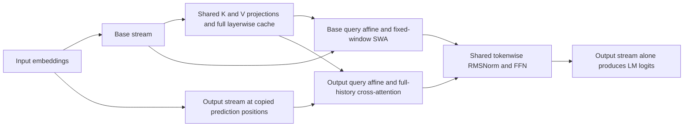
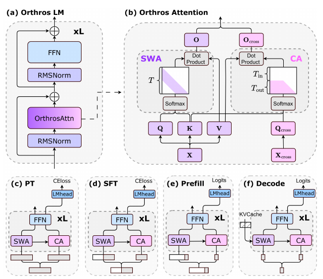

# Orthros: Phase-heterogeneous attention

<!-- source-sha256: 5ee59ccac8e70d3b179b126bcd076e3cb24f4c81bda306f494f0da76e650080c -->

[简体中文](README.md)

## Paper information

| Field | Value |
| --- | --- |
| Paper | [arXiv 2610.13735](https://arxiv.org/abs/2610.13735) |
| Affiliations | The Hong Kong Polytechnic University / University of Chinese Academy of Sciences / University of Sydney |
| First public release | 2026-10-09 (arXiv v1) |
| Author code | No public author implementation found as of 2026-10-12 |
| Adapter | `orthros` |
| Local implementation | [`src/auto_research/reproductions/orthros/`](https://github.com/daiwk/auto-research/tree/main/src/auto_research/reproductions/orthros/) |

The PDF gives an internal date of October 7; the first public release is arXiv v1 on October 9. The implementation is `core_mechanism / L1`, with actual A100 runs for three seeds and real KV consistency checks.

## Original paper

### Motivation and method

With long prompts and short answers, prefill and decoding do different work. Orthros maintains two token streams. Base tokens run fixed-window sliding-window attention (SWA) at all positions and build a full layerwise KV cache. Output-specific tokens appear only at output prediction positions and use full-history causal cross-attention over that shared cache. The streams share FFNs, normalization, and main Q/K/V/O weights, but their queries have separate learnable affine transforms.

“Linear prefill” here means fixed-window $O(Tw)$, **not kernelized linear attention**. Prefill copies only the last prompt token; decoding copies one new token per step, with the two streams respectively updating KV and retrieving globally. The output stream never writes KV, and local reads in the base stream do not discard historical KV.



[](https://arxiv.org/pdf/2610.13735v1)

Figure 1 on page 5 of the [v1 PDF](https://arxiv.org/pdf/2610.13735v1) was checked across all four configurations. Same-layer K/V come only from X, not from a cross-layer cache or a compressed linear state. Copyright remains with the authors.

### Core equations

$$
q_t=\alpha\odot(x_tW_Q)+\beta,\quad q'_t=\alpha'\odot(x'_tW_Q)+\beta',\quad k_t=x_tW_K,\ v_t=x_tW_V.
$$

$$
o_t=\operatorname{softmax}_{j\in[\max(1,t-w+1),t]}(q_tk_j^\top/\sqrt d)V,\quad o'_t=\operatorname{softmax}_{j\in[1,t]}(q'_tk_j^\top/\sqrt d)V.
$$

PT copies the entire sequence; SFT copies only answer-prediction positions. Prefill performs global retrieval only at the last prompt position, while decoding uses the entire historical KV cache. Training loss is computed only from the output-specific stream. See [Section 3, Algorithms 1–2](https://arxiv.org/html/2610.13735v1#S3).

### Paper-reported results

| Paper experiment | Transformer | Orthros |
| --- | ---: | ---: |
| 1.3B mean commonsense score, Table 1 | 53.41 | 53.98 |
| Llama3.1 conversion mean, Table 2 | 65.47 | 67.26 |
| 1.3B mean on recall-intensive tasks, Table 3 | 33.9 | 34.4 |
| H100/SGLang, TTFT in seconds with 128K input and 128 output, Table 4 | 77.249 | 17.016 |

The abstract's maximum 21.9× prefill result does not use the same end-to-end conditions as Table 4. Its 33.7 versus 33.3 decode-only tokens/s also does not imply faster decoding. See [experiments](https://arxiv.org/html/2610.13735v1#S4). No production A/B is reported; the H100 inference runs are not randomized production traffic tests.

## Local reproduction

> The reference continues training a small pretrained Transformer. The intervention converts and actually adapts Orthros from the same starting point. Only fixed-budget NLL and batch/cache agreement are measured, not the paper's throughput gain.

A real byte-level Transformer is pretrained for 10 steps on WikiText train. Its Q/K/V/O, FFN, normalization, embeddings, and output head are copied; new affine transforms start at identity. Both arms then train for 40 steps on identical batches. With `window>=T`, identity-affine conversion exactly recovers standard Transformer output.

```bash
PYTHONPATH=src python scripts/run_oct12_foundation.py --paper orthros \
  --device cuda --seed 42 --steps 40 --width 64 --layers 2 --window 16 \
  --sequence-length 64 --train-bytes 32768 --eval-bytes 4096 \
  --dataset-dir data/oct12-wikitext --output runs/oct12/orthros-s42
```

### Data and results

The three official [Salesforce/wikitext splits](https://huggingface.co/datasets/Salesforce/wikitext) are pinned to `b08601e04326c79dfdd32d625aee71d232d685c3`. Byte vocabulary, budgets, and window are fixed; test does not tune them. `scripts/prepare_oct12_public_sources.py --source wikitext` exports a hash-verified offline mirror.

On 2026-10-12, A100 runs for seeds 42/43/44 each used 10 shared pretraining steps and 40 adaptation steps per arm. Test byte NLL was 3.02851 ± 0.05278 for the baseline and 3.02952 ± 0.05255 for Orthros. The intervention was slightly worse; this result is retained. The largest absolute batch/cache discrepancy across actual prefill/decode was 1.43×10⁻⁶, below the prespecified 10⁻⁴ threshold, and full KV grew during decoding.

See [measured metrics](metrics/wikitext-a100-seeds42-44.json) and the [GPU receipt](../../gpu-validations/oct12-orthros-a100.json). A short-sequence byte model does not establish long-context capability or the paper's 21.9× speedup.

### Code mapping and limits

`sliding_window_attention` builds a T×window local view rather than masking a dense T×T matrix. `OrthrosAttention.forward_pair/decode_pair` uses shared same-layer KV for both streams. `OrthrosLM.prefill/decode` retains actual full layerwise KV; `from_transformer` converts weights and the runner backpropagates.

The local model is a small dense LM with learned positions, not the original Llama/Qwen models, RoPE at 128K, SGLang, or FlashAttention. PT's global cross-stream attention is still quadratic; the prefill complexity is not a claim of linear training. Short diagnostic evidence is L1, not paper-scale long-context or production throughput evidence. No Evolve integration is claimed.
