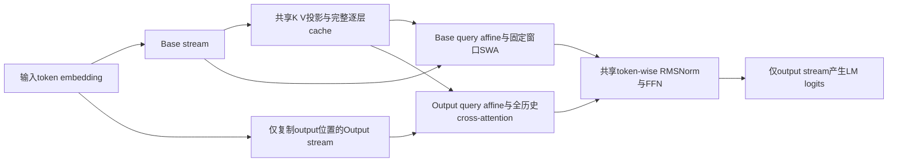
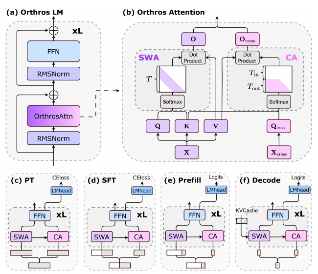

# Orthros：阶段异构注意力

## 论文信息

| 字段 | 内容 |
|---|---|
| 论文链接 | [arXiv 2610.13735](https://arxiv.org/abs/2610.13735) |
| 公司/机构 | 香港理工大学、中国科学院大学、悉尼大学；另有独立研究者 |
| 首次公开日期 | 2026-10-09（arXiv v1） |
| 原文开源代码 | 否：截至 2026-10-12 未找到作者公开源码 |
| Adapter | `orthros` |
| 本地复现代码 | [`src/auto_research/reproductions/orthros/`](https://github.com/daiwk/auto-research/tree/main/src/auto_research/reproductions/orthros/) |

PDF 另标内部日期 October 7；本目录首次公开日期以 arXiv v1 的 October 9 为准。实现为 `core_mechanism / L1`，GPU gate 尚待真实回执。

## 原始论文总结

### 背景与主要改动

长 prompt、短回答的推理中，prefill 与 decode 的计算角色不同。Orthros 保留两个 token 流：base tokens 对所有位置执行固定窗口 SWA，并构建完整的逐层 KV；output-specific tokens 只在需预测输出的位置出现，用共享 KV 做全历史 causal cross-attention。FFN、norm 和主要 Q/K/V/O 权重共享，但两种 query 各有可学习 affine 变换。

这里的“线性 prefill”是固定窗口 $O(Tw)$，**不是 kernelized linear attention**。prefill 只复制最后一个 prompt token；decode 每步复制一个新 token，两流分别更新KV和检索全局。输出流不写KV，base流的局部读取也不代表丢弃历史KV。



原图检查：已检查 [v1 PDF](https://arxiv.org/pdf/2610.13735v1) 第5页 Figure1，包含PT/SFT/Prefill/Decode四种双流配置。截图明确同层 K/V 只来自 X，不能替换为跨层缓存或压缩线性状态。

<!-- paper-figure:start -->
### 原论文关键图

[](https://arxiv.org/pdf/2610.13735v1)

图片来自[原论文](https://arxiv.org/pdf/2610.13735v1)第5页Figure1，版权归原作者所有；已检查完整双流与四个执行阶段。
<!-- paper-figure:end -->

### 核心公式

$$q_t=\alpha\odot(x_tW_Q)+\beta,\quad q'_t=\alpha'\odot(x'_tW_Q)+\beta',\quad k_t=x_tW_K,\ v_t=x_tW_V.$$

$$o_t=\operatorname{softmax}_{j\in[\max(1,t-w+1),t]}(q_tk_j^\top/\sqrt d)V,\quad o'_t=\operatorname{softmax}_{j\in[1,t]}(q'_tk_j^\top/\sqrt d)V.$$

PT时复制整个序列，SFT时只复制回答预测位置；prefill仅最后一个prompt位置执行global retrieval，decode使用完整历史KV。训练损失只从output-specific流计算。来源：[原文 §3、Algorithms1–2](https://arxiv.org/html/2610.13735v1#S3).

### 论文离线与线上效果

| 原文实验 | Transformer | Orthros |
|---|---:|---:|
| 1.3B常识任务平均，Table1 | 53.41 | 53.98 |
| Llama3.1转换平均，Table2 | 65.47 | 67.26 |
| 1.3B recall-intensive平均，Table3 | 33.9 | 34.4 |
| H100/SGLang，128K输入128输出TTFT秒，Table4 | 77.249 | 17.016 |

摘要的最高prefill21.9×与Table4的端到端条件不是同一个口径，不能混作同一列；Table4 decode-only tok/s 33.7与33.3也说明不是decode加速承诺。[原文实验](https://arxiv.org/html/2610.13735v1#S4)。**线上 A/B：未报告**，H100推理实验不是生产随机流量A/B。

## 本地复现

> **本地对照口径**：共享小型预训练起点继续训练的Transformer为基线，转换并真实适配的Orthros为实验组；论文吞吐相对收益不适用，本地只报告固定预算NLL与cached/batch一致性。

同一个真正的 byte Transformer 先在 WikiText train 预训练10步；复制Q/K/V/O、FFN、norm、embedding/head进入Orthros，新增affine初始化为identity；基线和实验组再各训练40步，读取相同train批次。`window>=T` 时identity-affine转换严格恢复标准Transformer输出。

```bash
PYTHONPATH=src python scripts/run_oct12_foundation.py --paper orthros \
  --device cuda --seed 42 --steps 40 --width 64 --layers 2 --window 16 \
  --sequence-length 64 --train-bytes 32768 --eval-bytes 4096 \
  --dataset-dir data/oct12-wikitext --output runs/oct12/orthros-s42
```

### 数据协议与结果

使用 [Salesforce/wikitext](https://huggingface.co/datasets/Salesforce/wikitext) pinned revision `b08601e04326c79dfdd32d625aee71d232d685c3` 的三个官方split。固定byte vocab、预算与window，不使用test调参。哈希验证的offline镜像由 `scripts/prepare_oct12_public_sources.py --source wikitext` 导出。

`metrics/protocol.json` 保留待GPU验证状态，不预填速度或NLL。CPU单测已验证不相同的base/output affine、window3、三层模型：batch PT/SFT与真实prefill+逐token decode等价；完整cache随decode增长而非只留window。runner 对实际运行另设 max-absolute-error <1e-4 强断言。

计划GPU receipt为 `docs/gpu-validations/oct12-orthros-a100.json`，requires_gpu_validation=true；A100/A30运行与回执接受前不能宣称MR已过GPU gate。

### 代码映射与边界

`sliding_window_attention` 真正构造 T×window 局部视图，不先生成T×T dense矩阵再mask。`OrthrosAttention.forward_pair/decode_pair` 执行同层双流共享KV；`OrthrosLM.prefill/decode` 维护真实逐层完整KV状态；`from_transformer` 是实际权重转换，runner后续真实backprop训练。

本地是小型learned-position dense LM，而非Llama/Qwen原模型、RoPE128K、SGLang或FlashAttention kernel。global PT cross stream仍有二次计算；不把prefill的理论复杂度改写成训练线性。单seed/短序列结果仅L1，不复现论文21.9×、长上下文能力或生产吞吐。未声明evolve集成。
