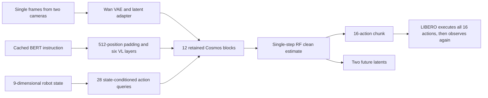
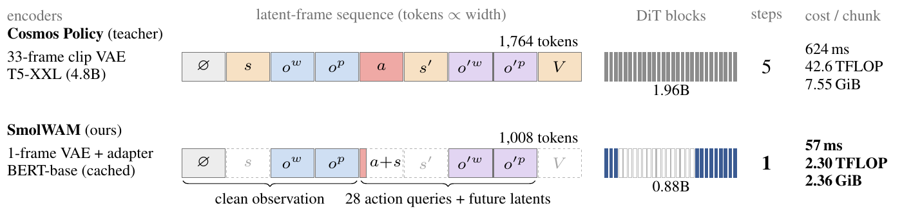
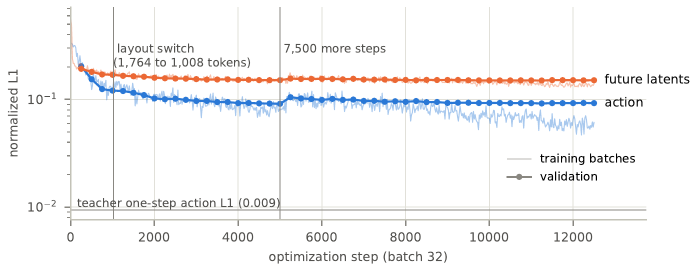

# SmolWAM: A Compact Robot Action Model That Preserves World Prediction

<!-- source-sha256: 87f5d92344399570014f4e936502156ca06a9c2d393c9bf3351adb69c4369b2a -->

[简体中文](README.md)

> **Core mechanism.** A real A100 ran scaled teacher distillation, a two-stage layout curriculum, and closed-loop LIBERO evaluation of newly trained students for three seeds. Neither the students nor no-op completed a task. This is not VQA, a random small proxy, the original 5000-step training, a full pipeline, or evidence of capability improvement.

## Paper information

| Field | Value |
| --- | --- |
| Paper | [arXiv 2610.13740](https://arxiv.org/abs/2610.13740) |
| Affiliations | ML Collective |
| First public release | 2026-10-09 (arXiv v1) |
| Author code | Yes: [authors' code](https://github.com/iitimii/SmolWAM). |
| Adapter | `smolwam` |
| Local implementation | [`src/auto_research/reproductions/smolwam/`](https://github.com/daiwk/auto-research/tree/main/src/auto_research/reproductions/smolwam/) |

The v1 submission was 2026-10-09 15:34:33 UTC. Code is Apache-2.0, pinned at `dde1e5bfe35c439499343c6d70e9cd32c96d0b36`. **Released weights use the NVIDIA One-Way Noncommercial License; open code does not authorize commercial use of the weights.** The Wan VAE is separately Apache-2.0. Check training, distribution, and downstream use independently.

## Original paper

### Background and contribution

Cosmos Policy packs robot state, two cameras, actions, and future state into nine latent frames through a video-generation interface: 33-frame VAE, T5-XXL, 28-block 2B DiT, 1764 tokens, and five denoising steps. SmolWAM preserves the pretrained trunk, token positions, and rectified-flow readout while addressing distribution shifts from each interface change. It is not merely a smaller action head.

A single-frame Wan VAE and 0.5M adapter map back to the clip latent space. Cached BERT features are padded to 512 positions, retaining a zero-bias attention sink. Keep blocks 0–2 and 19–27 (12 total, about 0.85B trunk parameters); six zero-initialized vision-to-language layers bring the total to about 0.88B. Replace the 196-token action frame with 28 state-conditioned queries, retaining blank and image slots for a 1008-token sequence. One trunk forward reads out 16×7 actions and future latents for both cameras.

### Architecture



[Local redraw](assets/architecture.mmd), [authors' architecture SVG](https://github.com/iitimii/SmolWAM/blob/dde1e5bfe35c439499343c6d70e9cd32c96d0b36/assets/architecture.svg), and [source provenance](assets/source-provenance.json).

<!-- paper-figure:start -->
### Key figures from the paper

[](https://arxiv.org/pdf/2610.13740v1#page=2)

[Figure 1](https://arxiv.org/html/2610.13740v1#S2.F1): replace the 33-frame VAE with a single-frame VAE and adapter, cache BERT text, remove state/value frames, and use 28 state-conditioned queries to output actions and future latents. Token count drops from 1,764 to 1,008, the DiT keeps 12 blocks, and inference drops from 5 steps to 1. Latency, compute, and memory are the authors' A100 measurements, not local results.



[Figure 4](https://arxiv.org/html/2610.13740v1#A1.F4), [v1 PDF page 8](https://arxiv.org/pdf/2610.13740v1#page=8): the authors train normalized action and future-latent L1 at batch 32. Faint lines are training batches and thick dotted lines are held-out validation. Vertical lines mark the switch to compact layout and the start of an additional 7,500 steps. This is original long training, not the scaled run.

The figures are visually checked 250-DPI PDF crops, with unmodified text. The paper figures are CC BY 4.0, credited to the authors, distinct from the noncommercial weight license. PDF/image hashes and crop geometry are in [original-figures.json](assets/original-figures.json). [Figure 2](https://arxiv.org/html/2610.13740v1#S4.F2) decodes futures for illustration only; it is not a local quality measurement.
<!-- paper-figure:end -->

### Core equations

Unlike LeWAM's noise-to-data orientation, this follows the teacher's data-to-noise rectified flow:

$$
x_\tau=(1-\tau)x_0+\tau\epsilon,\quad v_\theta\approx\epsilon-x_0,\quad \hat x_0=x_\tau-\tau v_\theta.
$$

Keep the original preconditioning, spatial RoPE extrapolation of 3.0, and disabled fps modulation. Successful weight loading alone does not establish equivalence with incorrect defaults. The main L1 objective, with both future views in the latent term, is:

$$
\mathcal L=\|\hat a-a\|_1+\|\hat a-a^T\|_1+\|\hat z-z^T\|_1.
$$

The first 1000/5000 steps use the teacher's 1764-token layout to recover from pruning; then switch to 1008-token compact layout. The original state/value auxiliary supervision has weight 0.1. Released inference uses one forward and does not denoise the future before outputting actions.

### Paper results

| Metric | SmolWAM | Paper comparison |
| --- | --- | --- |
| LIBERO success, 400 episodes | 95.5% (382/400) | Cosmos Policy 98.2%, teacher from an earlier evaluation pipeline |
| A100 chunk latency | 57 ms | Five-step teacher 624 ms |
| FLOPs per chunk | 2.30 TFLOP | 42.6 TFLOP; paper includes VAE |
| Peak memory | 2.36 GiB | 7.55 GiB |
| Future latent L1, 96 held-out contexts | 0.101 | Copy-current 0.133 |
| Decoded LPIPS | 0.128 | Copy-current 0.115; no texture improvement |

[Paper Section 4](https://arxiv.org/html/2610.13740v1#S4): Spatial/Object were close to the teacher; Goal/Long lagged. Additional training, eight blocks, latent-action cascade, and visual-reward fine-tuning had negative results. The paper used one training seed and simulated LIBERO. It did not verify edge hardware, real robots, or production A/B.

## Local reproduction

> Compare each newly trained, validation-selected student with no-op executed from the same fixed LIBERO initial states. No teacher-retention or speedup comparison is available. The released inference entry point remains, but the results below are not from the released student.

```bash
PYTHONPATH=src python scripts/run_oct13_robotics.py \
  --paper smolwam --config /path/to/smolwam.json --seed 42 \
  --output runs/smolwam/seed42.json
```

Configuration supplies `source_root`, isolated `python`, `model_dir`, `vae_dir`, `libero_root`, `output_dir`, `device`, pinned `tasks`, and `trials`. Use the original image inversion correction, 9-D proprioception, 10 initial waits, and full 16-action chunks. Future outputs must really be finite `(2,16,28,28)` tensors. Missing model/assets fail; no implicit download or proxy.

### Public resources and evaluation

Released [SmolWAM](https://huggingface.co/timiiowolabi/SmolWAM) revision `c269c6e3a9c113b2b04187daf977c09486e2eadc`: 3,517,377,924-byte model and 3,936,048-byte text cache. Wan2.1 VAE revision `37ec512624d61f7aa208f7ea8140a131f93afc9a`: only the 507,609,880-byte `Wan2.1_VAE.pth`, not the diffusion trunk. LIBERO Git revision `8f1084e3132a39270c3a13ebe37270a43ece2a01`: closed-loop inference needs code, assets, BDDL, and initial states, not demonstrations.

The original author code retains four distillation terms, six VL layers, and the layout curriculum. This run generated scaled teacher targets and trained students for 8 steps, not 5000. Closed-loop inference outputs real world latents, without measuring the paper's image-quality metrics against actual futures. This task/episode subset and three seeds are not the 400-episode benchmark. [Implementation contracts](metrics/implementation-contract.json) are formula-test evidence, not GPU closed-loop results.

On 2026-10-14, frozen snapshot `2b84c377` ran the Wan-VAE latent bank, 28-block/T5 teacher targets, 12-block two-stage student, and new-student closed loop on a real A100 for all three seeds. The first 8 demonstrations provide 202 rows per seed, with 32 train and 24 validation rows. Teacher targets cover all 202 rows; teacher-vs-demonstration action L1 is about 0.0090183. Each seed had eight optimizer calls with nonzero gradients and seven actual parameter changes, because native warmup uses zero LR on the first step. The 1764/1008-token layouts ran for 2/6 steps. All four main terms, total loss, validation, and auxiliary terms were finite.

| Seed | Best compact validation action L1 | Sampled parameter change L2 | New student / no-op success | Train + closed-loop seconds |
| --- | --- | --- | --- | --- |
| 42 | 0.332996 | 0.008666 | 0/2 / 0/2 | 352.48 |
| 43 | 0.348870 | 0.010348 | 0/2 / 0/2 | 353.11 |
| 44 | 0.325485 | 0.010461 | 0/2 / 0/2 | 351.01 |

Each seed used two trials of `libero_goal:6` (cream cheese in bowl), 300 actions per trial, identical initial states per arm, and an 1800-second wall-time cap. Each student executed 600 actions and 38 model queries with action/future outputs. Both arms scored 0% ± 0%, so there is no task-success or relative-improvement claim. [Training and student metrics](metrics/native-student-a100-seeds42-44.json) bind six exact raw JSON files and loss, gradient, weight, and implementation hashes. The [sanitized GPU receipt](../../gpu-validations/oct13-smolwam-a100.json) verifies scaled mechanism execution, not full reproduction. The earlier `2a061dd6` failure remains separate.

### Code map and safe loading

| File | Responsibility |
| --- | --- |
| `algorithm.py` | Section 3 clean readout, layout curriculum, four distillation terms, release contracts |
| `worker.py` | Real `SmolWAM.from_pretrained`, `predict_action(return_future=True)`, LIBERO steps |
| `../lewam/external.py` | Pinned source, provenance SHA, offline subprocess, failures/timeouts |
| `paper.yaml` | CUDA receipt gate, core_mechanism classification, explicit unretrained components |

Tests: `python -m pytest tests/reproductions/test_oct13_agents_jepa.py`. Simulator needs `robosuite==1.4.0` and `mujoco==3.3.2`, unlike LeWAM; do not overwrite shared versions. The pinned LIBERO initial states contain NumPy arrays, rejected by modern Torch's default weights-only deserializer. Verify public revision and exact file SHA first, then use scoped `safe_globals` for ndarray/dtype/reconstruct and Float32/64 dtype while keeping `weights_only=True`. Unknown pickle types fail. Source pins, shared Torch, and global policy are unchanged; the allow-set is restored.

### Teacher distillation and layout curriculum

The [older A100 seed-42 failure](metrics/a100-failed-adapter-2a061dd6.json), 2026-10-14 at `2a061dd6`, built the first eight demonstrations' 202-row bank but failed constructing the KD teacher. The adapter-only safetensors interface received full release weights containing 768-D text layers, incompatible with the correct 1024-D T5 teacher. Preserve the failure and bank; seeds 43/44 did not start, and there were no teacher targets, student updates, or new closed-loop results. It is not a passing receipt. Do not change the teacher's T5, 28 blocks, or 1764-token layout to fit the wrong input.

The training manifest binds SHA256s of `lewam/external.py` and SmolWAM `algorithm.py`, `training.py`, and `worker.py`. Closed-loop loading requires matching hashes, positive integer updates, and positive finite parameter change. It rejects NaN/Inf, fractional counts, and implementation drift. Both ends validate required fields, finiteness, and count consistency for all four demonstration/teacher terms, total loss, validation, and per-layout gradient/parameter traces. New-student evaluation must explicitly use `tasks=["libero_goal:6"]`, matching the single demonstration task.

`--phase train` calls pinned author entry points `smolwam.train.bank:main`, `smolwam.train.kd_targets:main`, and `smolwam.train.train:train`. Wan VAE encodes public demonstrations. The real 28-block Cosmos teacher generates action/future targets at fixed inputs and noise. The 12-block student optimizes four L1 terms under 1764-token then 1008-token layouts.

```bash
PYTHONPATH=src python scripts/run_oct13_robotics.py --paper smolwam --phase train \
  --config /path/to/smolwam-train.json --seed 42 --output runs/smolwam/train-seed42.json
```

The training config adds `teacher_dir` and `training_data_dir`. Defaults: first 8 demonstrations, 8 steps, `curriculum_fraction=0.25` (2 teacher-layout and 6 compact-layout steps), `max_training_rows=32`, batch 1. The release's latent adapter and BERT cache are reused; the single-frame-to-clip adapter is not retrained. Teacher `.pt` and cached T5 `.pkl` load only from hash-verified pinned official resources.

Native KD/student `--adapter` accepts only the frozen latent adapter. Extract exactly `adapter.*` and `adapter_inv.*` from verified `model.safetensors`, validate every key, shape, and finite value against author module templates, and write separate derived safetensors with source and derived hashes/key list. The released trunk, text projection, VL, state, and query weights are not injected into either teacher or new student. The teacher retains T5/28 blocks/1764 tokens. The student is initialized from the teacher using the pinned native 12-block configuration, matching the released architecture field by field. This compatibility fix alone is not GPU evidence.

| Additional resource | Pinned revision | Files and sizes |
| --- | --- | --- |
| `nvidia/Cosmos-Policy-LIBERO-Predict2-2B` | `cb689ec0e3347c13667d70a78a3447388f5c3bb8` | `Cosmos-Policy-LIBERO-Predict2-2B.pt`, 3,913,017,345 bytes; `libero_t5_embeddings.pkl`, 41,957,938 bytes; `libero_dataset_statistics.json`, 2,372 bytes |
| `nvidia/LIBERO-Cosmos-Policy` | `b463cbd5d114909e4daea65eb03bed9787290042` | Single-task `success_only/libero_goal_regen/put_the_cream_cheese_in_the_bowl_demo.hdf5`, 143,770,729 bytes; `success_only/dataset_statistics.json`, 2,372 bytes |

The bounded plan excludes the full roughly 14.84 GB success-only dataset. Additional teacher and single-task files total about 4.10 GB within the original 20 GB batch budget. Preparation is separate; the runner does not download resources.

The pinned [Cosmos teacher card](https://huggingface.co/nvidia/Cosmos-Policy-LIBERO-Predict2-2B/blob/cb689ec0e3347c13667d70a78a3447388f5c3bb8/README.md) specifies the NVIDIA One-Way Noncommercial License (NSCLv1). The pinned [demonstration dataset card](https://huggingface.co/datasets/nvidia/LIBERO-Cosmos-Policy/blob/b463cbd5d114909e4daea65eb03bed9787290042/README.md) uses CC BY 4.0. Reusing the adapter, distilling, or exporting a student does not lift teacher-weight restrictions.

In upstream KD, `val_frac=0` still excludes an episode, which could exclude every student validation target in a one-task subset. Only the **teacher inference cache** is changed to produce real targets for all bounded bank rows, including validation. Student split and validation-only selection are unchanged. Validation rows never enter the student train loader, and the upstream pin is unchanged. `training.py` enforces actual nonzero gradients and parameter updates for both layouts, all four loss terms, nonempty validation, and a checkpoint chosen by compact-layout validation.

The three-seed A100 result verifies this training path and same-task student closed loop. Eight steps do not establish the original 68,830-row/5000-step result. Adapter retraining, full training, multi-task coverage, the 400-episode benchmark, and teacher closed-loop comparison remain unfinished. Released inference does not substitute for these phases.

`native-training/student/training-provenance.json` binds seed, author revision, public data, gradients/updates, and the SHA256 of validation-selected `best.pt`. Through `trained_model_dir`, closed-loop evaluation checks 12 blocks, six VL layers, 512 text positions, and 1008-token compact layout before loading all actual new student weights. VAE, text cache, and normalization come from the verified release. Student and no-op start from the same state for each task/trial. Results are bounded diagnostics, not eligible for promotion. The receipt binds this actual new-student path.
