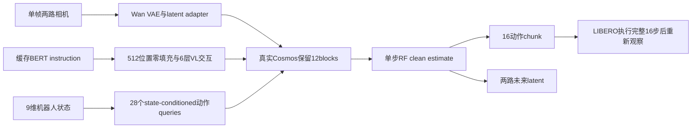

# SmolWAM：保留世界预测的紧凑机器人动作模型

> 当前为 `core_mechanism`：实现入口保留真实 Cosmos-derived trunk、LIBERO 动作闭环、teacher target 生成与布局课程，不用 VQA/随机小网络替代。尚待实际 CUDA receipt；原5000步蒸馏未重训，不能称 full_pipeline。

## 论文信息

| 项目 | 内容 |
| --- | --- |
| 论文链接 | [arXiv 2610.13740](https://arxiv.org/abs/2610.13740) |
| 公司/机构 | ML Collective |
| 首次公开日期 | 2026-10-09（arXiv v1） |
| 原文开源代码 | 是：[作者 SmolWAM 仓库](https://github.com/iitimii/SmolWAM) |
| Adapter | `smolwam` |
| 本地复现代码 | [`src/auto_research/reproductions/smolwam/`](https://github.com/daiwk/auto-research/tree/main/src/auto_research/reproductions/smolwam/) |

原始时间为 2026-10-09 15:34:33 UTC。代码固定 `dde1e5bfe35c439499343c6d70e9cd32c96d0b36`，Apache-2.0；**发布权重使用 NVIDIA One-Way Noncommercial License，不因代码开源而允许商业权重用途**。Wan VAE 独立为 Apache-2.0。训练、分发和后续应用须分别核对许可。

## 原始论文总结

### 背景与主要改动

Cosmos Policy 将机器人状态、两路相机、动作和未来状态编码为九个 latent frame，沿用视频生成接口：33 帧 VAE、T5-XXL、28-block 2B DiT、1764 tokens 和五步去噪。SmolWAM 并非只换一个轻量 action head，而是在保留预训练 trunk、token 原位置与 rectified-flow readout 的同时，逐项恢复接口改变造成的分布偏移。

单帧 Wan VAE 配合 0.5M adapter，映射回原 clip latent 空间；BERT 特征缓存并填充到 512 positions，保留偏置为零的注意力 sink。保留 block 0–2、19–27，共 12 block / 约 0.85B trunk，加 6 层零初始化 vision-to-language 交互后总模型约 0.88B。28 个 state-conditioned action queries 替代 196-token action frame，保留 blank 与图像，使序列为 1008 tokens。单次 trunk forward 同时读取 16×7 动作和两路 future latent。

### 架构流程



重绘源码：[architecture.mmd](assets/architecture.mmd)。原版[Figure 1](https://arxiv.org/html/2610.13740v1#S2.F1) 为 HTML 内嵌图，作者提供[架构 SVG](https://github.com/iitimii/SmolWAM/blob/dde1e5bfe35c439499343c6d70e9cd32c96d0b36/assets/architecture.svg)；[Figure 2](https://arxiv.org/html/2610.13740v1#S4.F2) 为 future 解码展示。[source-provenance.json](assets/source-provenance.json) 留存来源和固定版本。

### 核心公式

与 LeWAM 的噪声→数据方向不同，这里沿用 teacher 的数据→噪声 rectified flow：

$$x_\tau=(1-\tau)x_0+\tau\epsilon,\quad v_\theta\approx\epsilon-x_0,\quad \hat x_0=x_\tau-\tau v_\theta.$$

原版预条件化、RoPE 空间 extrapolation=3.0、禁用 fps modulation 均须保留；加载权重成功并不代表错误默认设置下的 trunk 等价。训练四个主要 L1 项为：

$$\mathcal L=\|\hat a-a\|_1+\|\hat a-a^T\|_1+\|\hat z-z\|_1+\|\hat z-z^T\|_1.$$

第一阶段 1000/5000 步用 teacher 的 1764-token layout 恢复 pruning，随后用 1008-token compact layout；原先存在的状态/value 另有 0.1 权重辅助监督。发布推理只需一次 forward，并不依赖先去噪 future 才能输出动作。

### 论文离线与线上效果

| 原文指标 | SmolWAM | 原文对照 |
| --- | --- | --- |
| LIBERO 400 episodes 成功率 | 95.5%（382/400） | Cosmos Policy 98.2%，teacher 来自较早评测管线 |
| A100 单 chunk 延迟 | 57ms | teacher 五步 624ms |
| 单 chunk FLOPs | 2.30 TFLOP | 42.6 TFLOP，正文计算含 VAE |
| 峰值显存 | 2.36GiB | 7.55GiB |
| 96 留出上下文 future latent L1 | 0.101 | copy-current 0.133 |
| 解码 LPIPS | 0.128 | copy-current 0.115，纹理并未更好 |

来源：[原文 §4](https://arxiv.org/html/2610.13740v1#S4)。Spatial/Object 接近 teacher，Goal/Long 更弱；追加训练、8-block、latent-action cascade 或视觉奖励微调存在负结果。只在模拟 LIBERO 测试、一个训练 seed；未实际验证 edge hardware、真实机器人或生产线上 A/B，不能把论文题目理解为已部署端侧。

## 本地复现

> **本地对照口径**：基线为同固定 LIBERO 初始状态实际执行的 no-op 策略，实验组为固定 SmolWAM checkpoint；完整 teacher 保持率与相对提速不适用。

```bash
PYTHONPATH=src python scripts/run_oct13_robotics.py \
  --paper smolwam --config /path/to/smolwam.json --seed 42 \
  --output runs/smolwam/seed42.json
```

配置含 `source_root`、隔离 `python`、`model_dir`、`vae_dir`、`libero_root`、`output_dir`、`device`、固定 `tasks` 和 `trials`。每 seed 的方法和 no-op 使用相同初始状态；使用原版倒置图像修正、9维 proprio、10次初始 wait、完整 16-action chunk。future 输出必须实际为 `(2,16,28,28)` 且有限；不以接口 dummy tensor 代替。没有完整模型/资产会失败，不隐式下载或换代理。

### 数据协议、结果与边界

发布模型 [timiiowolabi/SmolWAM](https://huggingface.co/timiiowolabi/SmolWAM) revision `c269c6e3a9c113b2b04187daf977c09486e2eadc`，model 3,517,377,924 bytes，text cache 3,936,048 bytes。Wan2.1 VAE 固定 `37ec512624d61f7aa208f7ea8140a131f93afc9a`，只读取 507,609,880-byte `Wan2.1_VAE.pth`，不下载视频 diffusion trunk。LIBERO 原版 Git 固定 `8f1084e3132a39270c3a13ebe37270a43ece2a01`；仅需代码、assets、bddl、init_files，闭环推理不需要 demonstration 下载。

原作者训练代码完整保留了四项蒸馏、6层 VL 和 layout curriculum；本地合同检查这些结构，但没有声称重新生成 teacher targets/执行 5000 步训练。当前为发布推理核心；world latent 实际输出但尚未对真实 future 计算原文图像指标。限定任务/episode 和三 seed 仍不是原版 400-episode benchmark。公式测试证据见 [implementation-contract.json](metrics/implementation-contract.json)，不当作 GPU 闭环结果；GPU gate 尚需真实 receipt。

### 代码映射

| 本地文件 | 原文/作者对应 |
| --- | --- |
| `algorithm.py` | §3 clean readout、布局课程、四项 distillation loss、发布结构合同 |
| `worker.py` | 实际 `SmolWAM.from_pretrained` + `predict_action(return_future=True)` + LIBERO step |
| `../lewam/external.py` | 源码 pin、provenance SHA、离线子进程、失败/超时保留 |
| `paper.yaml` | CUDA receipt 门禁、core_mechanism 与明确未重训组件 |

测试入口为 `python -m pytest tests/reproductions/test_oct13_agents_jepa.py`。模拟器依赖 `robosuite==1.4.0`、`mujoco==3.3.2`，不同于 LeWAM；两者不能覆盖共享环境版本。

### 接受范围中的真实 teacher 蒸馏与布局课程

训练两机制仍在本轮接受 scope 中。`--phase train` 调用固定作者 `smolwam.train.bank:main`、`smolwam.train.kd_targets:main`、`smolwam.train.train:train`，不是只链接 upstream。真实公开 demonstrations 经 Wan VAE 编码；真实 28-block Cosmos teacher 在同输入/固定噪声下生成 action/future targets；保留 12 block 的 student 先用 1764 tokens，再用 1008 tokens 进行四项 L1 更新。

```bash
PYTHONPATH=src python scripts/run_oct13_robotics.py --paper smolwam --phase train \
  --config /path/to/smolwam-train.json --seed 42 --output runs/smolwam/train-seed42.json
```

训练配置除既有资源外须有 `teacher_dir` 与 `training_data_dir`；默认按源顺序取前8 demonstrations、训练8步、`curriculum_fraction=0.25`，即2个 teacher-layout 与6个 compact-layout 优化步；`max_training_rows=32`、batch1。原始 latent adapter/BERT text cache 复用发布版，没有声称重新训练单帧↔clip adapter。teacher `.pt` 与缓存 T5 `.pkl` 仅从逐文件 hash 核验的官方固定版本加载。

| 增量训练资源 | 固定版本 | 文件/体积 |
| --- | --- | --- |
| `nvidia/Cosmos-Policy-LIBERO-Predict2-2B` | `cb689ec0e3347c13667d70a78a3447388f5c3bb8` | `Cosmos-Policy-LIBERO-Predict2-2B.pt` 3,913,017,345 bytes；`libero_t5_embeddings.pkl` 41,957,938 bytes；`libero_dataset_statistics.json` 2,372 bytes |
| `nvidia/LIBERO-Cosmos-Policy` | `b463cbd5d114909e4daea65eb03bed9787290042` | 单任务 `success_only/libero_goal_regen/put_the_cream_cheese_in_the_bowl_demo.hdf5` 143,770,729 bytes；`success_only/dataset_statistics.json` 2,372 bytes |

全量 `success_only` 为约14.84GB，不在该限量方案中下载。增量 teacher+单任务约4.10GB，可放在本轮20GB总预算内；由主代理统一下载，入口不下载资源。

许可再核验：固定版本[Cosmos teacher model card](https://huggingface.co/nvidia/Cosmos-Policy-LIBERO-Predict2-2B/blob/cb689ec0e3347c13667d70a78a3447388f5c3bb8/README.md) 也明确为 NVIDIA One-Way Noncommercial License（NSCLv1），不允许商业用途；[演示数据说明](https://huggingface.co/datasets/nvidia/LIBERO-Cosmos-Policy/blob/b463cbd5d114909e4daea65eb03bed9787290042/README.md) 为 CC BY 4.0。复用 latent adapter、蒸馏和导出 student 不会解除 teacher 的权重许可边界。

一个必须显式记录的 bounded-data 修正：作者 KD 默认 `val_frac=0` 仍排除一个 episode，单任务规模下它恰好可能排除全部 student validation KD rows。本地仅在 **teacher inference 缓存阶段** 对所有 bounded bank rows 生成真实 targets，包括 validation；student split/validation选checkpoint逻辑不变，未给 student train-loader 加入 validation 行，未修改 upstream pin。`training.py` 强制两种布局都有真实非零梯度/参数更新，所有四项 loss 实际存在、validation 非空，并只接受 compact-layout validation 选择的 checkpoint。

此训练入口目前尚需实际 A100 运行验证。即使8步全部执行，也只是缩小训练机制诊断，不代表原68,830row/5000step效果；重新训练 latent adapter、完整训练、多任务数据覆盖和**新 student**的 LIBERO闭环评测仍未完成。发布版推理不能被写成这些训练阶段已复现。
