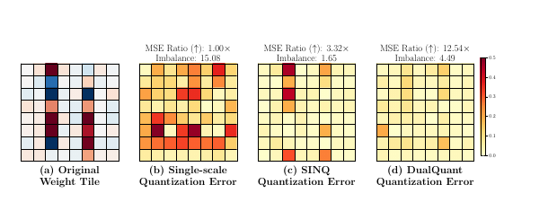

# DualQuant: Calibration-Free Dual-Scale Weight and Activation Quantization

<!-- source-sha256: 88f1833985537599b8a8db50bf43570b1d4dbea3004a4a9fc35dbb4d820e4f29 -->

[简体中文](README.md)

## Paper information

| Field | Value |
| --- | --- |
| Paper | [arXiv 2610.13767](https://arxiv.org/abs/2610.13767) |
| Affiliations | d-Matrix |
| First public release | 2026-10-09 (arXiv v1) |
| Author code | Yes: [authors' code](https://github.com/MahsaMoonlike/dualquant). |
| Adapter | `dualquant` |
| Local implementation | [`src/auto_research/reproductions/dualquant/`](https://github.com/daiwk/auto-research/tree/main/src/auto_research/reproductions/dualquant/) |

The local `core_mechanism / L1` implementation is a software simulation of specific formats, executed on an A100. It does not imply native FP4 matrix multiplication on that accelerator.

## Original paper

### Background and contribution

Weight and activation errors compound in W+A quantization. Minimizing row-wise dynamic range does not eliminate systematic column outliers. DualQuant uses only static weights to minimize reconstruction MSE jointly over row/block and column scales. The column scale also rescales activations at inference; no calibration examples, activation statistics, or Hessian are required.

This is not a search over heuristic exponents. Variable splitting separates inner scales used to assign quantization codes from outer scales used in reconstruction. With fixed codes, solve independent one-dimensional least-squares updates for row and column scales, project to representable values, synchronize the inner copies, and requantize. The black-box quantizer $Q$ lets the solver support multiple codebooks.

```mermaid
flowchart LR
  A[Static weight tile only] --> B[Inner row and column scaling]
  B --> C[Black-box format grid Q]
  C --> D[Fixed-code row inverse-scale update]
  D --> E[Project, synchronize, and requantize]
  E --> F[Fixed-code column inverse-scale update]
  F --> G[Project and requantize]
  G --> B
  G --> H[Low-bit weight codes and dual inverse scales]
  H --> I[Scale X by column inverse scales, then quantize]
  I --> J[Reference matmul and row output scale]
```



[Figure 1 on page 3 of the v1 PDF](https://arxiv.org/pdf/2610.13767v1) compares elementwise error with matrix imbalance: more balanced does not mean MSE-optimal. The 12.54× figure is a specific tile example, not whole-model acceleration or a local result.

<!-- paper-figure:start -->
### Key figure from the paper

[](https://arxiv.org/pdf/2610.13767v1)

Figure 1 from page 3 of the [paper](https://arxiv.org/pdf/2610.13767v1), copyright the authors. This depicts weight-tile error, not local performance.
<!-- paper-figure:end -->

### Core equations

$$
W\approx D_\alpha^{-1}Q(D_\alpha W D_\beta)D_\beta^{-1},\quad XW^\top\approx (XD_\beta^{-1})\hat Q^\top D_\alpha^{-1}.
$$

Let the outer inverse scales be $a=\alpha^{-1},b=\beta^{-1}$. With fixed codes, set $R=\hat QD_b,S=D_a\hat Q$:

$$
a_i\leftarrow\Pi_{F_a}\frac{\sum_j W_{ij}R_{ij}}{\sum_j R_{ij}^2},\quad b_j\leftarrow\Pi_{F_b}\frac{\sum_i W_{ij}S_{ij}}{\sum_i S_{ij}^2}.
$$

Requantize after the row update and again after the column update. Use scale 1 for an all-zero code slice. Projection is on **inverse scales**; arbitrary positive real values are not necessarily hardware legal. See [Section 4 and Algorithm 1](https://arxiv.org/html/2610.13767v1#S4). Descent after codes stabilize does not guarantee monotonicity while they change.

### Paper results

| Llama3.1-8B, WikiText2 PPL, Table 1 | RTN | SmoothQuant | DualQuant |
|---|---:|---:|---:|
| INT4 W+A, G64 | 7.11 | 6.98 | 6.73 |
| MXINT4 W+A, G32 | 7.63 | 7.48 | 7.15 |
| NVFP4 W+A, G16 | 9.04 | 7.32 | 6.83 |

For packed INT4 W4A4 on RTX4090 with Llama3.1-8B, the paper reports up to 2.61× lower memory and 2.46× throughput at prefill batch 16 (Table 3). This is not native FP4 on A100. See [paper experiments](https://arxiv.org/html/2610.13767v1#S5). No online A/B test was reported.

## Local reproduction

> Compare single-scale and dual-scale INT4 W+A on identical linear layers of the same public checkpoint. The simulation reports reconstruction MSE and held-out test NLL, not throughput or memory improvement.

`solve_dual_scale` does not accept $X$; it executes black-box $Q$, closed-form updates, projection, and synchronization. `DualQuantLinear.forward` rescales and quantizes $X$ before reference matmul. Supported formats are signed INT4 codebook `[-8,7]` with BF16 scales, or MXINT4 with the same codebook and E8M0 power-of-two scales. Exponents are restricted to [-126,126]. MXFP4/NVFP4 are unsupported; renaming INT4 does not implement FP4.

```bash
PYTHONPATH=src python scripts/run_oct12_foundation.py --paper dualquant \
  --device cuda --seed 42 --iterations 15 --max-linear-layers 4 \
  --scale-format bf16 --eval-bytes 4096 \
  --dataset-dir data/oct12-wikitext --output runs/oct12/dualquant-s42
```

The default quantizes the first four decoder `nn.Linear` modules of public SmolLM2-135M using row tiles of 128 and column groups of 32. This is a **partial-checkpoint mechanism diagnostic**. `--max-linear-layers 0` visits every eligible decoder linear layer; embeddings and lm_head remain unquantized. Results list exact modules, not an assumed whole-model W4A4 scope.

### Data and results

The public [SmolLM2-135M](https://huggingface.co/HuggingFaceTB/SmolLM2-135M) revision is `93efa2f097d58c2a74874c7e644dbc9b0cee75a2`; WikiText2 is pinned to `b08601e04326c79dfdd32d625aee71d232d685c3`. The solver minimizes weight MSE without validation or test inputs and uses fixed format and iteration counts. The NLL evaluator uses only official validation/test, separate from the paper's PPL.

Use `--checkpoint-path` for an offline mirror. Verify identity, pinned revision, and SHA256s of all model/tokenizer files before loading with local_files_only. `scripts/prepare_oct12_public_sources.py --source smollm` downloads the pinned revision and seals hashes. Receipts omit local paths, hostnames, and accounts.

The 2026-10-12 A100 run used `--max-linear-layers 0 --iterations 5` and covered all eligible decoder linear layers. Single-seed held-out test NLL was `4.52491` for single-scale, `4.41843` for dual-scale, and `3.61779` for full precision. Dual scaling reduces quantization damage but remains worse than full precision. This is neither a capability improvement nor evidence of low-bit kernel acceleration.

See [measured results and exact modules](metrics/smollm2-wikitext-a100-42.json) and the [GPU receipt](../../gpu-validations/oct12-dualquant-a100.json). Equation tests cover call order, closed-form updates, zero slices, representable scales, and activation rounding.

### Code and limits

Algorithm: `foundation_models/oct12_mechanisms.py::{solve_dual_scale,DualScaleTile,DualQuantLinear}`. Public checkpoint comparison: `reproductions/oct12_foundation_multimodal.py::run_dualquant`. Tests: `tests/test_oct12_foundation_mechanisms.py`.

Codes are floating-point tensors and reference weights are retained for MSE diagnostics. There is no packing, compressed storage, or low-bit CUDA kernel, so the implementation can use more memory or run slower than FP32. Format names, an A100 run, and unit tests do not establish hardware speedups. The paper's packed RTX4090 path differs from the local reference implementation. No Evolve integration is claimed.
