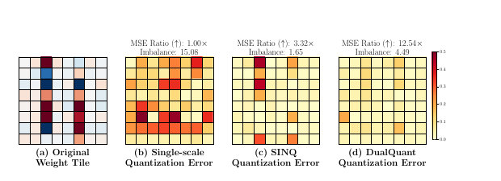

# DualQuant：免校准双尺度权重与激活量化

## 论文信息

| 项目 | 内容 |
| --- | --- |
| 论文链接 | [arXiv 2610.13767](https://arxiv.org/abs/2610.13767) |
| 公司/机构 | d-Matrix |
| 首次公开日期 | 2026-10-09（arXiv v1） |
| 原文开源代码 | 是：[官方/作者代码](https://github.com/MahsaMoonlike/dualquant) |
| Adapter | `dualquant` |
| 本地复现代码 | [`src/auto_research/reproductions/dualquant/`](https://github.com/daiwk/auto-research/tree/main/src/auto_research/reproductions/dualquant/) |

本地是 `core_mechanism / L1` 的限定格式software simulation，已在A100执行；不声称A100具备原生FP4矩阵乘法。

## 原始论文总结

### 背景与主要改动

W+A量化中，权重与激活误差相互放大；仅最小化逐row动态范围不能消除跨row系统性column outlier。DualQuant只读取静态权重，以row/block尺度与column尺度共同最小化重建MSE。column尺度同时变成推理时的激活重缩放，不需要校准样本、激活统计或Hessian。

核心不是遍历若干启发式指数：量化grid assignment的inner尺度与重建的outer尺度作variable splitting，在固定codes时分别解row/column一维最小二乘闭式解，投影到格式可表示尺度，再同步inner copies重新量化。$Q$是black-box，使同一solver支持不同codebook。


原图检查：已检查 [v1 PDF](https://arxiv.org/pdf/2610.13767v1) 第3页Figure1。它比较逐元素误差与matrix imbalance，说明“更均衡”不是MSE最优的同义词；图中12.54×是特定tile示例，不可当全模型加速或本地指标。

<!-- paper-figure:start -->
### 原论文关键图

[](https://arxiv.org/pdf/2610.13767v1)

图片来自[原论文](https://arxiv.org/pdf/2610.13767v1)第3页Figure1，版权归原作者所有；这是特定weight tile误差示例，非本地性能图。
<!-- paper-figure:end -->

### 核心公式

$$
W\approx D_\alpha^{-1}Q(D_\alpha W D_\beta)D_\beta^{-1},\quad XW^\top\approx (XD_\beta^{-1})\hat Q^\top D_\alpha^{-1}.
$$

记outer inverse-scales为 $a=\alpha^{-1},b=\beta^{-1}$，固定codes时令 $R=\hat QD_b,S=D_a\hat Q$：

$$
a_i\leftarrow\Pi_{F_a}\frac{\sum_j W_{ij}R_{ij}}{\sum_j R_{ij}^2},\quad b_j\leftarrow\Pi_{F_b}\frac{\sum_i W_{ij}S_{ij}}{\sum_i S_{ij}^2}.
$$

row更新后必须重新量化，再解column并重新量化；零codes slice采用scale1约定。投影的是**inverse-scale**，不是把任意正实数声称为硬件合法scale。[原文 §4、Algorithm1](https://arxiv.org/html/2610.13767v1#S4)。codes稳定之后的descent结论，不等于codes变化时期也无条件单调。

### 论文离线与线上效果

| 原文Llama3.1-8B，WikiText2 PPL，Table1 | RTN | SmoothQuant | DualQuant |
|---|---:|---:|---:|
| INT4 W+A，G64 | 7.11 | 6.98 | 6.73 |
| MXINT4 W+A，G32 | 7.63 | 7.48 | 7.15 |
| NVFP4 W+A，G16 | 9.04 | 7.32 | 6.83 |

原文RTX4090、Llama3.1-8B真实packed INT4 W4A4 Table3报告最大2.61×内存下降、2.46×throughput（prefill batch16）；它不是A100 native FP4结果。[原文实验](https://arxiv.org/html/2610.13767v1#S5)。**线上 A/B：未报告**。

## 本地复现

> **本地对照口径**：相同公开checkpoint中相同线性层的single-scale INT4 W+A为基线，dual-scale为实验组；相对吞吐和内存不适用，software simulation只报告重建MSE与隔离test NLL。

`solve_dual_scale` API不接受X；它实际执行black-box Q、闭式更新、投影和同步。`DualQuantLinear.forward` 真正重缩放并量化X，再执行reference matmul。只支持signed INT4 `[-8,7]` codebook、BF16尺度，或同codebook的E8M0 power-of-two尺度MXINT4；指数在[-126,126]，明确限定子集。未支持MXFP4/NVFP4，不能仅更改标签把INT4当成FP4。

```bash
PYTHONPATH=src python scripts/run_oct12_foundation.py --paper dualquant \
  --device cuda --seed 42 --iterations 15 --max-linear-layers 4 \
  --scale-format bf16 --eval-bytes 4096 \
  --dataset-dir data/oct12-wikitext --output runs/oct12/dualquant-s42
```

默认量化公开SmolLM2-135M的前四个decoder `nn.Linear`，每row tile128、column group32，属于**部分checkpoint机制诊断**；`--max-linear-layers 0`才遍历全部合格decoder线性层，embedding/lm_head仍不量化。result列出精确module名单，避免默认为全模型W4A4。

### 数据协议与结果

公共checkpoint [SmolLM2-135M](https://huggingface.co/HuggingFaceTB/SmolLM2-135M) revision `93efa2f097d58c2a74874c7e644dbc9b0cee75a2`；WikiText2 revision `b08601e04326c79dfdd32d625aee71d232d685c3`。仅权重MSE优化，validation/test都不进入solver，格式/迭代数固定。NLL evaluator只用官方validation/test，结果与原论文PPL口径分开。

离线公开镜像须用 `--checkpoint-path`，身份/固定revision与所有model/tokenizer文件SHA256校验成功后才以local_files_only加载。`scripts/prepare_oct12_public_sources.py --source smollm` 下载固定revision并seal哈希；不把本地path、主机名或账号写回执。

2026-10-12 A100实跑使用 `--max-linear-layers 0 --iterations 5`，覆盖全部合格decoder线性层。单seed隔离test NLL：single-scale `4.52491`，dual-scale `4.41843`，全精度 `3.61779`。dual-scale损伤更小，但仍劣于全精度；不能称为模型能力提升，也不支持低位kernel加速结论。

实测及精确module名单见 [smollm2-wikitext-a100-42.json](metrics/smollm2-wikitext-a100-42.json)，回执见 [GPU证据](../../gpu-validations/oct12-dualquant-a100.json)。公式单测覆盖调用顺序、闭式解、zero slice、可表示scale与activation rounding。

### 代码映射与边界

算法位于 `foundation_models/oct12_mechanisms.py::{solve_dual_scale,DualScaleTile,DualQuantLinear}`；public checkpoint对照位于 `reproductions/oct12_foundation_multimodal.py::run_dualquant`；测试位于 `tests/test_oct12_foundation_mechanisms.py`。

codes以浮点tensor保存，且保留reference权重用于MSE诊断：没有packing、压缩存储或低位CUDA kernel，甚至可能比FP32更慢/占更多内存。不得根据格式名称、A100实跑或单位测试宣称硬件加速；paper packed4090部署与本地reference路径完全不同。未声明evolve集成。
