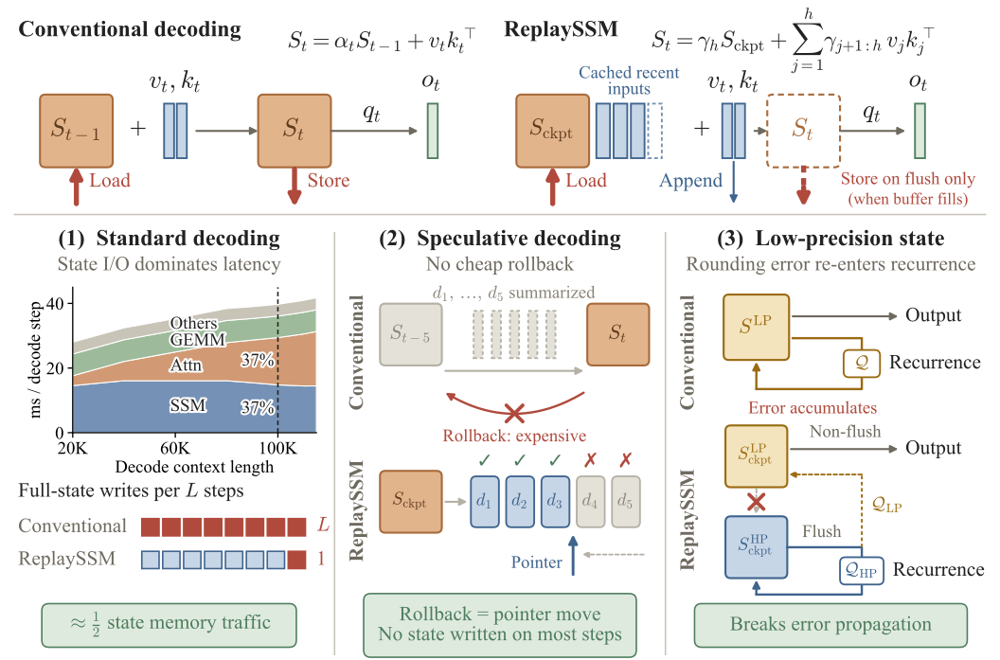
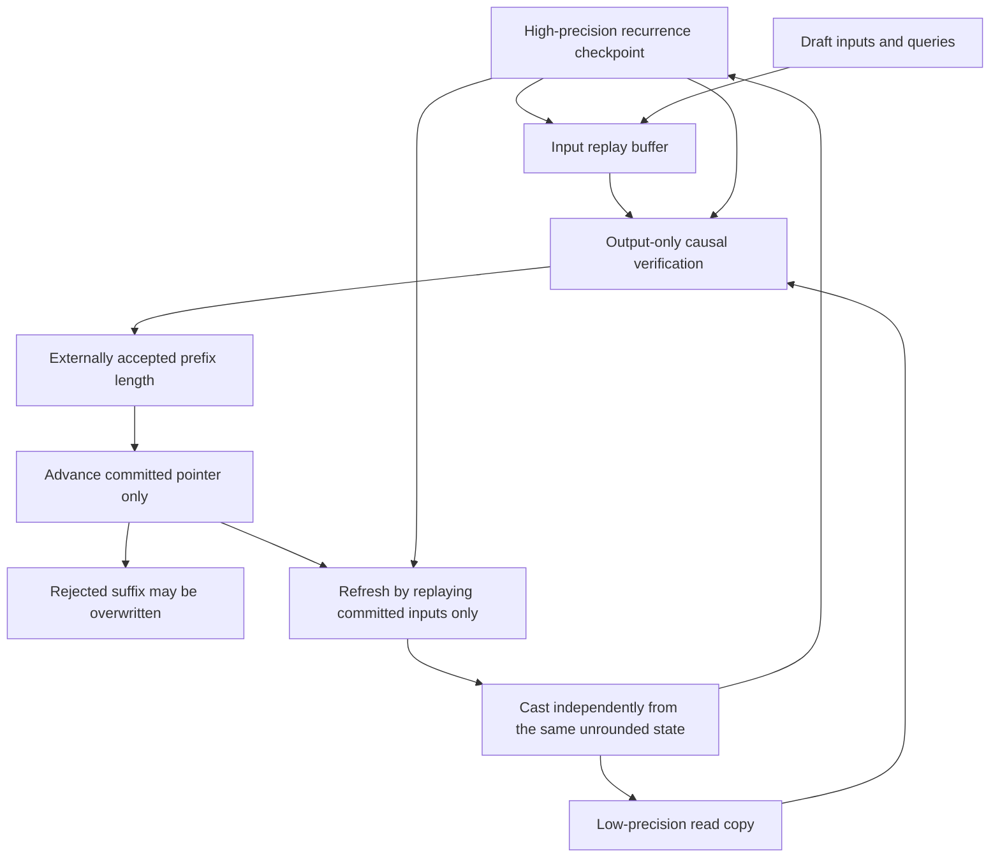

# ReplaySSM: Cache SSM inputs instead of writing back state for every token

<!-- source-sha256: 484da6cd97e204eb4fe6bab2d3a05149d52677a41c78bb1cb4e1e0dc9b5244ff -->

[简体中文](README.md)

## Paper information

| Field | Value |
| --- | --- |
| Paper | [arXiv 2610.13778](https://arxiv.org/abs/2610.13778) |
| Affiliations | Princeton University / NVIDIA |
| First public release | 2026-10-09 (arXiv v1), 15:59:40 UTC |
| Author code | [ReplaySSM](https://github.com/Johnny-Liou/ReplaySSM), Apache-2.0 |
| Adapter | `replayssm` |
| Local implementation | [src/auto_research/reproductions/replayssm/](https://github.com/daiwk/auto-research/tree/main/src/auto_research/reproductions/replayssm/) |

The upstream commit is `5d3ea597d479ef0c8e9e2eb2845a2adfdb9a8b44`; the vLLM baseline is `ee1d99636702b8ed9ad88c2c2b833d331dce01c1`. The local runner does not execute the authors' installation script and checks the pinned commit and license before importing standalone Triton code.

## Original paper

### Motivation and method

Mamba2/GDN decoding normally reads and writes the full matrix state every token and is often memory-bandwidth-bound. ReplaySSM separates persistent state from output computation: refresh a checkpoint every 16 tokens and log only small inputs between refreshes. Outputs replay the checkpoint and buffered inputs. Speculative verification uses an output-only form rather than materializing a full state for each draft.

The acceptance length advances only the committed-input pointer; rejected drafts never enter the recurrence. Separating a low-precision copy used for output reads from a high-precision recurrence anchor prevents repeated feedback of read quantization error. GDN keeps original values and recomputes residuals from the high-precision anchor on refresh.

### Original paper figure and local flow

[](https://arxiv.org/html/2610.13778v1/overview_figure.svg)

[Figure 1](https://arxiv.org/html/2610.13778v1#S1.F1) contrasts per-token writeback with buffered inputs and periodic refresh, then explains pointer rollback and the separate recurrence and read states. The [original SVG](https://arxiv.org/html/2610.13778v1/overview_figure.svg) was rendered at twice the resolution without redrawing it; see [provenance](assets/provenance.json). Throughput and memory-traffic annotations are the authors' native serving results, not measurements from the local FP32-storage emulation. Copyright remains with the original authors.

The following local diagram maps [Algorithms 1–3](https://arxiv.org/html/2610.13778v1#S4) to the implementation:



### Core equations

$$
S_h=\gamma_h S_{ckpt}+\sum_{j=1}^h\gamma_{j+1:h}v_j k_j^T,\quad \gamma_{a:b}=\prod_{i=a}^b\alpha_i.
$$

$$
O=S_{ckpt}QD+V\left(W\odot K^TQ\right),\quad W_{js}=\mathbf1[j\le h+s]\gamma_{j+1:h+s}.
$$

This reassociation computes key-query scalar products without a per-token $d_v\times d_k$ intermediate state. GDN residuals satisfy the triangular system:

$$
u_j+\sum_{i<j}\beta_j\gamma_{i+1:j}(k_i^Tk_j)u_i=\beta_j\left(v_j-\gamma_j S_{ckpt}k_j\right).
$$

Refresh forms $S$ from the committed raw records, then casts independently to $Q_{HP}(S)$ and $Q_{LP}(S)$. The read copy is not derived from a previously rounded anchor. Speculative flush triggers at $h+T>L$; when the acceptance count is unknown it can still refresh only the old committed portion.

### Paper-reported results

| Configuration | Reported result |
| --- | --- |
| Standard decoding, B=256, L=16, FP32 state | SSM kernel 1.46–1.80×; whole-model decode step 1.20–1.47× |
| 120B-class speculative decoding, B=512, T=4 | 1.85× / 2.10× throughput versus conventional speculation |
| Qwen3.5-4B PG-19, 128K teacher forcing | Shared NVFP4 KL 0.136; FP32 recurrence + NVFP4 read KL 0.0038 |
| Shared NVFP4+SR, mean over four models | GPQA-Diamond -13.05 percentage points |
| NVFP4 read / FP16+SR recurrence | GPQA-Diamond -2.36 percentage points |

The paper uses 4B/H100 and 120B-class/B300 configurations, not the local A100 configuration. It discusses serving adoption but reports no online A/B experiment; a deployment description is not causal production evidence.

## Local reproduction

This core-mechanism / L1 reproduction has two evidence paths. An independent PyTorch reference executes checkpointing, accept/rollback, output-only verification, the GDN triangular solve, and dual-precision refresh. Pinned upstream standalone code runs **actual Triton CUDA kernels** for Mamba2/GDN precision and window checks. The references are conventional FP32 recurrence and the authors' `s32_rs`; error measurements do not establish native serving throughput or relative bandwidth savings.

### Data protocol and entry point

Seeded recurrent inputs follow `replayssm-random-input-protocol-v2-gdn-rollback`, not a public language benchmark. The GDN reference runs zero, partial, and full acceptance and window refresh on the actual requested device, with an independent original stepwise GDN recurrence as control. FP16/FP32 read copies share an FP32 anchor to verify that read error does not enter committed state. An empty committed history after zero acceptance leaves the anchor unchanged and never calls an empty triangular solve. The runner clones the upstream emulation's reused output buffer immediately and runs at least 17 steps to cover a 16-token refresh. Upstream standalone `.step` is not native speculative serving.

```bash
PYTHONPATH=src python scripts/run_replayssm.py \
  --upstream /path/to/pinned-ReplaySSM --steps 48 --seed 42 \
  --output runs/replayssm-seed42.json
```

Set `upstream` and `steps` in the adapter's `dataset_dir/replayssm.json`. The upstream path requires PyTorch/Triton and real NVIDIA CUDA. The runner does not install dependencies, load model weights, or claim a vLLM build.

### Pinned upstream JIT compatibility

The A100 run at `34148c2e` on 2026-10-13 failed during GDN kernel compilation: Triton 3.3 rejected the three-term Boolean AST `TWOPREC and (not is_flush) and (not is_seed)`. That failure is retained; it is neither a three-seed success nor evidence of unmodified native serving.

The compatibility entry point adds left-associative parentheses only to verified source in `_gdn_unf_vf_step_kernel`, producing `(TWOPREC and (not is_flush)) and (not is_seed)`. The sole edit is at JIT-function-relative line 122, columns 7–51. Upstream file SHA256 is `80311d6654584c633db01f76e3be5bc189fbdfab031c1bc0711757e1cd09eec3`; original JIT text SHA256 is `7f60e87d974bfea4b5095980599043d8a7a615db4ba1b5fdbf7a0c1d0bfc6ab1`. A mismatch in the file, function identity, edit range, or JIT cache-reset API fails closed. The upstream files on disk and shared Torch/Triton are not modified.

The transformation is only for compatibility with the original algorithm, not a replacement for its kernel, precision, or refresh logic. The receipt records both text hashes and the exact edit. CPU tests verify AST structure, Boolean results, and short-circuit order, not arbitrary custom truth-value objects with side effects. Frozen commit `6aabe57a` was rerun on real A100 for three seeds; CPU tests do not replace CUDA evidence.

### Local reference and A100 results

[CPU reference results](metrics/cpu-contracts.json), seed 42: maximum output error `1.1920928955078125e-7`, 12 accepted tokens, 3 refreshes. Four behavior tests cover the formulas, GDN, pending/rollback, and isolation of low-precision reads from the recurrence.

The [three-seed metrics](metrics/a100-three-seeds-6aabe57a.json) and [sanitized GPU receipt](../../gpu-validations/replayssm-a100-20261013.json) bind executed commit `6aabe57a97ec3a586aac7aeea66128750f9441da`, the source archive and three core source hashes, the pinned upstream commit and six upstream hashes, and 12 successful raw-file hashes. The adapter's receipt path retains 20261013, but the run completed at 2026-10-13 17:50:33 UTC (October 14 in Beijing). Seeds 42/43/44 each ran the authors' four Mamba2/GDN precision modes for 48 steps without increasing the budget.

Maximum independent CUDA reference output error for both Mamba-style and original stepwise GDN controls was `1.1920928955078125e-7`; GDN committed state error was at most `1.4901161193847656e-8`. Zero, partial, and full acceptance ran (0/1/2/3 accepted tokens repeated twice), totaling 12 tokens and 3 refreshes for each FP16/FP32 read. Changing read precision changed the output by up to `2.3543834686279297e-4`, but the high-precision anchors differed by **0** for every seed.

Upstream Triton emulation RMSE versus `s32_rs`, mean ± sample standard deviation; these are not perplexity, downstream capability, or throughput:

| Precision mode | Mamba2 output RMSE | Mamba2 anchor RMSE | GDN output RMSE | GDN anchor RMSE |
| --- | ---: | ---: | ---: | ---: |
| `s32_rs` | 0 | 0 | 0 | 0 |
| `tp8_hi32` | 0.027127 ± 0.000286 | 0 | 0.00019007 ± 0.00000124 | 0 |
| `tp4_hi16_sr` | 0.101185 ± 0.001308 | 0.000052374 ± 0.000000075 | 0.00070530 ± 0.00000246 | 0.00012261 ± 0.00000337 |
| `f4_sr_rs` | 0.159245 ± 0.001547 | 0.0245588 ± 0.0000476 | 0.00110594 ± 0.00000467 | 0.0215533 ± 0.0000678 |

Independent read casts passed for both architectures and all seeds. Shared FP4 recurrence error is preserved, not zeroed after successful execution. The lower anchor error on these random inputs does not validate paper-level PG-19/GPQA results.

Original JIT hash `7f60e87d…` and parentheses-only compiled text hash `9add48ef24fa9df25a71e5f8a05fc0dac46b35c6b5efdc73012cbeeeae1c8174` match across seeds; upstream files are unchanged. The `34148c2e` seed 42 compile failure and its three raw-file hashes remain in the new receipt, never marked passed or bound to unexecuted source.

Wall times for 48 steps were 22.89/2.65/2.58 seconds. Seed 42 included cold compilation and later seeds hit the cache; these timings cannot compare modes, native serving, or the paper's speedups. Read-only curator `scripts/curate_oct14_replayssm.py` and fixture tests verify source, JIT change, budgets, success status, and finiteness without relying on CI's local `runs/`.

The upstream emulation stores decoded quantized values as **FP32 tensors**. It can test FP4/FP8 rounding, independent casts, and state error, not physical low-bit HBM traffic or speed gains. The low-precision CuTe performance path targets B300, not A100 FP32-storage emulation. The reference buffer is a bounded list, not native CUDA circular allocation. Native vLLM, Qwen3.5/Nemotron weights, PG-19 KL, and downstream long generation are outside scope. The standalone Triton run is not a full serving reproduction and is not integrated into Evolve.

### Code mapping

| Component | Local code |
| --- | --- |
| Replay, output-only, rollback, GDN, and dual precision | [replayssm.py](https://github.com/daiwk/auto-research/blob/main/src/auto_research/foundation_models/replayssm.py) |
| Pinned upstream Triton precision verification | [run_replayssm.py](https://github.com/daiwk/auto-research/blob/main/scripts/run_replayssm.py) |
| Behavior tests | [test_replayssm.py](https://github.com/daiwk/auto-research/blob/main/tests/test_replayssm.py) |
