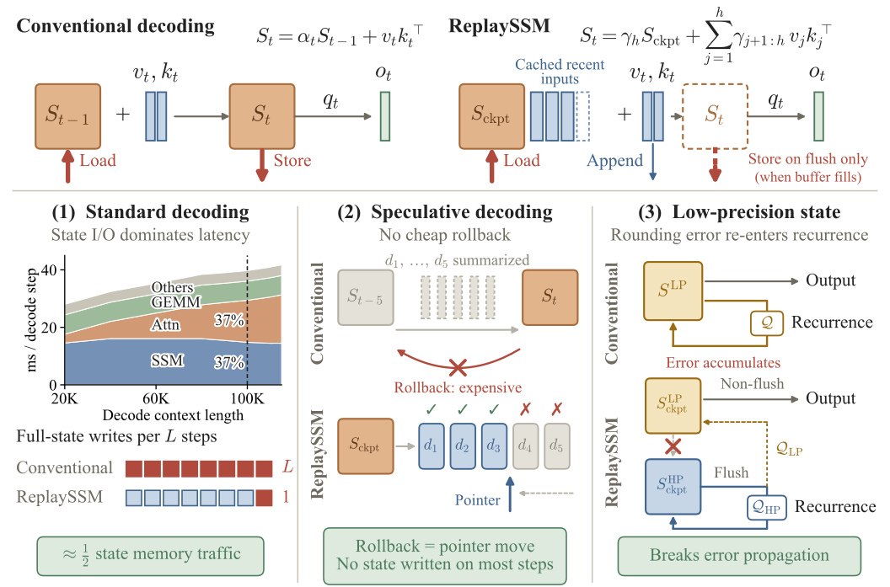
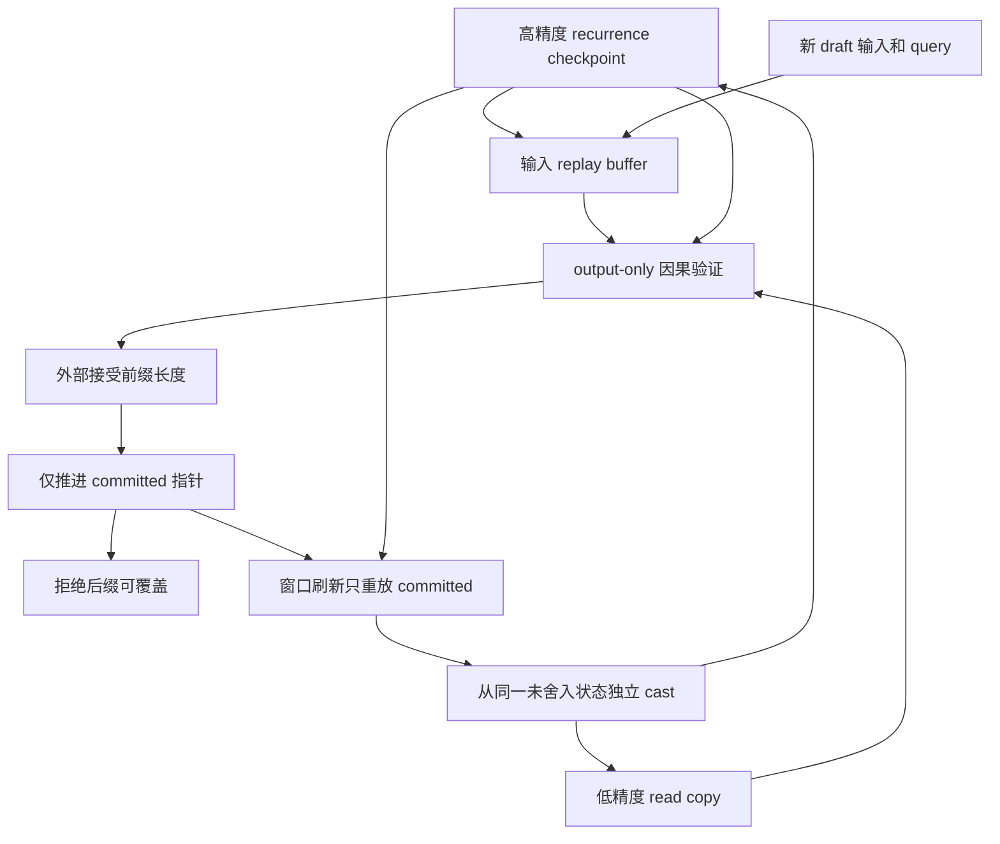

# ReplaySSM：缓存 SSM 输入，避免逐 token 状态写回

## 论文信息

| 字段 | 内容 |
| --- | --- |
| 论文链接 | [arXiv 2610.13778](https://arxiv.org/abs/2610.13778) |
| 公司/机构 | Princeton University / NVIDIA |
| 首次公开日期 | 2026-10-09（arXiv v1） |
| 原文开源代码 | 是：[ReplaySSM](https://github.com/Johnny-Liou/ReplaySSM) |
| Adapter | `replayssm` |
| 本地复现代码 | [`src/auto_research/reproductions/replayssm/`](https://github.com/daiwk/auto-research/tree/main/src/auto_research/reproductions/replayssm/) |

原始 v1 提交时间 2026-10-09 15:59:40 UTC。作者仓库固定 `5d3ea597d479ef0c8e9e2eb2845a2adfdb9a8b44`，Apache-2.0；vLLM 基线 commit 为 `ee1d99636702b8ed9ad88c2c2b833d331dce01c1`。本地不执行作者安装脚本，standalone Triton import 前检查固定 commit 与许可证。

## 原始论文总结

### 背景与主要改动

Mamba2/GDN 解码一般每 token 读写完整矩阵状态，常受显存带宽限制。ReplaySSM 把持久化状态与输出计算拆开：每 16 token 才刷新 checkpoint，其间只记录小型输入；输出由 checkpoint 与输入重放计算。投机验证使用 output-only 形式，避免为每个 draft 物化完整状态。

接受长度只推进已提交输入指针；被拒 draft 不进入 recurrence。进一步把输出读取用的低精度副本与高精度 recurrence anchor 分开，避免低精度误差逐轮反馈。GDN 必须保留原始 value，并在刷新时从高精度 anchor **重算** residual。

### 架构图

<!-- paper-figure:start -->
### 原论文关键图

[](https://arxiv.org/html/2610.13778v1/overview_figure.svg)

原论文 Figure 1 总览：上方将逐 token 状态写回改为输入缓存和周期刷新；下方解释接受指针回滚，以及高精度 recurrence anchor 与低精度 read copy 的分离。来源为 [arXiv 2610.13778v1，Figure 1](https://arxiv.org/html/2610.13778v1#S1.F1) 的 [原始 SVG](https://arxiv.org/html/2610.13778v1/overview_figure.svg)，PNG 仅作两倍分辨率渲染，未重绘。图内吞吐、显存流量注记属于作者原生 serving 设置，**不是**本地 FP32 存储 emulation 的性能测量。原 SVG、PNG 与视觉核验记录见 [assets/provenance.json](assets/provenance.json)。

> **原论文 Figure 1（关键图）**：上文说明所选原图的范围；并非本地测量。图片来自[原论文](https://arxiv.org/html/2610.13778v1/overview_figure.svg)，版权归原作者所有；点击图片可查看固定版本来源。
<!-- paper-figure:end -->

下图为本地实现映射的重绘示意，对应 [原文 Algorithms 1–3](https://arxiv.org/html/2610.13778v1#S4)：



### 核心公式

$$
S_h=\gamma_h S_{ckpt}+\sum_{j=1}^h\gamma_{j+1:h}v_j k_j^T,\quad \gamma_{a:b}=\prod_{i=a}^b\alpha_i.
$$

$$
O=S_{ckpt}QD+V\left(W\odot K^TQ\right),\quad W_{js}=\mathbf1[j\le h+s]\gamma_{j+1:h+s}.
$$

该重括号形式只计算 key/query 标量积，不产生每 token 的 $d_v\times d_k$ 中间状态。GDN residual满足三角系统：

$$
u_j+\sum_{i<j}\beta_j\gamma_{i+1:j}(k_i^Tk_j)u_i=\beta_j\left(v_j-\gamma_j S_{ckpt}k_j\right).
$$

刷新规则是从 committed 原始记录构造 $S$，再独立形成 $Q_{HP}(S)$、$Q_{LP}(S)$；不是先把高精度 anchor 舍入，再从已舍入值生成 read copy。投机 flush 条件为 $h+T>L$，在接受数未知时也只能刷新旧 committed 部分。

### 论文离线与线上效果

| 原文配置 | 报告结果 |
| --- | --- |
| 标准解码，B=256、L=16、FP32 state | SSM kernel 1.46–1.80×，全模型 decode step 1.20–1.47× |
| 120B-class 投机，B=512、T=4 | 相对 conventional speculation 吞吐 1.85× / 2.10× |
| Qwen3.5-4B PG-19，128K teacher forcing | shared NVFP4 KL 0.136；FP32 recurrence + NVFP4 read KL 0.0038 |
| shared NVFP4+SR，四模型均值 | GPQA-Diamond -13.05 个百分点 |
| NVFP4 read / FP16+SR recurrence | GPQA-Diamond -2.36 个百分点 |

原文性能 GPU 为 4B/H100 与 120B-class/B300，不是本地 A100 同配置结果。作者讨论 serving 采用，但原文**未报告线上 A/B**；部署描述不替代在线因果效果证据。

## 本地复现

`core_mechanism / L1` 分成两条证据：独立 PyTorch 参考执行 checkpoint、accept/rollback、output-only、GDN 三角解与双精度刷新；固定作者 standalone **真实 Triton CUDA kernel**执行 Mamba2/GDN 精度和窗口检查。

> **本地对照口径**：基线为 conventional FP32 recurrence 与作者 `s32_rs`，实验组为重放及独立精度配置；它们的误差指标不是原生服务吞吐，相对带宽提升百分比不适用。

### 数据协议与执行入口

随机 recurrent 输入使用版本化协议 `replayssm-random-input-protocol-v1` 和显式 seed，不是公开语言 benchmark。作者 emulation 每次调用复用 output buffer，本地立即 clone，至少执行 17 步覆盖 16-token refresh。

```bash
PYTHONPATH=src python scripts/run_replayssm.py \
  --upstream /path/to/pinned-ReplaySSM --steps 48 --seed 42 \
  --output runs/replayssm-seed42.json
```

adapter 的 `dataset_dir/replayssm.json` 包含 `upstream` 与 `steps`。作者需要 PyTorch/Triton + 真实 NVIDIA CUDA，脚本不安装依赖、不加载模型权重、不声称完成 vLLM build。

### 本地结果与边界

[cpu-contracts.json](metrics/cpu-contracts.json)记录 seed 42 独立参考：最大输出误差 `1.1920928955078125e-7`、接受 12 个 token、刷新 3 次；4 个行为测试覆盖公式、GDN、pending/rollback 和低精度 read 不进入 recurrence。

作者 emulation 把量化数值解码后存成 **FP32 tensor**。它可验证 FP4/FP8 舍入、独立 cast 与状态误差，但不能验证低比特物理 HBM 流量或带宽速度收益。该 repo 的低精度 CuTe 性能路径面向 B300，不以 A100 FP32-storage 仿真代替。独立 reference buffer 是有界列表，不是原生 CUDA circular allocation。

Native vLLM、Qwen3.5/Nemotron 权重、PG-19 KL 与下游长生成评测仍不属于本入口；不能把 standalone Triton 测试升级为完整服务复现。未接入 Evolve。

### 代码映射

| 原文组件 | 本地实现 |
| --- | --- |
| Replay、output-only、rollback、GDN、双精度 | [replayssm.py](https://github.com/daiwk/auto-research/blob/main/src/auto_research/foundation_models/replayssm.py) |
| 固定作者 Triton 精度验证 | [run_replayssm.py](https://github.com/daiwk/auto-research/blob/main/scripts/run_replayssm.py) |
| 行为测试 | [test_replayssm.py](https://github.com/daiwk/auto-research/blob/main/tests/test_replayssm.py) |

