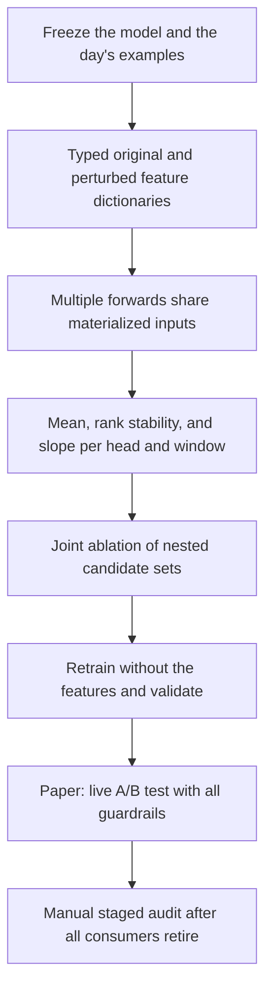
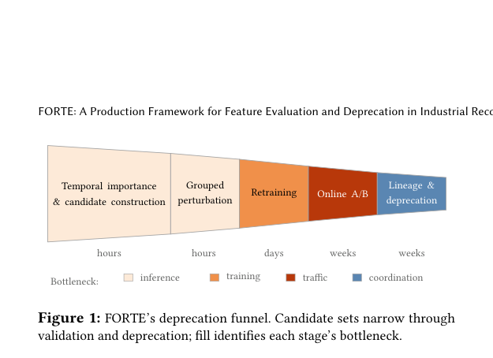

# FORTE: Feature Evaluation and Retirement in Production Recommenders

<!-- source-sha256: 23be922581f48bde86d0e80b07d2bee47357b13895770c2f0b3afdec80b24555 -->

[简体中文](README.md)

## Paper information

| Field | Value |
| --- | --- |
| Paper | [arXiv 2610.13806](https://arxiv.org/abs/2610.13806) |
| Affiliations | Pinterest |
| First public release | 2026-10-09 (arXiv v1) |
| Author code | No public implementation from the authors was found as of 2026-10-12. |
| Adapter | `forte` |
| Local implementation | [`src/auto_research/reproductions/forte/`](https://github.com/daiwk/auto-research/tree/main/src/auto_research/reproductions/forte/) |

> **Local comparison:** A full-feature dual-head model is compared with retrained feature-removal variants using the same seeds, samples, and epochs. Select only on validation; read test only after selection. MovieLens offline results are not Pinterest's production A/B evidence or authorization to remove production features.

## Original paper

### Background and contribution

Adding a feature need only help one metric; retiring it must not harm any business metric, and a feature may feed multiple model consumers. FORTE applies increasingly expensive checks: measure frozen-model feature dependence daily, check long-term stability, jointly perturb proposed sets and retrain, and finally run online experiments and audit every consumer's lineage.

This is not one-shot feature selection. Adding individual effects does not estimate a joint removal effect: individually redundant features may jointly carry important information, and different heads can disagree on the direction.



<!-- paper-figure:start -->
### Key figure from the paper

[](https://arxiv.org/pdf/2610.13806#page=3)

> **Original Figure 1:** Overview of the approach and its components. From the [paper](https://arxiv.org/abs/2610.13806); copyright belongs to the authors.
<!-- paper-figure:end -->

### Core equation

For baseline $M_0$ and perturbed metric $M_G$, the paper defines

$$
\Delta_M(G)=100s_M\frac{M_G-M_0}{M_0},\quad s_M\in\{+1,-1\}.
$$

For higher-is-better metrics, $s_M=+1$; a negative change means perturbation hurts quality and the model depends on the feature. Lower-is-better metrics reverse the sign. The implementation's `signed_change` preserves this convention. Time filtering uses dependence $I_j(t)=-\Delta_j(t)$: low mean, a consistently weak rank, and a nonpositive fitted slope **for every head and every lookback window**.

`VirtualBatch` materializes dense, COO sparse, and ragged features with a terminal offset once, caching correctly typed perturbed values. Each candidate set selects original or perturbed inputs by reference. Permutation is within-batch, not global or conditional importance. `evaluate` checks parameter digests before and after each forward pass to ensure the baseline is frozen.

Joint cumulative effect $D_k=\Delta(G_k)$ and marginal effect $m_k=D_k-D_{k-1}$ are not sums of individual feature effects. The local run ablates and retrains the three weakest nested groups. A group that fails the temporal gate remains diagnostic even if retraining succeeds.

Lineage stages are dataloader, dataset, ingestion, and logging. `LineageAudit` records review state only. Passing requires no remaining consumers and owner approval. The code does not remove data columns, logs, or production services.

### Offline and online paper results

In Section 7.1, Search Relevance, three removal sets of 32/48/59 out of 111 features passed offline checks. The 59-feature set failed a secondary live guardrail and was not released. The chosen 48-feature set reduced parameters by 2.3%, increased throughput by 2.0%, and reduced online page wait time by 0.1696% relative ($p=0.0012$). US/non-US relevance checks were neutral. sDCG@25 uses LLM judgments, not human ground truth.

In Section 7.2, Pin Ranker, the 2- and 8-feature arms had no significant regression in clicks, closeups, or repins during a three-week online A/B test. Releasing the 8-feature set reduced parameters by 29.9%, increased CUDA Graph throughput by 19.8–25.5%, and cut inference cost by about 10%. These are **paper production measurements**, not local results.

A single permutation is unbiased over the implemented within-batch permutation space. The paper's ROC-AUC variance analysis requires row-independent inference and does not automatically apply to cross-candidate attention or PR-AUC. The 20-order Shapley-style analysis diagnoses order sensitivity; the local defaults do not compute exact Shapley values.

## Run the local reproduction

```bash
python -m pip install -e '.[neural-recs]'
PYTHONPATH=src python scripts/run_forte.py \
  --dataset-dir .cache/data --device cpu --seed 42 \
  --epochs 6 --batch-size 512 --output runs/forte-42.json
# On NVIDIA, replace --device cpu with --device cuda.
```

The public MovieLens-100K archive is checked against a pinned SHA-256. Records are ordered by timestamp, user, and item for a chronological 80/10/10 split. Age, occupation, user/item IDs, and ragged genres are public metadata. The two targets are ratings ≥4 and ≥3, not clicks or retention. Normalization uses training only. Three validation slices test the temporal mechanism on a small scale, not daily production monitoring.

Output includes baseline loss, thresholds by window and head, ablation and retraining changes, final selection, and test values. Fall back to the baseline if no set qualifies; do not choose by test. Lineage stages remain pending manual/online confirmation, with no automated production retirement.

## Reproduction scope

This is an L2 public-data training run of the core mechanism. It does not reproduce Pinterest's capabilities or throughput gains. Private multimodal features, the large DCNv2/MMoE Pin Ranker, distributed actors, daily checkpoint sensors, live A/B, and actual infrastructure removal are not reproduced. Failed gates are valid results and remain visible.

On 2026-10-12, an NVIDIA A100 executed seeds 42/43/44. Each baseline and each of the three feature-removal groups trained for 6 epochs. No candidate met all temporal, grouping, and retraining gates in any seed, so each retained the baseline. Head 0 test ROC-AUC was 0.71282±0.00217 and PR-AUC was 0.75231±0.00198 (sample standard deviation). This confirms execution of the workflow, not a benefit from feature removal. No production A/B was simulated.

See [three-seed local metrics and failed gates](metrics/movielens-100k-a100-seeds42-44.json) and the [sanitized GPU receipt](../../gpu-validations/oct12-forte-a100.json).
