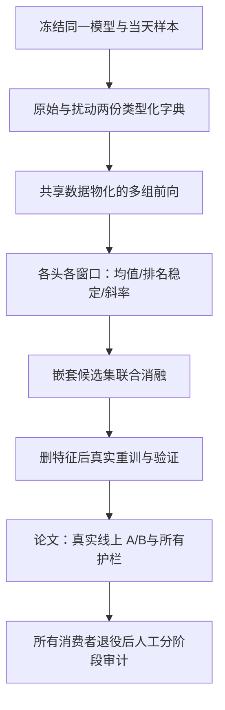
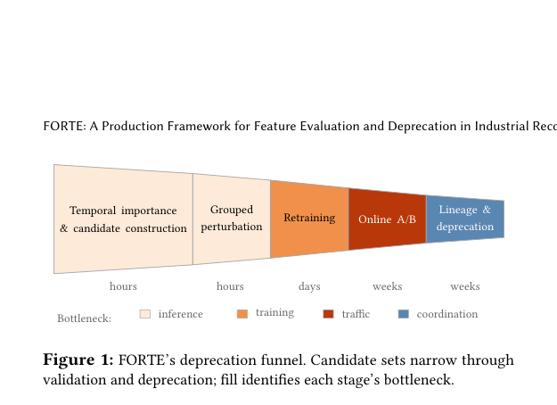

# FORTE：生产推荐系统的特征评估与退役

## 论文信息

| 项目 | 内容 |
| --- | --- |
| 论文链接 | [arXiv 2610.13806](https://arxiv.org/abs/2610.13806) |
| 公司/机构 | Pinterest |
| 首次公开日期 | 2026-10-09（arXiv v1） |
| 原文开源代码 | 否：未找到原作者公开实现（核查日期：2026-10-12） |
| Adapter | `forte` |
| 本地复现代码 | [`src/auto_research/reproductions/forte/`](https://github.com/daiwk/auto-research/tree/main/src/auto_research/reproductions/forte/) |

> **本地对照口径**：全特征双输出头模型为基线，实验组为删特征模型，从相同随机种子、相同训练样本和轮数重训；相对生产收益不适用。只在 validation 上筛选，选择完成后才读取 test。公开 MovieLens 离线训练不是 Pinterest 线上 A/B，也不是生产特征删除授权。

## 原始论文总结

### 背景与主要改动

添加一个特征只需在某项指标上有收益，删除却不能损伤任何业务指标，而且同一个特征可能有多个模型消费者。FORTE 将退役流程拆成逐渐昂贵的门槛：先每天衡量冻结模型的特征依赖，检查长期稳定性，再联合扰动候选集合并真实重训，最后做线上实验和所有消费者的血缘审计。

它不是单次 feature selection，也不能把单特征收益相加当成联合删除效果。一个特征单独看没有价值，可能与另一个冗余特征共同承载重要信号；不同输出头也可能给出相反方向。



<!-- paper-figure:start -->
### 原论文关键图

[](https://arxiv.org/pdf/2610.13806#page=3)

> **原论文 Figure 1（关键图）**：展示原论文方法的总体设计和关键组成。图片来自[原论文](https://arxiv.org/abs/2610.13806)，版权归原作者所有；点击图片可查看来源。
<!-- paper-figure:end -->

### 核心公式

对基线指标 $M_0$ 和扰动指标 $M_G$，论文定义

$$
\Delta_M(G)=100s_M\frac{M_G-M_0}{M_0},\quad s_M\in\{+1,-1\}.
$$

高优指标用 $s_M=+1$；负值表示扰动损害质量，即模型依赖该特征。低优指标反向。代码 `signed_change` 保留这个符号，不能将“重要性”误读为越大越重要。时间筛选用依赖方向 $I_j(t)=-\Delta_j(t)$：均值低、长期处于弱依赖排名、拟合斜率不为正，且必须在**所有头和所有回看窗口**同时成立。

`VirtualBatch` 只物化一次 dense、COO sparse、带 terminal offset 的 ragged 特征，缓存一份正确类型的扰动字典，各候选组通过引用选择原值/扰动值。置乱是批内置乱，不是假称全数据置乱或条件重要性。`evaluate` 对每组前向前后核对参数摘要，确保没有更新基线。

联合累计效果 $D_k=\Delta(G_k)$，边际 $m_k=D_k-D_{k-1}$ 不等于单特征指标求和。本地对最弱的三个嵌套组真实消融和重训；若时间门槛未通过，该组仍标为诊断候选，**不会因为重训成功而覆盖原来的失败**。

血缘审计依次为 dataloader、dataset、ingestion、logging。`LineageAudit` 只登记审计，必须无剩余消费者且有 owner approval 才可过关；程序不删除数据列、日志或生产服务。

### 论文离线与线上效果

原文 §7.1 Search Relevance：111 个特征中，32/48/59 的三个删除集合均通过离线门槛，但 59-feature 组在真实线上次要护栏失败，未发布。最终 48-feature 组参数减少 2.3%、吞吐增加 2.0%；线上 page wait time 相对下降 0.1696%，$p=0.0012$。US/non-US 分段相关性检查为中性；sDCG@25 使用 LLM 标注，不能说成人类真实标签。

原文 §7.2 Pin Ranker：2/8-feature 两组在三周线上 A/B 中 clicks、closeups、repins 无显著退化；发布 8-feature 组后参数减少 29.9%、CUDA Graph 吞吐增加 19.8–25.5%、推理成本约降低 10%。这些效率数字是**论文生产系统**的结果，不是本地测量。

单次置乱在实现的批内置乱空间上估计无偏；原文 ROC-AUC 方差分析要求行独立推理，不能自动套用到跨候选注意力或 PR-AUC。20-order Shapley 风格分析是顺序敏感性诊断，不是本地默认为精确 Shapley。

## 本地复现与运行

```bash
python -m pip install -e '.[neural-recs]'
PYTHONPATH=src python scripts/run_forte.py \
  --dataset-dir .cache/data --device cpu --seed 42 \
  --epochs 6 --batch-size 512 --output runs/forte-42.json
# NVIDIA 机器将 --device cpu 改为 --device cuda
```

加载经过固定 archive SHA-256 校验的公开 MovieLens-100K。按 timestamp、user、item 排序，chronological 80/10/10；age、occupation、user/item 和 ragged genres 来自公开元数据。双头是 rating≥4 和 rating≥3，不冒充点击/留存。归一化仅依赖训练段，三段 validation 时间片用于短期机制验证，不能等同每天更新的生产模型监测。

输出完整基线训练损失、逐窗口逐头门槛、每组消融/重训变化、实际选择和测试值。没有合格集合时回退基线；不挑选 test 最好的组。阶段审计停留在待人工/线上确认，不自动完成生产退役。

## 复现边界

L2 公开数据训练，核心机制实现；结果仍是诊断，不能宣称复现 Pinterest 能力或吞吐收益。未复刻私有多模态特征、DCNv2/MMoE 大型 Pin Ranker、分布式 actor、每日生产 checkpoint sensors、线上 A/B 和实际基础设施移除。没有通过任一门槛也是有效结果，保留而不伪造通过。

2026-10-12 已在 NVIDIA A100 真实执行 42/43/44 三个种子，每个种子基线及三个删特征组均各训练 6 epochs。三个种子都没有候选通过所有时间/分组/重训门槛，选择均保留基线。head0 测试 ROC-AUC 为 0.71282±0.00217、PR-AUC 为 0.75231±0.00198（样本标准差）。这说明流程跑通，不说明删除特征带来收益；没有模拟生产 A/B。

完整门槛和负结果：[本地三种子指标](metrics/movielens-100k-a100-seeds42-44.json)；[脱敏 GPU 回执](../../gpu-validations/oct12-forte-a100.json)。
