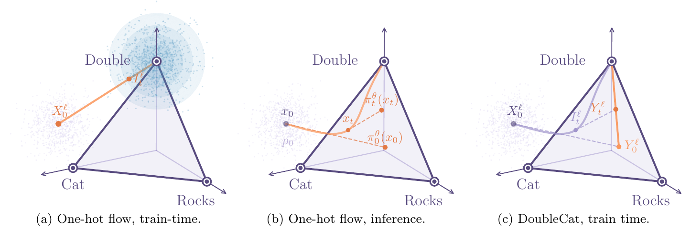
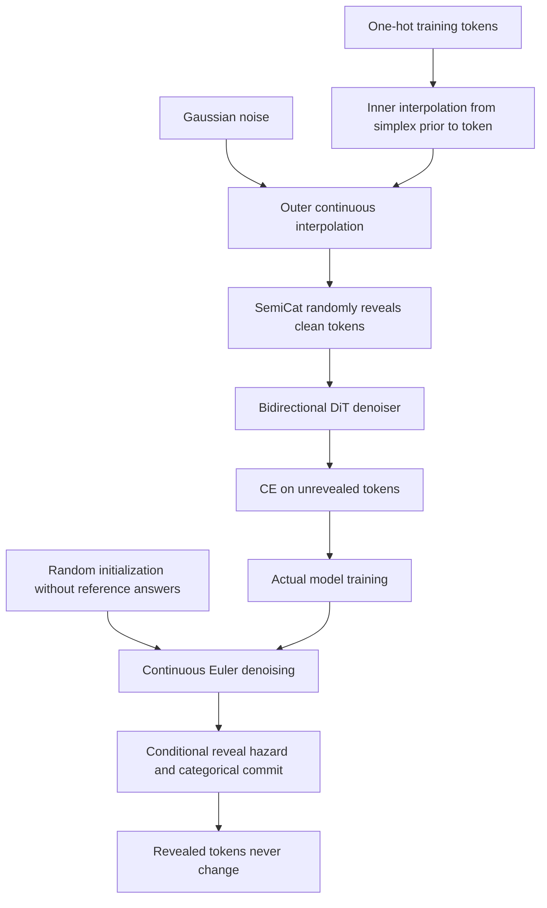

# DoubleCat / SemiCat: Nested Interpolation and Discrete Reveals for Continuous Diffusion LMs

<!-- source-sha256: e56f6e2722e286b0517e94feb74f112332ab186b3d55b6525dbdb4b87af8e607 -->

[简体中文](README.md)

## Paper information

| Field | Value |
| --- | --- |
| Paper | [arXiv 2610.13834](https://arxiv.org/abs/2610.13834) |
| Affiliations | Apple / University of Oxford / University of Amsterdam |
| First public release | 2026-10-09 (arXiv v1) |
| Author code | No public author implementation found as of 2026-10-13. The paper links only generic tiktoken code. |
| Adapter | `doublecat-semicat` |
| Local implementation | [`src/auto_research/reproductions/doublecat_semicat/`](https://github.com/daiwk/auto-research/tree/main/src/auto_research/reproductions/doublecat_semicat/) |

The original v1 submission was 2026-10-09 16:41:32 UTC. Affiliations follow the Oxford/Amsterdam affiliations and Apple author entry on the official HTML first page. The first author's correspondence is at Oxford and the work was done at Apple. The paper and appendix establish algorithm facts; third-party paper lists are not author code.

## Original paper

### Background and contribution

One-hot continuous flow sees mostly low-entropy vertices near the training endpoint, but inference follows an uncertain denoiser distribution, causing trajectory mismatch. DoubleCat nests an interpolation from a simplex prior to one-hot inside the Gaussian path, moving training probability mass into the simplex interior where inference operates.

High-dimensional Gaussian noise has norm about $\sqrt{|V|}$, while the one-hot signal has norm 1. Existing tokens can therefore be hard to identify. SemiCat draws a random reveal time per position; a revealed token becomes a clean one-hot and is carried over permanently. Training computes CE only on unrevealed positions.

### Architecture

<!-- paper-figure:start -->
### Key figure from the paper

[](https://arxiv.org/pdf/2610.13834v1#page=3)

The original three panels show near-vertex training inputs, inference trajectories following an uncertain denoiser, and DoubleCat's second corruption inside the simplex. This addresses training-distribution mismatch without an extra denoiser forward; it is not the two-forward standard self-conditioning ablation or a local capability result. Source: [arXiv 2610.13834v1 PDF, page 3](https://arxiv.org/pdf/2610.13834v1#page=3), corresponding to [v1 HTML Figure 1](https://arxiv.org/html/2610.13834v1#S2.F1). The complete image and its original panel labels were extracted at 216 DPI, without redraw or compositing. [assets/provenance.json](assets/provenance.json) records PDF/image hashes and crop coordinates. Copyright belongs to the authors.
<!-- paper-figure:end -->

Local implementation diagram, with SemiCat reveals from [Section 3.2 and Algorithm 1](https://arxiv.org/html/2610.13834v1#S3.SS2):



### Core equations

$$
Y_t=(1-\kappa_t)Y_0+\kappa_tX_1,\qquad I_t^{dc}=(1-\gamma_t)X_0+\gamma_t(1-\kappa_t)Y_0+\gamma_t\kappa_tX_1.
$$

The paper uses a uniform-on-simplex prior and $\kappa_t=\sqrt t$. Locally, `Dirichlet(1)` samples the distribution; a constant $1/|V|$ is not equivalent.

$$
I_t^{sc,\ell}=I_t^{dc,\ell}\mathbf1[t<\tau^\ell]+X_1^\ell\mathbf1[t\ge\tau^\ell],\quad \tau^\ell\sim U(0,1).
$$

$$
\mathcal L=-\mathbb E\sum_\ell\mathbf1[t<\tau^\ell]\log\pi_t^{\theta,\ell}(X_1^\ell\mid I_t^{sc}).
$$

Algorithm 1 uses conditional reveal probability $(t_{n+1}-t_n)/(1-t_n)$. Continuous Euler steps target the untempered denoiser $p$; temperature applies only to categorical commits. The final hazard is 1, revealing every token. Revealed inputs and outputs carry over permanently.

The paper recommends ordinary one-hot flow without the $Y_t$ term when sampling a DoubleCat-trained model, because it performed better. The local implementation follows that recommendation.

**Forward count and self-conditioning:** DoubleCat's interpolation (Section 3.1, Eq. 3.2) approximates the training-distribution benefit of self-conditioning without using the denoiser to construct inputs. SemiCat (Section 3.2, Eqs. 3.6–3.7) also has no extra self-conditioning forward. All three defaults use one forward per optimization step. Section 2, Eq. 2.5 and Appendix E.2, Table 8 allow a separate standard self-conditioning ablation: Bernoulli($p_{sc}$) triggers a same-time, no-grad prediction before the training forward. Only explicit `--self-conditioning` enables it; the extra call is counted. The paper does not fix $p_{sc}$; local ablation defaults to 0.5 and records it. Section 4.3's Plaid Bayesian posterior proxy is a different embedding-space method, not implemented here.

Appendix E.1 applies stop-gradient L2 weighting to one-hot, DoubleCat, and SemiCat:

$$
\Delta_t^\ell=\sqrt{\|\pi_t^{\theta,\ell}(I_t)-X_1^\ell\|_2+10^{-2}},\qquad \mathcal L_{train}=-\mathbb E\sum_\ell\mathbf1[t<\tau^\ell]\frac{\log\pi_t^{\theta,\ell}(X_1^\ell\mid I_t)}{\operatorname{sg}(\Delta_t^\ell)}.
$$

The weight comes from the same denoiser logits, with no extra forward. Training sums over positions and averages over batch. Reported denoising CE is instead the unweighted mean over unrevealed tokens. Optional self-conditioning during sampling reuses the previous prediction without increasing NFE.

### Paper results

| TinyGSM, 256 NFE | Best accuracy % | Runnable programs % | Name errors % |
|---|---:|---:|---:|
| Base one-hot flow | 4.42 | 50.91 | 48.07 |
| DoubleCat | 14.78 | 63.61 | 36.16 |
| DoubleCat, base one-hot sampling | 16.00 | 69.67 | 30.02 |
| SemiCat | 32.90 | 89.23 | 10.39 |
| SemiCat, standard hyperparameters | 38.67 | 90.75 | 9.10 |
| SemiCat + tuned confidence sampler | 49.94 | 95.36 | 4.38 |

Training and sampling settings differ, so changes cannot be attributed to one component. The local run does not implement InfoNoise or the confidence sampler from the last row. The paper's 1.7B model trained on 2.1T Nemotron tokens beat the discrete baseline on ARC-E/BoolQ/PIQA/SIQA but still trailed on OBQA. No online A/B test was reported.

## Local reproduction

This `core_mechanism / L1` experiment trains an actual **bidirectional DiT diffusion LM** from scratch on continuous one-hot states, not an AR model followed by rescoring. Each seed trains one-hot, DoubleCat, and SemiCat with matched architecture and budgets. The default disables the extra standard self-conditioning forward for all three. Training calls equal optimization steps, sampling calls equal NFE, and results log actual calls by phase.

> Compare DoubleCat and SemiCat with a one-hot diffusion LM. Report denoising CE at fixed t=0.5 and sampling diagnostics, not the paper's Gen.PPL or a relative capability gain.

### Data and entry point

WikiText-2 raw train/validation/test use separate byte blocks. `verify_offline_manifest` checks pinned ID/revision/config and every split SHA256; CLI claims alone are insufficient. Integrity checks do not provide held-out content to the model. The 256-byte vocabulary uses real language data but is not GPT-2/TikToken. Select checkpoints on validation CE only; tokenize and evaluate test after selecting all three. Unconditional sampling never reads gold text.

```bash
PYTHONPATH=src python scripts/run_doublecat_semicat.py \
  --data /path/to/wikitext --dataset-id Salesforce/wikitext \
  --dataset-revision b08601e04326c79dfdd32d625aee71d232d685c3 \
  --device cuda --steps 40 --sequence-length 32 --batch-size 4 \
  --width 64 --layers 2 --nfe 32 --seed 42 --no-self-conditioning \
  --output runs/doublecat-semicat-seed42.json
```

The adapter reads explicit CLI settings from `dataset_dir/doublecat-semicat.json`. No extra model download is needed. Results include the seed and random-initialization protocol revision `doublecat-semicat-byte-dit-v2-no-extra-forward-core`. Standard self-conditioning requires `--self-conditioning --self-conditioning-probability 0.5`; extra calls are logged separately.

### Results and limits

[cpu-diagnostic-seed42.json](metrics/cpu-diagnostic-seed42.json) preserves the old `byte-dit-v1` CPU run: one step, length 8, width 16, 1 layer, and 2 NFE. It used standard self-conditioning by default and omitted Appendix E.1 L2 weighting, so it does not verify the current one-forward core. Parameter L2 changes were about 0.1345 for each model. Test denoising CE was 5.6510 (one-hot), 5.6516 (DoubleCat), and 5.6580 (SemiCat); SemiCat **did not improve test CE** at this budget. Old GPU diagnostics also remain tied to their old code. Current tests check one default forward, two with explicit self-conditioning, exactly NFE sampling forwards, and stop-gradient L2 weighting.

[cpu-v2-no-extra-forward-seed42.json](metrics/cpu-v2-no-extra-forward-seed42.json) records the corrected equal-budget one-step CPU run: one training forward, one validation and one test call, and two sampling calls per model, without a training pre-forward. Test CE was 5.6774 (one-hot), 5.6824 (DoubleCat), and 5.6012 (SemiCat). DoubleCat still performed worse; SemiCat's lower CE is not a language-capability gain. Ten behavioral tests passed. The protocols are reported separately.

[Three-seed measurements](metrics/public-a30-seeds42-44.json) and the [source-bound GPU receipt](../../gpu-validations/doublecat-semicat-a30-20261013.json) cover the corrected core on a real A30. For every seed and architecture, there were 40 training forwards, 4 validation calls, 1 test call, and 32 sampling calls, with no extra standard self-conditioning forward. Parameters changed in all three. Test denoising CE mean ± sample SD: one-hot **3.2930±0.0126**, DoubleCat **3.2970±0.0123**, SemiCat **3.3479±0.0847**.

All one-hot and DoubleCat samples collapsed to spaces across all three seeds, with byte entropy 0. SemiCat's mean entropy was 3.1005; higher entropy does not establish language quality. This tiny model cannot support a capability comparison. Denoising CE is neither exact likelihood nor GPT-2/Qwen Gen.PPL, and byte entropy differs from the paper's tokenizer protocol. TinyGSM, GSM8K, OWT, large-scale pretraining, downstream MCQA, distillation, InfoNoise, and confidence sampling were not run. No Evolve integration.

### Code map

| Component | Local implementation |
|---|---|
| Nested interpolant, bidirectional DiT, L2 weighting, reveals, and optional standard self-conditioning | [doublecat_semicat.py](https://github.com/daiwk/auto-research/blob/main/src/auto_research/foundation_models/doublecat_semicat.py) |
| Actual training, validation selection, and isolated test | [run_doublecat_semicat.py](https://github.com/daiwk/auto-research/blob/main/scripts/run_doublecat_semicat.py) |
| Behavioral tests | [test_doublecat_semicat.py](https://github.com/daiwk/auto-research/blob/main/tests/test_doublecat_semicat.py) |
