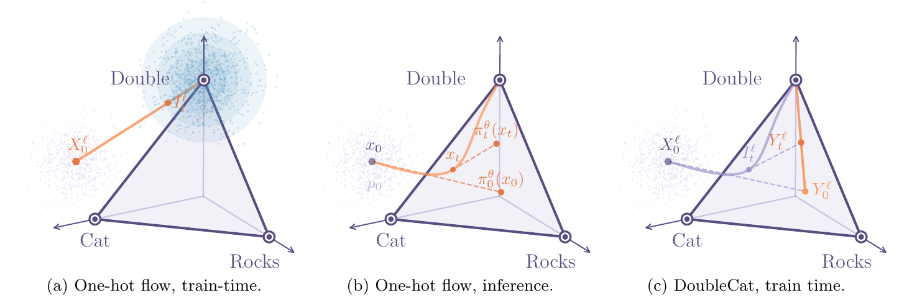
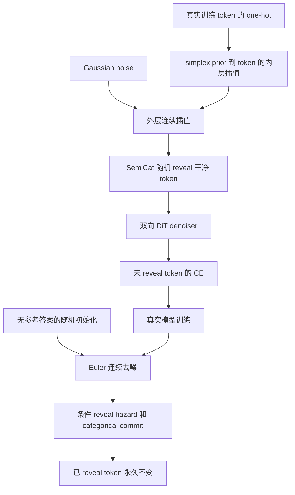

# DoubleCat / SemiCat：连续扩散 LM 的双层插值与离散 reveal

## 论文信息

| 字段 | 内容 |
| --- | --- |
| 论文链接 | [arXiv 2610.13834](https://arxiv.org/abs/2610.13834) |
| 公司/机构 | Apple / University of Oxford / University of Amsterdam |
| 首次公开日期 | 2026-10-09（arXiv v1） |
| 原文开源代码 | 否：截至 2026-10-13，原文未链接作者实现，未找到公开作者仓库；通用 tiktoken 不是本篇代码 |
| Adapter | `doublecat-semicat` |
| 本地复现代码 | [`src/auto_research/reproductions/doublecat_semicat/`](https://github.com/daiwk/auto-research/tree/main/src/auto_research/reproductions/doublecat_semicat/) |

原始 v1 提交时间为 2026-10-09 16:41:32 UTC。机构依据官方 HTML 首页残留的 Oxford/Amsterdam affiliation 与 Apple 作者条目；一作 correspondence 为 Oxford，工作在 Apple 期间完成。原文与 Appendix 是算法事实来源，不把第三方论文列表当作作者代码。

## 原始论文总结

### 背景与主要改动

One-hot continuous flow 在接近终点时训练几乎只看见低熵顶点，但推理跟随有熵 denoiser 概率，产生轨迹错配。DoubleCat 在高斯路径内部再插入 simplex prior 到 one-hot 的插值，把训练质量移到更像推理的 simplex 内部。

另一个问题是高维高斯噪声范数约 $\sqrt{|V|}$，而 one-hot 信号范数仅为 1，已有 token 难以辨识。SemiCat 为每个位置增加随机 reveal 时间，已 reveal 的 token 变成干净 one-hot 并永久 carry-over；训练只对未 reveal 位置计算 CE。

### 架构图

<!-- paper-figure:start -->
### 原论文关键图

[](https://arxiv.org/pdf/2610.13834v1#page=3)

原论文 Figure 1 的完整三面板：左为接近 one-hot 顶点的训练输入，中为跟随有熵 denoiser 的推理轨迹，右为 DoubleCat 在 simplex 内加入的第二层 corruption。它解释的是无需额外 denoiser 前向的训练分布修正，不是两次前向标准 SC 消融，也不是本地能力结果。来源为 [arXiv 2610.13834v1 PDF，第 3 页](https://arxiv.org/pdf/2610.13834v1#page=3)，对应 [v1 HTML Figure 1](https://arxiv.org/html/2610.13834v1#S2.F1)；以 216 DPI 提取完整图和原有面板标签，未重绘、未拼接不同来源。PDF/图像 SHA256 与裁剪范围见 [assets/provenance.json](assets/provenance.json)。

> **原论文 Figure 1（关键图）**：上文说明所选原图的范围；并非本地测量。图片来自[原论文](https://arxiv.org/pdf/2610.13834v1#page=3)，版权归原作者所有；点击图片可查看固定版本来源。
<!-- paper-figure:end -->

下图为本地 DoubleCat/SemiCat 实现映射的重绘示意；SemiCat reveal 依据 [原文 §3.2 与 Algorithm 1](https://arxiv.org/html/2610.13834v1#S3.SS2)：



### 核心公式

$$
Y_t=(1-\kappa_t)Y_0+\kappa_tX_1,\qquad I_t^{dc}=(1-\gamma_t)X_0+\gamma_t(1-\kappa_t)Y_0+\gamma_t\kappa_tX_1.
$$

作者保留 uniform-on-simplex prior，$\kappa_t=\sqrt t$。本地使用 `Dirichlet(1)`，不是把常数 $1/|V|$ 当作完整随机 simplex 分布。

$$
I_t^{sc,\ell}=I_t^{dc,\ell}\mathbf1[t<\tau^\ell]+X_1^\ell\mathbf1[t\ge\tau^\ell],\quad \tau^\ell\sim U(0,1).
$$

$$
\mathcal L=-\mathbb E\sum_\ell\mathbf1[t<\tau^\ell]\log\pi_t^{\theta,\ell}(X_1^\ell\mid I_t^{sc}).
$$

Algorithm 1 的条件 reveal 概率为 $(t_{n+1}-t_n)/(1-t_n)$。连续 Euler 走向未温度调整的 denoiser $p$，categorical commit 才按温度调整。最后一步 hazard=1，保证全部 token 已 reveal；已 reveal 输入及输出永久 carry-over。

DoubleCat 训练的推荐推理方式在原文中丢弃 $Y_t$ 项、采用普通 one-hot flow，得到更好的结果。本地遵循该推荐，而不是把它误写为未实现 DoubleCat。

**前向次数与自条件边界**：§3.1 / Eq. 3.2 的双层插值本身模拟 self-conditioning 的训练分布收益，不调用 denoiser 构造输入；§3.2 / Eqs. 3.6–3.7 的 SemiCat 也没有额外 SC 前向。因此默认三个模型均关闭标准 SC，一次优化只做一次模型前向。§2 / Eq. 2.5 和 Appendix E.2 / Table 8 明确允许另开标准 SC 消融：Bernoulli($p_{sc}$) 触发同时间 no-grad 预测，再做真实训练前向。该消融只由 `--self-conditioning` 显式开启，额外一次前向如实计入预算，绝不称作 DoubleCat 的零额外前向机制。论文未给固定 $p_{sc}$；本地消融默认 0.5 并写入结果。§4.3 的 Plaid Bayesian posterior proxy 是另一嵌入空间方法，未冒充本实现。

Appendix E.1 对包括 one-hot、DoubleCat、SemiCat 在内的训练使用停止梯度 L2 weighting：

$$
\Delta_t^\ell=\sqrt{\|\pi_t^{\theta,\ell}(I_t)-X_1^\ell\|_2+10^{-2}},\qquad \mathcal L_{train}=-\mathbb E\sum_\ell\mathbf1[t<\tau^\ell]\frac{\log\pi_t^{\theta,\ell}(X_1^\ell\mid I_t)}{\operatorname{sg}(\Delta_t^\ell)}.
$$

本地从同一次 denoiser logits 算出权重，不增加前向；训练对位置求和、对 batch 求均值。报告的 denoising CE 则明确为未加权、每个未 reveal token 的均值，不能把两者混为一项指标。可选 SC 推理复用上一采样步的预测，不增加 NFE。

### 论文离线与线上效果

| 原文 TinyGSM，256 NFE | best accuracy % | 能运行的程序 % | name error % |
| --- | ---: | ---: | ---: |
| Base one-hot flow | 4.42 | 50.91 | 48.07 |
| DoubleCat | 14.78 | 63.61 | 36.16 |
| DoubleCat，base one-hot sampling | 16.00 | 69.67 | 30.02 |
| SemiCat | 32.90 | 89.23 | 10.39 |
| SemiCat，标准超参数 | 38.67 | 90.75 | 9.10 |
| SemiCat + 调整的 confidence sampler | 49.94 | 95.36 | 4.38 |

这些行的 training/sampling 配置并不完全相同，不能归因于单一组件。本地不实现 InfoNoise/confidence sampler 来伪装最后一行。原文 1.7B、2.1T Nemotron token 扩展在 ARC-E/BoolQ/PIQA/SIQA 四项超过离散基线，但 OBQA 仍落后；不可概括为全部 benchmark 更好。线上 A/B：**未报告**。

## 本地复现

`core_mechanism / L1`：从随机初始化训练真实 **双向 DiT diffusion LM**，输入为连续 one-hot 状态，不调用 AR LM 生成后再改分数。每个 seed 实际训练 onehot、DoubleCat、SemiCat 三个同架构、同预算模型；默认三个模型均无标准 SC 额外前向。结果逐阶段记录实际模型调用数，默认训练调用数等于优化步数，采样调用数等于 NFE。

> **本地对照口径**：基线为 one-hot diffusion LM，实验组为 DoubleCat 与 SemiCat；报告固定 t=0.5 的 denoising CE 与采样机制指标，不把它们称作原文 Gen.PPL，相对能力提升百分比不适用。

### 数据协议与执行入口

公开 WikiText-2 raw train/validation/test 使用独立字节块。先用 `verify_offline_manifest` 检查固定 ID/revision/config 和所有实际 split SHA256，不能只靠 CLI 声明；该哈希完整性检查不向模型提供 held-out 内容。256-byte vocabulary 保留真实离散语言数据，但不是 GPT-2/TikToken。只用 validation CE 选 checkpoint；三个模型全部选完才 tokenize/evaluate test；无条件采样不读 gold text。

```bash
PYTHONPATH=src python scripts/run_doublecat_semicat.py \
  --data /path/to/wikitext --dataset-id Salesforce/wikitext \
  --dataset-revision b08601e04326c79dfdd32d625aee71d232d685c3 \
  --device cuda --steps 40 --sequence-length 32 --batch-size 4 \
  --width 64 --layers 2 --nfe 32 --seed 42 --no-self-conditioning \
  --output runs/doublecat-semicat-seed42.json
```

adapter 读取 `dataset_dir/doublecat-semicat.json` 的显式 CLI 参数。无需下载额外模型权重；当前随机初始化协议 revision `doublecat-semicat-byte-dit-v2-no-extra-forward-core` 与 seed 记入结果。标准 SC 消融需另加 `--self-conditioning --self-conditioning-probability 0.5`，额外调用单独记录。

### 本地结果与边界

[cpu-diagnostic-seed42.json](metrics/cpu-diagnostic-seed42.json)保留先前 `byte-dit-v1` 的 CPU 一步、长度 8、宽度 16、1 层、2 NFE 诊断：当时默认标准 SC 开启，且未采用 Appendix E.1 L2 weighting，不能代表当前无额外前向核心协议。三模型参数 L2 变化分别约 0.1345；test denoising CE 为 onehot 5.6510、DoubleCat 5.6516、SemiCat 5.6580，SemiCat 此极小预算**没有改善 test CE**。旧源码 GPU 诊断也保留，不能通过改名/重绑定充当正确新源结果。当前行为测试另外核验默认核心一次前向、显式 SC 两次前向、采样严格 NFE 次以及停止梯度 L2 weighting。

[cpu-v2-no-extra-forward-seed42.json](metrics/cpu-v2-no-extra-forward-seed42.json)为修正后的同等 CPU 一步预算：三模型实际训练前向各 1 次、validation/test 各 1 次、采样各 2 次，没有 no-grad 训练预前向。test CE 为 onehot 5.6774、DoubleCat 5.6824、SemiCat 5.6012，DoubleCat 在该诊断仍较差；SemiCat 的较低 CE 不能推导语言能力提升。10 个行为测试通过，新旧结果分别保留，不作跨协议提升比较。

[public-a30-seeds42-44.json](metrics/public-a30-seeds42-44.json)与[源码绑定 GPU 回执](../../gpu-validations/doublecat-semicat-a30-20261013.json)记录修正后核心在真实 A30 的三 seed 运行。每 seed / 每结构 40 次真实训练前向、4 次 validation、1 次 test、32 次采样，没有额外标准 SC 前向；三结构均发生参数变化。Test denoising CE 平均±样本标准差为 onehot **3.2930±0.0126**、DoubleCat **3.2970±0.0123**、SemiCat **3.3479±0.0847**。

onehot 与 DoubleCat 三 seed 的采样均坍缩为全空格，byte entropy=0；SemiCat 平均 entropy=3.1005，但更高 entropy 并非更高语言质量。保留这些负结果，不宣称稳定提升。此极小模型没有语言能力比较资格；denoising CE 不是精确 likelihood 或 GPT-2/Qwen Gen.PPL，采样 byte entropy 也不是原文 tokenizer 口径。未运行 TinyGSM、GSM8K、OWT、大规模 pretraining、下游 MCQA、distillation/InfoNoise/confidence sampler；未接入 Evolve。

### 代码映射

| 原文组件 | 本地实现 |
| --- | --- |
| 二级 interpolant、双向 DiT、L2 weighting、reveal；可选标准 SC 消融 | [doublecat_semicat.py](https://github.com/daiwk/auto-research/blob/main/src/auto_research/foundation_models/doublecat_semicat.py) |
| 真训练、validation 选择和隔离 test | [run_doublecat_semicat.py](https://github.com/daiwk/auto-research/blob/main/scripts/run_doublecat_semicat.py) |
| 行为测试 | [test_doublecat_semicat.py](https://github.com/daiwk/auto-research/blob/main/tests/test_doublecat_semicat.py) |
