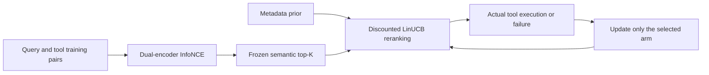
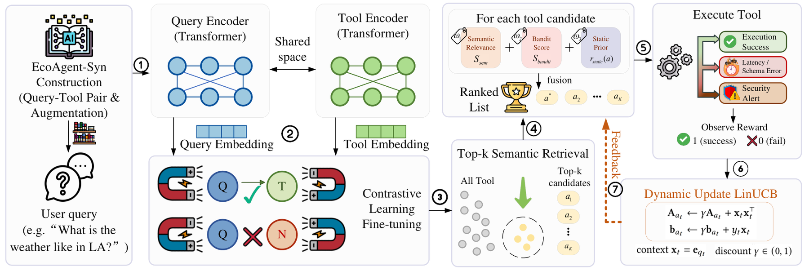

# RATED: Reliability-Aware AI Agent Tool Retrieval via Execution Dynamics

<!-- source-sha256: dee2de92764a4b169a42a5012c6b93d8bd85fd1d02fc27094378d53d38cfad59 -->

[简体中文](README.md)

> This is a core-mechanism / L1 diagnostic interface. It does not reproduce the paper's capabilities or qualify for Evolve promotion.

## Paper information

| Field | Value |
| --- | --- |
| Paper | [arXiv 2610.13889](https://arxiv.org/abs/2610.13889) |
| Affiliation | Texas Tech University |
| First public release | 2026-10-09 (arXiv v1) |
| Author code | [EcoAgent / RATED](https://github.com/Elliotes/EcoAgent) |
| Adapter | `rated` |
| Local implementation | [src/auto_research/reproductions/rated/](https://github.com/daiwk/auto-research/tree/main/src/auto_research/reproductions/rated/) |

## Original paper

### Motivation and method

Separate query and tool encoders normalize CLS embeddings and learn with contrastive InfoNCE. At deployment they are frozen. Semantic retrieval first selects top-K tools; reranking combines metadata priors with discounted LinUCB per tool. Execution successes, errors, or timeouts update only the actually selected arm. See the [full paper](https://arxiv.org/html/2610.13889v1).



The [local redraw](assets/architecture.mmd) is separate from the original evidence. See [figure provenance](assets/source-provenance.json).

### Original paper figure

[](https://arxiv.org/html/2610.13889v1/ari_rated.png)

Figure 3 shows the paper's key modules and their connections. The [source paper](https://arxiv.org/abs/2610.13889) and figure belong to the original authors.

### Core equations

$L_{NCE}=-B^{-1}\sum_i\log[\exp(e_{q_i}^Te_{a_i}/\tau)/\sum_j\exp(e_{q_i}^Te_{a_j}/\tau)]$. The score is $S=w_1S_{sem}+w_2(\hat\theta_a^Tx+\alpha\sqrt{x^TA_a^{-1}x})+w_3r_{static}$. For the selected arm, update the diagonal $A_a\leftarrow\gamma A_a+x\odot x$ and $b_a\leftarrow\gamma b_a+yx$.

### Paper-reported results

| Metric | Paper method | Paper baseline or protocol |
| --- | --- | --- |
| EcoAgent-Real MRR | 0.618 | ToolLLM 0.406 |
| Fault selection at 30% persistent failure | 2.9% | ToolLLM 86.2% |
| Additional ranking latency | 0.172 ms/step | Authors' RTX5070 protocol |

The [paper](https://arxiv.org/html/2610.13889v1) reports these values, not the local run. It reports no production A/B test. Do not compare across different models, data, scoring, or hardware protocols. [Paper result excerpts](assets/paper-results.json) are kept outside local metrics and the dashboard.

## Local reproduction

> The reference is a frozen semantic dual encoder; the intervention adds online-feedback reranking. The current implementation executes the intervention, but no formal capability comparison supports a stable relative improvement.

The implementation is in `src/auto_research/agent_research/oct12_memory_tools.py`. A thin adapter loads configuration from an explicit `oct12.json` without injecting fixed candidates or gold answers.

```bash
PYTHONPATH=src python scripts/run_oct12_agents.py \
  --method rated --device cuda \
  --dataset /path/to/public/input --query-checkpoint /path/to/query-encoder --tool-checkpoint /path/to/tool-encoder \
  --query-checkpoint-id OWNER/MODEL --query-checkpoint-revision IMMUTABLE_40_HEX_COMMIT \
  --tool-checkpoint-id OWNER/MODEL --tool-checkpoint-revision IMMUTABLE_40_HEX_COMMIT \
  --seed 42 --rounds 2 --group-size 2 --train-steps 2 \
  --output runs/oct12/rated/result.json
```

### Data protocol and code mapping

The inputs are EcoAgent-compatible positive pairs and authorized local tool bindings. Candidate and parameter selection is restricted to validation; test is separate from training, and gold labels are used only for independent external scoring. The short run is marked `diagnostic_only=true`, `capability_comparison=false`, and `evolve_promotion_eligible=false`. Training positives use split=train, and final queries use split=test. Tool code requires explicit authorization; production API calls are prohibited.

### Measured results and limits

Two independent pretrained Transformer encoders are actually trained. Each tool requires an authorized local code binding. Execution feedback comes from the bubblewrap process state and output schema, not the tool's self-reported reward. Semantic `reference_tool` is used only in the external Recall@1 calculation, and overlapping train/test queries are rejected. A fixed checkpoint is not tuning on the local test set, and a local API substitute does not reproduce the original deployment.

On 2026-10-12 two independent MiniLM encoders trained on A100 for 4 steps on 32 distinct positive tool pairs. Contrastive loss fell from 2.44620 to 2.02495 with nonzero gradients at every step. Semantic Recall@1 was 0.125 over 8 official test queries. The pool was selected using only training data; only 1 test reference was in the pool, and no tools were added from test answers.

The original API backend and credentials were unavailable. The authorized sandbox bindings actually failed, yielding 0 successes in 8 executions. A valid JSON schema or a simulated response would not establish original tool capability. With both encoders frozen, the bandit updates prequentially from actual failures on the test stream. This is not a fully frozen-policy holdout; gold is used only for subsequent semantic scoring.

Input export: `scripts/prepare_oct12_agent_inputs.py --kind rated`. See [local results](metrics/public-agent-a100-42.json) and the [GPU receipt](../../gpu-validations/oct12-rated-a100.json). The failures are preserved; no original production API reproduction, capability gain, or Evolve promotion is claimed.

Tests: `python -m pytest tests/test_oct12_agent_algorithms.py tests/test_oct12_agent_delivery.py`.
