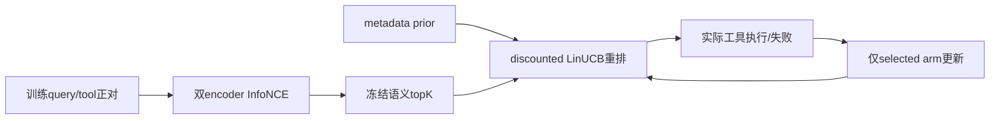
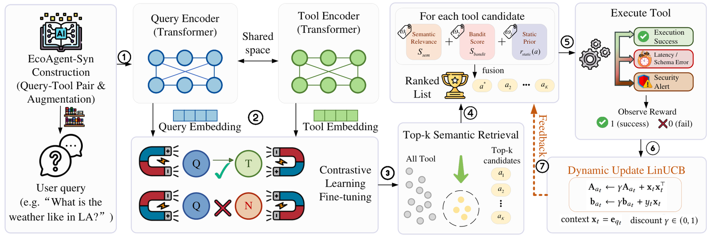

# RATED: Reliability-Aware AI Agent Tool Retrieval via Execution Dynamics

> 当前是 core_mechanism / L1 机制诊断接口；未声称完成原论文能力复测，未接入 Evolve 晋级。

## 论文信息

| 项目 | 内容 |
| --- | --- |
| 论文链接 | [arXiv 2610.13889](https://arxiv.org/abs/2610.13889) |
| 公司/机构 | Texas Tech University |
| 首次公开日期 | 2026-10-09（arXiv v1） |
| 原文开源代码 | 是：[EcoAgent / RATED](https://github.com/Elliotes/EcoAgent) |
| Adapter | `rated` |
| 本地复现代码 | [`src/auto_research/reproductions/rated/`](https://github.com/daiwk/auto-research/tree/main/src/auto_research/reproductions/rated/) |

## 原始论文总结

### 背景与主要改动

独立 query/tool encoder 做 CLS 归一化与 contrastive InfoNCE 训练。部署时 encoder 冻结，先语义 top-K，再融合 metadata prior 与逐工具 discounted LinUCB；只从实际选中工具的执行成功、错误或超时更新对应 arm。 事实来源：[原文全文](https://arxiv.org/html/2610.13889v1)。

### 架构流程



重绘源码：[architecture.mmd](assets/architecture.mmd)。[原论文 Figure 3](https://arxiv.org/html/2610.13889v1/ari_rated.png) 展示原文的整体机制；本地重绘没有替换原图作为证据。来源与核查边界见 [source-provenance.json](assets/source-provenance.json)。

<!-- paper-figure:start -->
### 原论文关键图

[](https://arxiv.org/html/2610.13889v1/ari_rated.png)

> **原论文 Figure 3（关键图）**：展示原论文提出的核心架构、主要模块及其连接关系。图片来自[原论文](https://arxiv.org/abs/2610.13889)，版权归原作者所有；点击图片可查看来源。
<!-- paper-figure:end -->

### 核心公式

$L_{NCE}=-B^{-1}\sum_i\log[\exp(e_{q_i}^Te_{a_i}/\tau)/\sum_j\exp(e_{q_i}^Te_{a_j}/\tau)]$。$S=w_1S_{sem}+w_2(\hat\theta_a^Tx+\alpha\sqrt{x^TA_a^{-1}x})+w_3r_{static}$；选中 arm 的对角 $A_a\leftarrow\gamma A_a+x\odot x$，$b_a\leftarrow\gamma b_a+yx$。

### 论文离线与线上效果

| 原文指标 | 原文方法 | 原文对照/协议 |
|---|---|---|
| EcoAgent-Real MRR | 0.618 | ToolLLM 0.406 |
| 30% persistent failure: fault selection | 2.9% | ToolLLM 86.2% |
| additional ranking latency | 0.172 ms/step | 原文RTX5070硬件协议 |

这些是[原论文](https://arxiv.org/html/2610.13889v1)报告值，不是本地结果；未报告生产线上 A/B。模型、数据、打分或资源协议不同，禁止直接横比。复核摘录见 [paper-results.json](assets/paper-results.json)。原文数值不进入 local metrics/dashboard。

## 本地复现

> **本地对照口径**：基线为冻结语义dual encoder；线上反馈重排实验组；实验组由当前真实实现执行；稳定相对提升不适用，尚无正式能力对照。

实现位于 `src/auto_research/agent_research/oct12_memory_tools.py`；薄 adapter 从明确的 `oct12.json` 加载运行配置，不注入默认固定候选或 gold。统一入口：

```bash
PYTHONPATH=src python scripts/run_oct12_agents.py \
  --method rated --device cuda \
  --dataset /path/to/public/input --query-checkpoint /path/to/query-encoder --tool-checkpoint /path/to/tool-encoder \
  --query-checkpoint-id OWNER/MODEL --query-checkpoint-revision IMMUTABLE_40_HEX_COMMIT \
  --tool-checkpoint-id OWNER/MODEL --tool-checkpoint-revision IMMUTABLE_40_HEX_COMMIT \
  --seed 42 --rounds 2 --group-size 2 --train-steps 2 \
  --output runs/oct12/rated/result.json
```

### 数据协议与代码映射

输入来源为 EcoAgent-compatible positive pairs and authorized local tool bindings。候选/参数晋级仅在 validation，test 与训练分开；金标只进入独立外部 scoring。短运行报告 `diagnostic_only=true`、`capability_comparison=false` 与 `evolve_promotion_eligible=false`。训练正对为split=train，最终查询为split=test；工具代码是明确授权绑定，禁止自动请求生产API。

### 结果、验证与边界

两支独立 pretrained transformer 参数真实训练；工具必须具备明确授权的 local code binding，bubblewrap 进程状态与输出schema产生执行反馈，不信任工具自报 reward。语义 reference_tool 仅外部计算 Recall@1；train/test query 交集拒绝。固定论文权重不是本地test调参；本地API替代不证明原生产生态结论。

2026-10-12已在A100训练两支独立MiniLM encoder：32个互异tool正对、4步，contrastive loss `2.44620 → 2.02495`，每步真实梯度非零。8个官方test查询的semantic Recall@1 `0.125`；pool只按训练选取，其中仅1个test reference在pool内，未按test答案扩充工具。

原始API backend/凭据不可用，明确授权的沙箱binding实际返回失败，8次执行成功率 `0`；不能以JSON schema或模拟响应冒充原工具能力。encoder冻结后，bandit在test查询流中依真实失败做prequential更新，这不是完全冻结policy的holdout对照，gold只用于事后语义评分。

输入可由 `scripts/prepare_oct12_agent_inputs.py --kind rated` 导出。实测见 [public-agent-a100-42.json](metrics/public-agent-a100-42.json)，回执见 [GPU证据](../../gpu-validations/oct12-rated-a100.json)。保留失败，不声明原生产API复现、能力提升或evolve晋级。

测试入口：`python -m pytest tests/test_oct12_agent_algorithms.py tests/test_oct12_agent_delivery.py`。

