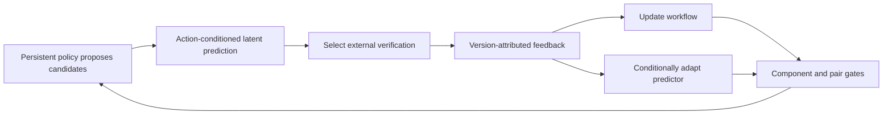
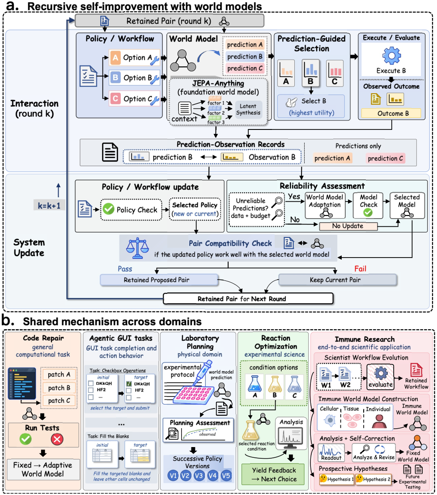

# RSI-Anything: Unlocking Recursive Self-Improvement with World Models

<!-- source-sha256: 1a7c140e88bff0cdbcd3693f6f23a316fc748ce6ed0745efb7dbf74c73985a97 -->

[简体中文](README.md)

> This is a concept_demo / L1 mechanism diagnostic, not a reproduction of the original capability evaluation or a candidate for Evolve promotion.

## Paper information

| Field | Value |
| --- | --- |
| Paper | [arXiv 2610.13912](https://arxiv.org/abs/2610.13912) |
| Affiliations | PhAI Labs / The Chinese University of Hong Kong and others |
| First public release | 2026-10-09 (arXiv v1) |
| Author code | Yes: [RSI-Anything](https://github.com/Gen-Verse/RSI-Anything). |
| Adapter | `rsi-anything` |
| Local implementation | [`src/auto_research/reproductions/rsi_anything/`](https://github.com/daiwk/auto-research/tree/main/src/auto_research/reproductions/rsi_anything/) |

## Original paper

### Background and contribution

A world model predicts candidate outcomes before requesting external verification. Feedback updates a persistent policy workflow. If predictor reliability is poor and enough data and budget remain, adapt the predictor too. Only versions that pass both component and pairwise compatibility checks advance. See the [full paper](https://arxiv.org/html/2610.13912v1).

### Architecture



[Local redraw](assets/architecture.mmd); the [original Figure 2](https://arxiv.org/html/2610.13912v1/figure1_v12_2026-10-09.png) shows the paper mechanism and is not replaced by the redraw as evidence. See [source provenance](assets/source-provenance.json).

<!-- paper-figure:start -->
### Key figure from the paper

[](https://arxiv.org/html/2610.13912v1/figure1_v12_2026-10-09.png)

> **Original Figure 2:** The overall workflow, major stages, and data flow. From the [paper](https://arxiv.org/abs/2610.13912); copyright belongs to the authors.
<!-- paper-figure:end -->

### Core equations

$\widehat z_{t+1}=F_\phi(E_\phi(s_t),a_t,c_d)$ and $\widehat o=R_\phi(\widehat z)$. Adapt when $u_k^W=1\{\rho_k^W=\mathrm{unreliable}\}1\{D_{adapt}\text{ is sufficient}\}1\{B_{update}\ge\widehat c\}$. If $Q_{pair}$ fails, restore the complete previous $(\theta,\phi)$ pair.

### Paper results

| Metric | Paper results | Protocol or comparison |
|---|---|---|
| Code repair: static / predictive / adapted | 26.3% / 29.2% / 31.2% | Same coder, approximately matched test usage |
| Laboratory planning: first / fifth policy | 21.80% / 46.01% | Five consecutive policy versions |
| Best reaction yield | 96.15% | Bayesian optimization 82.16%; 40 experiments each |

These are [paper](https://arxiv.org/html/2610.13912v1) results, not local measurements. No production A/B was reported. Different models, data, scoring, and resource protocols are not directly comparable. [Paper results](assets/paper-results.json) are kept outside local metrics and the dashboard.

## Local reproduction

> Compare against the initial workflow and predictor pair. The current implementation executes the experimental mechanism but establishes neither stable relative gain nor a formal capability comparison.

Implementation: `src/auto_research/agent_research/oct12_evolution.py` and `oct12_checkpoint.py`. The thin adapter reads explicit `oct12.json` configuration without fixed default candidates or gold answers.

```bash
PYTHONPATH=src python scripts/run_oct12_agents.py \
  --method rsi-anything --checkpoint "$PUBLIC_CHECKPOINT_CACHE" --device cuda \
  --checkpoint-id Qwen/Qwen2.5-7B-Instruct \
  --checkpoint-revision bb46c15ee4bb56c5b63245ef50fd7637234d6f75 \
  --seed 42 --rounds 2 --group-size 2 --train-steps 2 \
  --max-tokens 1536 --output runs/oct12/rsi-anything-7b-1536-seed42/result.json
```

Run from the repository root in its Python environment. `PUBLIC_CHECKPOINT_CACHE` must point to a byte-verified local copy of the pinned public revision, not floating `main`. CUDA requires Linux bubblewrap/prlimit, PyTorch, Transformers, safetensors, and a real A100/A30. Load only local weights with remote code disabled. Do not reuse the output directory. This seed/budget/checkpoint configuration ran on A100; see the receipt for the exact snapshot and sanitized command. The example cache path is not a machine path.

### Data and implementation

The input is public-circle-packing-26, without the optimal layout. Training and gate use different context strings but the same underlying task, not independent generalization validation/test. Gate labels do not train the predictor. Short runs set `diagnostic_only=true`, `capability_comparison=false`, and `evolve_promotion_eligible=false`. Generated programs run only under Linux bubblewrap/prlimit; without isolation the runner fails closed instead of executing code on the host.

### Validation and limitations

The implementation uses real checkpoint embeddings, a trainable factorized latent predictor, and an outcome readout. Targets encode observed execution feedback using latent MSE, outcome MSE, and factor orthogonality. This is not the authors' JEPA-Anything model. Training and gate labels stay separate. Historical predictions are recomputed under the current version rather than mixing errors across versions.

A real NVIDIA A100 ran Qwen2.5-7B-Instruct, seed 42, 1536 maximum output tokens, 2 rounds, 2 candidates per round, and 2 conditional adaptation steps at snapshot `3eae2c8863678692a8cf2de988d4562314c2731f`. [Sanitized measurements and round audit](metrics/public-circle-a100-42.json) are local, not paper results.

Round one reported `reliability=insufficient` and did not update the predictor. Round two reported `unreliable` and triggered actual adaptation. Predictor loss was 0.24024838209152222 → 0.19830742478370667, with gradient norms 0.6622512340545654 / 0.5989798307418823. The policy component passed both rounds, the model component only round two, and both pair gates passed. Round-two pair prediction error changed from 0.2382378494734292 to 0.15235200799976756. Policy updates modify persistent workflow, not backbone weights. The predictor is not a JEPA-Anything checkpoint.

**Circle validation fitness was zero for old and new pairs in both rounds.** Pair retention does compare utility and prediction error, but separate contexts on the same task do not establish independent capability. Lower loss and gate acceptance are not improved circle solving. Keep `concept_demo / L1`, `diagnostic_only=true`, `capability_comparison=false`, and `evolve_promotion_eligible=false`.

The [GPU receipt](../../gpu-validations/oct12-rsi-anything-a100.json) preserves source hashes from `git show` at the execution commit, public checkpoint revision, task-spec hash, and actual values. The task downloads no external dataset; environment revision is bound to the source snapshot, not an invented HF revision. Receipt `passed` applies only to that snapshot's mechanism run. It does not validate later or dirty changes. Keep paper and local metrics separate and retain the all-zero fitness. Raw model outputs, machine paths, logs, and weights are not published.

Tests: `python -m pytest tests/test_oct12_agent_algorithms.py tests/test_oct12_agent_delivery.py`.
