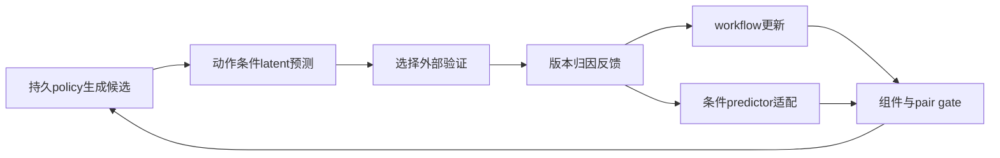

# RSI-Anything: Unlocking Recursive Self-Improvement with World Models

> 当前是 concept_demo / L1 机制诊断接口；未声称完成原论文能力复测，未接入 Evolve 晋级。

## 论文信息

| 字段 | 内容 |
|---|---|
| 论文链接 | [arXiv 2610.13912](https://arxiv.org/abs/2610.13912) |
| 公司/机构 | PhAI Labs / The Chinese University of Hong Kong 等（一作 Taoyong Cui） |
| 首次公开日期 | 2026-10-09（arXiv v1） |
| 原文开源代码 | 是：[RSI-Anything](https://github.com/Gen-Verse/RSI-Anything) |
| Adapter | `rsi-anything` |
| 本地复现代码 | [`src/auto_research/reproductions/rsi_anything/`](https://github.com/daiwk/auto-research/tree/main/src/auto_research/reproductions/rsi_anything/) |

## 原始论文总结

### 背景与主要改动

候选先经世界模型预测，再向外部验证申请反馈；反馈更新持久 policy/workflow，可靠性不足且数据/预算足够时适配 predictor。只有组件检查和配对兼容性检查均通过的版本进入下一轮。 事实来源：[原文全文](https://arxiv.org/html/2610.13912v1)。

### 架构流程



重绘源码：[architecture.mmd](assets/architecture.mmd)。[原论文 Figure 2](https://arxiv.org/html/2610.13912v1/figure1_v12_2026-10-09.png) 展示原文的整体机制；本地重绘没有替换原图作为证据。来源与核查边界见 [source-provenance.json](assets/source-provenance.json)。

### 核心公式

$\widehat z_{t+1}=F_\phi(E_\phi(s_t),a_t,c_d)$，$\widehat o=R_\phi(\widehat z)$；$u_k^W=1\{\rho_k^W=\mathrm{unreliable}\}1\{D_{adapt}\text{足够}\}1\{B_{update}\ge\widehat c\}$。若 $Q_{pair}$ 不通过，整个 $(\theta,\phi)$ 回退到此前配对。

### 论文离线与线上效果

| 原文指标 | 原文方法 | 原文对照/协议 |
|---|---|---|
| code repair: static / predictive / adapted | 26.3% / 29.2% / 31.2% | coder 固定，近似等测试使用量 |
| laboratory planning: first / fifth policy | 21.80% / 46.01% | 五次连续 policy 版本 |
| reaction best yield | 96.15% | Bayesian optimization 82.16%，均40次实验 |

这些是[原论文](https://arxiv.org/html/2610.13912v1)报告值，不是本地结果；未报告生产线上 A/B。模型、数据、打分或资源协议不同，禁止直接横比。复核摘录见 [paper-results.json](assets/paper-results.json)。原文数值不进入 local metrics/dashboard。

## 本地复现

> **本地对照口径**：基线为初始 policy workflow 与初始 predictor 配对；实验组由当前真实实现执行；稳定相对提升不适用，尚无正式能力对照。

实现位于 `src/auto_research/agent_research/oct12_evolution.py / oct12_checkpoint.py`；薄 adapter 从明确的 `oct12.json` 加载运行配置，不注入默认固定候选或 gold。统一入口：

```bash
PYTHONPATH=src python scripts/run_oct12_agents.py \\
  --method rsi-anything --checkpoint /path/to/public/local/checkpoint --device cuda \\
  --checkpoint-id OWNER/MODEL --checkpoint-revision IMMUTABLE_40_HEX_COMMIT \\
  --seed 42 --rounds 2 --group-size 2 --train-steps 2 \\
  --output runs/oct12/rsi-anything/result.json
```

### 数据协议与代码映射

输入来源为 public-circle-packing-26。候选/参数晋级仅在 validation，test 与训练分开；金标只进入独立外部 scoring。短运行报告 `diagnostic_only=true`、`capability_comparison=false` 与 `evolve_promotion_eligible=false`。生成程序只在Linux bubblewrap/prlimit执行，未具备隔离环境时fail-closed；不在宿主机exec生成代码。

### 结果、验证与边界

代码真实使用 checkpoint embeddings、可训练 factorized latent predictor 与 outcome readout；目标为观测执行反馈的编码，含 latent MSE、outcome MSE、factor orthogonality。它不是作者 JEPA-Anything 模型。训练与 gate 标签隔离；历史预测按当前版本重算，不混用旧版本误差。单 circle 任务的 context partition 不等于泛化验证。

当前检查为 L0 合同及真梯度测试；本地 NVIDIA 运行由本批集成统一生成脱敏回执，未通过前不得写GPU已验证。CUDA metadata已声明requires_gpu_validation=true，未来回执路径为 docs/gpu-validations/oct12-rsi-anything-a100.json；本文不预填数值。 论文指标与本地指标严格分离；运行日志/模型权重不提交，失败与负结果保留。

测试入口：`python -m pytest tests/test_oct12_agent_algorithms.py tests/test_oct12_agent_delivery.py`。

