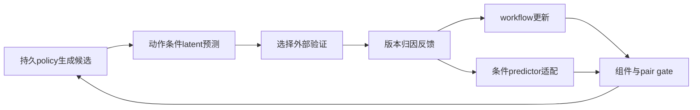
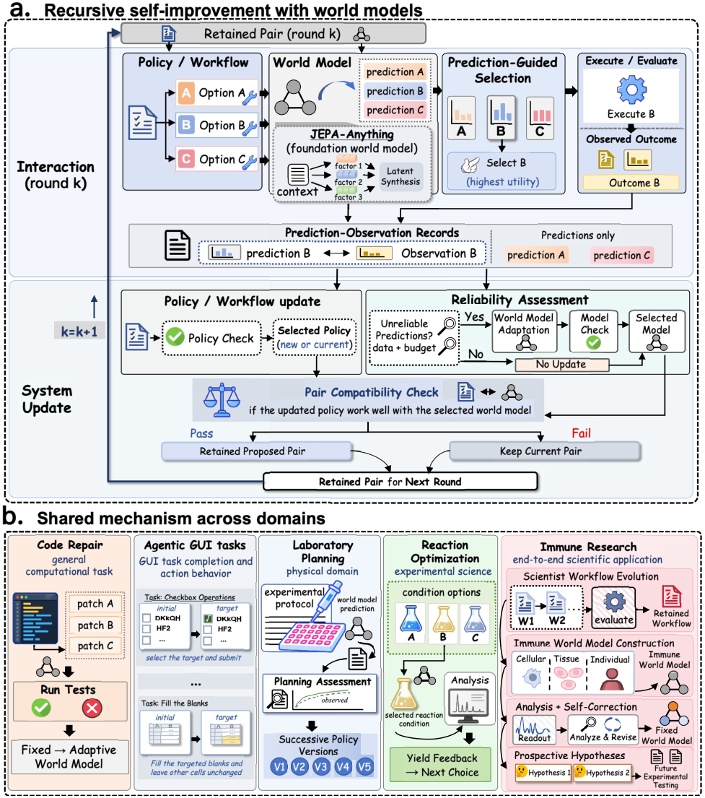

# RSI-Anything: Unlocking Recursive Self-Improvement with World Models

> 当前是 concept_demo / L1 机制诊断接口；未声称完成原论文能力复测，未接入 Evolve 晋级。

## 论文信息

| 项目 | 内容 |
| --- | --- |
| 论文链接 | [arXiv 2610.13912](https://arxiv.org/abs/2610.13912) |
| 公司/机构 | PhAI Labs / The Chinese University of Hong Kong 等 |
| 首次公开日期 | 2026-10-09（arXiv v1） |
| 原文开源代码 | 是：[RSI-Anything](https://github.com/Gen-Verse/RSI-Anything) |
| Adapter | `rsi-anything` |
| 本地复现代码 | [`src/auto_research/reproductions/rsi_anything/`](https://github.com/daiwk/auto-research/tree/main/src/auto_research/reproductions/rsi_anything/) |

## 原始论文总结

### 背景与主要改动

候选先经世界模型预测，再向外部验证申请反馈；反馈更新持久 policy/workflow，可靠性不足且数据/预算足够时适配 predictor。只有组件检查和配对兼容性检查均通过的版本进入下一轮。 事实来源：[原文全文](https://arxiv.org/html/2610.13912v1)。

### 架构流程



重绘源码：[architecture.mmd](assets/architecture.mmd)。[原论文 Figure 2](https://arxiv.org/html/2610.13912v1/figure1_v12_2026-10-09.png) 展示原文的整体机制；本地重绘没有替换原图作为证据。来源与核查边界见 [source-provenance.json](assets/source-provenance.json)。

<!-- paper-figure:start -->
### 原论文关键图

[](https://arxiv.org/html/2610.13912v1/figure1_v12_2026-10-09.png)

> **原论文 Figure 2（关键图）**：展示原论文的整体流程、关键阶段及其数据流向。图片来自[原论文](https://arxiv.org/abs/2610.13912)，版权归原作者所有；点击图片可查看来源。
<!-- paper-figure:end -->

### 核心公式

$\widehat z_{t+1}=F_\phi(E_\phi(s_t),a_t,c_d)$，$\widehat o=R_\phi(\widehat z)$；$u_k^W=1\{\rho_k^W=\mathrm{unreliable}\}1\{D_{adapt}\text{足够}\}1\{B_{update}\ge\widehat c\}$。若 $Q_{pair}$ 不通过，整个 $(\theta,\phi)$ 回退到此前配对。

### 论文离线与线上效果

| 原文指标 | 原文方法 | 原文对照/协议 |
|---|---|---|
| code repair: static / predictive / adapted | 26.3% / 29.2% / 31.2% | coder 固定，近似等测试使用量 |
| laboratory planning: first / fifth policy | 21.80% / 46.01% | 五次连续 policy 版本 |
| reaction best yield | 96.15% | Bayesian optimization 82.16%，均40次实验 |

这些是[原论文](https://arxiv.org/html/2610.13912v1)报告值，不是本地结果；未报告生产线上 A/B。模型、数据、打分或资源协议不同，禁止直接横比。复核摘录见 [paper-results.json](assets/paper-results.json)。原文数值不进入 local metrics/dashboard。

## 本地复现

> **本地对照口径**：基线为初始 policy workflow 与初始 predictor 配对；实验组由当前真实实现执行；稳定相对提升不适用，尚无正式能力对照。

实现位于 `src/auto_research/agent_research/oct12_evolution.py / oct12_checkpoint.py`；薄 adapter 从明确的 `oct12.json` 加载运行配置，不注入默认固定候选或 gold。统一入口：

```bash
PYTHONPATH=src python scripts/run_oct12_agents.py \
  --method rsi-anything --checkpoint "$PUBLIC_CHECKPOINT_CACHE" --device cuda \
  --checkpoint-id Qwen/Qwen2.5-7B-Instruct \
  --checkpoint-revision bb46c15ee4bb56c5b63245ef50fd7637234d6f75 \
  --seed 42 --rounds 2 --group-size 2 --train-steps 2 \
  --max-tokens 1536 --output runs/oct12/rsi-anything-7b-1536-seed42/result.json
```

从仓库根目录、仓库 Python 环境执行；`PUBLIC_CHECKPOINT_CACHE` 指向已按该公开 revision 完成字节校验的本地目录，不可用浮动 `main`。需要 Linux bubblewrap/prlimit、PyTorch/Transformers/safetensors 与真实 A100/A30，本地加载不信任远程代码。输出目录不可复用。上述 seed/budget/公开 checkpoint 配置已在本批 A100 运行，实际快照和脱敏命令见下方回执；示例缓存位置不代表实际机器路径。

### 数据协议与代码映射

输入来源为 public-circle-packing-26，不提供最优布局。train/gate 的 context 字符串不同，但仍是同一 circle 任务，不能当独立泛化 validation/test；gate 标签不进入 predictor 训练。短运行报告 `diagnostic_only=true`、`capability_comparison=false` 与 `evolve_promotion_eligible=false`。生成程序只在 Linux bubblewrap/prlimit 执行，未具备隔离环境时 fail-closed；不在宿主机 exec 生成代码。

### 结果、验证与边界

代码真实使用 checkpoint embeddings、可训练 factorized latent predictor 与 outcome readout；目标为观测执行反馈的编码，含 latent MSE、outcome MSE、factor orthogonality。它不是作者 JEPA-Anything 模型。训练与 gate 标签隔离；历史预测按当前版本重算，不混用旧版本误差。单 circle 任务的 context partition 不等于泛化验证。

真实 NVIDIA A100 运行使用 Qwen2.5-7B-Instruct、seed 42、最大输出 1536 token、2 rounds、每轮 2 candidates、条件适配 2 steps；执行快照为 `3eae2c8863678692a8cf2de988d4562314c2731f`。脱敏数值与逐轮 audit 见 [public-circle-a100-42.json](metrics/public-circle-a100-42.json)，不是原论文指标。

首轮 `reliability=insufficient`，不更新 predictor；第二轮 `unreliable` 实际触发适配。两步 predictor loss 为 0.24024838209152222 → 0.19830742478370667，梯度范数为 0.6622512340545654 / 0.5989798307418823。policy component gate 两轮接受，model component 仅第二轮接受，两轮 pair gate 均接受；第二轮配对预测误差为 0.2382378494734292 → 0.15235200799976756。这里 policy 更新的是持久 workflow，不是 backbone 权重训练，predictor 也不是作者 JEPA-Anything checkpoint。

**两轮旧配对与新配对的 circle validation fitness 全部为 0**。整对 retention 真实比较 utility 与预测误差，但相同任务的不同 context partition 不构成独立能力验证；loss 降低与 gate 接受不能据此解释成更会求解 circle packing。保持 `concept_demo / L1`、`diagnostic_only=true`、`capability_comparison=false`、`evolve_promotion_eligible=false`，不进入 Evolve 晋级。

[GPU 回执](../../gpu-validations/oct12-rsi-anything-a100.json) 保存该执行 commit 的 `git show` 源码哈希、公开 checkpoint revision、任务规范哈希与真实数值。此任务无外部数据集下载，环境 revision 明确绑定执行源码快照，不虚构 HF dataset revision。回执 `passed` 只覆盖该快照的机制运行，不表示当前 HEAD/dirty 的所有改动均已 GPU 实跑。论文指标与本地指标严格分离；不提交模型原始输出、机器路径、运行日志或权重，保留全零 fitness 负结果。

测试入口：`python -m pytest tests/test_oct12_agent_algorithms.py tests/test_oct12_agent_delivery.py`。

