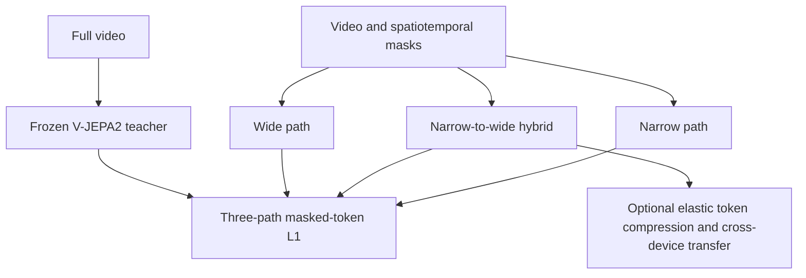
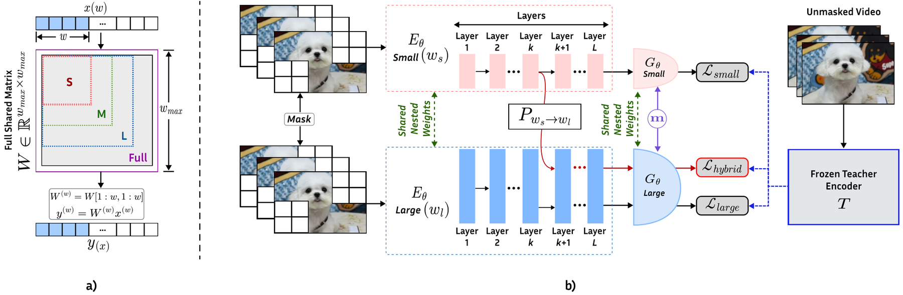

# EV-JEPA: Elastic V-JEPA for Any Device and Cross-Device Inference

<!-- source-sha256: c3e5af8c40ed6660492c92b108a2774df29921540a9f76ce0542fd4ae60034cd -->

[简体中文](README.md)

> **Deferred because of cost; not reproduced or validated.** This is a research reference. The review logged the deferral without downloading models or data, training, registering an executable adapter, or integrating Evolve. Paper figures below are not local measurements.

## Paper information

| Field | Value |
| --- | --- |
| Paper | [arXiv 2610.14324](https://arxiv.org/abs/2610.14324); [pinned v1 full text](https://arxiv.org/html/2610.14324v1) |
| Organizations | Meta Reality Labs Research / FAIR at Meta |
| First author's affiliation | Meta Reality Labs Research |
| First public date | 2026-10-09 (arXiv v1) |
| Authors' open-source code | Not found: v1 did not link official implementation for this method as checked on 2026-10-14. This is not a claim that no code exists anywhere. |
| Adapter | `ev-jepa` (planned, not implemented or registered) |
| Local code | **No algorithm implementation.** [Deferred specification](https://github.com/daiwk/auto-research/blob/main/src/auto_research/reproductions/ev_jepa/deferred-spec.json) is a plan, not executable code. |
| Validation status | Not implemented or GPU-validated. Not a capability comparison or executable Evolve operator. |

## Original paper

### Background and contribution

A fixed-capacity video model cannot readily accommodate both edge-device budgets and collaboration across devices. Separately trained widths also need not have compatible internal representations. EV-JEPA shares parameters across nested widths, jointly training narrow, wide, and narrow-to-wide paths at every step. A frozen video teacher constrains their common representation space, and adjustable token compression supports transfer.

### Architecture and data flow

This is a local redraw; see [original Figure 1](https://arxiv.org/html/2610.14324v1#S1.F1).

<!-- paper-figure:start -->
### Key figure from the paper

On the left, nested width slices share weights. On the right, narrow, wide, and narrow-to-wide paths are trained together under the same frozen video teacher. This is the paper's T3 architecture, not a local model.

Source: [Figure 2 in v1, S3.F2](https://arxiv.org/html/2610.14324v1#S3.F2). [figure-source.json](figure-source.json) records the original and local PNG hashes, dimensions, and processing. Copyright belongs to the authors; the local PNG conversion preserves aspect ratio and is neither a placeholder, AI redraw, nor a local measurement.
<!-- paper-figure:end -->

### Core equations

Sections 3.3–3.4 jointly optimize the same width pair $(w_s,w_l)$ and split layer $k$:

$$
\mathcal L(c)=|M|^{-1}\sum_{i\in M}\|z_{S,i}^{(c)}-T(X)_i\|_1,\qquad
\mathcal L_{\rm T3}=\mathcal L(w_s)+\mathcal L(w_s,w_l,k)+\mathcal L(w_l).
$$

Shared parameters are sliced by channel. A learned projection increases width at layer $k$ on the hybrid path. The teacher is frozen, not EMA. Compressor post-training adds a reconstruction loss at the split layer; ordinary pruning is not a substitute for training compatibility.

### Paper results

On SSv2, K400, and EK100, the elastic model was within about 1 percentage point of independently trained references, with some intermediate widths beating existing elastic training by up to 11 points. The narrow-to-wide hybrid was within about 1.1 points of the high-capacity reference. These are offline video results, with no reported production A/B. Transfer compression compares with uncompressed 8-bit RGB, not a hardware video codec.

## Local reproduction

### Cost and deferral

Section 4.1 specifies 128 GPUs, 300 epochs, Kinetics-710/SSv2/HowTo100M video, and a frozen V-JEPA2 ViT-G teacher, training all three paths in each step. The compressor separately requires 100 epochs × 300 iterations with global batch 4096. This paper budget, not a local timing measurement, is well beyond one A100, one A30, or a local Mac. No full video download or multi-arm training was attempted.

The estimate assumes only one available accelerator or a Mac, not simultaneous multi-node capacity. A smaller experiment is not automatically authorized. Reopening requires an explicit budget decision, pinned public resources, and preservation of the defining mechanisms.

### Data protocol, code, and results

No algorithm run, local metrics, model download, or passing GPU receipt exists. The deferred specification records components and future acceptance requirements but supplies no `paper.yaml`, `adapter.py`, or executable entry point. Paper tables, zero-training fixtures, and empty registry entries do not constitute reproduction.

Any future run must isolate train, validation, and test and select only on validation. Real train/inference paths, cost accounting, multiple seeds, and matched-budget controls must be executed. An advertised CUDA path still requires a sanitized A100/A30 receipt.

### Reopening criteria

This remains deferred for cost and does not block other delivery or research review. Reopening requires a fresh budget assessment and necessary resources, not replacing defining mechanisms with heuristics or gold-answer access. The [pinned source](https://arxiv.org/html/2610.14324v1) and specification support the review, not an implementation claim.
