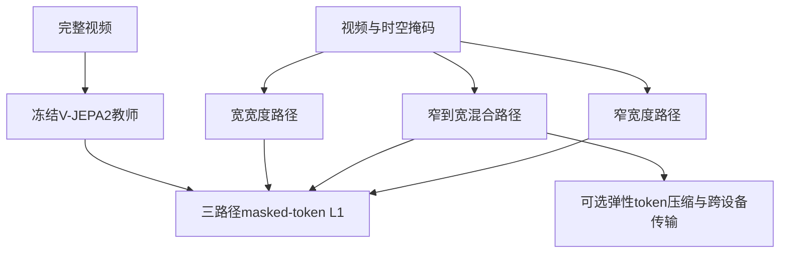
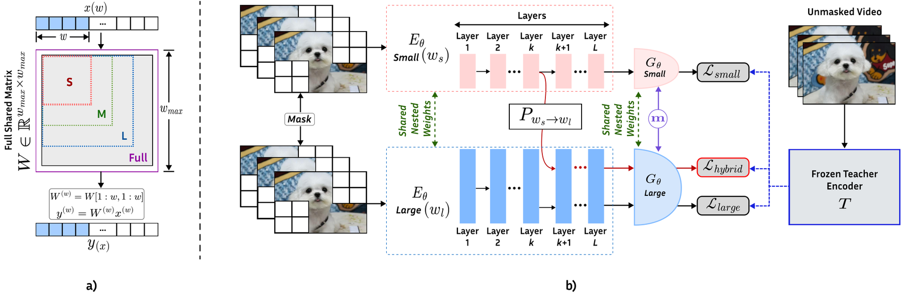

# EV-JEPA: Elastic V-JEPA for Any Device and Cross-Device Inference

> **成本过高，暂不复现；待验收（仅研究资料）。** 本轮完成全文审查与延期登记，不下载模型或数据，不训练、不注册可执行Adapter、不接入evolve。下文论文数值不是本地实验结果。

## 论文信息

| 字段 | 内容 |
| --- | --- |
| 论文链接 | [arXiv 2610.14324](https://arxiv.org/abs/2610.14324)；[固定v1全文](https://arxiv.org/html/2610.14324v1) |
| 公司/机构 | Meta Reality Labs Research / FAIR at Meta |
| 一作所属机构 | Meta Reality Labs Research |
| 首次公开日期 | 2026-10-09（arXiv v1） |
| 原文开源代码 | 未发现：固定v1原文未链接本方法官方源码（2026-10-14核验；不宣称全网不存在） |
| Adapter | `ev-jepa`（计划键；未实现、未注册） |
| 本地复现代码 | **尚无算法实现**；[`src/auto_research/reproductions/ev_jepa/deferred-spec.json`](https://github.com/daiwk/auto-research/blob/main/src/auto_research/reproductions/ev_jepa/deferred-spec.json)仅为延期计划规格，不是运行代码 |
| 当前验收状态 | 未实施；GPU未验收；非能力比较、非可执行evolve算子 |

## 原始论文总结

### 背景与主要改动

固定容量的视频模型难以同时适配端侧预算和跨设备协作，独立训练不同宽度也不保证中间表示兼容。EV-JEPA共享嵌套宽度参数，每步联合训练窄、宽与窄转宽三条路径，以冻结视频教师约束共同表示空间，并增加可调token压缩。

### 架构与数据流

本地重绘；原图见[Figure 1](https://arxiv.org/html/2610.14324v1#S1.F1)。

<!-- paper-figure:start -->
### 原论文关键图

中文图注（原论文 Figure 2）：左侧是共享权重的嵌套宽度切片；右侧同时训练窄、宽与窄转宽混合路径，三条路径用同一冻结视频教师约束。此处选择原论文Figure 2的T3核心结构，不是本地模型。

来源：[固定v1 Figure 2，`S3.F2`](https://arxiv.org/html/2610.14324v1#S3.F2)；资源与本地PNG的SHA-256、尺寸和处理记录见[figure-source.json](figure-source.json)。

> **原论文 Figure 2（关键图）**：图片来自[原论文](https://arxiv.org/html/2610.14324v1#S3.F2)，版权归原作者所有；点击图片查看固定原始资源。本地仅做保持比例的PNG展示转换，不是占位图、AI重绘或本地测量。
<!-- paper-figure:end -->

### 核心公式

原文§3.3–3.4对同一宽度对$(w_s,w_l)$与切分层$k$联合优化：

$$
\mathcal L(c)=|M|^{-1}\sum_{i\in M}\|z_{S,i}^{(c)}-T(X)_i\|_1,\qquad
\mathcal L_{\rm T3}=\mathcal L(w_s)+\mathcal L(w_s,w_l,k)+\mathcal L(w_l).
$$

共享参数按通道切片，混合路径在$k$层经可学习投影升宽；教师固定，不是EMA。压缩器后训练另加切分层重建损失，不能用普通裁剪替代兼容性训练。

### 论文离线与线上效果

SSv2、K400和EK100上，作者报告弹性模型距独立训练参考约1个百分点以内，部分中间宽度比既有弹性训练高至11个百分点。窄转宽混合路径距高容量参考约1.1个百分点以内；这些是视频离线评测，未报告生产线上A/B。传输压缩比较基准是未压缩8-bit RGB，不是硬件视频编码器。

## 本地复现

### 资源成本与延期依据

原文§4.1：128 GPU、300epochs，Kinetics-710/SSv2/HowTo100M视频，冻结V-JEPA2 ViT-G教师；每步同时训练窄、宽、混合三路径。压缩器另需100epochs×300iterations、全局batch4096。不是本地测速，原预算显著超出单卡A100/A30或Mac；不下载全视频或尝试多臂训练。

可用资源按一张A100**或**A30、或本地Mac评估，不假设多机同时可用。结论是基于论文预算与资源依赖的估计，不是本轮实测。缩小规模不是自动批准启动；如以后要恢复，须在明确成本后获得用户指定，再固定公开数据和checkpoint版本。

### 数据协议、代码位置与结果

本轮没有运行算法，没有本地指标、模型下载或GPU通过回执。延期规格保留核心组件与未来验收要求，但没有`paper.yaml`、`adapter.py`或可执行入口。不得以论文表格、零训练fixture或空注册伪装本地复现。

未来执行须隔离train/validation/test，选择只看validation；真实训练/推理路径、成本账、多seed与同预算对照均需实际完成。有CUDA宣传路径时仍须A100/A30脱敏回执，不能用本页文档替代。

### 边界与后续触发条件

维持“成本过高，暂不复现；待验收”，不阻塞其他论文交付或审查闭环。重新执行须重新评估预算、取得必要资源，保留全部定义性机制；不能用启发式或gold读取降成本。上述[固定版本来源](https://arxiv.org/html/2610.14324v1)及规格是审查依据，不声明实现完成。
