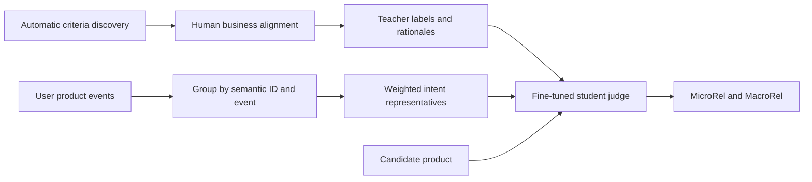
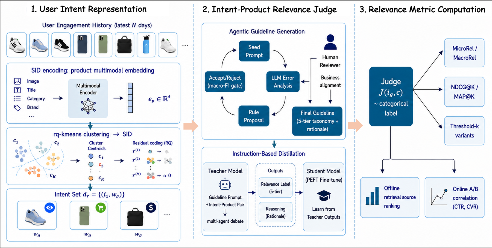

# LLM-based User-Product Relevance Evaluation for Dynamic Product Advertising

<!-- source-sha256: 454d741f9beb3cbc795e5869d151dc68e17f96eb4eb471a865ddb0dfa5dfc82f -->

[简体中文](README.md)

> Deferred due to cost; research reference only, pending implementation acceptance. Full-text review and deferral registration are complete. No model or data download, training, executable adapter, or Evolve integration. Paper metrics below are not local results.

## Paper information

| Field | Details |
|---|---|
| Paper | [arXiv 2610.14550](https://arxiv.org/abs/2610.14550); [pinned v1 full text](https://arxiv.org/html/2610.14550v1) |
| Institution | Snap Inc., including the first author. |
| First public release | 2026-10-10 (arXiv v1) |
| Author code | Not found: the reviewed v1 did not link an official implementation (checked 2026-10-14). This does not prove that none exists elsewhere. |
| Local adapter or method key | `snap-dpa-relevance` is planned, not implemented or registered. |
| Local reproduction code | No algorithm implementation. [`src/auto_research/reproductions/snap_dpa_relevance/deferred-spec.json`](https://github.com/daiwk/auto-research/blob/main/src/auto_research/reproductions/snap_dpa_relevance/deferred-spec.json) is a deferral specification, not executable code. |
| Acceptance status | Not implemented or GPU validated; no capability comparison or executable Evolve operator. |

## Paper method and evidence

Clicks are sparse and biased, so offline hit rate alone does not represent user intent. This method compresses user history by semantic ID and event type, trains a student judge using automatically discovered and manually business-aligned relevance criteria, and aggregates scores by user and traffic group.

This explanatory redraw is not local capability evidence; see [Figure 1](https://arxiv.org/html/2610.14550v1#S1.F1).

<!-- paper-figure:start -->
### Original paper figure

The original [v1 Figure 1](https://arxiv.org/html/2610.14550v1#S1.F1) shows grouping, human-aligned teacher–student judging, and offline aggregation against online metrics. Its feedback and distillation paths did not run here. [Figure provenance](figure-source.json) records source and PNG SHA-256 hashes, dimensions, and processing. Copyright remains with the authors. The local PNG is a proportional conversion, not a placeholder, AI redraw, or local measurement.
<!-- paper-figure:end -->

### Core equations

Algorithm 1 uses each group's most recent event as its intent representative and weights it by $w_g=\log(1+|g|)\beta(e_g)$:

$$
m_u(c)=\sum_gw_g\mathcal J(i_g,c),\quad
v_u(c)=\mathbf1[m_u(c)\ge k],\quad
s(u)=|C_u|^{-1}\sum_{c\in C_u}v_u(c).
$$

MicroRel weights user–candidate pairs equally; MacroRel weights users equally. The default is $k=7$. The judge is trained with criteria and distillation, not populated with gold labels. Criteria discovery requires paired-bootstrap accuracy improvements with per-class F1 regression limits; human business coverage review is part of the method.

### Reported results

The student reached F1 0.869, and semantic-ID/event grouping used 3.4% of the pairing calls required for full history. [Table 2](https://arxiv.org/html/2610.14550v1#S3.T2) reports four 14-day A/B tests on 10% of DPA traffic. Each row is relative to its preceding production version; do not add the lifts:

| Retrieval iteration | Relative CTR lift | Relative CVR lift |
|---|---:|---:|
| Content model 1 | 0.149% | 1.472% |
| Content model 2 | 0.211% | 4.98% |
| Behavior model 1 | 0.350% | 2.604% |
| Behavior model 2 | 0.210% | 2.194% |

These experiments align retrieval iterations with the offline judge. They do not establish that deploying the judge itself directly produced all the gains, and are not local results.

## Local reproduction boundary

Sections 4–5 use 10K private logs, GPT-5 and Gemini-2.5-Pro, several human review rounds, and a production student fine-tuned from Gemini-2.5-Flash and served through Vertex AI. Those commercial services, annotations, and private data are not reproducible on one A100 or A30, or a Mac. This is an assessment based on paper resources, not measured local/API cost. No paid teacher calls, model downloads, or heuristic judge substitutions were attempted.

The specification preserves defining components and future acceptance criteria, but there is no `paper.yaml`, `adapter.py`, runnable entry point, local metric, or GPU receipt. Do not promote paper tables, zero-training fixtures, or empty registration into reproduction evidence. Any future run needs user direction after a cost review, pinned public data and checkpoints, disjoint train/validation/test splits, validation-only selection, real training/inference, cost accounting, multiple seeds, and matched-budget controls. An advertised CUDA path still requires a sanitized A100/A30 receipt. The [pinned source](https://arxiv.org/html/2610.14550v1) and deferral spec document the review; the deferral does not block other papers or review closure.
