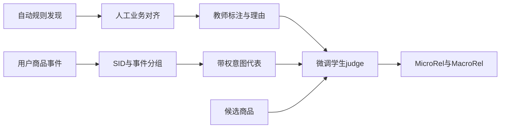
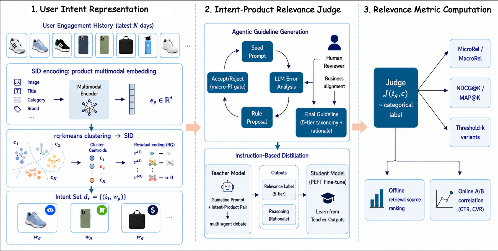

# LLM-based User-Product Relevance Evaluation for Dynamic Product Advertising

> **成本过高，暂不复现；待验收（仅研究资料）。** 本轮完成全文审查与延期登记，不下载模型或数据，不训练、不注册可执行Adapter、不接入evolve。下文论文数值不是本地实验结果。

## 论文信息

| 字段 | 内容 |
| --- | --- |
| 论文链接 | [arXiv 2610.14550](https://arxiv.org/abs/2610.14550)；[固定v1全文](https://arxiv.org/html/2610.14550v1) |
| 公司/机构 | Snap Inc. |
| 一作所属机构 | Snap Inc. |
| 首次公开日期 | 2026-10-10（arXiv v1） |
| 原文开源代码 | 未发现：固定v1原文未链接本方法官方源码（2026-10-14核验；不宣称全网不存在） |
| Adapter | `snap-dpa-relevance`（计划键；未实现、未注册） |
| 本地复现代码 | **尚无算法实现**；[`src/auto_research/reproductions/snap_dpa_relevance/deferred-spec.json`](https://github.com/daiwk/auto-research/blob/main/src/auto_research/reproductions/snap_dpa_relevance/deferred-spec.json)仅为延期计划规格，不是运行代码 |
| 当前验收状态 | 未实施；GPU未验收；非能力比较、非可执行evolve算子 |

## 原始论文总结

### 背景与主要改动

广告召回的点击信号稀疏且有偏，单纯离线命中率难以代表用户真实需求。该方法按语义ID与事件类型压缩历史意图，通过自动发现且人工业务对齐的相关性准则训练学生判别器，再聚合为用户与流量组的相关性指标。

### 架构与数据流

本地重绘；原图见[Figure 1](https://arxiv.org/html/2610.14550v1#S1.F1)，不冒充本地能力。

<!-- paper-figure:start -->
### 原论文关键图

中文图注（原论文 Figure 1）：三阶段分别为语义ID与事件分组的用户意图、自动准则发现与人工业务对齐的教师学生judge、以及离线相关性聚合与线上指标对齐。原图中的业务反馈和蒸馏链路本轮未运行。

来源：[固定v1 Figure 1，`S1.F1`](https://arxiv.org/html/2610.14550v1#S1.F1)；资源与本地PNG的SHA-256、尺寸和处理记录见[figure-source.json](figure-source.json)。

> **原论文 Figure 1（关键图）**：图片来自[原论文](https://arxiv.org/html/2610.14550v1#S1.F1)，版权归原作者所有；点击图片查看固定原始资源。本地仅做保持比例的PNG展示转换，不是占位图、AI重绘或本地测量。
<!-- paper-figure:end -->

### 核心公式

原文Algorithm 1以每组最新事件代表意图，$w_g=\log(1+|g|)\beta(e_g)$：

$$
m_u(c)=\sum_gw_g\mathcal J(i_g,c),\quad
v_u(c)=\mathbf1[m_u(c)\ge k],\quad
s(u)=|C_u|^{-1}\sum_{c\in C_u}v_u(c).
$$

MicroRel按用户-候选对等权，MacroRel按用户等权；默认$k=7$。判别器是经准则与蒸馏训练的模型，不是标签直接回填。规则发现需配对bootstrap准确率提升并限制各类F1退步，人工业务覆盖审查不能省略。

### 论文离线与线上效果

作者报告学生F1为0.869；SID与事件分组只用完整历史3.4%的配对调用量。正文[Table 2](https://arxiv.org/html/2610.14550v1#S3.T2)四项A/B均为14天、10%DPA流量；每行相对上一生产版本，不能累计：

| 召回迭代 | CTR相对提升 | CVR相对提升 |
| --- | ---: | ---: |
| 内容模型1 | 0.149% | 1.472% |
| 内容模型2 | 0.211% | 4.98% |
| 行为模型1 | 0.350% | 2.604% |
| 行为模型2 | 0.210% | 2.194% |

这些是召回迭代与离线judge的对齐证据，不是“部署judge直接带来全部增益”，也不是本地结果。

## 本地复现

### 资源成本与延期依据

原文§4–5依赖10K私有日志经GPT-5、Gemini-2.5-Pro与多轮人工审定；生产student为Gemini-2.5-Flash微调并经Vertex AI调用。商业API、人工标注和私有数据不是当前单卡可直接复现的资源；未测量本地或API总成本，不启动付费教师调用或替换为启发式judge。

可用资源按一张A100**或**A30、或本地Mac评估，不假设多机同时可用。结论是基于论文预算与资源依赖的估计，不是本轮实测。缩小规模不是自动批准启动；如以后要恢复，须在明确成本后获得用户指定，再固定公开数据和checkpoint版本。

### 数据协议、代码位置与结果

本轮没有运行算法，没有本地指标、模型下载或GPU通过回执。延期规格保留核心组件与未来验收要求，但没有`paper.yaml`、`adapter.py`或可执行入口。不得以论文表格、零训练fixture或空注册伪装本地复现。

未来执行须隔离train/validation/test，选择只看validation；真实训练/推理路径、成本账、多seed与同预算对照均需实际完成。有CUDA宣传路径时仍须A100/A30脱敏回执，不能用本页文档替代。

### 边界与后续触发条件

维持“成本过高，暂不复现；待验收”，不阻塞其他论文交付或审查闭环。重新执行须重新评估预算、取得必要资源，保留全部定义性机制；不能用启发式或gold读取降成本。上述[固定版本来源](https://arxiv.org/html/2610.14550v1)及规格是审查依据，不声明实现完成。
