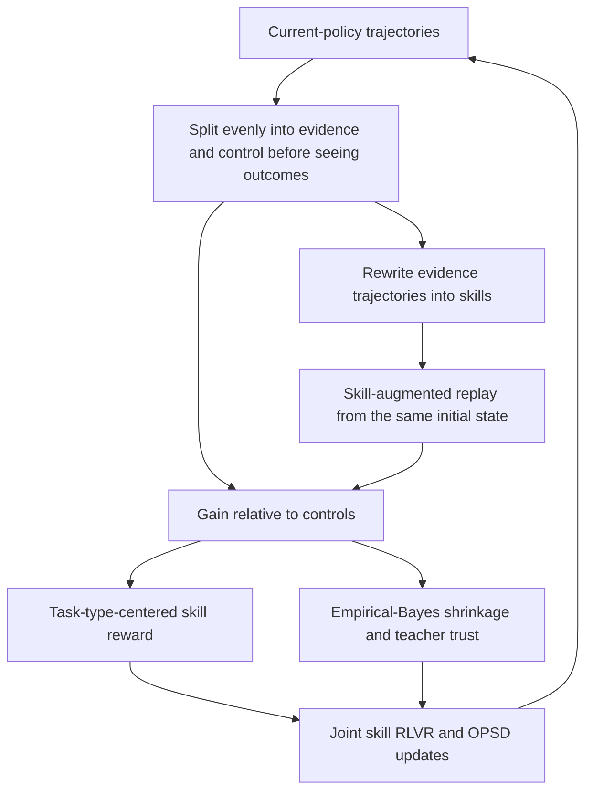
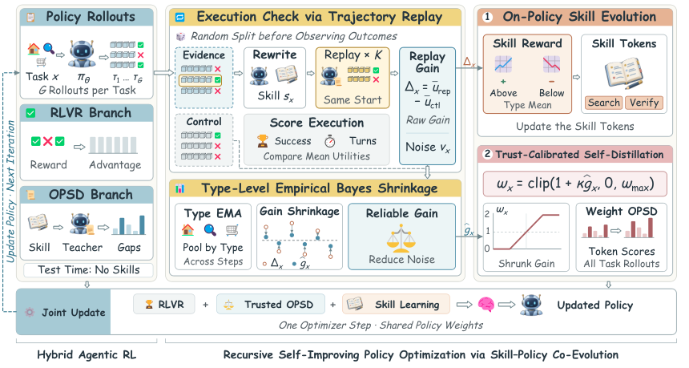

<!-- source-sha256: acea59f0231c41a1b74cdde86a27d21eddf51163dc48d5ac8849807dd776ed69 -->

[简体中文](README.md) · English

# RSIPO: Recursive Self-Improving Policy Optimization for Agentic Reinforcement Learning via Skill-Policy Co-Evolution

> **Too costly to reproduce for now; acceptance pending (research material only).** Full-text review and deferral are complete. No downloads, training, executable adapter or Evolve integration. Paper figures below are not local results.

## Paper information

| Field | Details |
| --- | --- |
| Paper | [arXiv 2610.15772](https://arxiv.org/abs/2610.15772); [pinned v1 full text](https://arxiv.org/html/2610.15772v1) |
| Institutions | CUHK / Tsinghua University / NUS / Tongji University / UW-Madison / Westlake University / Shanghai AI Laboratory / Peking University |
| First author affiliation | Chinese University of Hong Kong |
| First public release | 2026-10-11 (arXiv v1) |
| Original source code | Released: [author repository](https://github.com/zfkarl/RSIPO) (read-only review, not downloaded) |
| Adapter | `rsipo` (planned key; not implemented or registered) |
| Local reproduction code | **No algorithm implementation.** [`src/auto_research/reproductions/rsipo/deferred-spec.json`](https://github.com/daiwk/auto-research/blob/main/src/auto_research/reproductions/rsipo/deferred-spec.json) is a deferred-work specification, not runnable code. |
| Acceptance status | Not implemented or GPU-accepted; neither a capability comparison nor an executable Evolve operator. |

## Original paper summary

### Background and main changes

Static or offline-trained skills may not keep up with an improving policy, and a skill-augmented teacher can underperform its student. RSIPO produces skills from current-policy trajectories, measures their benefit with independent controls and matched initial-state replay, and jointly optimizes skill generation, RLVR, and self-distillation weighted by empirical-Bayes reliability.

### Architecture and data flow

Local redraw; see original [Figure 3](https://arxiv.org/html/2610.15772v1#S2.F3).

<!-- paper-figure:start -->
### Key figure from the paper

Figure 3: Separate evidence and control trajectories before observing results, measure skill gain by matched initial-state replay, and apply empirical-Bayes shrinkage by task type to control OPSD trust while rewarding skill generation. Skills, RLVR and trusted self-distillation update jointly. This figure is not a local run.

Source: [Pinned v1 Figure 3, `S2.F3`](https://arxiv.org/html/2610.15772v1#S2.F3). See [figure-source.json](figure-source.json) for hashes, dimensions and conversion details for the source asset and local PNG.

> **Figure 3 from the paper:** From the [paper](https://arxiv.org/html/2610.15772v1#S2.F3); copyright belongs to the authors. Click the image for the pinned original asset. The local version is a proportional PNG conversion, not a placeholder, AI redraw or measurement.
<!-- paper-figure:end -->

### Core equations

In Section 3.2, utility combines success and execution efficiency:

$$
u(\tau)=\mathbf1\{R(\tau)=1\}\cdot(1-\alpha T/T_{\max}),\quad
\Delta_x=K^{-1}\sum_k u(\widetilde\tau_k)-|\mathcal C_x|^{-1}\sum_{\tau\in\mathcal C_x}u(\tau).
$$

$$
\widehat g_x=w_x\Delta_x+(1-w_x)\overline\Delta_c,\quad
w_x=\widehat\sigma_c^2/(\widehat\sigma_c^2+v_x),\quad
\omega_x=\operatorname{clip}(1+\kappa\widehat g_x,0,\omega_{\max}).
$$

Skill reward uses the unshrunk $r_x=\Delta_x-\overline\Delta_c$; shrunk gains are used only for OPSD trust. Invalid initial-state replay is not a valid control, and no skills are given at test. Trajectory answers or gold labels must not be supplied directly to the evaluated agent.

### Paper results

The authors report 98.6% average ALFWorld success for Qwen2.5-7B, 17.4 percentage points above GRPO; the 3B model reaches 95.7%. These are offline agent-environment results, not a production A/B test. Skill generation and policy change jointly; fixed rule-based skills or registry labels do not implement the algorithm or integrate Evolve.

## Local reproduction

### Resource cost and deferral

Table 2 uses Qwen2.5-3B/7B and Qwen3-1.7B with 150 training steps. ALFWorld uses 16 tasks × 8 rollouts per step, up to 50 turns, plus 4 initial-state replays per task and 4096 tokens for skill generation. Search uses 128 tasks × 8 rollouts per step. GLM-5.2-labeled skill SFT precedes these stages. Multi-turn environment training and teacher scoring are expected to take substantial time on one GPU; no local timing, downloads or runs were attempted.

Resource estimates assume one A100 **or** A30, or a local Mac, not concurrent use of multiple machines. They derive from paper budgets and dependencies, not local measurements. A smaller run is not automatically approved. Reopening requires explicit user direction after costs are clear, with pinned public data and checkpoint revisions.

### Data protocol, code, and results

No algorithm run, local metrics, model download, or passing GPU receipt exists for this batch. The deferred specification records core components and future acceptance requirements, but there is no `paper.yaml`, `adapter.py` or executable entry point. Paper tables, zero-training fixtures and empty registrations cannot be passed off as local reproduction.

A future run must isolate train, validation and test and select only on validation. Actual training or inference, cost accounting, multiple seeds, and equal-budget controls must all run. Any advertised CUDA path still needs a sanitized A100/A30 receipt, not this page.

### Scope and conditions for reopening

Status remains **too costly to reproduce for now; acceptance pending**, without blocking other papers or the review. Reopening requires reassessing budget, obtaining resources, and preserving all defining mechanisms. Heuristics and gold-answer access are not cost shortcuts. The [pinned source](https://arxiv.org/html/2610.15772v1) and specification document the review, not implementation completion.
