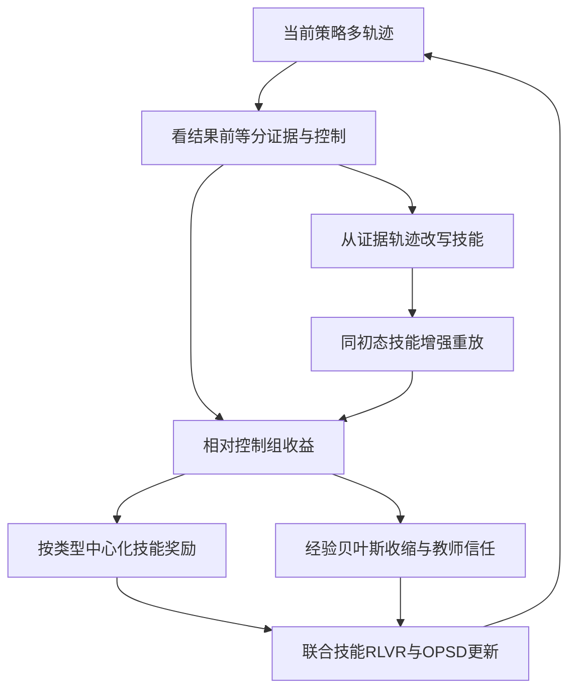
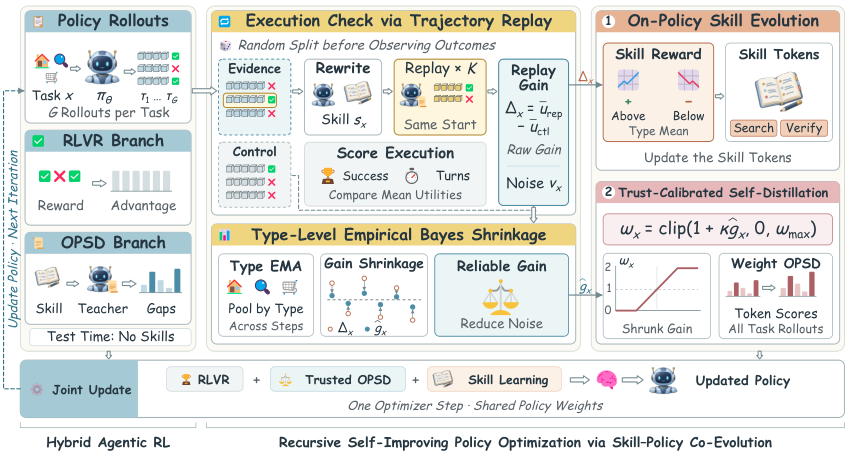

# RSIPO: Recursive Self-Improving Policy Optimization for Agentic Reinforcement Learning via Skill-Policy Co-Evolution

> **成本过高，暂不复现；待验收（仅研究资料）。** 本轮完成全文审查与延期登记，不下载模型或数据，不训练、不注册可执行Adapter、不接入evolve。下文论文数值不是本地实验结果。

## 论文信息

| 字段 | 内容 |
| --- | --- |
| 论文链接 | [arXiv 2610.15772](https://arxiv.org/abs/2610.15772)；[固定v1全文](https://arxiv.org/html/2610.15772v1) |
| 公司/机构 | CUHK / Tsinghua University / NUS / Tongji University / UW-Madison / Westlake University / Shanghai AI Laboratory / Peking University |
| 一作所属机构 | Chinese University of Hong Kong |
| 首次公开日期 | 2026-10-11（arXiv v1） |
| 原文开源代码 | 已发布：[作者仓库](https://github.com/zfkarl/RSIPO)（本轮只读核验，未下载） |
| Adapter | `rsipo`（计划键；未实现、未注册） |
| 本地复现代码 | **尚无算法实现**；[`src/auto_research/reproductions/rsipo/deferred-spec.json`](https://github.com/daiwk/auto-research/blob/main/src/auto_research/reproductions/rsipo/deferred-spec.json)仅为延期计划规格，不是运行代码 |
| 当前验收状态 | 未实施；GPU未验收；非能力比较、非可执行evolve算子 |

## 原始论文总结

### 背景与主要改动

静态或离线训练的技能库难以跟随策略进步，而技能增强教师也可能比学生更差。RSIPO从当前策略轨迹产生技能，以独立控制组与同初态重放测量技能收益，联合优化技能生成、RLVR和按经验贝叶斯可靠性加权的自蒸馏。

### 架构与数据流

本地重绘；原图见[Figure 3](https://arxiv.org/html/2610.15772v1#S2.F3)。

<!-- paper-figure:start -->
### 原论文关键图

中文图注（原论文 Figure 3）：先在观察结果前拆分证据与控制轨迹，用同初态重放测量技能收益，再按任务类型做经验贝叶斯收缩以控制OPSD信任，同时奖励技能生成。技能、RLVR和可信自蒸馏联合更新；图不是本地实跑结果。

来源：[固定v1 Figure 3，`S2.F3`](https://arxiv.org/html/2610.15772v1#S2.F3)；资源与本地PNG的SHA-256、尺寸和处理记录见[figure-source.json](figure-source.json)。

> **原论文 Figure 3（关键图）**：图片来自[原论文](https://arxiv.org/html/2610.15772v1#S2.F3)，版权归原作者所有；点击图片查看固定原始资源。本地仅做保持比例的PNG展示转换，不是占位图、AI重绘或本地测量。
<!-- paper-figure:end -->

### 核心公式

原文§3.2，成功与执行效率共同构成效用：

$$
u(\tau)=\mathbf1\{R(\tau)=1\}\cdot(1-\alpha T/T_{\max}),\quad
\Delta_x=K^{-1}\sum_k u(\widetilde\tau_k)-|\mathcal C_x|^{-1}\sum_{\tau\in\mathcal C_x}u(\tau).
$$

$$
\widehat g_x=w_x\Delta_x+(1-w_x)\overline\Delta_c,\quad
w_x=\widehat\sigma_c^2/(\widehat\sigma_c^2+v_x),\quad
\omega_x=\operatorname{clip}(1+\kappa\widehat g_x,0,\omega_{\max}).
$$

技能奖励为未收缩的$r_x=\Delta_x-\overline\Delta_c$；收缩收益仅用于OPSD信任。失效初态重放不能作为有效对照，test不给技能。不能将轨迹答案或gold直接塞给受评agent。

### 论文离线与线上效果

原文Qwen2.5-7B在ALFWorld平均成功率98.6%，比GRPO高17.4个百分点；3B为95.7%。都是作者离线Agent环境指标，未报告生产线上A/B。技能生成与策略共同变更，固定规则技能或仅注册标签不等于算法或evolve实现。

## 本地复现

### 资源成本与延期依据

原文Table2：Qwen2.5-3B/7B、Qwen3-1.7B，150训练steps；ALFWorld每step16任务×8rollouts，最长50turns，每任务另4次初态重放与4096token技能生成；搜索每step128任务×8rollouts。之前还要GLM-5.2标注的技能SFT。多轮环境训练与教师评分在单卡预计长时间，未作本地测速；不下载或启动。

可用资源按一张A100**或**A30、或本地Mac评估，不假设多机同时可用。结论是基于论文预算与资源依赖的估计，不是本轮实测。缩小规模不是自动批准启动；如以后要恢复，须在明确成本后获得用户指定，再固定公开数据和checkpoint版本。

### 数据协议、代码位置与结果

本轮没有运行算法，没有本地指标、模型下载或GPU通过回执。延期规格保留核心组件与未来验收要求，但没有`paper.yaml`、`adapter.py`或可执行入口。不得以论文表格、零训练fixture或空注册伪装本地复现。

未来执行须隔离train/validation/test，选择只看validation；真实训练/推理路径、成本账、多seed与同预算对照均需实际完成。有CUDA宣传路径时仍须A100/A30脱敏回执，不能用本页文档替代。

### 边界与后续触发条件

维持“成本过高，暂不复现；待验收”，不阻塞其他论文交付或审查闭环。重新执行须重新评估预算、取得必要资源，保留全部定义性机制；不能用启发式或gold读取降成本。上述[固定版本来源](https://arxiv.org/html/2610.15772v1)及规格是审查依据，不声明实现完成。
